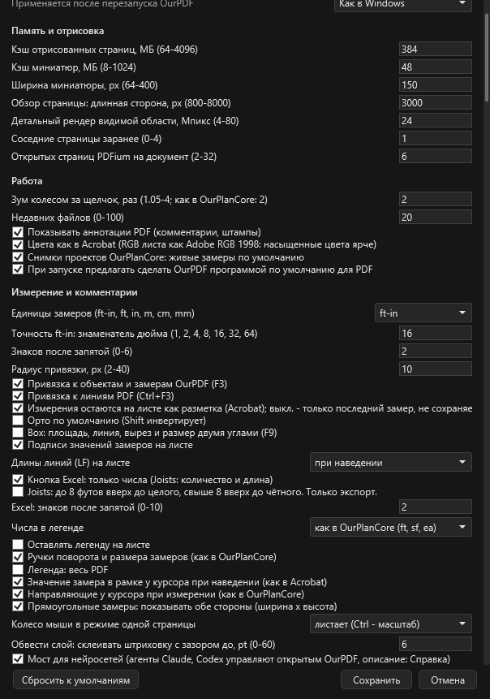

# AI agent control

Here: how Claude or Codex work in an open OurPDF, what they can do, how to turn it on and off. You do not need to know the whole protocol: the agent reads it by itself.

<figure markdown>
  { width="600" }
  <figcaption markdown="span">Settings, section "Measure and comments": the checkbox "AI agent bridge (Claude, Codex agents drive the open OurPDF; description: Help)". On by default.</figcaption>
</figure>

## What it is { #what }

OurPDF understands commands from AI models (Claude, Codex). An agent can open a PDF, look at a sheet as an image, read its text, set the scale, place and fix measurements, cut areas, export to Excel and, if you ask, write everything into the PDF with ++ctrl+s++.

- You see every change in the window right away.
- ++ctrl+z++ undoes an agent action like any other: each add, edit, delete or cut is one undo step.
- It works only on this computer and only for this Windows user, nothing goes to the network. The agent drops requests into a folder, the open OurPDF window carries them out.

## How to ask the agent { #how-to-ask }

1. Open OurPDF (or ask the agent to open the file itself).
2. Tell the agent: "read the OurPDF bridge description and do ...". For example: "read the OurPDF bridge description, set the scale to 1/8 on the first sheet and trace the areas of all rooms".
3. Watch the window: measurements appear on the sheet, the status bar says what was done.
4. Check the result and, if everything is right, ask it to write into the PDF or press ++ctrl+s++ yourself.

The description for the agent: `Help > For AI agents: driving OurPDF`. This window shows whether the bridge is on and has the "Open the bridge folder" and "Copy the description path" buttons. The description itself is in English, it is for the agent.

## Turn it on and off { #on-off }

- Settings (++ctrl+comma++), section "Measure and comments", the **"AI agent bridge"** checkbox. On by default.
- The checkbox is read when the app starts: uncheck it, save and restart OurPDF, and agents can no longer drive it; the `Help > For AI agents: driving OurPDF` window says "The bridge is off". Turning it back on works the same way, also with a restart.

## What the agent can do { #operations }

| Group | What it does |
| --- | --- |
| State | tabs, current page, sheet scale, tool, selection |
| Files and view | open a PDF (and start OurPDF if it is closed), switch tabs, go to a page at a given zoom, run any command the way its key does (except commands with dialogs) |
| Look at the sheet | a PNG image of the page (36-300 dpi), the PDF text in full or inside a frame (scans have no text) |
| Scale | read or set the scale of a sheet or all sheets |
| Measurements and markups | a list with values (LF, SF), add, change, delete, select on the sheet; distance, perimeter, area with cutouts, joists, lines, arrows, shapes, clouds, notes, text, highlight |
| Cut | cut a polygon out of areas |
| Check without writing | calculate a length or area from points without saving anything |
| Excel | export the measurement table to `.xlsx` |
| Ctrl+S | write markups into the open PDF with a backup |

The style of the agent's new measurements is the same as yours: line width 4, font 14, opacity 70 %, unless the agent sets its own.

## Rules for agents { #rules }

They are written in the description itself, and the agent follows them:

- It says what it did: the person sees the changes live.
- It does not write into the PDF (++ctrl+s++) until asked: that changes your file.
- OurPlanCore project snapshots and `.ourplan` projects are read-only: OurPDF markups can go on top, but the takeoffs themselves change only in OurPlanCore.
- Requests from several agents are carried out in turn.
- A request does not run while a dialog is open or while you are dragging, typing or tracing something: it waits and runs right after. If there is no answer for a long time, OurPDF is waiting for you (a dialog is open), and the agent will tell you.

## Where it lives { #files }

| What | Where |
| --- | --- |
| Bridge folder | `%LOCALAPPDATA%\OurPDF\agent-bridge` |
| Description for the agent | `AGENT_BRIDGE.md` in the bridge folder, written at every OurPDF start |
| Ready-made client for the agent | `ourpdf_agent.py` in the same folder |
| Sheet images taken by the agent | `agent-bridge\renders` |
| Log (`agent-bridge` lines) | `%LOCALAPPDATA%\OurPDF\logs` |

An example of what the agent runs by itself (you do not need to do this):

```powershell
$c = "$env:LOCALAPPDATA\OurPDF\agent-bridge\ourpdf_agent.py"
python $c state
python $c render '{"page": 1, "dpi": 100}'
python $c markups '{"page": 1}'
```

## See also

- [What OurPDF is](index.md)
- [Measurements](measure.md)
- [AI in OurPlanCore](../reference/ourplancore-ai.md), [OurPlanCore AI console](../reference/ourplancore-ai-console.md)
