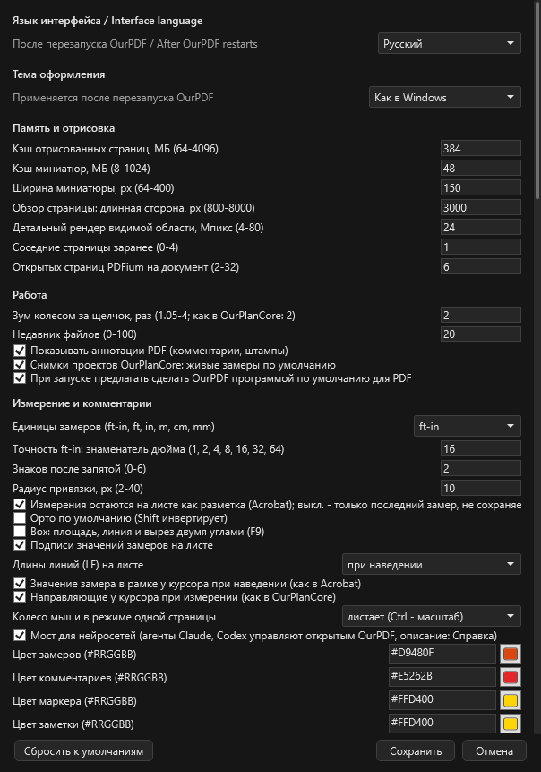

# Управление нейросетями

Здесь: как Claude или Codex работают в открытом OurPDF, что они умеют, как это включить и выключить. Протокол целиком знать не нужно: агент читает его сам.

<figure markdown>
  { width="600" }
  <figcaption markdown="span">Настройки, раздел "Измерение и комментарии": галка "Мост для нейросетей (агенты Claude, Codex управляют открытым OurPDF, описание: Справка)". По умолчанию включена.</figcaption>
</figure>

## Что это { #what }

OurPDF понимает команды нейросетей (Claude, Codex). Агент может открыть PDF, посмотреть лист картинкой, прочитать его текст, задать масштаб, поставить и поправить замеры, вырезать площади, выгрузить Excel и, если вы попросите, записать всё в PDF по ++ctrl+s++.

- Вы видите каждое изменение в окне сразу.
- ++ctrl+z++ отменяет действие агента как обычное: каждое добавление, правка, удаление или вырез - один шаг отмены.
- Работает только на этом компьютере и только для этого пользователя Windows, ничего не уходит в сеть. Агент кладёт запросы в папку, открытое окно OurPDF их выполняет.

## Как попросить агента { #how-to-ask }

1. Откройте OurPDF (или попросите агента открыть файл сам).
2. Скажите агенту: "прочитай описание моста OurPDF и сделай ...". Например: "прочитай описание моста OurPDF, задай масштаб 1/8 на первом листе и обведи площади всех комнат".
3. Смотрите в окно: замеры появляются на листе, строка состояния пишет, что сделано.
4. Проверьте результат и, если всё верно, попросите записать в PDF или нажмите ++ctrl+s++ сами.

Описание для агента: `Справка > Для нейросетей`. В этом окне видно, включён ли мост, и есть кнопки "Открыть папку моста" и "Копировать путь к описанию". Само описание на английском, оно для агента.

## Включить и выключить { #on-off }

- Настройки (++ctrl+comma++), раздел "Измерение и комментарии", галка **"Мост для нейросетей"**. По умолчанию включена.
- Галка проверяется при запуске программы: сняли её, сохранили и перезапустили OurPDF - агенты больше не могут им управлять, окно `Справка > Для нейросетей` пишет "Мост выключен". Включается так же, тоже с перезапуском.

## Что агент умеет { #operations }

| Группа | Что делает |
| --- | --- |
| Состояние | вкладки, текущая страница, масштаб листа, инструмент, выбор |
| Файлы и вид | открыть PDF (и запустить OurPDF, если он закрыт), переключить вкладку, перейти на страницу с нужным масштабом вида, выполнить любую команду, как её клавиша (кроме команд с окнами) |
| Смотреть лист | картинка страницы PNG (36-300 dpi), текст PDF целиком или в рамке (у сканов текста нет) |
| Масштаб | прочитать или задать масштаб листа или всех листов |
| Замеры и пометки | список со значениями (LF, SF), добавить, изменить, удалить, выделить на листе; расстояние, периметр, площадь с вырезами, joists, линии, стрелки, фигуры, облака, заметки, текст, маркер |
| Вырез | вырезать многоугольник из площадей |
| Проверка без записи | посчитать длину или площадь по точкам, ничего не сохраняя |
| Excel | выгрузить таблицу замеров в `.xlsx` |
| Ctrl+S | записать пометки в открытый PDF с резервной копией |

Стиль новых замеров у агента такой же, как у вас: толщина 4, шрифт 14, прозрачность 70 %, если агент не задал свой.

## Правила для агентов { #rules }

Они записаны в самом описании, и агент их соблюдает:

- Говорит, что сделал: человек видит изменения вживую.
- Не записывает в PDF (++ctrl+s++), пока его не попросили: это меняет ваш файл.
- Снимки проектов OurPlanCore и проекты `.ourplan` только для чтения: поверх можно ставить пометки OurPDF, а сами takeoffs меняются только в OurPlanCore.
- Запросы от нескольких агентов выполняются по очереди.
- Запрос не выполняется внутри открытого окна диалога и пока вы что-то тянете, печатаете или обводите: он ждёт и выполняется сразу после. Если ответа долго нет, значит OurPDF ждёт вас (открыт диалог), агент об этом скажет.

## Где лежит { #files }

| Что | Где |
| --- | --- |
| Папка моста | `%LOCALAPPDATA%\OurPDF\agent-bridge` |
| Описание для агента | `AGENT_BRIDGE.md` в папке моста, записывается при каждом запуске OurPDF |
| Готовый клиент для агента | `ourpdf_agent.py` в той же папке |
| Картинки листов, которые снял агент | `agent-bridge\renders` |
| Журнал (строки `agent-bridge`) | `%LOCALAPPDATA%\OurPDF\logs` |

Пример того, что агент запускает сам (вам это делать не нужно):

```powershell
$c = "$env:LOCALAPPDATA\OurPDF\agent-bridge\ourpdf_agent.py"
python $c state
python $c render '{"page": 1, "dpi": 100}'
python $c markups '{"page": 1}'
```

## См. также

- [Что такое OurPDF](index.md)
- [Измерения](measure.md)
- [ИИ в OurPlanCore](../reference/ourplancore-ai.md), [Консоль ИИ OurPlanCore](../reference/ourplancore-ai-console.md)
