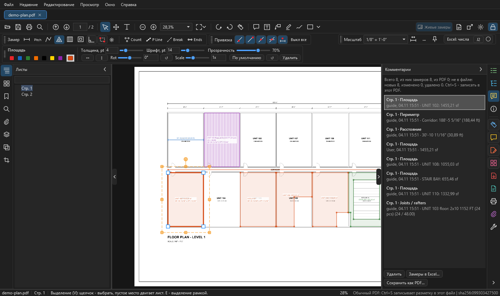
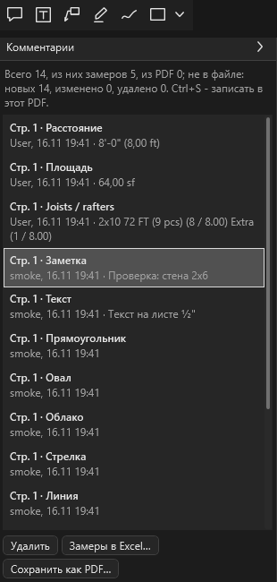

# Comments and saving

Here: the comment tools (note, text, highlight, drawing, shapes), how to edit markups, where they are stored before saving, what ++ctrl+s++ does and how "Save As" differs. Measurements are saved the same way as comments.

<figure markdown>
  
  <figcaption markdown="span">The "Comments" tab on the right strip: all markups and measurements of the document. At the top, the summary and what is not yet written to the file; at the bottom, `Delete`, `Measurements to Excel...`, `Save as PDF...`. On the top toolbar, the style block of the selected area.</figcaption>
</figure>

## Comment tools { #comments }

Buttons on the top toolbar or the "Comment" icon on the right strip.

<figure markdown>
  { width="320" }
  <figcaption markdown="span">On top the toolbar buttons: note, text, callout, freehand, polyline, shapes with the choice arrow. Below, the "Comments" tab after a check on the demo sheet: measurements and markups of each kind (note, text, rectangle, oval, cloud, arrow, line) with author and time. The interface on the picture is in Russian.</figcaption>
</figure>

| Tool | How | Tip |
| --- | --- | --- |
| Note (++ctrl+6++) | click on the sheet and type the text | the note icon lands at the click point |
| Text | a click or a frame, then the text; ++ctrl+enter++ - done | the text frame stretches by its corners |
| Callout | the first click is where the arrow points, the second where the text goes (or drag from the arrow to the text), then the text | like "Add text callout" in Acrobat; the frame, the arrow tip and the bend can be dragged later |
| Highlight | drag a frame over the text | if the PDF has no text layer, the frame is highlighted |
| Freehand drawing | drag with the mouse button held down | pencil |
| Shapes | the arrow next to the button picks a shape: rectangle, oval, cloud, arrow, line, polyline | ++shift++ keeps it straight: square, circle, 45 degrees |

- A cloud is drawn as a frame or by corners; by corners it finishes with ++enter++.
- Polyline (not a measurement): click the points, double-click or ++enter++ to end.
- Color, line width, font and opacity are set in the same style block as for measurements ([Measurement style](measure.md#style)).
- By default comments are red (`#E5262B`), line width 2, font 12; highlight and note are yellow (`#FFD400`). Change them in Settings, section "Measure and comments".
- The comment author is set in Settings; empty = the Windows user name.

## Edit and delete comments { #edit-comments }

1. The **Select** tool (++v++): a click selects a comment, ++ctrl++ and click adds to the selection, ++e++ turns on frame selection ([frame](measure.md#frame)).
2. Drag to move.
3. Double-click a text or note: edit the text. Same: right-click, "Edit text".
4. ++delete++ or the `Delete` button in the style block and in the "Comments" list deletes the selection.
5. ++ctrl+c++ and ++ctrl+v++ copy and paste markups, onto another sheet in the same spot.
6. ++ctrl+z++ undoes, ++ctrl+y++ redoes.

A list of all comments and measurements: the **"Comments"** tab on the right strip; a click on a row shows the markup on the sheet.

## Markups from other apps { #from-other-apps }

- When a PDF opens, its markups (Acrobat, Bluebeam, Nitro measurements, pencil, text and callouts, shapes, clouds, polylines) become OurPDF markups: they can be selected, moved, edited and deleted.
- Links, strikeouts, stamps, replies and hidden annotations stay as in the file.
- To turn off importing: Settings, section "Markups in the PDF itself", "Accept markups from the PDF on open".
- Whether to show PDF annotations at all: Settings, "Show PDF annotations (comments, stamps)".

More on measurements from other apps: [Measurements](measure.md#from-pdf).

## Where markups are stored before saving { #storage }

- Markups and measurements are saved **right away**, in the app profile, separately for each PDF: close and reopen, and everything is in place. Folder `%APPDATA%\OurPDF\markup`.
- The PDF itself does not change until you press ++ctrl+s++.
- The summary in the "Comments" list shows how many markups are not yet in the file: new, edited, deleted.

## Ctrl+S: write into this PDF { #save }

1. Press ++ctrl+s++ (or right-click a markup, "Write markups into this PDF").
2. OurPDF writes the markups into the PDF itself, as Acrobat does: it appends the changes to the end of the file, untouched markups stay byte for byte.
3. Before replacing the file, the app checks the result and puts a copy of the previous file into the backups folder.
4. Then the file is reopened.

Backups:

- Folder `%LOCALAPPDATA%\OurPDF\backups`, 5 copies per file.
- In Settings, section "Markups in the PDF itself (Ctrl+S)": number of copies per file (from 1 to 50), the folder path, how many copies and megabytes are there now, the "Open backup folder" button.
- To get the file back as it was before ++ctrl+s++, take a copy from this folder.

What ++ctrl+s++ does **not** write:

| Document | What happens |
| --- | --- |
| OurPlanCore project snapshot, `.ourplan` project | does not change, OurPlanCore builds them |
| password-protected PDF | not written |
| modified copy (after editing pages or content) | saved **into the original file** under the same name, with a check and a backup of the previous one. The setting "Ctrl+S after editing pages or content" switches it to a new file. When you close such a tab, the app asks whether to save it |
| overlays | [not written to the PDF](overlay.md#save) |

What ++ctrl+s++ will do with the open file is shown in the status bar on the right: for an ordinary PDF "Ctrl+S writes the markups into this file", for a modified copy "Ctrl+S saves into the original PDF".

When you close a file with changes, the app asks whether to save them. Yes: write into the PDF. No: drop everything unsaved since opening or the last ++ctrl+s++. Cancel: go back to the file. A copy of the dropped draft is in the backups folder, subfolder `markup-drafts`.

## Save As { #save-as }

`File > Save As`, ++ctrl+shift+s++, the toolbar button or `Save as PDF...` in the "Comments" tab. Creates a **new** PDF, the source does not change.

| File type in the dialog | Result |
| --- | --- |
| PDF, comments stay editable | real annotations: visible and editable in Acrobat |
| PDF, comments burned into the sheet (flatten) | markups become part of the sheet and cannot be edited |

- Default name: `<name> (with markups).pdf`, for a modified copy `<name> (modified).pdf`.
- You cannot write over the open source PDF: pick another name.
- With flatten, hidden layers are off in the new PDF by default; the editable option keeps the visibility set in the file ([Layers](pages-edit.md#layers)).

## What goes where { #where }

| What | ++ctrl+s++ | Save As, editable | Save As, burned in | Print |
| --- | --- | --- | --- | --- |
| measurements and comments | into the file | into the copy | into the sheet, except hidden | only those written to the file |
| hidden in the legend | stay in the file | stay in the copy | no | no |
| [overlays](overlay.md) | **no**, profile only | **no** | visible layers, under the markups | **no** |
| [crops](crop.md) | into the file, as a stamp | into the copy, as a stamp | into the sheet | only those written to the file |
| legend on the sheet | no | no | no | no |
| [Excel links](excel-link.md) | **no**, profile only; waiting numbers are written into closed workbooks | no, they stay with the open file | no | no |

## Printing { #print }

++ctrl+p++, the button on the toolbar or on the right strip. Hidden PDF layers are not printed.

!!! warning "Printing draws the file as it is saved"
    Press ++ctrl+s++ before printing, otherwise new measurements, comments and crops do not make it to paper. Overlays are never printed: to get them on paper, do "Save As" with burn-in and print that file.

## See also

- [Measurements](measure.md): measurement list and Excel
- [Pages, editing, layers](pages-edit.md): modified copy and new file
- [View and settings](view-settings.md): section "Markups in the PDF itself"
