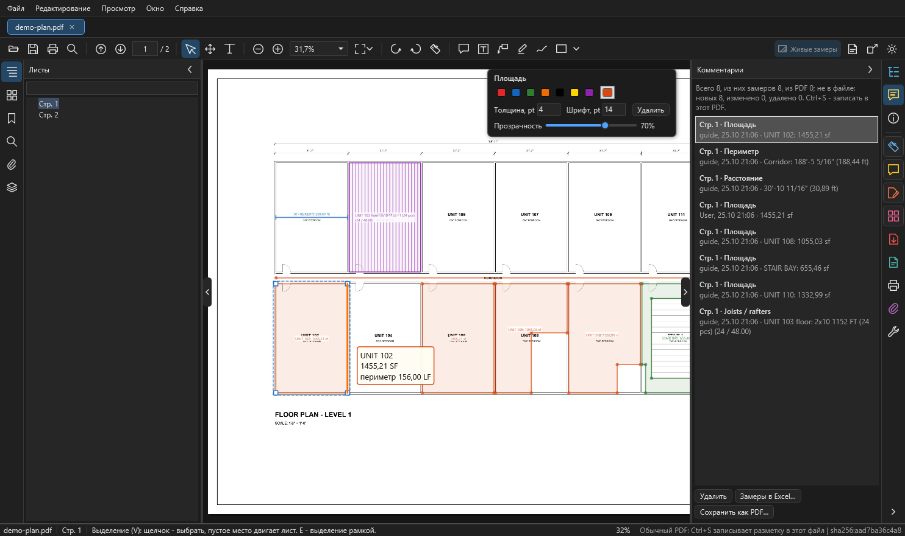

# Комментарии и сохранение

Здесь: инструменты комментариев (заметка, текст, маркер, рисование, фигуры), как править пометки, где они хранятся до сохранения, что делает ++ctrl+s++ и чем отличается "Сохранить как". Замеры сохраняются так же, как комментарии.

<figure markdown>
  
  <figcaption markdown="span">Вкладка "Комментарии" на полосе справа: все пометки и замеры документа. Сверху итог и что ещё не записано в файл, внизу `Удалить`, `Замеры в Excel...`, `Сохранить как PDF...`. Над листом карточка вида выбранной площади.</figcaption>
</figure>

## Инструменты комментариев { #comments }

Кнопки на панели инструментов сверху или значок "Комментарий" на полосе справа.

| Инструмент | Как | Совет |
| --- | --- | --- |
| Заметка (++ctrl+6++) | щёлкните по листу и введите текст | значок заметки встаёт в точку щелчка |
| Текст | щелчок или рамка, затем текст; ++ctrl+enter++ - готово | рамка текста тянется за углы |
| Выноска | первый щелчок - куда указывает стрелка, второй - где текст (или протянуть от стрелки к тексту), затем текст | как "Добавить выноску текста" в Acrobat; рамку, конец стрелки и излом потом можно тянуть |
| Маркер | протяните рамку по тексту | если у PDF нет текстового слоя, выделится рамка |
| Рисование от руки | ведите мышью с нажатой кнопкой | карандаш |
| Фигуры | стрелка рядом с кнопкой выбирает фигуру: прямоугольник, овал, облако, стрелка, линия, ломаная | ++shift++ - ровно: квадрат, круг, 45 градусов |

- Облако рисуется рамкой или по углам; по углам заканчивается ++enter++.
- Ломаная (без замера): щелчки по точкам, двойной щелчок или ++enter++ - конец.
- Цвет, толщина, шрифт и прозрачность задаются в той же карточке справа сверху, что и у замеров ([Вид замеров](measure.md#style)).
- По умолчанию комментарии красные (`#E5262B`), толщина линий 2, шрифт 12; маркер и заметка жёлтые (`#FFD400`). Менять в Настройках, раздел "Измерение и комментарии".
- Автор комментариев задаётся в Настройках; пусто = имя пользователя Windows.

## Править и удалять комментарии { #edit-comments }

1. Инструмент **Выделение** (++v++): щелчок выбирает комментарий, ++ctrl++ и щелчок добавляет к выбору, ++e++ включает выделение рамкой ([рамка](measure.md#frame)).
2. Перетащите, чтобы сдвинуть.
3. Двойной щелчок по тексту или заметке: изменить текст. То же: правая кнопка, "Изменить текст".
4. ++delete++ или кнопка `Удалить` в карточке и в списке "Комментарии" удаляют выбранное.
5. ++ctrl+c++ и ++ctrl+v++ копируют и вставляют пометки, на другой лист в то же место.
6. ++ctrl+z++ отменяет, ++ctrl+y++ повторяет.

Список всех комментариев и замеров: вкладка **"Комментарии"** на полосе справа; щелчок по строке показывает пометку на листе.

## Пометки из других программ { #from-other-apps }

- При открытии PDF его пометки (замеры Acrobat, Bluebeam, Nitro, карандаш, тексты и выноски, фигуры, облака, ломаные) становятся пометками OurPDF: выделяются, двигаются, правятся и удаляются.
- Ссылки, зачёркивания, штампы, ответы и скрытые аннотации остаются как в файле.
- Выключить приём: Настройки, раздел "Пометки в самом PDF", "Принимать пометки из PDF при открытии".
- Показывать ли аннотации PDF вообще: Настройки, "Показывать аннотации PDF (комментарии, штампы)".

Подробно о замерах других программ: [Измерения](measure.md#from-pdf).

## Где хранятся пометки до сохранения { #storage }

- Пометки и замеры сохраняются **сразу**, в профиле программы, отдельно для каждого PDF: закрыли и открыли - всё на месте. Папка `%APPDATA%\OurPDF\markup`.
- Сам PDF при этом не меняется, пока вы не нажмёте ++ctrl+s++.
- Итог в списке "Комментарии" показывает, сколько пометок ещё не в файле: новых, изменённых, удалённых.

## Ctrl+S: записать в этот PDF { #save }

1. Нажмите ++ctrl+s++ (или правая кнопка по пометке, "Записать разметку в этот PDF").
2. OurPDF записывает пометки в сам PDF, как Acrobat: дописывает изменения в конец файла, нетронутые пометки остаются байт в байт.
3. Перед заменой файла программа проверяет результат и кладёт копию прежнего файла в папку резервных копий.
4. Потом файл открывается заново.

Резервные копии:

- Папка `%LOCALAPPDATA%\OurPDF\backups`, по 5 копий на файл.
- В Настройках, раздел "Пометки в самом PDF (Ctrl+S)": число копий на файл (от 1 до 50), путь к папке, сколько копий и мегабайт там сейчас, кнопка "Открыть папку резервных копий".
- Чтобы вернуть файл, каким он был до ++ctrl+s++, возьмите копию из этой папки.

Что ++ctrl+s++ **не** записывает:

| Документ | Что происходит |
| --- | --- |
| снимок проекта OurPlanCore, проект `.ourplan` | не меняется, их строит OurPlanCore |
| PDF с паролем | не записывается |
| изменённая копия (после правки страниц или содержимого) | сохраняется **новым файлом**; при закрытии такой вкладки программа спросит, сохранить ли её |

Что ++ctrl+s++ сделает с открытым файлом, пишет строка состояния справа: у обычного PDF "Ctrl+S записывает разметку в этот файл".

## Сохранить как { #save-as }

`Файл > Сохранить как`, ++ctrl+shift+s++, кнопка на панели инструментов или `Сохранить как PDF...` во вкладке "Комментарии". Создаёт **новый** PDF, исходный не меняется.

| Тип файла в окне | Что получится |
| --- | --- |
| PDF, комментарии остаются редактируемыми | настоящие аннотации: видны и правятся в Acrobat |
| PDF, комментарии вжечь в лист (flatten) | пометки становятся частью листа и не редактируются |

- Имя по умолчанию: `<имя> (с разметкой).pdf`, у изменённой копии `<имя> (изменён).pdf`.
- Записать поверх открытого исходного PDF нельзя: выберите другое имя.
- Скрытые слои при flatten выключены в новом PDF по умолчанию; редактируемый вариант оставляет видимость, заданную в файле ([Слои](pages-edit.md#layers)).

## Печать { #print }

++ctrl+p++, кнопка на панели или на полосе справа. Скрытые слои не печатаются.

## См. также

- [Измерения](measure.md): список замеров и Excel
- [Страницы, правка, слои](pages-edit.md): изменённая копия и новый файл
- [Вид и настройки](view-settings.md): раздел "Пометки в самом PDF"
