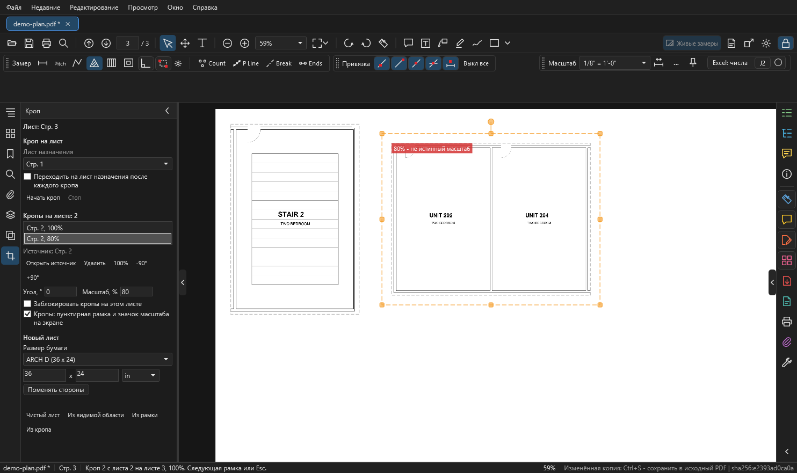
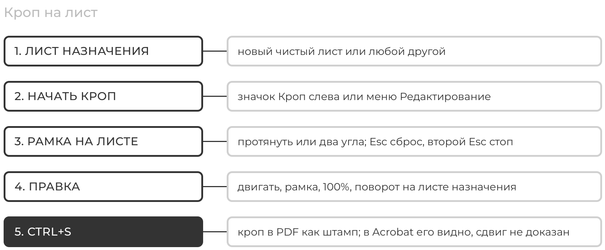
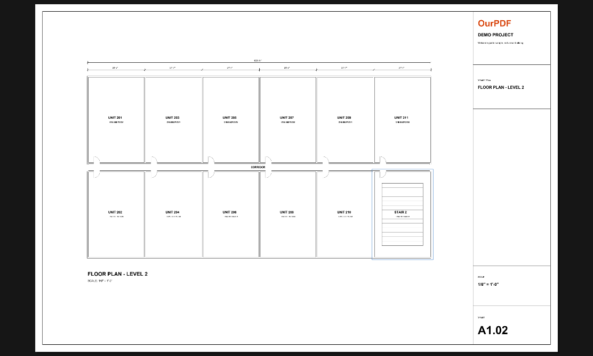
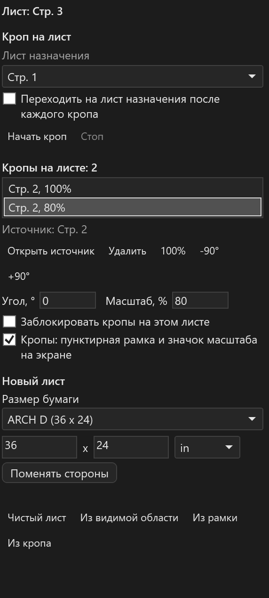

# Crop to sheet and new sheets

A detail from one sheet, in a frame, lands on another sheet at true scale. The detail stays vector and knows where it came from. This is how you build a working sheet from details on different pages. Also here: how to create a new sheet.

<figure markdown>
  
  <figcaption markdown="span">The "Crop" icon on the left strip, next to "Overlay". On a new blank sheet, two crops from sheet 2: one at 100 %, the selected one rescaled to 80 %, hence the red "not true scale" badge.</figcaption>
</figure>

<figure markdown>
  
  <figcaption markdown="span">From picking a sheet to writing to the file.</figcaption>
</figure>

!!! warning "Two limits"
    - A saved crop in the PDF is a stamp (Stamp). On November 4, 2026, when tested in Acrobat, no stamp could be moved with the mouse, so do not count on moving a crop in Acrobat. Move it in OurPDF.
    - An unsaved crop does not print. ++ctrl+s++ first.

## Make a crop { #make }

<figure markdown>
  
  <figcaption markdown="span">A frame around the stair on sheet 2, while the mouse button is held down.</figcaption>
</figure>

1. Click the "Crop" icon on the left strip. The same from the menu: `Edit > Crop to Sheet...`.
2. In "Target sheet", pick:
    - **New blank sheet**: the size comes from the "New sheet" section below, the sheet goes after the current one;
    - or any other sheet.
3. The checkbox "Go to the target sheet after each crop": off by default, you stay on the source and can take the next detail.
4. `Start Cropping`.
5. On the sheet you need, drag a frame or click two opposite corners. The corners snap to drawing lines. You can move between sheets: the frame works on any sheet except the target sheet itself.
6. The detail lands on the target sheet right away at 100 %, in reading order: left to right, top to bottom. If there is no room, the status bar says so.
7. ++esc++ drops a started frame, a second ++esc++ or the `Stop` button finishes.

A target sheet without a scale takes the scale from the source. If the scales differ, the status bar warns you.

## Edit a crop { #edit }

<figure markdown>
  { width="320" }
  <figcaption markdown="span">Target sheet, the crops of this sheet, values, new sheet.</figcaption>
</figure>

Open the target sheet. A crop is selected with a click on the sheet or with a row in the panel list; they highlight each other.

| What | How |
| --- | --- |
| move | drag inside the crop |
| rotate | the round handle of the orange frame, the `Angle` box or the `-90°`, `+90°` buttons |
| resize | corner and side handles, the `Scale` box; size changes only proportionally |
| restore true scale | the `100%` button |
| see where it came from | `Open Source`; the sheet name is written under the list |
| delete | ++delete++ or `Delete` |
| new sheet from this crop | the `From crop` button or right-click the crop |

- The `Angle` and `Scale` boxes apply on ++enter++ or on leaving the box, one undo step.
- ++ctrl+z++ undoes all of this, including placing the crop itself.
- The red "not true scale" badge and the dashed frame show only on screen. They are turned off with a checkbox in the panel or in Settings.
- If only a crop is selected, the style block on the top toolbar goes empty: color and line width do not apply to a crop.
- If the source was edited with "Edit PDF", the crop shows its new look on screen, and in the file it updates at the next ++ctrl+s++.

### Lock

The checkbox "Lock crops on this sheet" in the panel, or right-click the sheet. One lock per sheet, as in OurPlanCore. Locked crops are visible but cannot be selected: handy for measuring over them.

### Order on the sheet

Bottom to top: sheet, overlays, crops, measurements and comments. Measurements always lie over the crop, in other apps too. Crops are not included in the legend or in Excel.

## What happens to a crop in the PDF { #pdf }

| Where | What happens |
| --- | --- |
| before ++ctrl+s++ | the crop lives in the app profile, like any markup |
| ++ctrl+s++ | written to the file as a stamp (Stamp) with a vector appearance |
| "Save As", editable comments | into the copy, also as a stamp |
| "Save As", burned into the sheet | drawn right into the sheet, above overlays and under markups |
| printing | only those written to the file |
| Acrobat | shows the crop; none of the stamps could be moved with the mouse (tested November 4, 2026) |

- The file grows by the compressed content of the source sheet once. The next crop from the same sheet or a move adds about 1 KB.
- OurPDF reads back a stamp move made by another app.
- If another app changed or reordered the source sheet, the crop stays as the PDF draws it: you can delete it but not move it in OurPDF. The crop row then says "(source removed)".
- The same if the source sheet was deleted by a page edit. An unsaved crop with a deleted source disappears: the status bar counts these, ++ctrl+z++ brings them back.

## New sheets { #new-sheets }

The "New sheet" section in the "Crop" panel. The same commands are in the `Edit` menu, and the blank sheet also on right-click of a thumbnail.

| Button | Result |
| --- | --- |
| `Blank sheet` | an empty sheet after the current one; size above: paper list, width, height, units, "Swap width / height" |
| `From visible area` | a new sheet from what is on screen now |
| `From box` | drag a frame on the sheet |
| `From crop` | a new sheet from the area of the selected crop |

- Default size: ARCH D, 36 x 24 inches. The list of sizes is edited in Settings, section "Blank sheets".
- A sheet from an area is the same page with a crop box: vector, the sheet scale is kept, measurements and comments stay on the source sheet.
- All of this is a page edit: it goes into the modified copy (the tab gets a `*`), ++ctrl+s++ saves it like any page edit ([Modified copy](pages-edit.md#working-copy)).
- The new sheet has no name: a PDF page has no name field.

## If something is wrong { #troubleshooting }

| What you see | Why and what to do |
| --- | --- |
| "This is the target sheet" | the frame is dragged on the target sheet: open another sheet |
| "no free space" | the target sheet ran out of room: pick a larger sheet or a new one |
| "The box has no size" | click two opposite corners or drag a bigger frame |
| a crop cannot be selected | the lock is on for this sheet: uncheck it in the panel |
| a crop is not on paper | it is not written to the file yet: ++ctrl+s++ |
| a crop does not move in Acrobat | that is how it is, move it in OurPDF and save |

## See also

- [Sheet overlay](overlay.md)
- [Pages, editing, layers](pages-edit.md)
- [Comments and saving](comments-save.md#where)
