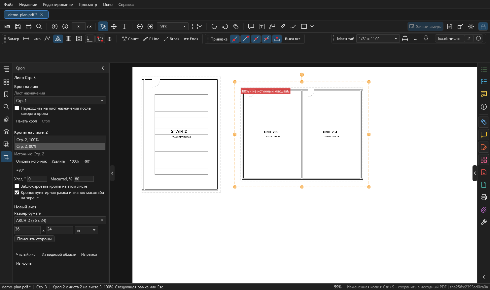
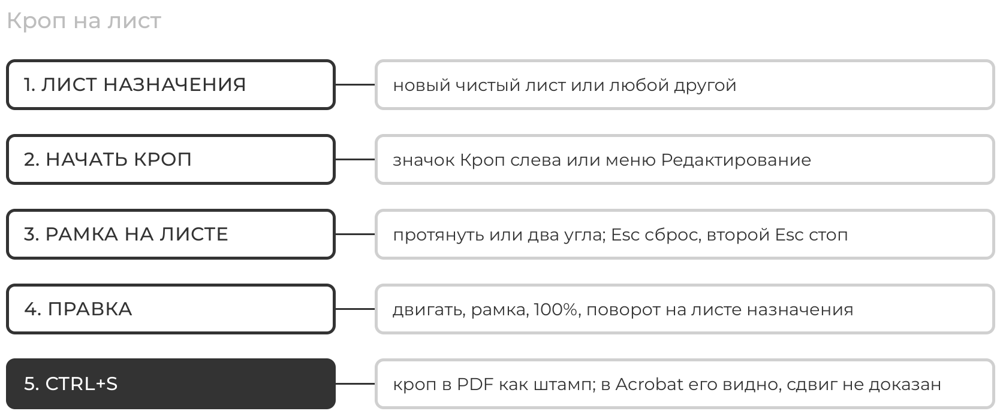
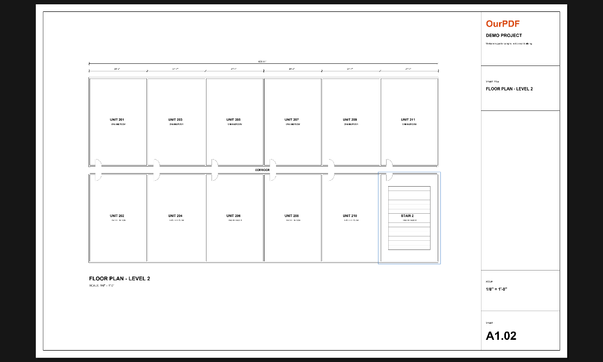
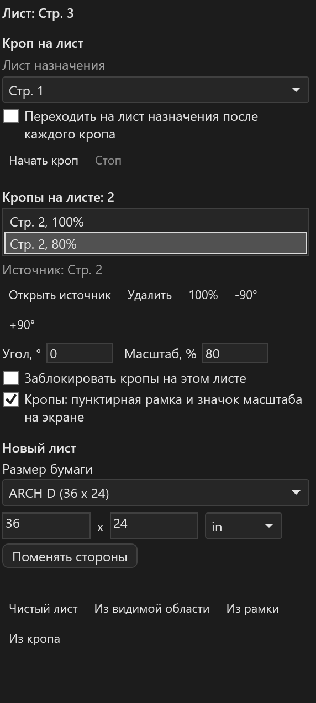

# Кроп на лист и новые листы

Деталь с одного листа в рамке ложится на другой лист в истинном масштабе. Деталь остаётся вектором и знает, откуда взята. Так собирают рабочий лист из деталей с разных страниц. Здесь же: как создать новый лист.

<figure markdown>
  
  <figcaption markdown="span">Значок "Кроп" на левой полосе, рядом с "Наложением". На новом чистом листе два кропа с листа 2: один 100 %, у выбранного масштаб изменён на 80 %, поэтому красный значок "не истинный масштаб".</figcaption>
</figure>

<figure markdown>
  
  <figcaption markdown="span">От выбора листа до записи в файл.</figcaption>
</figure>

!!! warning "Два ограничения"
    - Сохранённый кроп в PDF это штамп (Stamp). 4 ноября 2026 года при проверке в Acrobat ни один штамп не двигался мышью, так что рассчитывать на сдвиг кропа в Acrobat нельзя. Двигайте его в OurPDF.
    - Незаписанный кроп на печать не идёт. Сначала ++ctrl+s++.

## Сделать кроп { #make }

<figure markdown>
  
  <figcaption markdown="span">Рамка вокруг лестницы на листе 2, пока кнопка мыши нажата.</figcaption>
</figure>

1. Нажмите значок "Кроп" на левой полосе. То же из меню: `Редактирование > Кроп на лист...`.
2. В "Лист назначения" выберите:
    - **Новый чистый лист**: размер берётся из раздела "Новый лист" ниже, лист встанет после текущего;
    - или любой другой лист.
3. Галочка "Переходить на лист назначения после каждого кропа": по умолчанию выключена, вы остаётесь на источнике и можете брать следующую деталь.
4. `Начать кроп`.
5. На нужном листе протяните рамку или щёлкните два противоположных угла. Углы цепляются к линиям чертежа. Переходить между листами можно: рамка работает на любом листе, кроме самого листа назначения.
6. Деталь сразу ложится на лист назначения в 100 %, в порядке чтения: слева направо, сверху вниз. Если на нём нет места, строка состояния скажет об этом.
7. ++esc++ сбрасывает начатую рамку, второй ++esc++ или кнопка `Стоп` заканчивают работу.

У листа назначения без масштаба масштаб берётся от источника. Если масштабы разные, строка состояния предупредит.

## Править кроп { #edit }

<figure markdown>
  { width="320" }
  <figcaption markdown="span">Лист назначения, кропы этого листа, значения, новый лист.</figcaption>
</figure>

Откройте лист назначения. Кроп выбирается щелчком на листе или строкой в списке панели, они подсвечивают друг друга.

| Что | Как |
| --- | --- |
| сдвинуть | тянуть внутри кропа |
| повернуть | круглая ручка оранжевой рамки, поле `Угол` или кнопки `-90°`, `+90°` |
| изменить размер | угловые и боковые ручки, поле `Масштаб`; размер меняется только пропорционально |
| вернуть истинный масштаб | кнопка `100%` |
| посмотреть, откуда взят | `Открыть источник`; под списком написано имя листа |
| удалить | ++delete++ или `Удалить` |
| новый лист из этого кропа | кнопка `Из кропа` или правая кнопка по кропу |

- Поля `Угол` и `Масштаб` применяются по ++enter++ или при выходе из поля, один шаг отмены.
- ++ctrl+z++ отменяет всё это, в том числе саму установку кропа.
- Красный значок "не истинный масштаб" и пунктирная рамка видны только на экране. Убираются галочкой в панели или в Настройках.
- Если выбран только кроп, блок вида в верхней панели пустеет: цвет и толщина к кропу не относятся.
- Если источник поправили через "Редактировать PDF", кроп показывает его новый вид на экране, а в файле обновится при следующем ++ctrl+s++.

### Замок

Галочка "Заблокировать кропы на этом листе" в панели, или правая кнопка по листу. Замок один на лист, как в OurPlanCore. Запертые кропы видны, но не выбираются: удобно мерить поверх них.

### Порядок на листе

Снизу вверх: лист, наложения, кропы, замеры и комментарии. Замеры всегда лежат поверх кропа, и в других программах тоже. В легенду и в Excel кропы не входят.

## Что с кропом в PDF { #pdf }

| Куда | Что происходит |
| --- | --- |
| до ++ctrl+s++ | кроп живёт в профиле программы, как любая пометка |
| ++ctrl+s++ | записывается в файл как штамп (Stamp) с векторным видом |
| "Сохранить как", редактируемые комментарии | в копию, тоже штампом |
| "Сохранить как", вжечь в лист | рисуется прямо в лист, над наложениями и под пометками |
| печать | только записанные в файл |
| Acrobat | показывает кроп; сдвинуть его мышью не удалось ни на одном штампе (проверка 4 ноября 2026 года) |

- Файл растёт на сжатое содержимое листа-источника один раз. Следующий кроп с того же листа или сдвиг добавляют около 1 КБ.
- Сдвиг штампа, сделанный другой программой, OurPDF читает обратно.
- Если другая программа изменила или переставила лист-источник, кроп остаётся, как его рисует PDF: его можно удалить, но нельзя сдвинуть в OurPDF. Строка кропа тогда пишет "(источник удалён)".
- То же, если лист-источник удалён правкой страниц. Незаписанный кроп с удалённым источником пропадает: строка состояния считает такие, ++ctrl+z++ вернёт.

## Новые листы { #new-sheets }

Раздел "Новый лист" в панели "Кроп". Те же команды есть в меню `Редактирование`, чистый лист ещё и правой кнопкой по миниатюре.

| Кнопка | Что получится |
| --- | --- |
| `Чистый лист` | пустой лист после текущего; размер выше: список бумаги, ширина, высота, единицы, "Поменять стороны" |
| `Из видимой области` | новый лист из того, что сейчас на экране |
| `Из рамки` | протяните рамку на листе |
| `Из кропа` | новый лист из области выбранного кропа |

- Размер по умолчанию: ARCH D, 36 x 24 дюйма. Список размеров правится в Настройках, раздел "Чистые листы".
- Лист из области это та же страница с обрезкой: вектор, масштаб листа сохраняется, замеры и комментарии остаются на исходном листе.
- Всё это правка страниц: идёт в изменённой копии (во вкладке появляется `*`), ++ctrl+s++ сохраняет так же, как любую правку страниц ([Изменённая копия](pages-edit.md#working-copy)).
- Имени у нового листа нет: у страницы PDF нет поля имени.

## Если что-то не так { #troubleshooting }

| Что видно | Почему и что делать |
| --- | --- |
| "Этот лист и есть лист назначения" | рамку тянут на листе назначения: откройте другой лист |
| "нет места" | на листе назначения кончилось место: выберите лист больше или новый |
| "У рамки нет размера" | щёлкните два противоположных угла или протяните рамку побольше |
| кроп не выбирается | на листе включён замок: снимите галочку в панели |
| кроп не на бумаге | он ещё не записан в файл: ++ctrl+s++ |
| в Acrobat кроп не двигается | так и есть, двигайте в OurPDF и сохраняйте |

## См. также

- [Наложение листов](overlay.md)
- [Страницы, правка, слои](pages-edit.md)
- [Комментарии и сохранение](comments-save.md#where)
