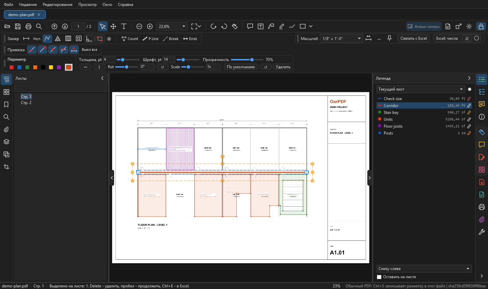
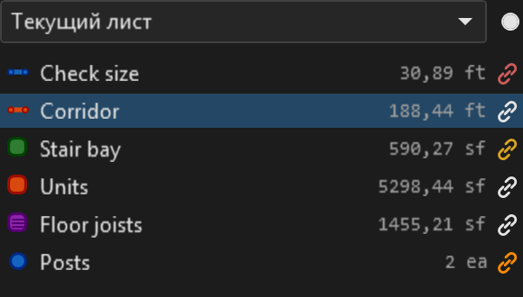
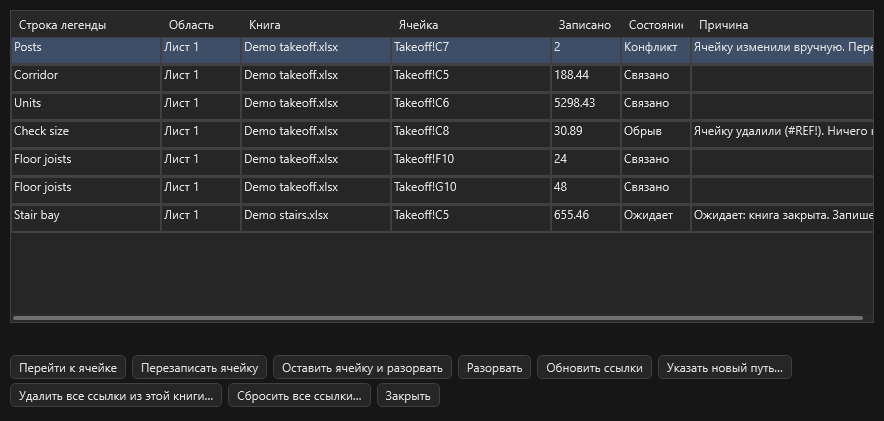
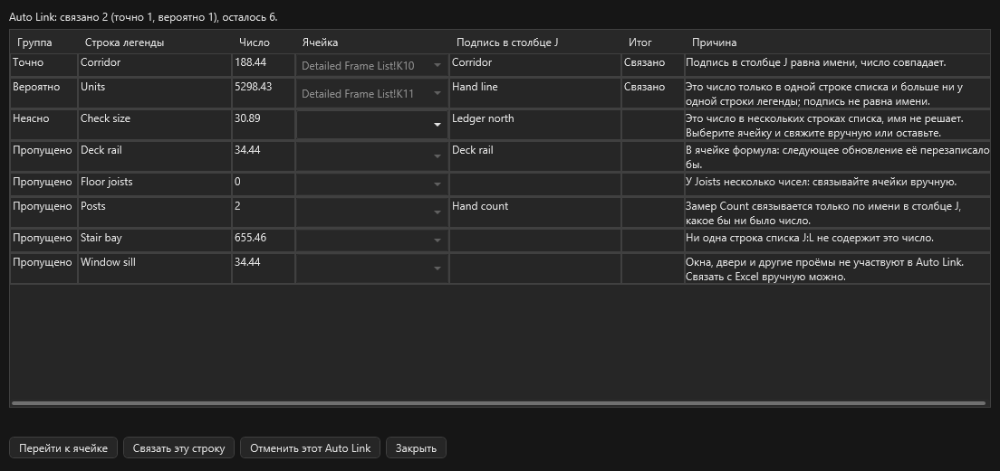

# Excel link

The number of one legend row sits in one workbook cell and updates by itself when the measurements change. Here: how to link, what happens with an open and a closed workbook, the four states, [Auto Link](#auto-link) for the whole DFL, [resetting all links](#reset) and what to do before handing the workbook to the client. A regular one-time paste is described on the [Measurements](measure.md#excel) page.

!!! warning "One way only, from OurPDF to Excel"
    Editing a cell does not change the measurement. The app never saves an open workbook: you save it, as after a regular paste. Until you press "Link to Excel", OurPDF does not touch Excel.

<figure markdown>
  
  <figcaption markdown="span">The Corridor row is selected. The Auto Link and "Link to Excel" buttons sit next to the Excel button, linked legend rows have a chain icon. The workbooks here are made up.</figcaption>
</figure>

## How to link { #how }

1. In OurPDF, select one legend row: click the row or its measurement on the sheet.
2. In Excel, open a saved workbook and click the cell you need.
3. In OurPDF, press **Link to Excel**. The number appears in the cell right away.

Good to know:

- The button is in the "Scale" block; with the lock open it comes in the style block together with the selection.
- The same command: right-click a legend row, the `Export PDF` menu on the right strip. There is no default key, but you can [assign one](shortcuts.md#remap).
- The number is the same as with the "values only" export: same units, decimals and J2.
- If the cell already has something in it, the app asks first.

## How it updates { #update }

| What happened | What happens |
| --- | --- |
| the workbook is open | the cell updates right away, after a short pause. The worksheet and the selection in Excel stay where they are. The write clears Excel's own undo (++ctrl+z++) |
| the workbook is closed | the link waits in the "Pending" state. The number is written on ++ctrl+s++ or on the "Update Links" command: in a hidden Excel with macros off, with a backup of the workbook in the app folder, `%LOCALAPPDATA%\OurPDF\excel-link-backups`. Nothing appears next to the workbook |
| rows were inserted in Excel | the link holds on to a hidden name in the workbook, which follows the cell. The app does not guess the address |
| the legend row was renamed or recolored | the link follows it |
| measurements hidden in the legend | **they are included in the number**, as in the legend total: hiding only removes them from the screen |
| the file was closed and reopened | the links are in place. They are stored in the profile, not in the PDF, they are not a ++ctrl+z++ step and not an unsaved change. Answering "No" when closing the file does not drop them |

## States { #states }

<figure markdown>
  { width="420" }
  <figcaption markdown="span">The icon color shows the worst state of the row's links. The icon tooltip: workbook, worksheet, cell, last number, reason.</figcaption>
</figure>

| State | Icon | What it means | What to do |
| --- | --- | --- | --- |
| **Linked** | text color | the cell holds this row's number | nothing |
| **Pending** | yellow | the new number is not written yet: the workbook is closed, Excel is busy or a cell is being edited, the file is busy, read-only or missing, the row has no scale | closed workbook: ++ctrl+s++ or "Update Links". Busy Excel: the app retries by itself. Missing file: "Point to New Path...". The reason is written in the link list |
| **Conflict** | orange | the cell was changed by hand, the app leaves it alone | "Overwrite the Cell" or "Keep the Cell and Unlink" |
| **Broken** | red | the legend row was deleted, the cell was deleted (`#REF!`) or the joists now have a different number of lengths. Nothing is written, the cell stays as it is | ++ctrl+z++ brings back a deleted row. Otherwise unlink and link again |

## Joists: two numbers { #joists }

A joists row has two numbers for each length: count and length. "Link to Excel" asks which one goes into this cell; if there are several lengths, the list also has the totals. For the second number, click another cell and press the button again.

## All links of the file { #list }

<figure markdown>
  
  <figcaption markdown="span">"All Excel Links...": where each link is and what state it is in. The two conflict buttons show when such a row is selected.</figcaption>
</figure>

| Button | What it does |
| --- | --- |
| Go to Cell | shows the cell in Excel, opens a closed workbook first |
| Unlink | the link is gone, the number stays in the cell. If the workbook is closed, its hidden name goes away when it is opened while this file is open |
| Update Links | writes everything that is waiting, including into closed workbooks |
| Point to New Path... | the workbook was moved or renamed |
| Remove All Links from This Workbook... | see below |
| Reset All Links... | removes all links of this file: [see below](#reset) |

!!! warning "Before handing the workbook to the client"
    "All Excel Links...", the row of this workbook, **"Remove All Links from This Workbook..."**. The numbers stay in the cells, the hidden names go away, including those made by other files and by OurPlanCore.

## Auto Link: the whole DFL in one click { #auto-link }

What for: the numbers are already exported to the `J:L` list, and linking each legend row by hand takes long.
Needed: OurPDF 0.9.27 or newer, a saved DFL workbook active in Excel. OurPlanCore has the same since version 3.0.29: [Auto Link in OurPlanCore](../reference/ourplancore-excel.md#auto-link).

!!! warning "Look at the result window right after pressing"
    There is no question before linking, the result window is the check. A probable link can land on someone else's row with the same number, and the next measurement edit will write the new number there. Once you close the window, "Undo This Auto Link" is gone.

1. In the legend, pick the scope: "Current sheet" or "Entire PDF". Auto Link takes only the rows of this scope. A PDF of several buildings and a workbook for one: do not pick "Entire PDF".
2. Press **Auto Link** next to "Link to Excel". The same command: right-click a legend row, the `Export PDF` menu on the right strip. There is no default key.
3. Links appear right away, the window shows the result for each row.
4. Check every **Probable** row: the label in column J must be about this legend row.
5. Save the workbook in Excel yourself. Auto Link does not change cell values and does not save the workbook, it only adds hidden names. Close the workbook without saving: the names disappear, the links show "Broken".

Result: the "Sure" and "Probable" rows are linked, the rest are described in the window with a reason.

<figure markdown>
  
  <figcaption markdown="span">The result window, the workbook is made up. `Corridor` is linked as Sure. `Units` is linked as Probable: the label `Hand line` says nothing about it, and that is exactly the row to check by eye.</figcaption>
</figure>

**DFL only**: a `.xlsm`, `.xlsb` or `.xls` workbook with a `Detailed Frame List` worksheet whose column A has the word `Description` in the first 150 rows. Another workbook: the status bar says so, and nothing else happens. "Link to Excel" works on any workbook.

**What gets linked.** There is only one target: constant numbers in column K of this worksheet, from row 2, with the label taken from column J. Formulas never count. Columns `A:H`, block O and other macro blocks, other worksheets are never targets, even if the number matches.

| Group | When | What happens |
| --- | --- | --- |
| **Sure** | the label in J equals the legend row name (case and spaces do not matter), the number matches, there is only one such row | linked right away |
| **Probable** | the label does not equal the name, but the number is one to one: it is in exactly one K cell and no other participating legend row has it (openings, joists and already linked rows do not count). That row's label is not the name of another legend row | linked right away, check by eye |
| **Ambiguous** | this number is in several cells or on several rows, the name does not decide it | not linked: select the row in the window, pick a cell in the "Cell" column, press "Link This Row" |
| **Skipped** | see the list below, the reason is written on the window row | not linked |

The number is compared at the Excel export precision (2 decimals by default) and no wider. A cell `162.504` matches the row `162.50` and keeps its value until the row number changes. You changed a measurement after the export: the number is not in the list, the row will be skipped.

**What is skipped:**

- windows, doors and other openings, by the row name and by the label in J: `window`, `windows`, `wind`, `wnd`, `door`, `doors`, `opening`, `openings`, `storefront`, `gd`, `lv`, `louver`, words starting with `окн`, `двер`, `проём` (Russian for window, door, opening), an opening size with a dot like `3.0x6.7 d`. A manual "Link to Excel" works on them;
- joists: the row has several numbers, link them by hand;
- Count without its own name in J: Count links only by name, whatever the number;
- a small whole number without a name: a line or area with a whole number below 10 (threshold in [settings](#settings)). With a name it links;
- zero and a row with no number (no scale);
- an already linked row, a cell with someone else's link, a formula in the cell, a list row with the name of another legend row, the number is not in the list.

A legend row without a name has nothing to compare: at best Probable, and Count without a name never links.

**When Probable is wrong:**

- a row with a different name and the same number was typed into J by hand, and the item itself has not been exported to the list yet;
- a total row (two items as one number) happens to equal a third one;
- the legend scope is wider than the workbook: "Entire PDF" of several buildings;
- the legend row has no name, only a number.

**What to do.** "Undo This Auto Link" removes all links from this window, including those linked in it by hand. One row is removed with "Unlink" in the legend row menu. The numbers in the cells stay, including those written after linking. A closed workbook loses the names the next time it is opened.

## Reset all links { #reset }

"Reset All Links..." removes all links of this file. The button is in the "All Excel Links..." window, on the right-click menu of a legend row, and in the `Export PDF` menu. First a question with the number of links. **It cannot be undone.** The values in the cells stay.

- Open workbooks lose this file's hidden names right away. The workbook is not saved, you save it.
- Closed workbooks lose the names when the workbook is opened while this file is open. Without saving.
- A second button, **"Remove Them and Clean the Closed Workbooks Now"**, shows if some workbook is closed. It cleans closed workbooks right away, with a hidden Excel and a backup, and removes all names from them, including those of other files and OurPlanCore.

| | Reset All Links | Remove All Links from This Workbook |
| --- | --- | --- |
| Scope | this file, all its workbooks | one workbook |
| Which names | only this file's, except with the second button | all, including other files' and OurPlanCore's |
| Closed workbook | at the next opening or with the second button | right away, with a hidden Excel and a backup |
| When | to link the file again | before handing the workbook to the client |

## Settings { #settings }

Settings, section "Link to Excel behaviour":

| Setting | Default |
| --- | --- |
| Update an open workbook at once | on |
| Update a closed workbook on ++ctrl+s++ | on |
| Backups kept per workbook | 5, from 1 to 50 |
| Delay before an open workbook is updated | 800 ms, from 100 to 10000 |
| Time limit for a closed workbook | 180 s, from 15 to 1800 |
| Auto Link: lines and areas, a whole number below this needs its name; Count always does | 10, from 0 to 1000 |

## See also

- [Measurements](measure.md#excel): one-time paste into an open workbook and J2
- [Legend](measure.md#legend): rows, hiding, renaming
- [What goes where](comments-save.md#where)
