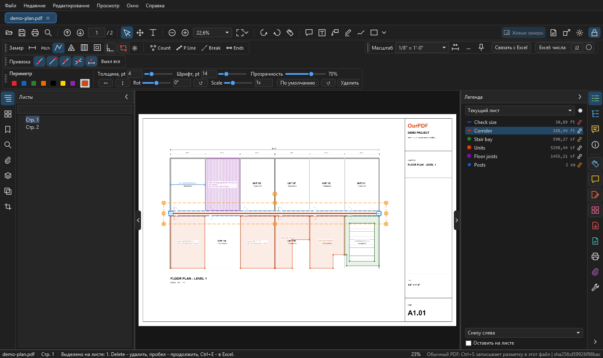
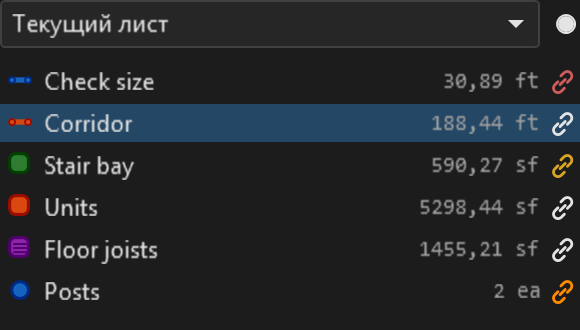
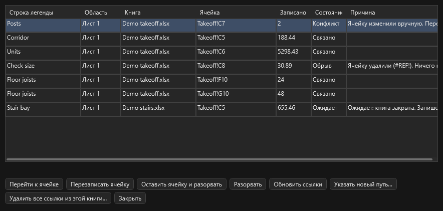

# Связь с Excel

Число одной строки легенды стоит в одной ячейке книги и само обновляется, когда меняются замеры. Здесь: как связать, что происходит с открытой и закрытой книгой, четыре состояния и что сделать перед сдачей книги клиенту. Обычная разовая вставка описана на странице [Измерения](measure.md#excel).

!!! warning "Только в одну сторону, из OurPDF в Excel"
    Правка ячейки замер не меняет. Открытую книгу программа никогда не сохраняет: сохраняете вы, как после обычной вставки. Пока вы не нажали "Связать с Excel", OurPDF к Excel не обращается.

<figure markdown>
  
  <figcaption markdown="span">Выбрана строка Corridor. Кнопка "Связать с Excel" стоит рядом с кнопкой Excel, у связанных строк легенды значок цепочки. Книги здесь вымышленные.</figcaption>
</figure>

## Как связать { #how }

1. В OurPDF выделите одну строку легенды: щелчком по строке или по её замеру на листе.
2. В Excel откройте сохранённую книгу и щёлкните нужную ячейку.
3. В OurPDF нажмите **Связать с Excel**. Число сразу появится в ячейке.

Полезно знать:

- Кнопка стоит в блоке "Масштаб", при открытом замке приходит в блоке вида вместе с выделением.
- Та же команда: правая кнопка по строке легенды, меню `Экспорт PDF` на полосе справа. Клавиши по умолчанию нет, её можно [назначить](shortcuts.md#remap).
- Число такое же, как при экспорте "только числа": те же единицы, знаки и J2.
- Если в ячейке уже что-то есть, программа сначала спросит.

## Как обновляется { #update }

| Что случилось | Что происходит |
| --- | --- |
| книга открыта | ячейка обновляется сразу, после короткой паузы. Лист и выделение в Excel остаются на месте. Запись очищает отмену (++ctrl+z++) самого Excel |
| книга закрыта | связь ждёт в состоянии "Ожидает". Число записывается по ++ctrl+s++ или по команде "Обновить ссылки": в скрытом Excel с выключенными макросами, с резервной копией книги в папке программы, `%LOCALAPPDATA%\OurPDF\excel-link-backups`. Рядом с книгой ничего не появляется |
| вставили строки в Excel | связь держится за скрытое имя в книге, оно идёт за ячейкой. Адрес программа не угадывает |
| переименовали строку легенды или сменили ей цвет | связь идёт за ней |
| скрыли замеры в легенде | **они входят в число**, как и в итог легенды: скрыть значит только убрать с экрана |
| закрыли и открыли файл | связи на месте. Они хранятся в профиле, а не в PDF, не шаг ++ctrl+z++ и не несохранённое изменение. Ответ "Нет" при закрытии файла их не отбрасывает |

## Состояния { #states }

<figure markdown>
  { width="420" }
  <figcaption markdown="span">Цвет значка показывает худшее состояние связей строки. Подсказка значка: книга, лист, ячейка, последнее число, причина.</figcaption>
</figure>

| Состояние | Значок | Что значит | Что делать |
| --- | --- | --- | --- |
| **Связано** (Linked) | цвета текста | в ячейке число этой строки | ничего |
| **Ожидает** (Pending) | жёлтый | новое число ещё не записано: книга закрыта, Excel занят или правится ячейка, файл занят, только для чтения или пропал, у строки нет масштаба | закрытая книга: ++ctrl+s++ или "Обновить ссылки". Занятый Excel: программа повторит сама. Файл пропал: "Указать новый путь...". Причина написана в списке связей |
| **Конфликт** (Conflict) | оранжевый | ячейку изменили вручную, программа её не трогает | "Перезаписать ячейку" или "Оставить ячейку и разорвать" |
| **Обрыв** (Broken) | красный | строку легенды удалили, ячейку удалили (`#REF!`) или у joists стало другое число длин. Ничего не пишется, ячейка остаётся как есть | удалённую строку вернёт ++ctrl+z++. Иначе разорвите связь и свяжите заново |

## Joists: два числа { #joists }

У строки joists на каждую длину два числа: штуки и длина. "Связать с Excel" спрашивает, какое идёт в эту ячейку; если длин несколько, в списке есть и итоги. Для второго числа щёлкните другую ячейку и нажмите кнопку ещё раз.

## Все связи файла { #list }

<figure markdown>
  
  <figcaption markdown="span">"Все ссылки Excel...": где каждая связь и в каком она состоянии. Две кнопки конфликта видны, когда выбрана такая строка.</figcaption>
</figure>

| Кнопка | Что делает |
| --- | --- |
| Перейти к ячейке | показывает ячейку в Excel, закрытую книгу сначала открывает |
| Разорвать | связи больше нет, число остаётся в ячейке. Если книга закрыта, её скрытое имя останется до "Удалить все ссылки" |
| Обновить ссылки | записывает всё, что ждёт, также в закрытые книги |
| Указать новый путь... | книгу перенесли или переименовали |
| Удалить все ссылки из этой книги... | см. ниже |

!!! warning "Перед сдачей книги клиенту"
    "Все ссылки Excel...", строка этой книги, **"Удалить все ссылки из этой книги..."**. Числа остаются в ячейках, скрытые имена уходят, также сделанные другими файлами и OurPlanCore.

## Настройки { #settings }

Настройки, раздел "Ссылки на Excel":

| Настройка | По умолчанию |
| --- | --- |
| Открытую книгу обновлять сразу | вкл |
| Закрытую книгу обновлять при ++ctrl+s++ | вкл |
| Резервных копий на книгу | 5, от 1 до 50 |
| Пауза перед записью в открытую книгу | 800 мс, от 100 до 10000 |
| Предел времени для закрытой книги | 180 с, от 15 до 1800 |

## См. также

- [Измерения](measure.md#excel): разовая вставка в открытую книгу и J2
- [Легенда](measure.md#legend): строки, скрытие, переименование
- [Что куда попадает](comments-save.md#where)
