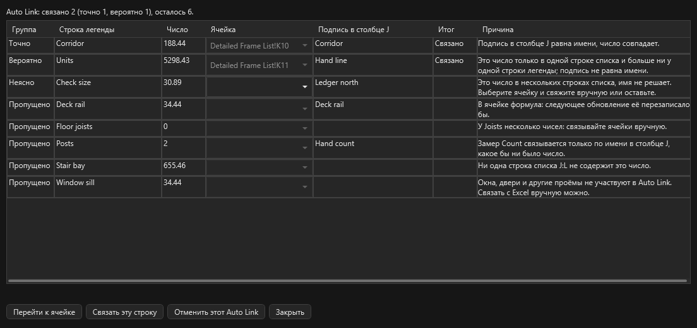

# Связь с Excel

Число одной строки легенды стоит в одной ячейке книги и само обновляется, когда меняются замеры. Здесь: как связать, что происходит с открытой и закрытой книгой, четыре состояния, [Auto Link](#auto-link) на весь DFL, [сброс всех ссылок](#reset) и что сделать перед сдачей книги клиенту. Обычная разовая вставка описана на странице [Измерения](measure.md#excel).

!!! warning "Только в одну сторону, из OurPDF в Excel"
    Правка ячейки замер не меняет. Открытую книгу программа никогда не сохраняет: сохраняете вы, как после обычной вставки. Пока вы не нажали "Связать с Excel", OurPDF к Excel не обращается.

<figure markdown>
  
  <figcaption markdown="span">Выбрана строка Corridor. Кнопки Auto Link и "Связать с Excel" стоят рядом с кнопкой Excel, у связанных строк легенды значок цепочки. Книги здесь вымышленные.</figcaption>
</figure>

## Как связать { #how }

1. В OurPDF выделите одну строку легенды: щелчком по строке или по её замеру на листе.
2. В Excel откройте сохранённую книгу и щёлкните нужную ячейку.
3. В OurPDF нажмите **Связать с Excel**. Число сразу появится в ячейке.

Полезно знать:

- Кнопка стоит в блоке "Масштаб", при открытом замке приходит в блоке вида вместе с выделением.
- Та же команда: правая кнопка по строке легенды, меню `Экспорт PDF` на полосе справа. Клавиши по умолчанию нет, её можно [назначить](shortcuts.md#remap).
- Число такое же, как при экспорте "только числа": те же единицы, знаки и J2.
- Если в ячейке уже что-то есть, программа сначала спросит.

## Как обновляется { #update }

| Что случилось | Что происходит |
| --- | --- |
| книга открыта | ячейка обновляется сразу, после короткой паузы. Лист и выделение в Excel остаются на месте. Запись очищает отмену (++ctrl+z++) самого Excel |
| книга закрыта | связь ждёт в состоянии "Ожидает". Число записывается по ++ctrl+s++ или по команде "Обновить ссылки": в скрытом Excel с выключенными макросами, с резервной копией книги в папке программы, `%LOCALAPPDATA%\OurPDF\excel-link-backups`. Рядом с книгой ничего не появляется |
| вставили строки в Excel | связь держится за скрытое имя в книге, оно идёт за ячейкой. Адрес программа не угадывает |
| переименовали строку легенды или сменили ей цвет | связь идёт за ней |
| скрыли замеры в легенде | **они входят в число**, как и в итог легенды: скрыть значит только убрать с экрана |
| закрыли и открыли файл | связи на месте. Они хранятся в профиле, а не в PDF, не шаг ++ctrl+z++ и не несохранённое изменение. Ответ "Нет" при закрытии файла их не отбрасывает |

## Состояния { #states }

<figure markdown>
  { width="420" }
  <figcaption markdown="span">Цвет значка показывает худшее состояние связей строки. Подсказка значка: книга, лист, ячейка, последнее число, причина.</figcaption>
</figure>

| Состояние | Значок | Что значит | Что делать |
| --- | --- | --- | --- |
| **Связано** (Linked) | цвета текста | в ячейке число этой строки | ничего |
| **Ожидает** (Pending) | жёлтый | новое число ещё не записано: книга закрыта, Excel занят или правится ячейка, файл занят, только для чтения или пропал, у строки нет масштаба | закрытая книга: ++ctrl+s++ или "Обновить ссылки". Занятый Excel: программа повторит сама. Файл пропал: "Указать новый путь...". Причина написана в списке связей |
| **Конфликт** (Conflict) | оранжевый | ячейку изменили вручную, программа её не трогает | "Перезаписать ячейку" или "Оставить ячейку и разорвать" |
| **Обрыв** (Broken) | красный | строку легенды удалили, ячейку удалили (`#REF!`) или у joists стало другое число длин. Ничего не пишется, ячейка остаётся как есть | удалённую строку вернёт ++ctrl+z++. Иначе разорвите связь и свяжите заново |

## Joists: два числа { #joists }

У строки joists на каждую длину два числа: штуки и длина. "Связать с Excel" спрашивает, какое идёт в эту ячейку; если длин несколько, в списке есть и итоги. Для второго числа щёлкните другую ячейку и нажмите кнопку ещё раз.

## Все связи файла { #list }

<figure markdown>
  
  <figcaption markdown="span">"Все ссылки Excel...": где каждая связь и в каком она состоянии. Две кнопки конфликта видны, когда выбрана такая строка.</figcaption>
</figure>

| Кнопка | Что делает |
| --- | --- |
| Перейти к ячейке | показывает ячейку в Excel, закрытую книгу сначала открывает |
| Разорвать | связи больше нет, число остаётся в ячейке. Если книга закрыта, её скрытое имя уйдёт, когда она будет открыта при открытом этом файле |
| Обновить ссылки | записывает всё, что ждёт, также в закрытые книги |
| Указать новый путь... | книгу перенесли или переименовали |
| Удалить все ссылки из этой книги... | см. ниже |
| Сбросить все ссылки... | снимает все ссылки этого файла: [см. ниже](#reset) |

!!! warning "Перед сдачей книги клиенту"
    "Все ссылки Excel...", строка этой книги, **"Удалить все ссылки из этой книги..."**. Числа остаются в ячейках, скрытые имена уходят, также сделанные другими файлами и OurPlanCore.

## Auto Link: весь DFL одним нажатием { #auto-link }

Зачем: числа уже выгружены в список `J:L`, и каждую строку легенды связывать руками долго.
Нужно: OurPDF 0.9.27 или новее, в Excel активна сохранённая книга DFL. В OurPlanCore то же с версии 3.0.29: [Auto Link в OurPlanCore](../reference/ourplancore-excel.md#auto-link).

!!! warning "Смотрите окно результата сразу после нажатия"
    Вопроса перед связью нет, окно результата и есть проверка. Вероятная связь может встать на чужую строку с таким же числом, и следующая правка замера запишет новое число туда. Закроете окно, и "Отменить этот Auto Link" больше нет.

1. В легенде выберите область: "Текущий лист" или "Весь PDF". Auto Link берёт только строки этой области. PDF нескольких зданий, а книга одного: не берите "Весь PDF".
2. Нажмите **Auto Link** рядом с "Связать с Excel". Та же команда: правая кнопка по строке легенды, меню `Экспорт PDF` на полосе справа. Клавиши по умолчанию нет.
3. Связи появляются сразу, окно показывает итог по каждой строке.
4. Проверьте каждую строку **Вероятно**: подпись в столбце J должна быть про эту строку легенды.
5. Сохраните книгу в Excel сами. Значения ячеек Auto Link не меняет и книгу не сохраняет, он только добавляет скрытые имена. Закроете книгу без сохранения: имена пропадут, связи покажут "Обрыв".

Результат: связаны строки "Точно" и "Вероятно", остальные описаны в окне с причиной.

<figure markdown>
  
  <figcaption markdown="span">Окно результата, книга вымышленная. `Corridor` связан Точно. `Units` связан Вероятно: подпись `Hand line` ничего о нём не говорит, такую строку и нужно проверить глазами.</figcaption>
</figure>

**Только DFL**: книга `.xlsm`, `.xlsb` или `.xls` с листом `Detailed Frame List`, в столбце A которого в первых 150 строках есть слово `Description`. Другая книга: об этом скажет строка состояния, и больше ничего не произойдёт. "Связать с Excel" работает на любой книге.

**Что связывается.** Цель только одна: числа-константы в столбце K этого листа, от строки 2, подпись берётся из столбца J. Формулы не считаются никогда. Столбцы `A:H`, блок O и другие блоки макросов, другие листы целью не бывают, даже если число совпало.

| Группа | Когда | Что происходит |
| --- | --- | --- |
| **Точно** | подпись в J равна имени строки легенды (регистр и пробелы не важны), число совпадает, такая строка одна | связано сразу |
| **Вероятно** | подпись не равна имени, зато число один к одному: стоит ровно в одной ячейке K и нет больше ни у одной участвующей строки легенды (проёмы, joists и уже связанные не считаются). Подпись той строки не имя другой строки легенды | связано сразу, проверьте глазами |
| **Неясно** | это число в нескольких ячейках или у нескольких строк, имя не решает | не связано: выделите строку в окне, выберите ячейку в столбце "Ячейка", нажмите "Связать эту строку" |
| **Пропущено** | список ниже, причина написана в строке окна | не связано |

Число сравнивается с точностью экспорта в Excel (по умолчанию 2 знака) и не шире. Ячейка `162.504` совпадает со строкой `162.50` и сохраняет своё значение, пока число строки не изменится. Поменяли замер после выгрузки: числа нет в списке, строка будет пропущена.

**Что пропускается:**

- окна, двери и другие проёмы, по имени строки и по подписи в J: `window`, `windows`, `wind`, `wnd`, `door`, `doors`, `opening`, `openings`, `storefront`, `gd`, `lv`, `louver`, слова на `окн`, `двер`, `проём`, размер проёма с точкой вроде `3.0x6.7 d`. Вручную "Связать с Excel" на них работает;
- joists: у строки несколько чисел, связывайте вручную;
- Count без своего имени в J: Count связывается только по имени, какое бы ни было число;
- малое целое без имени: линия или площадь с целым числом меньше 10 (порог в [настройках](#settings)). С именем связывается;
- ноль и строка без числа (нет масштаба);
- уже связанная строка, ячейка с чужой ссылкой, формула в ячейке, строка списка с именем другой строки легенды, числа нет в списке.

У строки легенды без имени сравнивать нечего: в лучшем случае Вероятно, а Count без имени не связывается никогда.

**Когда Вероятно ошибается:**

- в J рукой вписана строка с другим именем и тем же числом, а сама позиция в список ещё не выгружена;
- суммарная строка (две позиции одним числом) случайно равна третьей;
- область легенды шире книги: "Весь PDF" нескольких зданий;
- у строки легенды нет имени, есть только число.

**Что сделать.** "Отменить этот Auto Link" снимает все связи этого окна, также связанные в нём вручную. Одну строку снимает "Разорвать" в меню строки легенды. Числа в ячейках остаются, и записанные уже после связи тоже. Закрытая книга теряет имена при следующем открытии.

## Сбросить все ссылки { #reset }

"Сбросить все ссылки..." снимает все ссылки этого файла. Кнопка в окне "Все ссылки Excel...", правая кнопка по строке легенды, меню `Экспорт PDF`. Сначала вопрос с числом ссылок. **Отменить нельзя.** Значения в ячейках остаются.

- Открытые книги сразу теряют скрытые имена этого файла. Книга не сохраняется, сохраняете вы.
- Закрытые книги теряют имена, когда книга будет открыта при открытом этом файле. Без сохранения.
- Вторая кнопка **"Снять и очистить закрытые книги сейчас"** есть, если какая-то книга закрыта. Она чистит закрытые книги сразу, скрытым Excel с резервной копией, и удаляет из них все имена, также других файлов и OurPlanCore.

| | Сбросить все ссылки | Удалить все ссылки из этой книги |
| --- | --- | --- |
| Охват | этот файл, все его книги | одна книга |
| Какие имена | только этого файла, кроме второй кнопки | все, также других файлов и OurPlanCore |
| Закрытая книга | при следующем открытии или второй кнопкой | сразу, скрытым Excel с копией |
| Когда | связать файл заново | перед сдачей книги клиенту |

## Настройки { #settings }

Настройки, раздел "Ссылки на Excel":

| Настройка | По умолчанию |
| --- | --- |
| Открытую книгу обновлять сразу | вкл |
| Закрытую книгу обновлять при ++ctrl+s++ | вкл |
| Резервных копий на книгу | 5, от 1 до 50 |
| Пауза перед записью в открытую книгу | 800 мс, от 100 до 10000 |
| Предел времени для закрытой книги | 180 с, от 15 до 1800 |
| Auto Link: линии и площади, целое меньше этого только с именем; замеры Count с именем всегда | 10, от 0 до 1000 |

## См. также

- [Измерения](measure.md#excel): разовая вставка в открытую книгу и J2
- [Легенда](measure.md#legend): строки, скрытие, переименование
- [Что куда попадает](comments-save.md#where)
