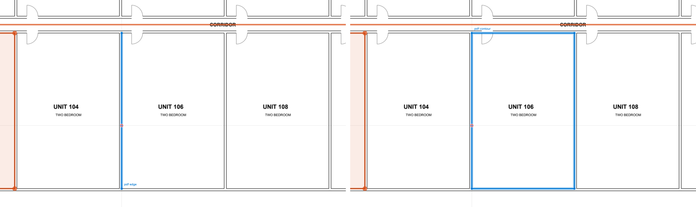
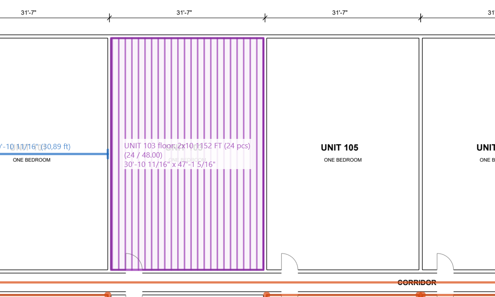
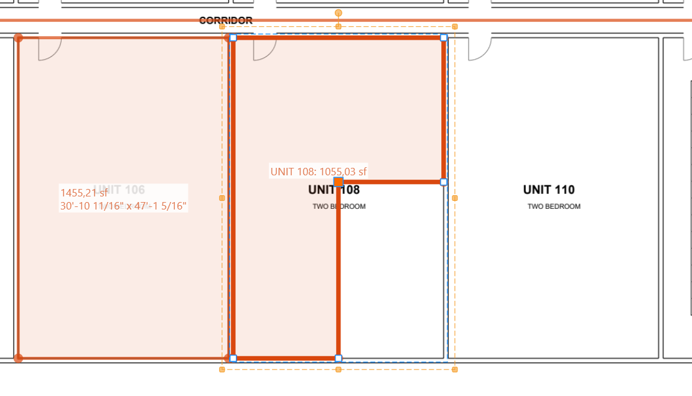

# How to measure step by step

Ready-made scenarios: what to press, where to click and what to check. Details on each tool are on the [Measurements](measure.md) page, all keys on the [Keyboard shortcuts](shortcuts.md) page.

!!! tip "Three rules"
    1. Scale first, then measurements. Without a scale, OurPDF writes inches on paper.
    2. The cursor snaps to drawing lines: place points on the line, not next to it.
    3. ++esc++ cancels what is being drawn, ++ctrl+z++ undoes what is finished.

## 1. Prepare the sheet { #prepare }

1. Open the PDF (++ctrl+o++ or drag the file into the window) and go to the sheet you need.
2. Turn measuring on: the ruler button. The buttons sit in blocks on the top toolbar ([Top toolbar](window.md#top-panel)).
3. In the "Scale" block, pick the scale from the title block or the caption under the view (`1/8" = 1'-0"`) and press ++enter++.
4. Check the scale: ++r++ and two clicks on the ends of a known dimension (a dimension string, a long wall). The value must match the dimension on the drawing.
5. It doesn't match: the calibrate button next to the scale box, mark a known segment and enter its length (`25'-6"`).
6. Save the scale in the sheet: the pin button next to the box (or ++ctrl+s++). The file will then open with it already set, here and in Acrobat.

!!! warning "A detail at a different scale"
    There is one scale for the whole sheet, and changing it recalculates all OurPDF measurements on that sheet. To get a dimension of a detail at its own scale: set the detail scale, take the dimension (++r++), write it down and set the sheet scale back. Do permanent measurements of such a detail in OurPlanCore.

## 2. Walls in LF { #walls }

1. Press ++l++ (line).
2. Click the wall corners along one face (or the centerline); each point snaps to a drawing line.
3. Perfectly horizontal or vertical: hold ++shift++ or turn on Ortho (++f8++).
4. Finish: ++c++, ++enter++ or double-click.
5. Name it: double-click the line (the "Select" tool, ++v++) and type a label, for example `1st Ext 2x6`.

Faster along the drawing: before the first point, hover over the wall line and press ++tab++. The edge (this line) highlights, a second ++tab++ highlights the whole contour, a click takes it all ([Tab along a line](measure.md#tab)).

The line's length shows in a box by the cursor on hover; all lines with their values are in the "Comments" list on the right.

## 3. Floor or room area in SF { #area }

<figure markdown>
  
  <figcaption markdown="span">Tab on a room wall: the first press takes the edge, the second the closed contour. A click turns the contour into an area.</figcaption>
</figure>

Three ways, from fast to manual:

| Way | When | How |
| --- | --- | --- |
| Tab along the contour | the room or floor is outlined with a solid line | ++a++, cursor on the wall, ++tab++ ++tab++, click |
| Box (++f9++) | a rectangle | ++a++, ++f9++, click one corner, click the opposite one; width x height shows under the value |
| By corners | a complex shape | ++a++, click the corners, click the first point, double-click or ++enter++ |

What to subtract (stair, shaft, atrium): ++x++, a box or polygon over the area. Inside the area you get a hole, across the edge it bites off a piece, across the whole area it splits it in two ([Cut](measure.md#cut)).

## 4. Elevation: sheathing and siding { #elevation }

1. Set the elevation scale (step 1).
2. ++a++ and trace the elevation wall along its outline: by corners, or Box (++f9++) if the wall is rectangular.
3. Subtract windows and doors: ++x++, drag a box over each opening. If the area was selected, only it is cut.
4. The area value is already net of openings (net SF); check it in the box on hover.
5. For finishes by height (for example, siding only up to a band), split the area with a cut across it.

If the elevation hatch sits on its own PDF layer, the areas can be taken with one button: the "Layers" tab, pick the layer, "Trace layer as areas" ([Trace a layer](pages-edit.md#layer-trace)).

## 5. Joists and rafters { #joists }

<figure markdown>
  
  <figcaption markdown="span">Joists area: the joists are laid out at spacing, the label "2x10 1152 FT (24 pcs)" is calculated by OurPlanCore code.</figcaption>
</figure>

1. The gear in the "Measure" block: type (`2x10`), spacing (`16"`), pitch (empty for joists, `6:12` for rafters), rounding.
2. ++j++, trace the area like an area (or ++f9++ and two corners, or ++tab++ along the contour).
3. Two points along the joist direction (++enter++ takes the long side).
4. Extra joists (doubled under walls, at openings): select the area, ++d++, click inside; ++shift++ and click removes one, ++d++ or ++esc++ exits.
5. Right-click the area: "Copy joists note" gives the label and a list of lengths with counts for Excel.

## 6. Check a dimension on the drawing { #check-size }

++r++ and two clicks: you get a dimension line with ticks at the ends, and the dimension is always labeled on the sheet. Handy for checking the scale, a span or an opening width. Delete it afterwards if not needed: select it and ++delete++.

Both room dimensions at once: ++r++, ++f9++, two opposite corners. You get two separate distances from the first corner, horizontal and vertical ([Box](measure.md#box)).

## 7. Fix a measurement { #fix }

<figure markdown>
  
  <figcaption markdown="span">A click on a point of the selected area selected it (orange): ++delete++ removes only this point.</figcaption>
</figure>

| What you need | How |
| --- | --- |
| move a point | ++v++, select the measurement, drag the point (it snaps to the drawing) |
| move an edge | drag an edge of the selected measurement; ++shift++ keeps it straight |
| delete a point | click the point, ++delete++ |
| delete an edge | click the edge (both its points get selected), ++delete++ |
| move the whole measurement | drag from inside the area or with ++alt++ |
| select many | ++e++ and a frame: left to right takes what is wholly inside, right to left everything touched |
| undo | ++ctrl+z++ |

## 8. Mark a question on the sheet { #question }

Callout (the button next to "Text" on the toolbar): click where the arrow points, a second click where the text goes, then the text. Handy for questions to the client and notes to yourself; it goes into the PDF together with the measurements.

## 9. Save and export { #save }

1. Measurements are saved automatically in the app profile while the PDF is open.
2. ++ctrl+s++ writes them into the PDF itself (a copy of the previous file goes into backups); they are visible in Acrobat and Bluebeam.
3. Totals by type: the "Legend" tab on the right strip. A list of all measurements: the "Comments" tab.
4. Into an open Excel workbook: select a cell, go back to OurPDF, the Excel button in the "Scale" block, ++ctrl+e++ or ++ctrl+t++ ([Excel](measure.md#excel)). To make the cell update by itself: [Excel link](excel-link.md).
5. As a separate `.xlsx` file: the "Measurements to Excel" button in the "Comments" list.

## 10. Compare two sheets { #compare }

1. Open the new sheet, the "Overlay" icon on the left strip.
2. `Add...`, pick the old sheet of this PDF or a page of another file.
3. `Auto Fit`. It doesn't match: `Edit by Points`, or drag the orange frame.
4. Colored lines with no black under them are the differences.

Details: [Sheet overlay](overlay.md). The overlay is not written on ++ctrl+s++ and is not printed.

## 11. Gather details on one sheet { #details }

1. The "Crop" icon on the left strip, "Target sheet": a new blank sheet, `Start Cropping`.
2. On the sheets you need, drag frames around the details: they land on the new sheet at 100 %.
3. ++esc++, open the new sheet, arrange the crops with the mouse.
4. Measure over the crop as usual, ++ctrl+s++.

Details: [Crop to sheet](crop.md).

## Common mistakes { #mistakes }

| Mistake | How to avoid it |
| --- | --- |
| dimensions in inches on paper | the sheet scale is not set: step 1 |
| the value does not match the dimension on the drawing | wrong scale or the sheet is not to scale: calibrate on a known dimension |
| a detail measured at the sheet scale | one scale per sheet: measure a detail at its own scale in OurPlanCore, or take the dimension and set the sheet scale back |
| a point landed on hatching or text | zoom in; turn off the extra snap in the "Snap" block or hide the hatch layer (the "Layers" tab) |
| an area counted twice | look at the "Comments" list: identical values next to each other |
| Excel shows less than the sheet | measurements hidden in the legend are not included in an area export; the status bar says how many |
| measurements are not on paper | printing draws the file as it is saved: ++ctrl+s++ first |
| openings not subtracted from the elevation | a cut ++x++ with a box over each opening |

## See also

- [Measurements](measure.md): all tools in detail
- [Keyboard shortcuts](shortcuts.md)
- [Comments and saving](comments-save.md)
- [Sheet overlay](overlay.md), [Crop to sheet](crop.md)
