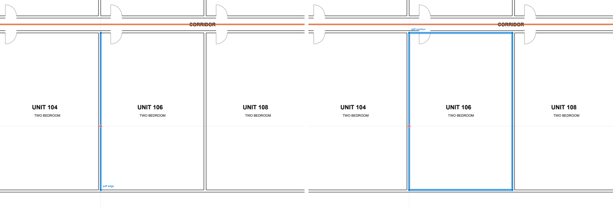
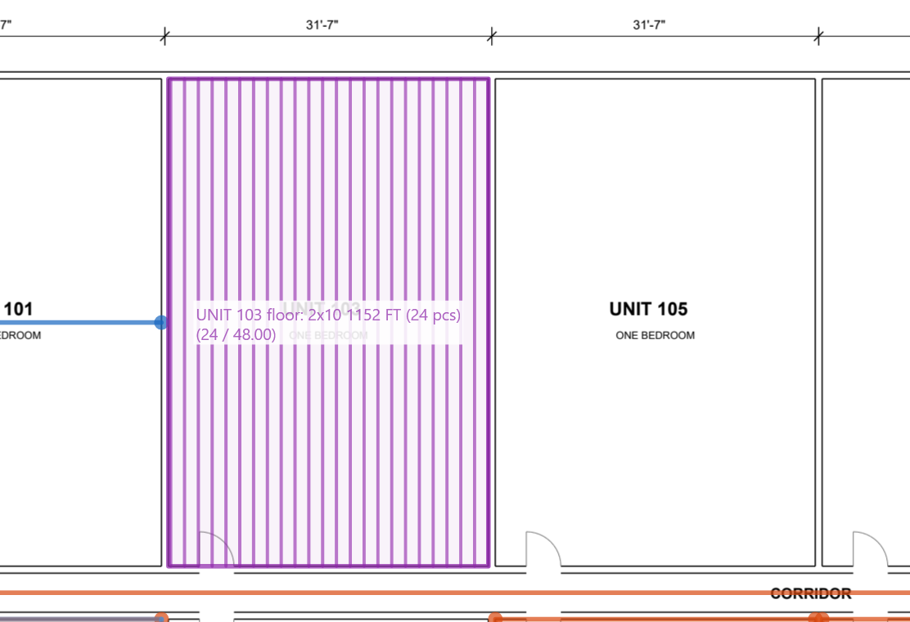
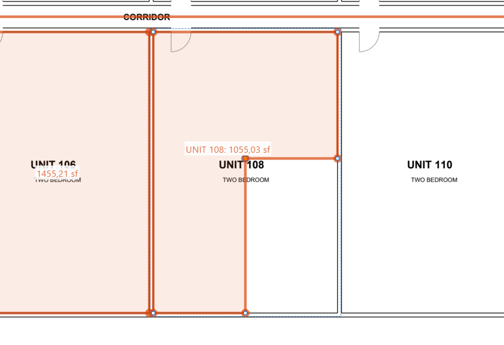

# Как мерить по шагам

Готовые сценарии: что нажать, куда щёлкнуть и что проверить. Подробности по каждому инструменту на странице [Измерения](measure.md), все клавиши на странице [Горячие клавиши](shortcuts.md).

!!! tip "Три правила"
    1. Сначала масштаб, потом замеры. Без масштаба OurPDF пишет дюймы на бумаге.
    2. Курсор цепляется к линиям чертежа: ставьте точки на линии, а не рядом.
    3. ++esc++ отменяет то, что рисуется, ++ctrl+z++ отменяет готовое.

## 1. Подготовить лист { #prepare }

1. Откройте PDF (++ctrl+o++ или перетащите файл в окно) и перейдите на нужный лист.
2. Включите измерение: ++ctrl+shift+m++ или кнопка-линейка. Справа сверху появится панель "Измерение".
3. В поле "Масштаб листа" выберите масштаб из штампа или подписи под видом (`1/8" = 1'-0"`) и нажмите ++enter++.
4. Проверьте масштаб: ++r++ и два щелчка по концам известного размера (размерная цепочка, длинная стена). Значение должно совпасть с подписью на чертеже.
5. Не совпало: кнопка калибровки рядом с полем масштаба, отметьте известный отрезок и введите его длину (`25'-6"`).
6. Запомните масштаб в листе: кнопка с булавкой рядом с полем (или ++ctrl+s++). Файл потом откроется уже с ним, здесь и в Acrobat.

!!! warning "Деталь в другом масштабе"
    Масштаб один на весь лист, и его смена пересчитывает все замеры OurPDF на этом листе. Размер детали в своём масштабе можно снять так: задать масштаб детали, снять размер (++r++), записать его и вернуть масштаб листа. Постоянные замеры такой детали делайте в OurPlanCore.

## 2. Стены в LF { #walls }

1. Нажмите ++l++ (линия).
2. Щёлкайте по углам стены по одной стороне (или по оси), каждая точка цепляется к линии чертежа.
3. Ровно по горизонтали или вертикали: держите ++shift++ или включите Орто (++f8++).
4. Закончить: ++c++, ++enter++ или двойной щелчок.
5. Дайте имя: двойной щелчок по линии (инструмент "Выделение", ++v++) и введите подпись, например `1st Ext 2x6`.

Быстрее по чертежу: до первой точки наведите курсор на линию стены и нажмите ++tab++. Подсветится грань (эта линия), второй ++tab++ подсветит весь контур, щелчок возьмёт его целиком ([Tab по линии](measure.md#tab)).

Длина линии видна в рамке у курсора при наведении; все линии со значениями есть в списке "Комментарии" справа.

## 3. Площадь пола или комнаты в SF { #area }

<figure markdown>
  
  <figcaption markdown="span">Tab по стене комнаты: первый раз берёт грань, второй раз замкнутый контур. Щелчок превращает контур в площадь.</figcaption>
</figure>

Три способа, от быстрого к ручному:

| Способ | Когда | Как |
| --- | --- | --- |
| Tab по контуру | комната или этаж обведены сплошной линией | ++a++, курсор на стену, ++tab++ ++tab++, щелчок |
| Box (++f9++) | прямоугольник | ++a++, ++f9++, щелчок в один угол, щелчок в противоположный |
| По углам | сложная форма | ++a++, щелчки по углам, щелчок в первую точку, двойной щелчок или ++enter++ |

Что вычесть (лестница, шахта, атриум): ++x++, рамка или многоугольник поверх площади. Внутри площади получается дырка, через край откусывается кусок, поперёк всей площади она делится на две ([Вырез](measure.md#cut)).

## 4. Фасад: обшивка и сайдинг { #elevation }

1. Задайте масштаб фасада (шаг 1).
2. ++a++ и обведите стену фасада по контуру: по углам или Box (++f9++), если стена прямоугольная.
3. Вычтите окна и двери: ++x++, протяните рамку по каждому проёму. Если площадь была выбрана, режется только она.
4. Значение площади уже за вычетом проёмов (net SF); проверьте его в рамке при наведении.
5. Для отделки по высоте (например, сайдинг только до пояса) делите площадь вырезом поперёк.

Если штриховка фасада лежит на своём слое PDF, площади можно снять одной кнопкой: вкладка "Слои", выбрать слой, "Обвести слой площадью" ([Обвести слой](pages-edit.md#layer-trace)).

## 5. Joists и rafters { #joists }

<figure markdown>
  
  <figcaption markdown="span">Зона joists: балки разложены с шагом, подпись "2x10 1152 FT (24 pcs)" считает код OurPlanCore.</figcaption>
</figure>

1. Шестерёнка в панели "Измерение": тип (`2x10`), шаг (`16"`), уклон (пусто для joists, `6:12` для rafters), округление.
2. ++j++, обведите зону как площадь (или ++f9++ и два угла, или ++tab++ по контуру).
3. Две точки вдоль направления балок (++enter++ берёт длинную сторону).
4. Лишние балки (двойные под стенами, у проёмов): выделите зону, ++d++, щелчки внутри; ++shift++ и щелчок убирает, ++d++ или ++esc++ выход.
5. Правая кнопка по зоне: "Копировать ноту joists" даёт подпись и список длин со штуками для Excel.

## 6. Проверить размер на чертеже { #check-size }

++r++ и два щелчка: получится размерная линия с засечками на концах, размер подписан на листе всегда. Так удобно сверить масштаб, проверить пролёт или ширину проёма. Ненужную потом удалите: выделите и ++delete++.

## 7. Поправить замер { #fix }

<figure markdown>
  
  <figcaption markdown="span">Щелчок по точке выбранной площади выбрал её (оранжевая): ++delete++ удалит только эту точку.</figcaption>
</figure>

| Что нужно | Как |
| --- | --- |
| сдвинуть точку | ++v++, выбрать замер, тянуть точку (цепляется к чертежу) |
| сдвинуть грань | тянуть грань выбранного замера; ++shift++ ровно |
| удалить точку | щелчок по точке, ++delete++ |
| удалить грань | щелчок по грани (выбираются обе её точки), ++delete++ |
| сдвинуть весь замер | тянуть изнутри площади или с ++alt++ |
| выбрать много | ++e++ и рамка: слева направо то, что целиком внутри, справа налево всё задетое |
| вернуть | ++ctrl+z++ |

## 8. Отметить вопрос на листе { #question }

Выноска (кнопка рядом с "Текстом" на панели инструментов): щелчок туда, куда указывает стрелка, второй щелчок туда, где будет текст, затем текст. Удобно для вопросов клиенту и пометок для себя; уходит в PDF вместе с замерами.

## 9. Сохранить и выгрузить { #save }

1. Замеры сохраняются сами в профиле программы, пока PDF открыт.
2. ++ctrl+s++ записывает их в сам PDF (копия прежнего файла кладётся в резервные копии); их видно в Acrobat и Bluebeam.
3. Список всех замеров: вкладка "Комментарии" на полосе справа.
4. В Excel: правая кнопка при линейке, "Экспорт разметки измерений в Excel" (или кнопка "Замеры в Excel" в списке).

## Частые ошибки { #mistakes }

| Ошибка | Как избежать |
| --- | --- |
| размеры в дюймах на бумаге | не задан масштаб листа: шаг 1 |
| значение не совпадает с размером на чертеже | масштаб не тот или лист не в масштабе: калибровка по известному размеру |
| деталь посчитана в масштабе листа | масштаб один на лист: деталь в своём масштабе мерьте в OurPlanCore или снимите размер и верните масштаб листа |
| точка встала на штриховку или текст | приблизьте вид; отключите лишнюю привязку в панели "Измерение" или скройте слой штриховки (вкладка "Слои") |
| площадь посчитана дважды | смотрите список "Комментарии": одинаковые значения рядом |
| проёмы не вычтены из фасада | вырез ++x++ рамкой по каждому проёму |

## См. также

- [Измерения](measure.md): все инструменты подробно
- [Горячие клавиши](shortcuts.md)
- [Комментарии и сохранение](comments-save.md)
