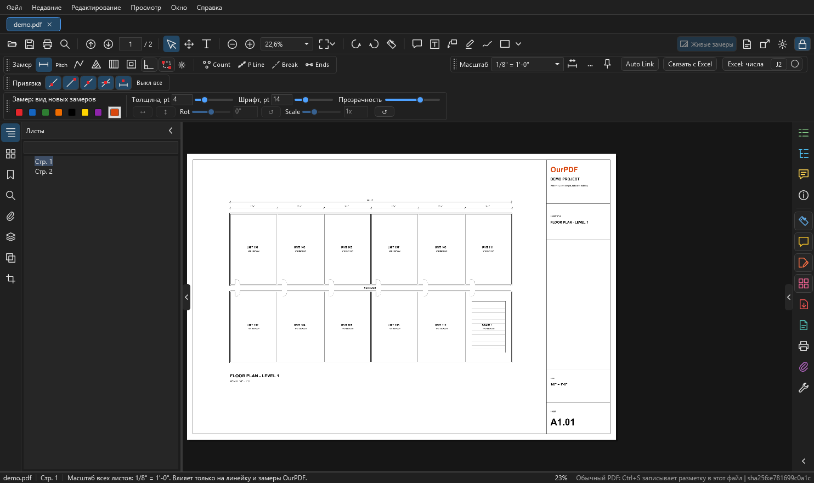

# OurPDF

OurPDF is an app for viewing and marking up construction drawings in PDF. The window and comments work like Adobe Acrobat, and measurements work like OurPlanCore: the same keys `R`, `L`, `A`, `J`, `X`, Box by two corners, Tab along a drawing line, cutouts from an area, and joists. This description is checked against OurPDF 1.0.0 (November 8, 2026); what changed: [What's new in 1.0](#whats-new).

<figure markdown>
  
  <figcaption markdown="span">The OurPDF window: menu, file tab and two toolbar rows at the top, sheet tabs on the left, the tab and tool strip on the right, the status bar at the bottom. Here and below, the pictures are taken on a demo sheet (a made-up plan, not a real job).</figcaption>
</figure>

## What it does and what it doesn't

- Opens PDFs in tabs, pages through them, searches text, shows layers, bookmarks and attachments.
- Measures lengths, polylines, areas with cutouts, joists / rafters and pieces (Count) by the sheet scale; the total shows on the sheet, in the legend, in the list and exports to Excel; a legend row can be [linked to a workbook cell](excel-link.md).
- Adds comments: notes, text, highlight, freehand drawing, shapes, clouds.
- Writes markups and measurements into the PDF itself on ++ctrl+s++, like Acrobat, and before writing puts a copy of the previous file into backups.
- Moves, rotates, deletes and extracts pages, edits sheet content (text, images, objects).
- Puts another sheet over the current one as a colored layer ([Overlay](overlay.md)), moves details from sheet to sheet ([Crop](crop.md)), creates new sheets.
- Shows OurPlanCore jobs (`.ourplan`) and their snapshots, view only.
- Uploads nothing to the internet and does not change OurPlanCore jobs. Takeoffs are still done in OurPlanCore: OurPDF measurements live in the PDF and do not go into the Takeoffs tree.

## How to start { #start }

1. Open the app with the **OurPDF** shortcut on the desktop.
2. Open a PDF in one of these ways:
    - drag the file into the window;
    - `File > Open` (++ctrl+o++);
    - `File > Recent`;
    - double-click a PDF in File Explorer, if OurPDF is the default app.
3. Each file opens in its own tab above the sheet. ++ctrl+w++ closes the tab.

Good to know:

- A missing file in Recent: the app offers to remove it from the list or find it again.
- A password-protected PDF asks for the password; the password is not saved anywhere.
- Make OurPDF the default app: `Help > Make OurPDF the default PDF app`. The app registers only for your user and opens Windows Settings; click "Set default" there (Windows lets only the user do that). Until OurPDF is the default app, it asks about it at start-up: "Yes" opens Windows Settings, "No" stops asking (you can turn it back on in Settings), "Cancel" asks again at the next start.
- Double-clicking a PDF while OurPDF is open opens the file in a new tab in the same window.

## The first five minutes { #first-five-minutes }

1. **Open a PDF**: drag it into the window or ++ctrl+o++.
2. **Set the sheet scale**: the "Scale" block in the second toolbar row: pick `1/8" = 1'-0"` or type your own and press ++enter++. Details: [Scale and calibration](measure.md#scale).
3. **Measure**: the ruler button, pick a type (distance ++r++, line ++l++, area ++a++), click the points. The cursor snaps to drawing lines.
4. **Read the values**: the area is labeled on the sheet, a line's length shows on mouse hover. Totals by type and color: the "Legend" tab on the right strip. All measurements one by one: the "Comments" tab.
5. **Save**: measurements are stored right away, in the app profile. ++ctrl+s++ writes them into the PDF itself; before that, a copy of the previous file goes into the backups folder.

!!! tip "Two keys for everything"
    ++esc++ always cancels what is being drawn, and from any tool returns to "Select". ++ctrl+z++ undoes the last markup action, ++ctrl+y++ redoes it.

## Built-in guide { #built-in-guide }

- ++f1++ or `Help > Keyboard shortcuts`: a panel with all active keys.
- `Help > How everything works`: this same guide as a PDF, opens in a tab. All tabs, with a focus on measurements.
- `Help > For AI agents: driving OurPDF`: a description of the bridge Claude and Codex use to drive an open OurPDF ([AI agent control](ai.md)).
- `Help > Keyboard shortcuts and settings`: the Settings window with a list of all keys.
- `Help > Open logs folder`: the work log, if something went wrong.
- `Help > About OurPDF`: the version number in the status bar.

## Sections

-   **Window and measurements**

    ---

    - [The app window](window.md): menu, top toolbar of blocks, lock, tabs on the left, strip on the right, status bar
    - [How to measure step by step](how-to-measure.md): walls, areas, elevations, joists, checking, editing, export
    - [Measurements](measure.md): scale, snapping, distance, line, area, Box, Tab, cutouts, joists, Count, editing points and edges, legend, list and Excel
    - [Excel link](excel-link.md): a legend row number in a workbook cell, updates by itself; Auto Link for the whole DFL, reset all links

-   **Markups and files**

    ---

    - [Comments and saving](comments-save.md): notes, text, shapes, ++ctrl+s++ into the PDF, backups, "Save As"
    - [Pages, editing, layers](pages-edit.md): pages, editing PDF content, layers, search, OurPlanCore snapshots
    - [Sheet overlay](overlay.md): another sheet over this one, alignment, in batch
    - [Crop to sheet and new sheets](crop.md): a detail onto another sheet, a blank sheet, a sheet from an area

-   **Reference**

    ---

    - [View and settings](view-settings.md): view modes, mouse wheel, the Settings window section by section
    - [Keyboard shortcuts](shortcuts.md): all keys by group and differences from OurPlanCore
    - [AI agent control](ai.md): the bridge for Claude and Codex

## What's new in 1.0 { #whats-new }

Changes after version 0.9.27, in order.

| Version | What changed | Details |
| --- | --- | --- |
| 0.9.28, 0.9.29 | PDFs exported from OurPlanCore look the same in OurPDF as in Acrobat on this computer | |
| 0.9.30 | Beam (++b++) and Openings (++o++), as in OurPlanCore | [Beam and Openings](measure.md#beam-openings) |
| 0.9.30 | Merge (++ctrl+m++), Split, Combine: move measurements into another or a new takeoff, add, subtract and split areas | [Merge, Split, Combine](measure.md#merge-split) |
| 0.9.30 | line and dimension end styles: dot, Acrobat-style arrow, closed arrow, tick, square, diamond, none | [Line ends](measure.md#line-ends) |
| 0.9.30 | every new takeoff gets a random color not yet used on the sheet | [Measurement style](measure.md#style) |
| 0.9.31 | Split on ++ctrl+shift+m++, as in OurPlanCore; turning measuring on no longer has a key (the ruler button) | [Keyboard shortcuts](shortcuts.md) |
| 0.9.31 | line ends change only the on-screen look, in the PDF and in Acrobat everything is as before | [Line ends](measure.md#line-ends) |
| 0.9.31 | in a narrow window, buttons wrap to the next row instead of being cut off | [The app window](window.md) |
| 1.0.0 | ++f3++ turns snapping to measurements on and off, ++ctrl+f3++ snapping to PDF lines, as in OurPlanCore; "Find next" is now ++enter++ in the search box | [Snapping](measure.md#snap) |

## Where things are { #files }

| What | Where |
| --- | --- |
| The app | OurPDF shortcut on the desktop |
| Settings, recent files | `%APPDATA%\OurPDF` |
| Markups and scales not yet written to the PDF, items hidden in the legend, Excel links | `%APPDATA%\OurPDF\markup` |
| Overlays and crop locks | `%APPDATA%\OurPDF\overlays` |
| Backups before ++ctrl+s++ | `%LOCALAPPDATA%\OurPDF\backups` |
| Copies of Excel workbooks before writing | `%LOCALAPPDATA%\OurPDF\excel-link-backups` |
| Logs | `%LOCALAPPDATA%\OurPDF\logs` (`Help > Open logs folder`) |
| AI agent bridge | `%LOCALAPPDATA%\OurPDF\agent-bridge` |
| OurPlanCore project snapshots | `Documents\OurPDF\Снимки` (the folder name is Russian) |

## See also

- [OurPlanCore 3.0](../reference/ourplanecore.md): the app where takeoffs are done
- [OurPlanCore measuring tools](../reference/ourplancore-tools.md): the same Line, Area, J Area in OurPlanCore
- [OurPDF keyboard shortcuts](shortcuts.md)
