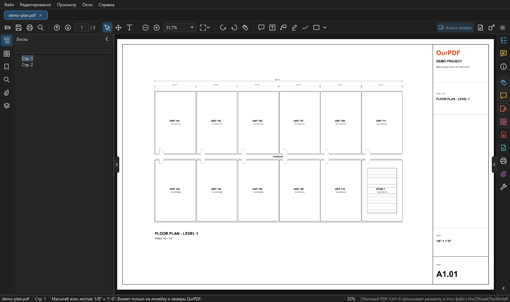

# OurPDF

OurPDF - программа для просмотра и разметки строительных чертежей в PDF. Окно и комментарии устроены как в Adobe Acrobat, а замеры как в OurPlanCore: те же клавиши `R`, `L`, `A`, `J`, `X`, Box двумя углами, Tab по линии чертежа, вырезы из площади и joists. Описание сверено с OurPDF 0.9.0 (октябрь 2026).

<figure markdown>
  
  <figcaption markdown="span">Окно OurPDF: меню и панель инструментов сверху, слева вкладки листа, справа полоса вкладок и инструментов, внизу строка состояния. Здесь и дальше картинки сняты на демонстрационном листе (вымышленный план, не реальный объект).</figcaption>
</figure>

## Что умеет и чего не делает

- Открывает PDF вкладками, листает, ищет текст, показывает слои, закладки и вложения.
- Меряет длины, ломаные, площади с вырезами и joists / rafters по масштабу листа; итог виден на листе, в списке и выгружается в Excel.
- Ставит комментарии: заметки, текст, маркер, рисование от руки, фигуры, облака.
- Записывает пометки и замеры в сам PDF по ++ctrl+s++, как Acrobat, и перед записью кладёт копию прежнего файла в резервные копии.
- Переставляет, поворачивает, удаляет и вытаскивает страницы, правит содержимое листа (текст, картинки, объекты).
- Показывает проекты OurPlanCore (`.ourplan`) и их снимки только для просмотра.
- Ничего не загружает в интернет и не меняет проекты OurPlanCore. Takeoffs по-прежнему ведутся в OurPlanCore: замеры OurPDF живут в PDF и в дерево Takeoffs не попадают.

## Как запустить { #start }

1. Откройте программу ярлыком **OurPDF** на рабочем столе.
2. Откройте PDF одним из способов:
    - перетащите файл в окно;
    - `Файл > Открыть` (++ctrl+o++);
    - `Файл > Недавние`;
    - двойной щелчок по PDF в проводнике, если OurPDF стоит программой по умолчанию.
3. Каждый файл открывается своей вкладкой над листом. ++ctrl+w++ закрывает вкладку.

Полезно знать:

- Пропавший файл в недавних: программа предложит убрать его из списка или найти заново.
- PDF с паролем спросит пароль; пароль нигде не сохраняется.
- Сделать OurPDF программой по умолчанию: `Справка > Сделать OurPDF программой по умолчанию для PDF`. Программа регистрируется только для вашего пользователя и открывает Параметры Windows, там нажмите "Установить по умолчанию" (Windows разрешает это только самому пользователю). Пока OurPDF не стал программой по умолчанию, он спрашивает об этом при запуске: "Да" открывает Параметры Windows, "Нет" больше не спрашивает (включить снова можно в Настройках), "Отмена" спросит при следующем запуске.
- Двойной щелчок по PDF при открытом OurPDF открывает файл новой вкладкой в том же окне.

## Первые пять минут { #first-five-minutes }

1. **Открыть PDF**: перетащить в окно или ++ctrl+o++.
2. **Задать масштаб листа**: кнопка-линейка на панели инструментов (++ctrl+shift+m++), справа сверху поле "Масштаб листа": выбрать `1/8" = 1'-0"` или ввести свой и нажать ++enter++. Подробно: [Масштаб и калибровка](measure.md#scale).
3. **Мерить**: выбрать тип (расстояние ++r++, линия ++l++, площадь ++a++), щёлкать по точкам. Курсор цепляется к линиям чертежа.
4. **Смотреть значения**: площадь подписана на листе, длина линии появляется при наведении мыши. Все замеры списком: вкладка "Комментарии" на полосе справа.
5. **Сохранить**: замеры хранятся сразу, в профиле программы. ++ctrl+s++ записывает их в сам PDF, перед этим копия прежнего файла кладётся в папку резервных копий.

!!! tip "Две клавиши на всё"
    ++esc++ всегда отменяет то, что рисуется, а из любого инструмента возвращает в "Выделение". ++ctrl+z++ отменяет последнее действие с пометками, ++ctrl+y++ повторяет.

## Руководство внутри программы { #built-in-guide }

- `Справка > Как всё работает`: это же руководство в PDF, открывается вкладкой. Все вкладки, упор на измерения.
- `Справка > Для нейросетей`: описание моста, через который Claude и Codex управляют открытым OurPDF ([Управление нейросетями](ai.md)).
- `Справка > Горячие клавиши и настройки`: окно Настроек со списком всех клавиш.
- `Справка > Открыть папку журналов`: журнал работы, если что-то пошло не так.
- `Справка > О программе`: номер версии в строке состояния.

## Разделы

-   **Окно и измерения**

    ---

    - [Окно программы](window.md): меню, панель инструментов, вкладки слева, полоса справа, строка состояния
    - [Как мерить по шагам](how-to-measure.md): стены, площади, фасады, joists, проверка, правка, выгрузка
    - [Измерения](measure.md): масштаб, привязки, расстояние, линия, площадь, Box, Tab, вырезы, joists, правка точек и граней, список и Excel

-   **Пометки и файлы**

    ---

    - [Комментарии и сохранение](comments-save.md): заметки, текст, фигуры, ++ctrl+s++ в PDF, резервные копии, "Сохранить как"
    - [Страницы, правка, слои](pages-edit.md): страницы, правка содержимого PDF, слои, поиск, снимки OurPlanCore

-   **Справка**

    ---

    - [Вид и настройки](view-settings.md): режимы просмотра, колесо, окно Настроек по разделам
    - [Горячие клавиши](shortcuts.md): все клавиши по группам и отличия от OurPlanCore
    - [Управление нейросетями](ai.md): мост для Claude и Codex

## Где что лежит { #files }

| Что | Где |
| --- | --- |
| Программа | ярлык OurPDF на рабочем столе |
| Настройки, недавние файлы | `%APPDATA%\OurPDF` |
| Пометки и масштабы, ещё не записанные в PDF | `%APPDATA%\OurPDF\markup` |
| Резервные копии перед ++ctrl+s++ | `%LOCALAPPDATA%\OurPDF\backups` |
| Журналы | `%LOCALAPPDATA%\OurPDF\logs` (`Справка > Открыть папку журналов`) |
| Мост для нейросетей | `%LOCALAPPDATA%\OurPDF\agent-bridge` |
| Снимки проектов OurPlanCore | `Документы\OurPDF\Снимки` |

## См. также

- [OurPlanCore 3.0](../reference/ourplanecore.md): программа, в которой ведутся takeoffs
- [Инструменты замера OurPlanCore](../reference/ourplancore-tools.md): те же Line, Area, J Area в OurPlanCore
- [Горячие клавиши OurPDF](shortcuts.md)
