# Measurements

The main part of OurPDF. Measurements as in Acrobat (distance, perimeter, area) plus what you are used to in OurPlanCore: the keys `R`, `L`, `A`, `J`, `X`, `C`, `B`, `O`, Ortho and Box modes, Tab along a drawing line, cutouts, joists and extra joists, Beam and Openings, Merge, Split and Combine, snapping on ++f3++ and ++ctrl+f3++, moving edges, frame selection, lengths in LF on hover. The line end style (arrows, ticks) is changed in Settings. Here, step by step: scale, toolbar blocks, each measurement type, editing, deleting points, legend, list and Excel. Linking a legend row to a workbook cell has its own page: [Excel link](excel-link.md).

<figure markdown>
  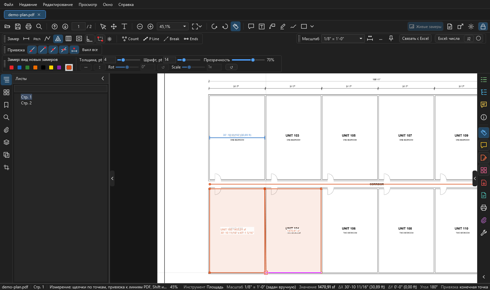
  <figcaption markdown="span">Area measuring is on. Room UNIT 102 is already measured: its width and height are under the value in sf. UNIT 104 is being traced now, guide lines run through the cursor, measurement info at the bottom.</figcaption>
</figure>

## In short { #summary }

| Task | Key | How | Result |
| --- | --- | --- | --- |
| turn measuring on | none | the ruler button on the toolbar or on the right strip; press again to turn it off. You can assign a key in Settings: ++ctrl+shift+m++ is now Split, as in OurPlanCore | top toolbar blocks ([lock](window.md#lock)) |
| dimension between two points | ++r++ | two clicks | length `12'-6" (12.50 ft)` |
| wall length, polyline | ++l++ | click the points, ++c++, ++enter++ or double-click | polyline length in LF |
| room area | ++a++ | click the corners, close | SF at the center of the area |
| joists / rafters | ++j++ | trace the area, two points along the joists | count and lengths by OurPlanCore's calculation |
| cutout from an area | ++x++ | a box or polygon over the area | hole, bite or split |
| rectangle by two corners | ++f9++ | Box mode for area, line, joists, cut | measurement by two corners |
| both sides of a room | ++r++ and ++f9++ | two corners | two distances at once |
| pieces | ++p++ | a click on each | Count, a row in `ea` |
| strictly horizontal or vertical | ++f8++ | Ortho mode; ++shift++ for a moment | a straight line |
| take a whole drawing line | ++tab++ | hover the line before the first point | edge, then contour |
| beam with order length | ++b++ | two clicks along the beam | a dimension and Count `Beam 12` ([Beam](#beam-openings)) |
| opening | ++o++ | two corners of the opening | width, height and Count `3.0x6.8` |
| move measurements into another or a new takeoff | ++ctrl+m++, ++ctrl+shift+m++ | select the measurements | Merge and Split ([details](#merge-split)) |
| snap to measurements, to PDF lines | ++f3++, ++ctrl+f3++ | press, press again to turn off | as in OurPlanCore ([Snapping](#snap)) |
| arrows at line ends | none | Settings, "Line ends" | [Line ends](#line-ends) |

## Scale and calibration { #scale }

Without a scale, values are written in inches on paper. The scale is stored for each sheet separately and affects only OurPDF measurements: it does not change OurPlanCore takeoffs.

### Pick or type a scale

1. Turn measuring on: the ruler button.
2. In the "Scale" block on the second toolbar row, pick a value from the list:
    - architectural `1/32" = 1'-0"` to `3" = 1'-0"`;
    - engineering `1" = 10'` to `1" = 200'`;
    - metric `1:1` to `1:1000`.
3. Or type your own: `1/8" = 1'-0"`, `1" = 20'`, `1:100`, `1 in = 8 ft` and press ++enter++.
4. Where the scale came from ("set by hand", "by calibration", "from the PDF", "from OurPlanCore") shows in the measurement info on the bottom bar.

Take the scale from the title block or the caption under the view (`SCALE: 1/8" = 1'-0"`), then check it with one measurement along a dimension string.

### Calibrate on a known dimension

Needed when the sheet has no scale or was printed not to scale.

1. Click the calibrate button to the right of the scale box.
2. Click the start and end of a segment of known length, for example a dimension line.
3. In the "Calibrate scale" window, enter the real length: `12'-6"`, `25'`, `3.5 m`.
4. The status bar shows "Sheet scale by calibration: ...".

### Save the scale in the sheet { #keep-scale }

The pin button next to the scale box (or right-click with the ruler on, "Save the scale into the PDF sheet") writes the scale into the PDF itself, as Acrobat does: a viewport with the scale is added to the sheet. It is the same write as ++ctrl+s++, with a backup of the previous file. After that the file opens with this scale in OurPDF, Acrobat and Bluebeam, on any computer. ++ctrl+s++ also writes the sheet scale by itself, together with the measurements.

### Scale and precision for all sheets

The `...` button next to the box opens the "Scale and precision" window (also in the right-click menu with the ruler on: "Change scale and precision").

| Field | Options |
| --- | --- |
| Sheet scale | a list or your own text; OurPlanCore snapshots have the item "As in OurPlanCore" |
| Units | feet-inches (`12'-6"`), feet (`12.50 ft`), inches, meters, centimeters, millimeters |
| Precision | inch denominator for ft-in, or decimal places |
| Apply | to this sheet or to all sheets of the document |

A measurement taken in from another app's PDF keeps its own scale, as in Acrobat. For OurPlanCore project snapshots, the scale comes from OurPlanCore by default.

## Top toolbar blocks { #panel }

The "Measure" card is gone: the buttons sit in blocks on two rows under the menu. How they work, how to move them and what the lock does: [Top toolbar](window.md#top-panel).

| Block | Buttons |
| --- | --- |
| Measure | distance (++r++), Pitch, perimeter or line (++l++), area (++a++), joists (++j++), Beam (++b++), Openings (++o++), cut (++x++); Ortho (++f8++) and Box (++f9++) modes; joists gear: type, spacing and pitch of new joists; Count (++p++), P Line, Break, Ends |
| Snap | to paths (any point of a line), to endpoints, to midpoints, to intersections, to OurPDF objects and measurements; "All off" and "All on"; ++f3++ to measurements, ++ctrl+f3++ to PDF lines |
| Measurement style | colors, palette, line width, font, opacity; Rot, Scale, Mirror |
| Scale | combo box, calibration, `...` (scale and precision), pin; Auto Link, "Link to Excel" and Excel buttons, J2, format circle |

At the bottom, in the status bar, **"Measurement info"**: tool, scale and where it came from, value, ΔX, ΔY, angle, snap type.

## Snapping { #snap }

- The cursor snaps to drawing lines. While a point is snapped, the line highlights purple and the icon by the cursor shows the snap type.
- Types are turned on and off with the buttons of the "Snap" block. All at once: the "All off" button (and "All on"). All snapping in one go: right-click, "Snap to page content".
- ++f3++ turns snapping to existing measurements (their corners, midpoints and lines) on and off, ++ctrl+f3++ snapping to the PDF's own lines, as in OurPlanCore. They are independent: without PDF snapping a point still lands on measurement corners, without measurement snapping on drawing lines. What turned on or off is written in the status bar. The same two checkboxes are in the right-click menu and in Settings.
- ++tab++ along a drawing line works while snapping to PDF lines is on.
- Snapping does not catch the content of an [overlay](overlay.md).
- The snap radius is set in Settings: "Snap radius, px", 10 by default (from 2 to 40).
- Snapping does not catch lines on hidden PDF layers ([Layers](pages-edit.md#layers)).
- While measuring, thin horizontal and vertical **guide lines** run through the cursor, as in OurPlanCore. Turned off in Settings: "Guide lines through the pointer while measuring".

## Distance: dimension between two points { #distance }

What for: check the scale, take a dimension that is not labeled on the drawing.

1. Press ++r++ (or the "Distance" button on the toolbar).
2. Click the start and the end.
3. The measurement is done right after the second click. The length is written as `12'-6"` with feet in parentheses.

A distance is drawn as a dimension line, like the Ruler in OurPlanCore: ticks across the ends, and the dimension is always labeled on the sheet (for a perimeter the length shows on hover).

## Pitch: slope from two points { #pitch }

The Pitch button in the "Measure" block. Two clicks along the slope on an elevation or section. No scale needed; for a sloped line, turn Ortho off (++f8++). Label: slope and angle, for example `6:12 (26.57°)`. Moving the ends recalculates the label.

## Line and perimeter: length by points { #line }

What for: wall length, polyline, room perimeter in LF.

1. Press ++l++ (the "Perimeter" button).
2. Click points along the wall centerline, corner by corner.
3. Finish: ++c++ (as in OurPlanCore), ++enter++ or double-click.
4. ++backspace++ removes the last point, ++esc++ cancels the whole measurement.

For a rectangular perimeter, turn on Box (++f9++): a line in Box mode is drawn by two corners and becomes a closed rectangle around the perimeter.

## Area: room, floor, balcony { #area }

What for: SF of a room, floor, balcony.

1. Press ++a++ (the "Area" button).
2. Click the corners of the outline.
3. Close it: click the first point, double-click, ++enter++ or ++c++.
4. The value in sf appears at the center of the area, net of cutouts. For a rectangle, width x height shows under the value.
5. To label a room, double-click the measurement and type a label (`UNIT 102`): it is written before the value.

Faster: a rectangle with Box (++f9++, two corners) or the closed room contour with ++tab++ ([Tab](#tab)).

## Box: rectangle by two corners (F9) { #box }

As in OurPlanCore. The mode applies to distance, area, line, joists and cut.

1. Press ++f9++ or the Box button on the toolbar.
2. Pick the type (++r++, ++a++, ++l++, ++j++ or ++x++).
3. Click the first corner: the rectangle follows the cursor.
4. Click the opposite corner.
5. ++f9++ again goes back to drawing by points.

<figure markdown>
  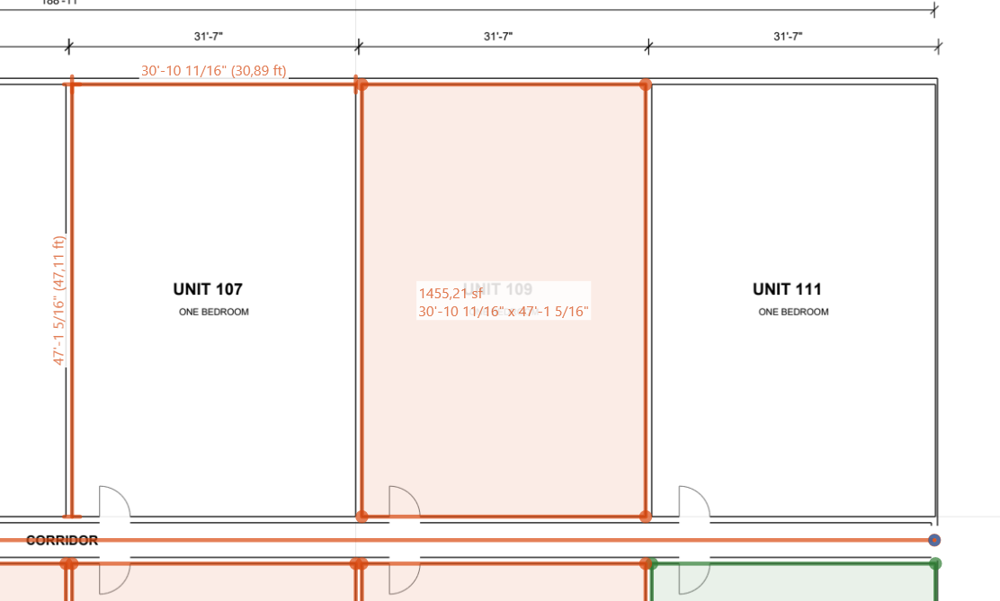
  <figcaption markdown="span">Left, distance in Box mode: UNIT 107, two sides with labels. Right, area in Box mode: width x height under the value.</figcaption>
</figure>

- **Distance in Box mode measures both sides**: two corners give two separate distances from the first corner, horizontal and vertical, and one ++ctrl+z++ step. A flat frame gives only the side it has.
- A line in Box mode is a closed rectangle around the perimeter.
- Box can be on by default in Settings: "Box: area, line, cut and size by two corners (F9)".

### Width x height on rectangles { #rectangle-sides }

A rectangular area, joists and a closed rectangular line show width x height under the value: on the sheet, in the hover box and in the info at the bottom. Any rectangle counts, whether drawn by points or brought in from another app (tolerance 1 % and about half a degree). Turned off in Settings: "Rectangular measurements: show both sides". Only the value itself is written into the PDF comment.

## Ortho: strictly horizontal or vertical (F8) { #ortho }

- ++f8++ or the Ortho button on the toolbar keeps the line strictly horizontal or vertical.
- ++shift++ does the same while held. With Ortho on, ++shift++ frees the line instead.
- Ortho can be on by default in Settings: "Ortho by default (Shift inverts)".

## Tab: take a whole drawing line { #tab }

Like edge snap in OurPlanCore: instead of clicking corners, you take a line or contour already drawn in the PDF.

<figure markdown>
  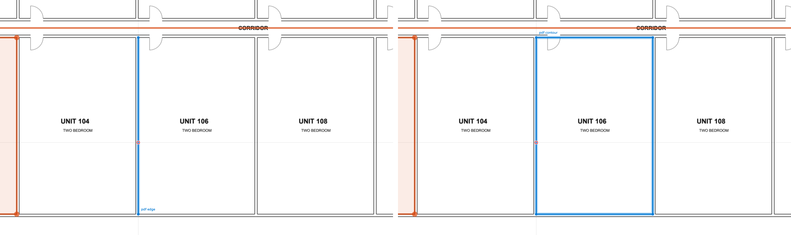
  <figcaption markdown="span">Left: one ++tab++, the edge is highlighted (`pdf edge`). Right: a second ++tab++, the closed contour of room UNIT 106 (`pdf contour`). A click gives the room area right away.</figcaption>
</figure>

1. Pick the measurement type and **do not place any points**.
2. Hover over a drawing line and press ++tab++: the **edge** (this line) highlights.
3. ++tab++ again: the **contour**, the whole chain of lines; if it closes, the **closed contour** of the room.
4. Further ++tab++ presses cycle through polylines and adjacent edges and return to regular points.
5. **A click takes** what is highlighted. ++esc++ cancels.

What you get by type:

| Type | Edge | Chain |
| --- | --- | --- |
| area, cut, joists | | a closed contour becomes an area right away (or a cut, or a joists area); an open chain places its points, then keep clicking as usual |
| perimeter | edge | the whole chain, closed back to the first point |
| distance | distance along the edge | perimeter along the chain |

Hovering another line starts again from points, as in OurPlanCore. The contour jumps over doors and small gaps in walls.

## Continue takeoff (Space) { #continue }

As in OurPlanCore: select a measurement, press ++space++ and keep drawing in it. New measurements get the same type, color, name, line width, opacity and font, for joists the joist type and spacing, and add up with it in one legend row. The takeoff row in the legend is bold. ++space++ again stops recording (an unfinished measurement is dropped), and ++space++ with nothing selected goes back to the last takeoff of this file.

## Count, P Line, Break, Ends { #count }

<figure markdown>
  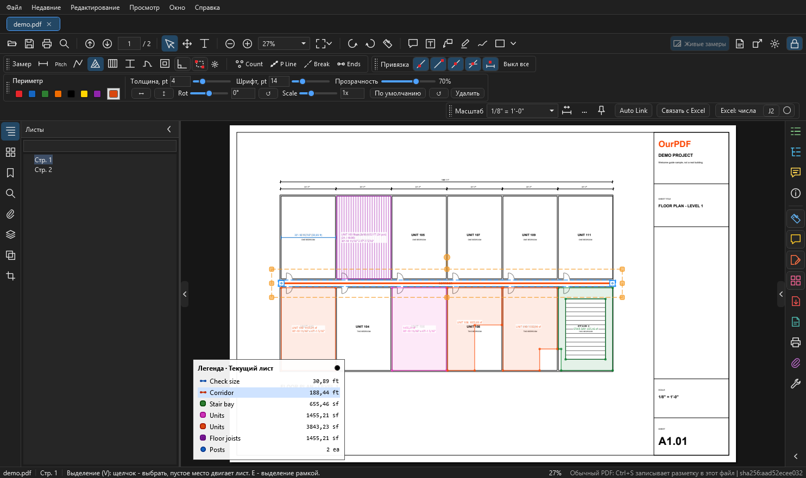
  <figcaption markdown="span">The buttons in the "Measure" block. The corridor line is selected, with two Posts count points at its ends (the Ends button). In the corner of the sheet, the pinned legend, the Corridor row selected together with the line.</figcaption>
</figure>

| Tool | How | Result |
| --- | --- | --- |
| Count (++p++) | a click on each point, ++esc++ finishes | count points, no scale needed |
| P Line | select lines, press P Line, set the name and spacing in inches | points at spacing from the start of each line; a physical spacing needs a scale |
| Break (++ctrl+shift+b++) | select a polyline | independent segments, the total length is kept |
| Ends | select lines | Count at starts and ends; coinciding ends can be merged |

P Line and Ends keep the source lines. ++ctrl+z++ undoes the creation of the whole group in one operation.

## Beam and Openings { #beam-openings }

Like ++b++ and ++o++ in OurPlanCore. The buttons sit in the "Measure" block.

| Tool | Key | How | Result |
| --- | --- | --- | --- |
| Beam | ++b++ | two clicks along the beam | a beam dimension and a Count takeoff with the order length in the name: `Beam 12` |
| Openings | ++o++ | two opposite corners of the opening | width as a dimension on top, height on the left, Count takeoff `3.0x6.8` with a mark in the middle |

- The order length in the Beam name is calculated as in OurPlanCore: up to 8 ft round up to whole feet, longer round up to even feet (10'-3" gives `Beam 12`). You can pick in Settings: whole feet or as measured.
- After two Beam clicks a window opens: name (the beginning selected), color and the "Keep a line along the beam" checkbox. If that name already exists, its color is used, and beams of one size go on one legend row. "Cancel" keeps only the dimension.
- Then the tool switches to Count of this takeoff by itself: click the other identical beams or openings, ++esc++ finishes. In Settings you can make it measure the next beam or opening right away instead.
- Openings works by two corners even with Box off.
- Beam and Openings dimensions are for reference: they show on the sheet with their length, but do not go into the legend, totals, Excel or Excel links. The Count takeoffs are what counts.
- One ++ctrl+z++ removes the whole beam or the whole opening.

## Merge, Split, Combine { #merge-split }

A takeoff here is a legend row: type, color and name.

| Command | Key | What it does |
| --- | --- | --- |
| Merge | ++ctrl+m++ | the selected measurements move into another takeoff of the same type (if several fit, a list appears) and take its color, name, line width, opacity and font. Collinear straight lines that touch become one segment, touching areas become one area |
| Split | ++ctrl+shift+m++ | the selected measurements go into a new takeoff with its own name and color |
| Combine Union | none | the selected areas become one |
| Combine Subtract | none | the first selected area minus the rest |
| Combine Intersect | none | only the common part of the areas remains |
| Combine Remove Overlap | none | removes double counting, the common part stays with the first selected |
| Combine Divide | none | each area keeps its own part, the common part becomes a new area |

- The Merge, Split and Combine buttons are in the legend header. The same commands are in the `Edit` menu, in the right-click menu on the sheet and on a legend row (then the whole takeoff is taken).
- For Combine, select two or more areas. The first selected is the main one.
- Each command is undone with one ++ctrl+z++.
- Merging of lines and areas, the merge tolerance (0.75 pt) and the new color on Split can be changed in Settings, section "Line ends, Beam, Openings, Merge".

## Joists and rafters { #joists }

<figure markdown>
  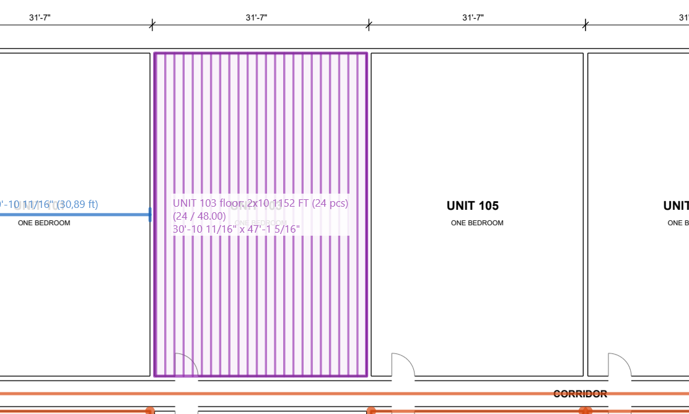
  <figcaption markdown="span">2x10 joists at 16" in UNIT 103: count, lengths and label are calculated by OurPlanCore code. Label `UNIT 103 floor: 2x10 1152 FT (24 pcs)`.</figcaption>
</figure>

What for: count and lengths of joists or rafters over an area, with the same calculation as in OurPlanCore (J Area).

### Set up new joists

1. In the "Measure" block, click the gear next to the types.
2. Fill in the "Joists / rafters: new areas" window:

| Field | What to enter |
| --- | --- |
| Type (label) | `2x10`, `11 7/8 TJI` |
| Spacing, inches (o.c.) | `16`, `19.2`, `24` |
| Pitch (rafters) | empty - flat joists; for rafters `6:12`, `6/12` or `4` (= 4:12), lengths are calculated along the slope |
| Length rounding | no rounding, up to the foot, up to the even foot, up to 2 feet |
| End joist at the far edge | checkbox |
| Detailed label | lengths by group: order, flat, along the slope |
| Length at each joist | checkbox |

### Draw the area

1. Press ++j++.
2. Trace the area by its corners and close it (or ++f9++ and two corners, or ++tab++ along the contour).
3. Place two points along the joists. ++enter++ (or right-click, "Direction along the longest side") lays the joists along the long side.
4. The joists and a label like `2x10 64 FT (8 pcs)` appear on the sheet: type, total length, count.

Double-clicking a finished area opens the same settings for it ("Joists / rafters: this area"): a label before the total and the checkbox "Set the direction again (two points along the joists)".

### Extra joists (D)

1. Select the joists area (++v++ and click).
2. Press ++d++.
3. Click inside the area: each extra joist lands along the joist direction and highlights.
4. ++shift++ and click removes the nearest extra.
5. ++d++ or ++esc++: exit.

Extras go into the total and into a separate "Extra" block in the note.

### Right-click menu of a joists area

| Item | What it does |
| --- | --- |
| Add extra joists (by clicks) | same as ++d++ |
| Remove all extra joists | deletes all extras of this area |
| Copy joists note | the label and the list of lengths with counts as text, for Excel or an email |
| Joists settings | the settings window of this area |

Rules on what to count as joists: [Joist](../work/horizontal/floor-framing/joist.md). The same tool in OurPlanCore: [J Area](../reference/ourplancore-tools.md#jarea).

## Cutout from an area { #cut }

<figure markdown>
  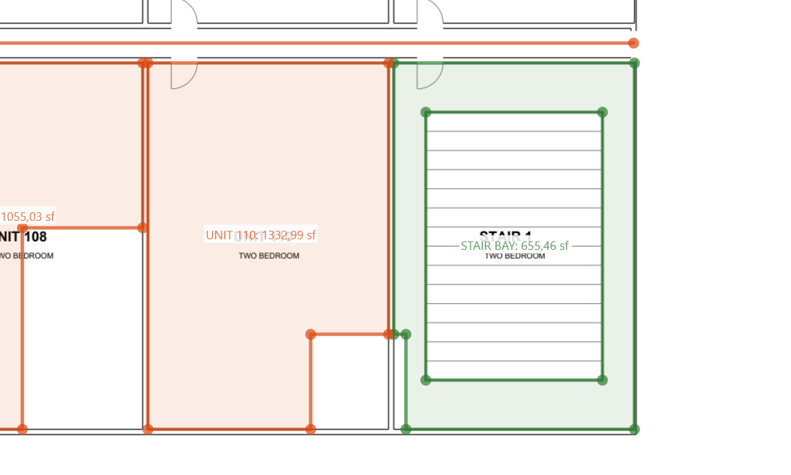
  <figcaption markdown="span">The stair is cut out of the STAIR BAY area (a hole), UNIT 110 has a corner bitten off for a closet. The values in sf are already net of the cutouts.</figcaption>
</figure>

What for: a shaft, stair, open to below inside an area; a corner that is not part of the room.

1. Turn the cut on: the cut button in the "Measure" block, ++x++ or right-click an area, "Cut from area".
2. Drag a box or click the corners (close: first point, double-click, ++enter++).
3. The result depends on where the cut goes:
    - inside the area you get a **hole**;
    - across the edge a piece is **bitten off**;
    - across the whole area it is **split in two**.
4. If areas were selected before the cut, only they are cut. Otherwise all areas and joists the cut touched are cut.
5. The mode stays on for the next cut. One ++ctrl+z++ undoes the whole cut.

Points and edges of cutouts are dragged the same way as those of the area itself. If you delete all points of a cutout, the cutout itself disappears.

**Cut from lines**: the same for lines. The part of a line inside the cut is deleted, the rest becomes separate lines with the same style, name and scale.

## Values: labels and hover { #values }

<figure markdown>
  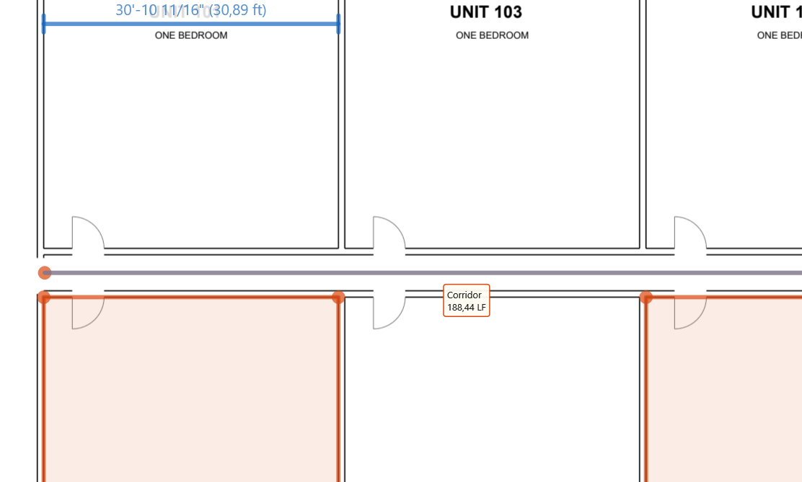
  <figcaption markdown="span">For lines, the length appears in a box by the cursor on hover ("Corridor 188,44 LF"). Over an area the box shows SF and the perimeter in LF.</figcaption>
</figure>

- An **area** is labeled at the center of the sheet area. The measurement label (for example `UNIT 102`) is written before the value: double-click the measurement or right-click, "Change markup label".
- A **distance** is a dimension line: ticks at the ends, the dimension always on the sheet.
- **Lines** (perimeter, and in a snapshot's live layer also OurPlanCore lines) show the length in LF only on hover, in a box by the cursor on top of everything.
- **Over an area**, the hover box shows SF and the perimeter in LF.
- To always label lines on the sheet: Settings, "Line lengths (LF) on the sheet" = "always labelled", or right-click with the ruler on and uncheck "Line lengths only on hover (LF)".
- Hide all value labels: right-click, "Hide measurement labels". The values stay in the list and in the info window.
- The hover box can be turned off in Settings: "Measurement value in a box by the pointer on hover".

## Measurement style: color, line width, font { #style }

The style block on the top toolbar: seven quick colors (red, blue, green, orange, black, yellow, purple), the **palette square**, line width and font in points with sliders, opacity. One slider movement equals one ++ctrl+z++ step.

- While nothing is selected, the block sets the style of **new** measurements ("Measure: style of new measurements").
- If a measurement is selected, **it** changes.
- Defaults: line width 4, font 14, opacity 70 %.
- Color: each new takeoff gets a random color not yet on this sheet, as in OurPlanCore (not gray, black or white). The color shows in the preview and in the style block before the click; a color picked in the block goes to the next measurement. Space, Beam and Openings take the color of their takeoff. To turn it off: Settings, "A new measurement gets a random color", then all new measurements are orange `#D9480F` (or the measurement color from Settings).
- The palette square opens any color: a grid, "OurPDF colours", a `#RRGGBB` box and the "More colours" button (the Windows color picker). Every color in Settings has the same square.
- The `Set default` button: select a finished measurement and press it, new measurements will have the same color, line width, font and opacity. The circular-arrow button next to it restores the factory style of new objects.

<figure markdown>
  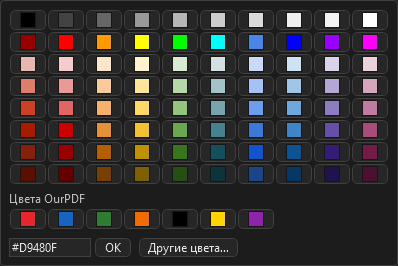{ width="400" }
  <figcaption markdown="span">The palette square: a color grid, OurPDF colors, a #RRGGBB box and the Windows color picker.</figcaption>
</figure>

Measurements are drawn as in Acrobat: circles at the ends and bends of lines, ticks on a dimension. Arrows and other ends: [Line ends](#line-ends).

## Line ends: arrows, ticks, dots { #line-ends }

The ends of lines and dimensions can be changed: for example, arrows, as in Acrobat. It is one setting for the whole app, in the Settings window.

### Where to change it

1. Open Settings: ++ctrl+comma++ or the `Edit` menu, `Settings…`.
2. Scroll to the **"Line ends, Beam, Openings, Merge"** section. It comes right after the "Measure and comments" section.
3. Pick a style in the row you need:

| Row in Settings | What it changes | Default |
| --- | --- | --- |
| Line ends (L, perimeter) | both ends of lines and perimeters (++l++) | dot |
| Line: dots at the bends | dots at every bend of a line, not only at the ends | on |
| Dimension ends (R) | both ends of a dimension (++r++), and also Beam and Openings dimensions | tick |
| End size, % (25-400) | size of the end symbols, 100 = normal size | 100 |

End styles: **dot**, **arrow, as in Acrobat**, **closed arrow**, **tick**, **square**, **diamond**, **no ends**.

4. Click `Save`. All measurements on the sheet, old and new, are redrawn with the new ends right away.

<figure markdown>
  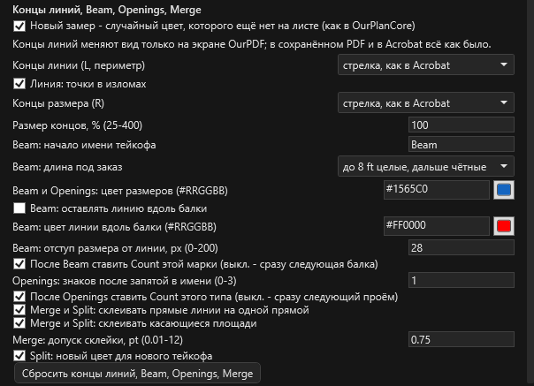{ width="600" }
  <figcaption markdown="span">The "Line ends, Beam, Openings, Merge" section in Settings. Here "arrow, as in Acrobat" is picked for lines and dimensions. The reset button is at the bottom of the section.</figcaption>
</figure>

To restore: in the same section, the `Reset line ends, Beam, Openings, Merge` button, then `Save`. The button restores the factory values of the whole section, including the Beam, Openings and Merge settings.

### What you get

| Where it is viewed | What shows |
| --- | --- |
| OurPDF on this computer | the chosen ends on all lines and dimensions |
| The PDF after ++ctrl+s++ or "Save As", opened in Acrobat or Bluebeam | ends as before: circles on lines, ticks on dimensions |
| OurPDF on another computer | the ends chosen in that computer's Settings |

<figure markdown>
  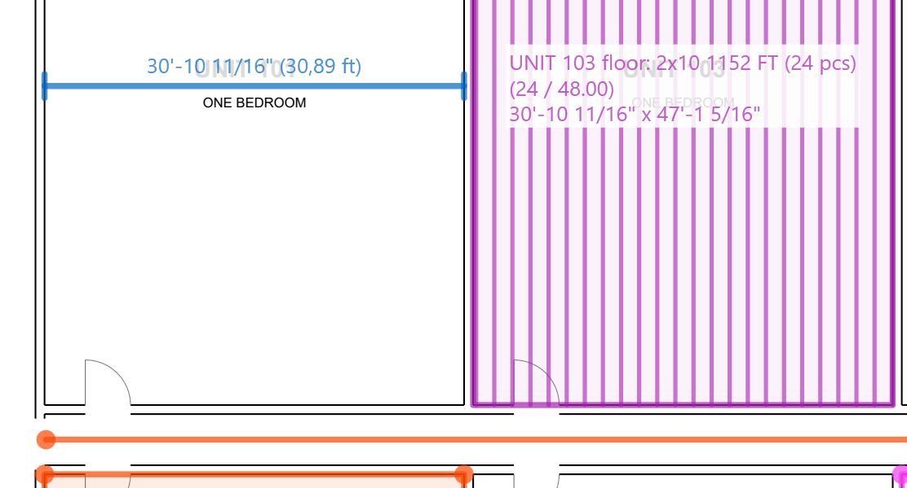
  <figcaption markdown="span">As before and as set by default: ticks on the dimension (blue), dots at the ends of the corridor line (orange).</figcaption>
</figure>

<figure markdown>
  
  <figcaption markdown="span">The same sheet after picking "arrow, as in Acrobat" for the line and the dimension. The values did not change, only the look of the ends did.</figcaption>
</figure>

- The setting changes only the look on the OurPDF screen; the PDF gets the old look. This is on purpose: a file sent to the client looks the same as before.
- Measurement values, the legend and Excel do not depend on the end style.
- The setting is stored in `%APPDATA%\OurPDF\settings.json` (section `measure_tools`, key `line_ends`). You do not need to edit this file by hand, everything is changed in the Settings window.

## Editing finished measurements { #edit }

<figure markdown>
  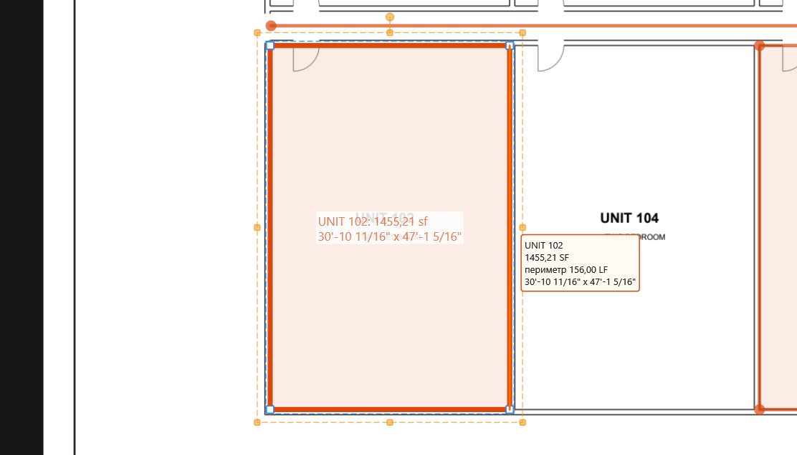
  <figcaption markdown="span">A selected area: the white squares are its points; the edge under the cursor is highlighted orange and can be dragged. Next to it, the hover box: SF and perimeter.</figcaption>
</figure>

1. Turn on **Select** (++v++, the normal mode the app opens in).
2. Click a measurement: it is selected, the line gets thicker, its points show as white squares, with an orange frame with handles around it ([Rotate and resize](#transform)). ++ctrl++ and click adds to the selection. A click on empty space moves the sheet.
3. What a click will take highlights under the cursor: the whole measurement, or for a selected one its edge (orange) or a point.
4. Edit:

| What to drag | What happens |
| --- | --- |
| a point | the value recalculates, the point snaps to drawing lines |
| an edge | both points of the edge follow the mouse, the adjacent edges stretch; ++shift++ - strictly horizontal or vertical |
| the whole measurement | drag from inside the area or with ++alt++ |

Also:

- ++delete++ with no points selected deletes the whole measurement.
- ++ctrl+c++ and ++ctrl+v++ copy and paste measurements and comments; on another sheet they are pasted in the same spot.
- Arrow keys move the selection.
- ++ctrl+z++ undoes, ++ctrl+y++ redoes. The `Edit` menu shows which action will be undone.

<figure markdown>
  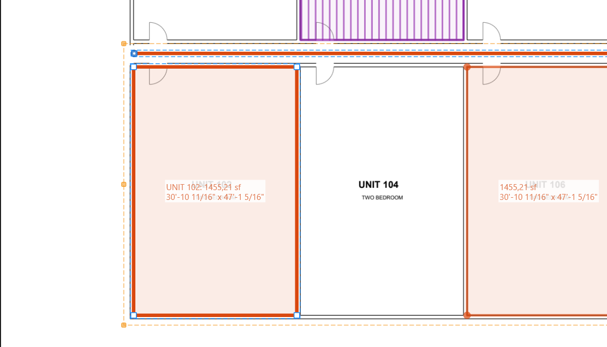
  <figcaption markdown="span">Area UNIT 102 and the corridor line are selected: thicker lines, white squares on the points, a blue dashed frame around each, an orange frame with handles outside.</figcaption>
</figure>

## Rotate, scale and Mirror { #transform }

<figure markdown>
  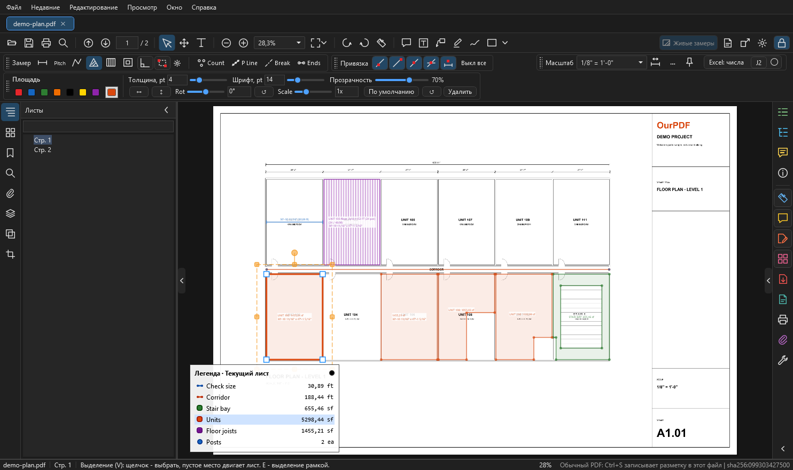
  <figcaption markdown="span">The bottom row of the style block and the orange frame around the selection.</figcaption>
</figure>

Select one or several measurements. Works only with measurements: line, area, joists, Count. A group rotates and mirrors around a common center.

| What | How |
| --- | --- |
| Rot | from -180° to 180°, with the slider or by typing the angle; ++shift++ while moving the slider: 15° steps |
| Scale | from 0.25x to 3x; you can type `1.25x` or `125%` and ++enter++. The sheet scale does not change, lengths and areas are recalculated |
| Mirror | horizontal and vertical. Cutouts, joist direction and extra joists follow the measurement |
| reset button | Rot 0 and Scale 1 for the next change, the resulting shape is kept |
| the orange frame on the sheet | corners: proportional resize; sides: width or height (++shift++ keeps proportions); round handle: rotate (++shift++ 15°); drag the border: move |

Until you release the mouse you see a preview, ++esc++ cancels it; after release ++ctrl+z++ reverts it in one step. The frame is turned off in Settings: "Measurement rotation and resize handles".

## Delete a point or an edge { #delete-points }

<figure markdown>
  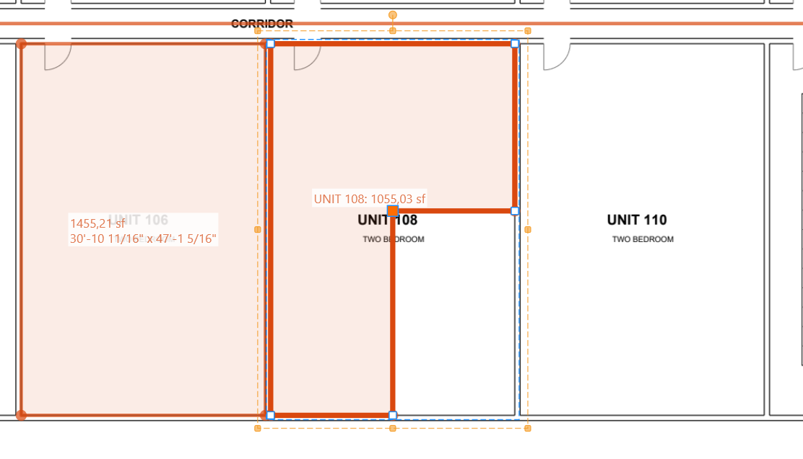
  <figcaption markdown="span">Area UNIT 108 is selected, a click on the inside corner selected that point (orange). ++delete++ removes only it, the adjacent edges join directly.</figcaption>
</figure>

1. Select the measurement (++v++, click).
2. Click one of its points: it turns orange. A click on an edge selects both its points.
3. ++ctrl++ and click adds more points or edges.
4. Press ++delete++: the selected points are deleted, not the whole measurement. The neighboring points join directly.
5. ++esc++ clears the point selection, ++ctrl+z++ brings back what was deleted.

The same via right-click on a point or edge: "Delete point", "Delete edge (its two points)", "Delete selected points (N)".

Limits: an area keeps at least 3 points, a line 2. Cutout points can be deleted too; deleting all points of a cutout removes the cutout itself.

## Frame selection (E) { #frame }

<figure markdown>
  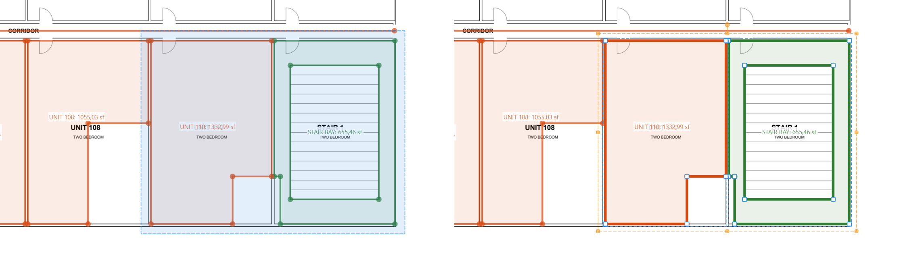
  <figcaption markdown="span">The ++e++ key: a frame over empty space. Left to right selects what is wholly inside; right to left everything the frame touches (as in OurPlanCore).</figcaption>
</figure>

1. Press ++e++: frame selection turns on.
2. Drag a frame over empty space:
    - **left to right** selects what is wholly inside;
    - **right to left** selects everything the frame touches.
3. ++ctrl++ with a frame adds to the selection. A click on empty space clears the selection.
4. Then ++delete++ deletes, dragging moves, ++ctrl+c++ copies.
5. ++v++ returns to regular selection, where empty space moves the sheet.

The middle and right mouse buttons always move the sheet, in any mode.

## Legend { #legend }

Its own tab in the right panel: the icon with green rows, the top one on the right strip. The panel shows either the legend or the takeoffs. ++f5++ collapses the panel.

<figure markdown>
  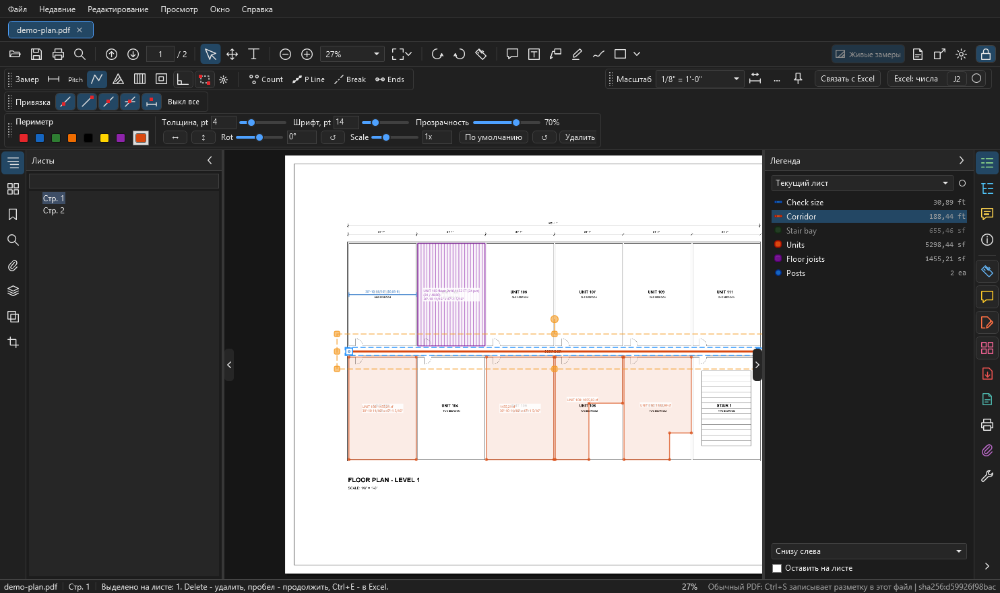
  <figcaption markdown="span">A click on the Corridor row selected the line on the sheet; the Stair bay row is hidden, the stair area left the sheet, the value stayed and dimmed.</figcaption>
</figure>

<figure markdown>
  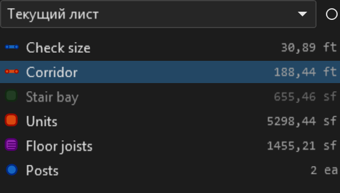{ width="360" }
  <figcaption markdown="span">Type icon in the takeoff color, name, total.</figcaption>
</figure>

<figure markdown>
  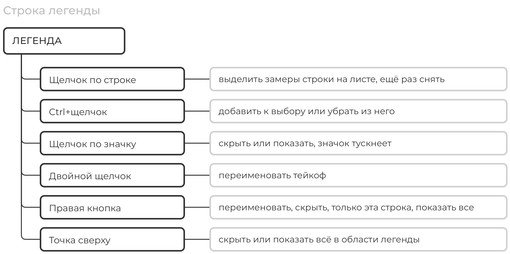
  <figcaption markdown="span">What each action does to a row.</figcaption>
</figure>

### What is in a row

- One row is one takeoff type, color and name. The scope is picked at the top: **Current sheet** or **Entire PDF**.
- **Type icon**, as in OurPlanCore: a thick line with dots for distance and line, a rounded square for area, the same with joists for joists, a dot for Count.
- **Numbers**, as in the OurPlanCore sheet legend: `ft` for lines, `sf` for areas and joists, `ea` for pieces and regular comments. Without a scale the row shows the number of segments or points. In Settings, "Numbers in the legend", you can turn on measurement units (ft-in and others).
- Each measurement is counted at its own scale if it has one, otherwise at the sheet scale. Measurements without a scale are not added to physical lengths and areas, they are listed separately.
- The drawing's own content, OurPlanCore snapshot takeoffs and crops are not part of the legend.

### What you can do

| Action | What happens |
| --- | --- |
| click a row | selects its measurements on the sheet, a second click clears them. A measurement selected on the sheet also highlights its row |
| ++ctrl++ and click | adds to or removes from the selection |
| click the icon | hides or shows the takeoff in the legend scope; the icon dims, for a partly hidden takeoff it is half light |
| the dot at the top right | hides or shows everything in the legend scope; filled while everything is shown |
| double-click | rename: type the name, ++enter++. A click outside the box also saves, ++esc++ cancels, an empty name restores the default. ++ctrl+z++ undoes, ++ctrl+s++ writes the name into the PDF |
| right-click | Rename, Hide or Show, Only this row, Show all |

If the measurements are on another sheet (the "Entire PDF" scope), a click goes to it; if they are off screen, the view moves, the zoom does not change.

### What "hidden" means { #hidden }

Hidden means removed from the screen, nothing more. It is not a ++ctrl+z++ step and not an unsaved change, the markup itself in the PDF is not rewritten.

| Where | What happens to a hidden measurement |
| --- | --- |
| on the sheet | not visible, not selectable, snapping does not catch it and cuts do not cut it. Right-click on the sheet: "Show hidden measurements" |
| in the legend | the row stays, the value is dimmed and is included in the total |
| Excel button, ++ctrl+e++, ++ctrl+t++ | not included in a legend-scope export; the status bar says how many were left out |
| [Excel link](excel-link.md) | included in the number: hiding writes nothing to the cell |
| "Save As", burned into the sheet | not burned in |
| ++ctrl+s++, "Save As" with editable markups | stays in the file; visibility is remembered in the profile and carries over to the new version of the file |
| printing | **not printed**, same as on screen |

If you answer "No" when closing the file, the visibility set after the last save is restored together with the draft.

### Keep on sheet { #pinned }

<figure markdown>
  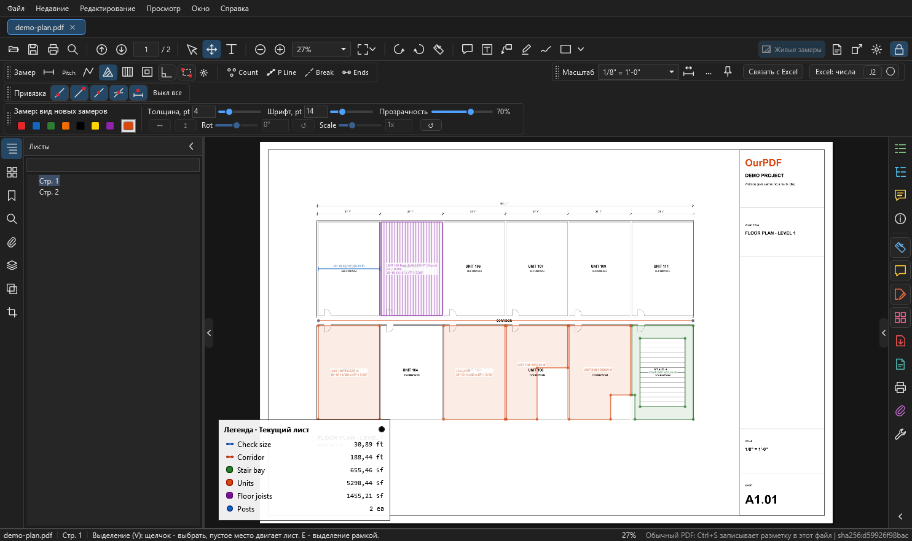
  <figcaption markdown="span">The checkbox is on, the right panel is closed: the legend sits in the corner of the sheet.</figcaption>
</figure>

The "Keep on sheet" checkbox at the bottom of the "Legend" tab. The legend stays in the corner of the sheet as a white semi-transparent panel with black text, as in OurPlanCore, in any tool. The corner is picked from a list above the checkbox, bottom left by default. Icons, the dot, clicks and the menu work there the same way as in the tab. It is an on-screen panel: it is not added to the sheet on save or print.

## Excel: paste into an open workbook { #excel }

<figure markdown>
  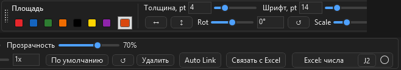
  <figcaption markdown="span">Lock open, an area selected: the style block came in with the Auto Link, "Link to Excel" and Excel buttons, the J2 toggle and the format circle. With the lock closed, the button sits in the "Scale" block.</figcaption>
</figure>

1. Open the Excel workbook and select the cell where the paste should start.
2. Go back to OurPDF and select the measurements you need. With no selection, the legend scope is exported: the current sheet or the entire PDF, without hidden items.
3. Press the Excel button, ++ctrl+e++ or ++ctrl+t++. Save the workbook in Excel: OurPDF does not save or close it.

| Command | What is written |
| --- | --- |
| ++ctrl+e++ | one column: the number |
| ++ctrl+t++ | three columns: name or color, number, unit |
| Excel button | the format is set by the circle on the right: off - numbers, on - three columns |
| joists, in any mode | exactly two columns: count and length, identical lengths are merged |

**J2** (blue means on): a length up to 8 feet inclusive rounds up to the whole foot, longer than 8 feet up to the even foot. Only on export, the geometry does not change. Off by default.

The export overwrites the values in the target cells: check the cell and the free space. No open workbook, protected or merged cells, a read-only workbook: the paste fails, and the status bar says why.

To keep a legend row number in a cell and have it update by itself: [Excel link](excel-link.md). The whole DFL in one click: [Auto Link](excel-link.md#auto-link).

## Measurement list and a separate Excel file { #list }

<figure markdown>
  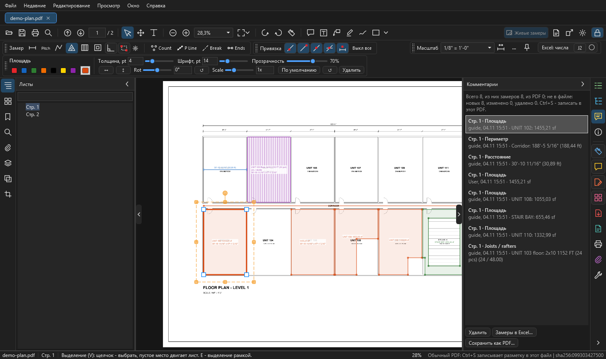
  <figcaption markdown="span">The "Comments" tab: all measurements and markups with their values. At the top, a summary: how many measurements, how many from the PDF and what is not yet written to the file. At the bottom, the `Delete`, `Measurements to Excel...`, `Save as PDF...` buttons.</figcaption>
</figure>

1. Open the **"Comments"** tab on the right strip.
2. At the top, a summary: "N in all, N of them measurements, N from the PDF; not in the file: new, edited, deleted. Ctrl+S writes into this PDF".
3. Each row: page, type, author, time, label and value. A click on a row shows the measurement on the sheet.
4. **"Measurements to Excel..."** saves the workbook `<PDF name> - measurements.xlsx`, worksheet "Measurements", one row per measurement.

Excel columns: `Sheet`, `Page`, `Type`, `Value`, `Unit`, `Label`, `Caption`, `Scale`, `Scale source`, `Points`, `Author`, `Created`.

The same from the menu: `File > Export measurement markup to Excel`, right-click with the ruler on, or `Export PDF > Measurements to Excel` on the right strip. If there are no measurements, the status bar suggests enabling measurement markup and measuring something.

## Right-click menu { #context-menu }

With the ruler on (the Measure tool):

| Item | What it does |
| --- | --- |
| Complete measurement, Cancel measurement | while a measurement is being drawn |
| Direction along the longest side, Cancel joists | at the joist direction step |
| Change scale and precision | the "Scale and precision" window |
| Change markup label | the label of the selected measurement |
| Show hidden measurements (N) | when there are items hidden in the legend |
| Enable / Disable measurement markup | off: only the last measurement stays on the sheet and it is not saved |
| Enable / Disable ortho | like ++f8++ |
| Box: by two corners of a rectangle | like ++f9++ |
| Hide / Show measurement labels on the sheet | values on the sheet |
| Line lengths only on hover (LF) | or always on the sheet |
| Cut from area | like ++x++ |
| Hide / Show rulers | rulers along the sheet edges |
| Snap to page content | snapping on and off as a whole |
| Snap to OurPDF objects and measurements (F3) | snapping to measurements, like ++f3++ |
| Snap to PDF lines (Ctrl+F3) | snapping to drawing lines, like ++ctrl+f3++ |
| Export measurement markup to Excel | like the "Measurements to Excel" button |
| Preferences | the Settings window |
| Hide measurement info window, Hide the "Measure" toolbar | the info on the bottom bar and the second toolbar row (same as the lock) |

On a selected measurement (the Select tool): delete the point or edge under the cursor, cut from area, edit text, delete, undo, hide measurement labels, write markups into this PDF.

At the bottom of any right-click menu: zoom 25 % - 400 %, "Actual size" (100 % = sheet size, as in Acrobat), fit page, fit width, fit content.

## Measurements from Acrobat, Bluebeam and other apps { #from-pdf }

- Markups already in the PDF become OurPDF markups on open: Acrobat, Bluebeam, Nitro measurements at their scale, pencil, text and callouts, shapes, clouds, polylines. You can select, move, edit and delete them; the values are recalculated and match what that app showed.
- A measurement made at a different scale on the same sheet keeps its scale.
- Strikeouts, stamps, links, replies and hidden annotations stay as the PDF draws them. Exception: the OurPDF crop stamp ([Crop](crop.md#pdf)).
- To turn off importing: Settings, "Accept markups from the PDF on open".
- After ++ctrl+s++, Acrobat redraws measurements from their properties by itself, so OurPDF writes them so that our look shows there too: color, line width, opacity, dots at the ends, area without a solid fill. Measurements written earlier the old way (the area in Acrobat was filled solid) are rewritten in the new form on the next ++ctrl+s++ of that file.
- Area cutouts are saved in the file and come back into OurPDF; in Acrobat the area shows as an outline.

## If something is wrong { #troubleshooting }

| What you see | Why and what to do |
| --- | --- |
| values in inches "on paper" | the sheet has no scale: set it ([Scale](#scale)) |
| the dimension does not match the dimension string | wrong scale or the sheet was printed not to scale: calibrate on a known dimension |
| the cursor does not snap to a line | a snap type or all snapping is off ("Snap to page content"), or the line is on a hidden layer |
| ++tab++ takes nothing | a point is already placed: Tab works before the first point; or the cursor is not on a drawing line (scans have no lines) |
| a line shows no length | line lengths show on hover; you can always label them in Settings |
| the cut cut the wrong area | with no selection, all areas under the cut are cut: select the ones you need first, ++ctrl+z++ undoes the whole cut |
| ++delete++ deleted the whole measurement | no points were selected: click a point or edge first |
| measurements are not visible in Acrobat or in print | they are still in the OurPDF profile: press ++ctrl+s++ ([Saving](comments-save.md#save)) |
| not all measurements in Excel | with no selection, the legend scope goes out without hidden items: check the scope and the icons |
| the blocks are not visible | the lock is open: press the ruler or close the lock ([Lock](window.md#lock)) |

## See also

- [The app window](window.md)
- [Excel link](excel-link.md)
- [Comments and saving](comments-save.md)
- [Keyboard shortcuts](shortcuts.md): all keys and differences from OurPlanCore
- [OurPlanCore measuring tools](../reference/ourplancore-tools.md), [OurPlanCore editing and snapping](../reference/ourplancore-editing.md)
- What to measure: [SQFT 1st-5th Floors](../work/sqfts/1st2nd.md), [Joist](../work/horizontal/floor-framing/joist.md), [Exterior](../work/vertical/walls/exterior.md)
