# Измерения

Главная часть OurPDF. Замеры как в Acrobat (расстояние, периметр, площадь) плюс то, к чему привыкли в OurPlanCore: клавиши `R`, `L`, `A`, `J`, `X`, `C`, режимы Орто и Box, Tab по линии чертежа, вырезы, joists и extra joists, сдвиг граней, выделение рамкой, длины в LF при наведении. Здесь по шагам: масштаб, блоки панели, каждый вид замера, правка, удаление точек, легенда, список и Excel.

<figure markdown>
  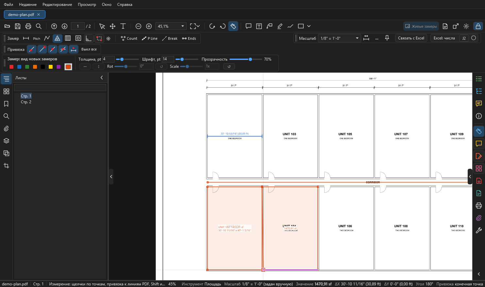
  <figcaption markdown="span">Включено измерение площади. Комната UNIT 102 уже измерена: под значением в sf её ширина и высота. UNIT 104 обводится сейчас, через курсор идут направляющие, внизу сведения об измерениях.</figcaption>
</figure>

## Коротко { #summary }

| Задача | Клавиша | Как | Что получится |
| --- | --- | --- | --- |
| включить измерение | ++ctrl+shift+m++ | кнопка-линейка на панели или справа на полосе; ещё раз выключает | блоки верхней панели ([замок](window.md#lock)) |
| размер между двумя точками | ++r++ | два щелчка | длина `12'-6" (12.50 ft)` |
| длина стены, ломаная | ++l++ | щелчки по точкам, ++c++, ++enter++ или двойной щелчок | длина ломаной в LF |
| площадь комнаты | ++a++ | щелчки по углам, замкнуть | SF по центру площади |
| joists / rafters | ++j++ | обвести площадь, две точки вдоль балок | штуки и длины расчётом OurPlanCore |
| вырез из площади | ++x++ | рамка или многоугольник поверх площади | дырка, откус или деление |
| прямоугольник двумя углами | ++f9++ | режим Box для площади, линии, joists, выреза | замер по двум углам |
| обе стороны комнаты | ++r++ и ++f9++ | два угла | два расстояния сразу |
| штуки | ++p++ | щелчок на каждую | Count, строка в `ea` |
| строго по горизонтали или вертикали | ++f8++ | режим Орто; ++shift++ временно | ровная линия |
| взять линию чертежа целиком | ++tab++ | навести на линию до первой точки | грань, потом контур |

Beam и Openings в OurPDF нет: это инструменты OurPlanCore.

## Масштаб и калибровка { #scale }

Без масштаба значения пишутся в дюймах на бумаге. Масштаб хранится у каждого листа отдельно и влияет только на замеры OurPDF: такеоффы OurPlanCore он не меняет.

### Выбрать или ввести масштаб

1. Включите измерение: ++ctrl+shift+m++ или кнопка-линейка.
2. В блоке "Масштаб" во второй линии панели выберите значение из списка:
    - архитектурные `1/32" = 1'-0"` до `3" = 1'-0"`;
    - инженерные `1" = 10'` до `1" = 200'`;
    - метрические `1:1` до `1:1000`.
3. Или впишите свой: `1/8" = 1'-0"`, `1" = 20'`, `1:100`, `1 in = 8 ft` и нажмите ++enter++.
4. Откуда масштаб ("задан вручную", "по калибровке", "из PDF", "из OurPlanCore"), видно в сведениях об измерениях в нижней строке.

Масштаб берите из штампа или подписи под видом (`SCALE: 1/8" = 1'-0"`), потом проверьте его одним замером по размерной цепочке.

### Калибровать по известному размеру

Нужно, когда масштаб на листе не указан или лист распечатан не в масштабе.

1. Нажмите кнопку калибровки справа от поля масштаба.
2. Щёлкните начало и конец отрезка известной длины, например размерной линии.
3. В окне "Калибровка масштаба" введите реальную длину: `12'-6"`, `25'`, `3.5 m`.
4. В строке состояния появится "Масштаб листа по калибровке: ...".

### Запомнить масштаб в листе { #keep-scale }

Кнопка с булавкой рядом с полем масштаба (или правая кнопка при линейке, "Записать масштаб в лист PDF") записывает масштаб в сам PDF, как это делает Acrobat: в лист добавляется видовое окно с масштабом. Это та же запись, что ++ctrl+s++, с резервной копией прежнего файла. После этого файл открывается с этим масштабом в OurPDF, Acrobat и Bluebeam, на любом компьютере. ++ctrl+s++ записывает заданный масштаб листа и сам, вместе с замерами.

### Масштаб и точность для всех листов

Кнопка `...` рядом с полем открывает окно "Масштаб и точность" (то же в меню правой кнопки при линейке: "Изменить масштаб и точность").

| Поле | Варианты |
| --- | --- |
| Масштаб листа | список или свой текст; у снимков OurPlanCore есть пункт "Как в OurPlanCore" |
| Единицы | футы-дюймы (`12'-6"`), футы (`12.50 ft`), дюймы, метры, сантиметры, миллиметры |
| Точность | знаменатель дюйма для ft-in или знаки после запятой |
| Применить | к этому листу или ко всем листам документа |

Замер, принятый из PDF другой программы, сохраняет свой масштаб, как в Acrobat. У снимков проектов OurPlanCore масштаб по умолчанию берётся из OurPlanCore.

## Блоки верхней панели { #panel }

Карточки "Измерение" больше нет: кнопки стоят блоками в двух линиях под меню. Как они устроены, как их переставить и что делает замок: [Верхняя панель](window.md#top-panel).

| Блок | Кнопки |
| --- | --- |
| Замер | расстояние (++r++), Pitch, периметр или линия (++l++), площадь (++a++), joists (++j++), вырез (++x++); режимы Орто (++f8++) и Box (++f9++); шестерёнка joists: тип, шаг и уклон новых балок; Count (++p++), P Line, Break, Ends |
| Привязка | к контурам (любая точка линии), к конечным точкам, к средним точкам, к пересечениям, к объектам и замерам OurPDF; "Выкл все" и "Вкл все" |
| Вид замеров | цвета, палитра, толщина, шрифт, прозрачность; Rot, Scale, Mirror |
| Масштаб | поле со списком, калибровка, `...` (масштаб и точность), булавка; кнопка Excel, J2, круг формата |

Внизу, в строке состояния, **"Сведения об измерениях"**: инструмент, масштаб и откуда он взят, значение, ΔX, ΔY, угол, тип привязки.

## Привязки { #snap }

- Курсор цепляется к линиям чертежа. Пока точка привязана, линия подсвечивается фиолетовым, а значок у курсора показывает тип привязки.
- Типы включаются и выключаются кнопками блока "Привязка". Все сразу: кнопка "Выкл все" (и "Вкл все"). Привязка к чертежу целиком: правая кнопка, "Привязать к содержимому страницы".
- Содержимое [наложения](overlay.md) привязка не ловит.
- Радиус привязки задаётся в Настройках: "Радиус привязки, px", по умолчанию 10 (от 2 до 40).
- К линиям скрытых слоёв PDF привязка не цепляется ([Слои](pages-edit.md#layers)).
- Через курсор при измерении идут тонкие горизонтальная и вертикальная **направляющие**, как в OurPlanCore. Выключаются в Настройках: "Направляющие у курсора при измерении".

## Расстояние: размер между двумя точками { #distance }

Зачем: проверить масштаб, снять размер, который не подписан на чертеже.

1. Нажмите ++r++ (или кнопку "Расстояние" в панели).
2. Щёлкните начало и конец.
3. Замер готов сразу после второго щелчка. Длина пишется как `12'-6"` и в скобках футы.

Расстояние рисуется размерной линией, как Ruler в OurPlanCore: засечки поперёк концов, а размер всегда подписан на листе (у периметра длина видна при наведении).

## Pitch: уклон по двум точкам { #pitch }

Кнопка Pitch в блоке "Замер". Два щелчка вдоль ската на фасаде или разрезе. Масштаб не нужен, для наклонной линии выключите Орто (++f8++). Подпись: уклон и угол, например `6:12 (26.57°)`. Перемещение концов пересчитывает подпись.

## Линия и периметр: длина по точкам { #line }

Зачем: длина стены, ломаной, периметр комнаты в LF.

1. Нажмите ++l++ (кнопка "Периметр").
2. Щёлкайте по точкам по оси стены, угол за углом.
3. Закончите: ++c++ (как в OurPlanCore), ++enter++ или двойной щелчок.
4. ++backspace++ убирает последнюю точку, ++esc++ отменяет весь замер.

Для прямоугольного периметра включите Box (++f9++): линия в Box рисуется двумя углами и получается замкнутым прямоугольником по периметру.

## Площадь: комната, этаж, балкон { #area }

Зачем: SF комнаты, этажа, балкона.

1. Нажмите ++a++ (кнопка "Площадь").
2. Щёлкайте по углам контура.
3. Замкните: щелчок по первой точке, двойной щелчок, ++enter++ или ++c++.
4. Значение в sf появится по центру площади, за вычетом вырезов. У прямоугольника под значением ширина x высота.
5. Чтобы подписать комнату, дважды щёлкните по замеру и введите подпись (`UNIT 102`): она пишется перед значением.

Быстрее: прямоугольник через Box (++f9++, два угла) или замкнутый контур комнаты через ++tab++ ([Tab](#tab)).

## Box: прямоугольник двумя углами (F9) { #box }

Как в OurPlanCore. Режим действует на расстояние, площадь, линию, joists и вырез.

1. Нажмите ++f9++ или кнопку Box в панели.
2. Выберите тип (++r++, ++a++, ++l++, ++j++ или ++x++).
3. Щёлкните первый угол: прямоугольник тянется за курсором.
4. Щёлкните противоположный угол.
5. Ещё раз ++f9++ возвращает рисование по точкам.

<figure markdown>
  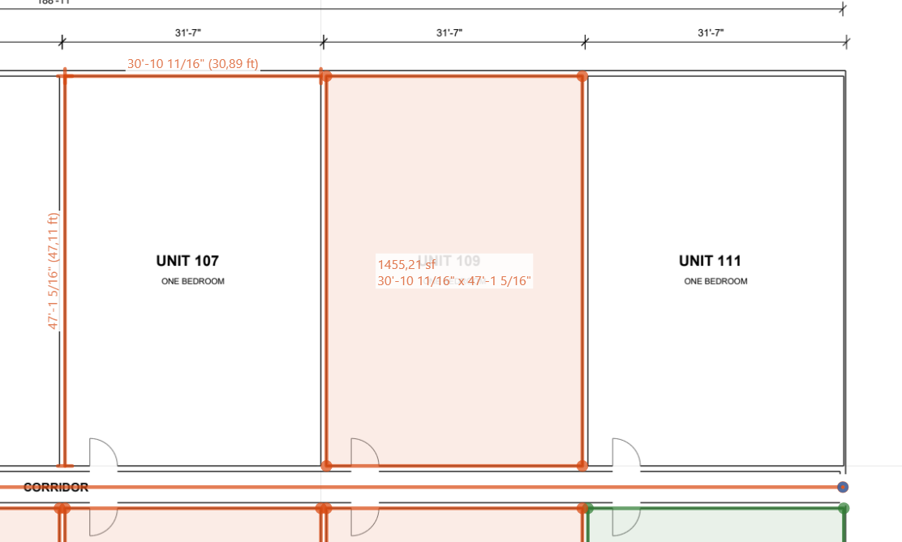
  <figcaption markdown="span">Слева расстояние в Box: UNIT 107, две стороны с подписями. Справа площадь в Box: под значением ширина x высота.</figcaption>
</figure>

- **Расстояние в Box меряет обе стороны**: два угла дают два отдельных расстояния от первого угла, горизонтальное и вертикальное, и один шаг ++ctrl+z++. Плоская рамка даёт только ту сторону, которая у неё есть.
- Линия в Box - замкнутый прямоугольник по периметру.
- Box можно включить по умолчанию в Настройках: "Box: площадь, линия, вырез и размер двумя углами (F9)".

### Ширина x высота у прямоугольников { #rectangle-sides }

Прямоугольная площадь, joists и замкнутая прямоугольная линия показывают ширину x высоту под значением: на листе, в рамке при наведении и в сведениях внизу. Считается любой прямоугольник, нарисованный по точкам или пришедший из другой программы (допуск 1 % и около полуградуса). Выключается в Настройках: "Прямоугольные замеры: показывать обе стороны". В комментарии PDF записывается только само значение.

## Орто: строго по горизонтали или вертикали (F8) { #ortho }

- ++f8++ или кнопка Орто в панели ведёт линию строго по горизонтали или вертикали.
- ++shift++ делает то же на время, пока зажат. При включённом Орто ++shift++, наоборот, отпускает линию.
- Орто можно включить по умолчанию в Настройках: "Орто по умолчанию (Shift инвертирует)".

## Tab: взять линию чертежа целиком { #tab }

Как edge snap в OurPlanCore: вместо щелчков по углам берёте линию или контур, уже нарисованный в PDF.

<figure markdown>
  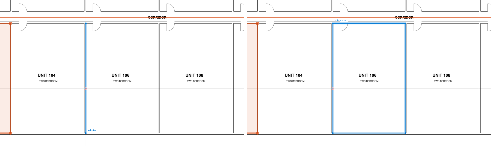
  <figcaption markdown="span">Слева: один ++tab++, подсвечена грань (`pdf edge`). Справа: второй ++tab++, замкнутый контур комнаты UNIT 106 (`pdf contour`). Щелчок сразу даёт площадь комнаты.</figcaption>
</figure>

1. Выберите тип замера и **не ставьте ни одной точки**.
2. Наведите курсор на линию чертежа и нажмите ++tab++: подсветится **грань** (эта линия).
3. Ещё раз ++tab++: **контур**, вся цепочка линий; если она замыкается, то **замкнутый контур** комнаты.
4. Дальше ++tab++ перебирает полилинии и соседние грани и возвращается к обычным точкам.
5. **Щелчок берёт** то, что подсвечено. ++esc++ отменяет.

Что получается по типам:

| Тип | Грань | Цепочка |
| --- | --- | --- |
| площадь, вырез, joists | | замкнутый контур сразу становится площадью (или вырезом, или зоной joists); открытая цепочка ставит свои точки, дальше щёлкайте как обычно |
| периметр | грань | вся цепочка, замкнутая с возвратом в первую точку |
| расстояние | расстояние по грани | периметр по цепочке |

Наведение на другую линию начинает снова с точек, как в OurPlanCore. Двери и небольшие разрывы в стенах контур перепрыгивает.

## Продолжить тейкоф (пробел) { #continue }

Как в OurPlanCore: выберите замер, нажмите ++space++ и рисуйте дальше в нём. Новые замеры получают тот же тип, цвет, имя, толщину, прозрачность и шрифт, у joists тип и шаг балок, и складываются с ним в одну строку легенды. Строка тейкофа в легенде выделена жирным. Ещё раз ++space++ останавливает запись (недорисованный замер сбрасывается), а ++space++ без выбора возвращает к последнему тейкофу этого файла.

## Count, P Line, Break, Ends { #count }

<figure markdown>
  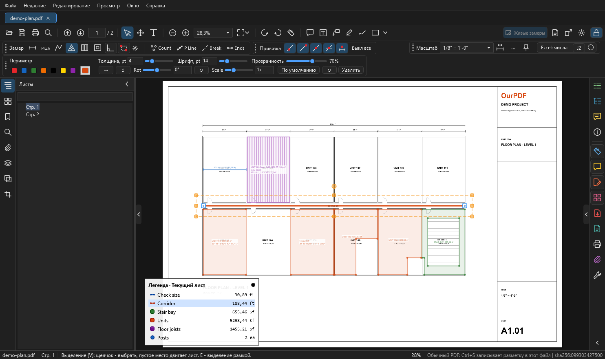
  <figcaption markdown="span">Кнопки в блоке "Замер". Выбрана линия коридора, на её концах две счётные точки Posts (кнопка Ends). В углу листа закреплённая легенда, строка Corridor выделена вместе с линией.</figcaption>
</figure>

| Инструмент | Как | Что получится |
| --- | --- | --- |
| Count (++p++) | щелчок на каждую точку, ++esc++ заканчивает | счётные точки, масштаб не нужен |
| P Line | выделите линии, нажмите P Line, задайте название и шаг в дюймах | точки с шагом от начала каждой линии; для физического шага нужен масштаб |
| Break (++ctrl+shift+b++) | выделите ломаную | независимые отрезки, общая длина сохраняется |
| Ends | выделите линии | Count на началах и концах; совпадающие концы можно объединить |

P Line и Ends сохраняют исходные линии. ++ctrl+z++ отменяет создание всей группы одной операцией.

## Joists и rafters { #joists }

<figure markdown>
  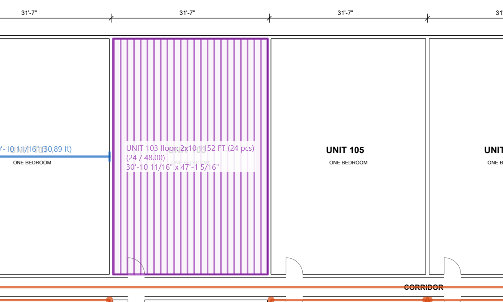
  <figcaption markdown="span">Балки 2x10 через 16" в UNIT 103: количество, длины и подпись считает код OurPlanCore. Подпись `UNIT 103 floor: 2x10 1152 FT (24 pcs)`.</figcaption>
</figure>

Зачем: штуки и длины joists или rafters по зоне, тем же расчётом, что в OurPlanCore (J Area).

### Настроить новые балки

1. В блоке "Замер" нажмите шестерёнку рядом с типами.
2. Заполните окно "Joists / rafters: новые площади":

| Поле | Что писать |
| --- | --- |
| Тип (подпись) | `2x10`, `11 7/8 TJI` |
| Шаг, дюймы (o.c.) | `16`, `19.2`, `24` |
| Уклон (rafters) | пусто - плоские joists; для rafters `6:12`, `6/12` или `4` (= 4:12), длины считаются по скату |
| Округление длины | без округления, вверх до фута, вверх до чётного фута, вверх до 2 футов |
| Крайняя балка у дальнего края | галка |
| Подробная подпись | длины по группам: заказ, без уклона, по уклону |
| Длина у каждой балки | галка |

### Нарисовать зону

1. Нажмите ++j++.
2. Обведите площадь по углам и замкните (или ++f9++ и два угла, или ++tab++ по контуру).
3. Поставьте две точки вдоль балок. ++enter++ (или правая кнопка, "Направление вдоль длинной стороны") кладёт балки вдоль длинной стороны.
4. На листе появятся балки и подпись вида `2x10 64 FT (8 pcs)`: тип, общая длина, штуки.

Двойной щелчок по готовой зоне открывает те же настройки для неё ("Joists / rafters: эта площадь"): подпись перед итогом и галка "Задать направление заново (две точки вдоль балок)".

### Extra joists (D)

1. Выделите зону joists (++v++ и щелчок).
2. Нажмите ++d++.
3. Щёлкайте внутри зоны: каждая лишняя балка встаёт по направлению joists и подсвечивается.
4. ++shift++ и щелчок убирает ближайшую extra.
5. ++d++ или ++esc++: выход.

Extra идут в итог и отдельным блоком "Extra" в ноте.

### Меню правой кнопки у зоны joists

| Пункт | Что делает |
| --- | --- |
| Добавить extra joists (щелчками) | то же, что ++d++ |
| Убрать все extra joists | удаляет все extra этой зоны |
| Копировать ноту joists | подпись и список длин со штуками текстом, для Excel или письма |
| Настройки joists | окно настроек этой зоны |

Правила, что считать joists: [Joist](../work/horizontal/floor-framing/joist.md). Тот же инструмент в OurPlanCore: [J Area](../reference/ourplancore-tools.md#jarea).

## Вырез из площади { #cut }

<figure markdown>
  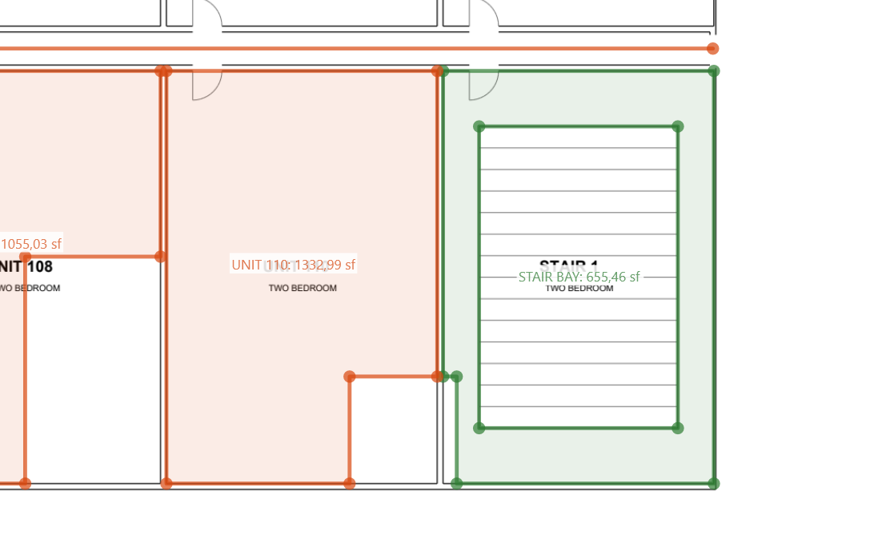
  <figcaption markdown="span">Лестница вырезана из площади STAIR BAY (дырка), у UNIT 110 откушен угол под кладовку. Значения в sf уже за вычетом вырезов.</figcaption>
</figure>

Зачем: шахта, лестница, open to below внутри площади; угол, который не входит в комнату.

1. Включите вырез: кнопка выреза в блоке "Замер", ++x++ или правая кнопка по площади, "Вырез из площади".
2. Протяните рамку или щёлкайте по углам (замкнуть: первая точка, двойной щелчок, ++enter++).
3. Результат зависит от того, где прошёл вырез:
    - внутри площади получается **дырка**;
    - через край кусок **откусывается**;
    - поперёк всей площади она **делится на две**.
4. Если перед вырезом площади были выбраны, режутся только они. Иначе режутся все площади и joists, которых коснулся вырез.
5. Режим остаётся включённым для следующего выреза. Один ++ctrl+z++ отменяет весь вырез.

Точки и грани вырезов тянутся так же, как у самой площади. Если удалить все точки выреза, пропадёт сам вырез.

**Вырез из линий**: то же для линий. Часть линии внутри выреза удаляется, остатки становятся отдельными линиями с прежними стилем, названием и масштабом.

## Значения: подписи и наведение { #values }

<figure markdown>
  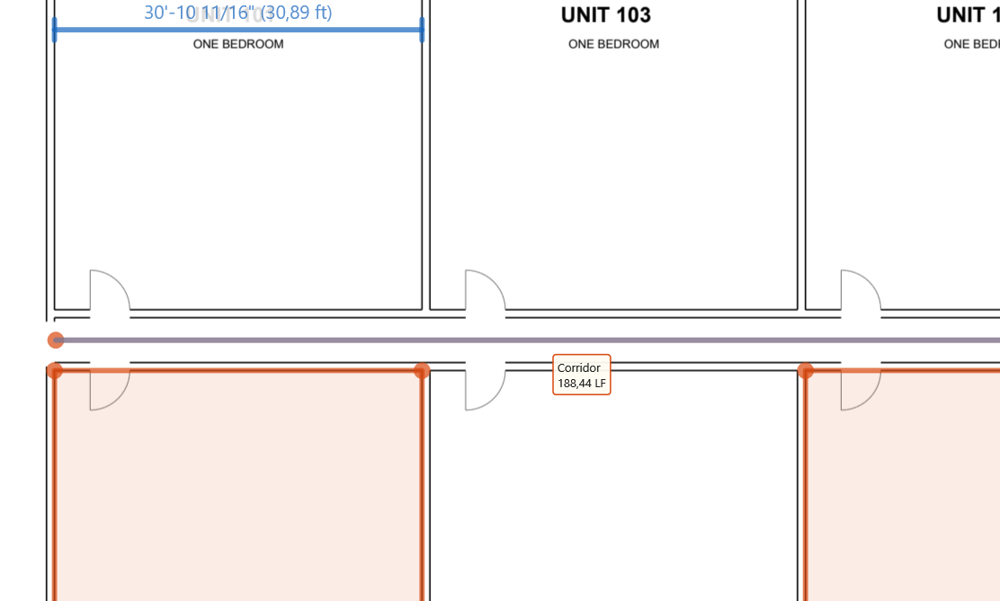
  <figcaption markdown="span">У линий длина появляется в рамке у курсора при наведении ("Corridor 188,44 LF"). Над площадью рамка показывает SF и периметр в LF.</figcaption>
</figure>

- **Площадь** подписана на листе по центру. Подпись замера (например `UNIT 102`) пишется перед значением: двойной щелчок по замеру или правая кнопка, "Изменить разметку ярлыка".
- **Расстояние** - размерная линия: засечки на концах, размер всегда на листе.
- **Линии** (периметр, а в живом слое снимка и линии OurPlanCore) показывают длину в LF только при наведении, рамкой у курсора поверх всего.
- **Над площадью** рамка при наведении показывает SF и периметр в LF.
- Подписать линии на листе всегда: Настройки, "Длины линий (LF) на листе" = "всегда подписаны", или правая кнопка при линейке, снять галку "Длины линий только при наведении (LF)".
- Скрыть все подписи значений: правая кнопка, "Скрыть подписи замеров". Значения останутся в списке и в окне сведений.
- Рамку при наведении можно выключить в Настройках: "Значение замера в рамке у курсора при наведении".

## Вид замеров: цвет, толщина, шрифт { #style }

Блок вида в верхней панели: семь быстрых цветов (красный, синий, зелёный, оранжевый, чёрный, жёлтый, фиолетовый), **квадратик палитры**, толщина и шрифт в пунктах с ползунками, прозрачность. Одно движение ползунка равно одному шагу ++ctrl+z++.

- Пока ничего не выбрано, блок задаёт вид **новых** замеров ("Замер: вид новых замеров").
- Если выбран замер, меняется **он сам**.
- По умолчанию у всех замеров, площадей тоже: цвет оранжевый `#D9480F`, толщина 4, шрифт 14, прозрачность 70 %.
- Квадратик палитры открывает любой цвет: сетка, "Цвета OurPDF", поле `#RRGGBB` и кнопка "Другие цвета" (окно цветов Windows). Такой же квадратик есть у каждого цвета в Настройках.
- Кнопка `По умолчанию`: выберите готовый замер и нажмите, новые замеры будут с таким же цветом, толщиной, шрифтом и прозрачностью. Кнопка с круговой стрелкой рядом возвращает заводской вид новых объектов.

<figure markdown>
  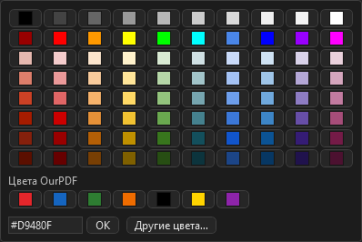{ width="400" }
  <figcaption markdown="span">Палитра квадратика: сетка цветов, цвета OurPDF, поле #RRGGBB и окно цветов Windows.</figcaption>
</figure>

Замеры рисуются как в Acrobat, но без стрелок: на концах и в вершинах кружки.

## Правка готовых замеров { #edit }

<figure markdown>
  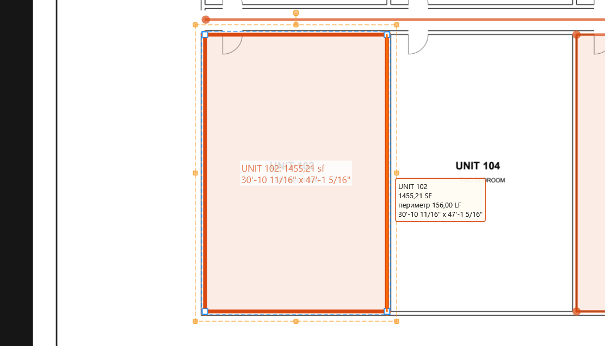
  <figcaption markdown="span">Выбранная площадь: белые квадратики - её точки; грань под курсором подсвечена оранжевым, её можно тянуть. Рядом рамка наведения: SF и периметр.</figcaption>
</figure>

1. Включите **Выделение** (++v++, обычный режим, в нём программа открывается).
2. Щёлкните по замеру: он выбран, линия становится толще, его точки показаны белыми квадратиками, вокруг оранжевая рамка с ручками ([Поворот и размер](#transform)). ++ctrl++ и щелчок добавляет к выбору. Щелчок по пустому месту двигает лист.
3. Под курсором подсвечивается то, что возьмёт щелчок: весь замер, у выбранного его грань (оранжевым) или точка.
4. Правьте:

| Что тянуть | Что происходит |
| --- | --- |
| точку | значение пересчитывается, точка цепляется к линиям чертежа |
| грань | обе точки грани идут за мышью, соседние грани тянутся; ++shift++ - строго по горизонтали или вертикали |
| весь замер | тянуть изнутри площади или с ++alt++ |

Ещё:

- ++delete++ без выбранных точек удаляет весь замер.
- ++ctrl+c++ и ++ctrl+v++ копируют и вставляют замеры и комментарии; на другой лист вставка идёт в то же место.
- Стрелки сдвигают выбранное.
- ++ctrl+z++ отменяет, ++ctrl+y++ повторяет. Меню `Редактирование` показывает, какое действие отменится.

<figure markdown>
  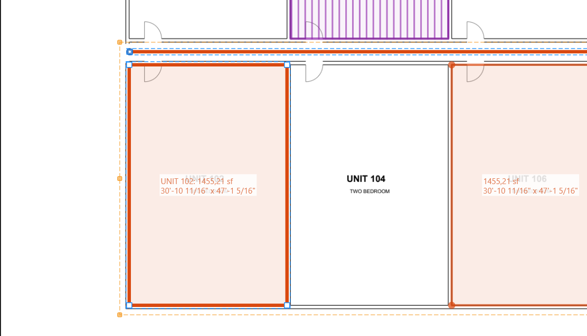
  <figcaption markdown="span">Выбраны площадь UNIT 102 и линия коридора: линии толще, белые квадратики на точках, вокруг оранжевая рамка.</figcaption>
</figure>

## Поворот, масштаб и Mirror { #transform }

<figure markdown>
  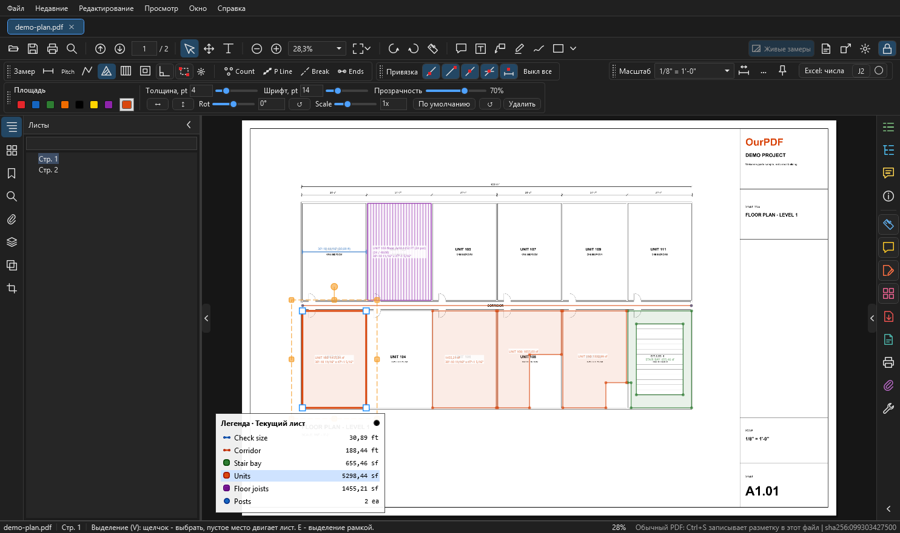
  <figcaption markdown="span">Нижний ряд блока вида и оранжевая рамка вокруг выделения.</figcaption>
</figure>

Выделите один замер или несколько. Работает только с замерами: линия, площадь, joists, Count. Группа поворачивается и отражается вокруг общего центра.

| Что | Как |
| --- | --- |
| Rot | от -180° до 180°, ползунком или вводом угла; ++shift++ при движении ползунка: шаг 15° |
| Scale | от 0,25x до 3x; можно ввести `1.25x` или `125%` и ++enter++. Масштаб листа не меняется, длины и площади пересчитываются |
| Mirror | по горизонтали и вертикали. Вырезы, направление joists и лишние балки следуют за замером |
| кнопка сброса | Rot 0 и Scale 1 для следующего изменения, полученная форма сохраняется |
| оранжевая рамка на листе | углы: пропорциональный размер; боковые: ширина или высота (++shift++ сохраняет пропорции); круглая ручка: поворот (++shift++ 15°); тянуть границу: сдвиг |

До отпускания мыши виден предварительный результат, ++esc++ его отменяет, после отпускания ++ctrl+z++ возвращает одним шагом. Рамка выключается в Настройках: "Ручки поворота и размера замеров".

## Удалить точку или грань { #delete-points }

<figure markdown>
  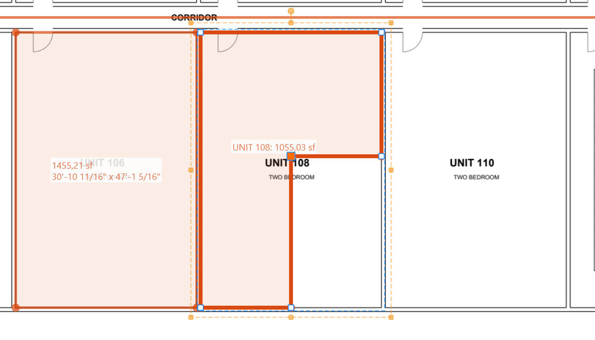
  <figcaption markdown="span">Выбранная площадь UNIT 108, щелчок по внутреннему углу выбрал эту точку (оранжевая). ++delete++ удалит только её, соседние грани соединятся напрямую.</figcaption>
</figure>

1. Выберите замер (++v++, щелчок).
2. Щёлкните по его точке: она станет оранжевой. Щелчок по грани выбирает обе её точки.
3. ++ctrl++ и щелчок добавляет ещё точки или грани.
4. Нажмите ++delete++: удаляются выбранные точки, а не весь замер. Соседние точки соединяются напрямую.
5. ++esc++ снимает выбор точек, ++ctrl+z++ возвращает удалённое.

То же через правую кнопку по точке или грани: "Удалить точку", "Удалить грань (её две точки)", "Удалить выбранные точки (N)".

Ограничения: у площади остаётся минимум 3 точки, у линии 2. Точки выреза тоже удаляются; все точки выреза убирают сам вырез.

## Выделение рамкой (E) { #frame }

<figure markdown>
  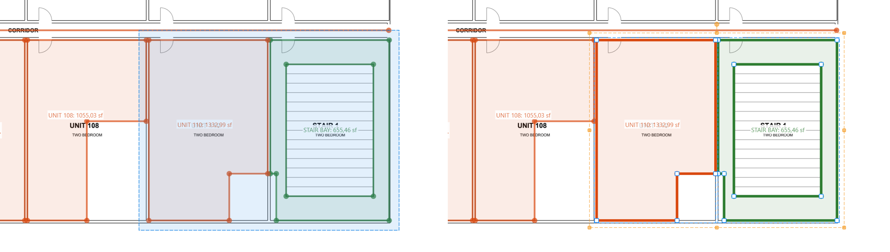
  <figcaption markdown="span">Клавиша ++e++: рамка по пустому месту. Слева направо выделяет то, что целиком внутри; справа налево - всё, что рамка задела (как в OurPlanCore).</figcaption>
</figure>

1. Нажмите ++e++: включится выделение рамкой.
2. Протяните рамку по пустому месту:
    - **слева направо** выделяется то, что целиком внутри;
    - **справа налево** выделяется всё, что рамка задела.
3. ++ctrl++ с рамкой добавляет к выбору. Щелчок по пустому месту снимает выбор.
4. Дальше ++delete++ удаляет, перетаскивание сдвигает, ++ctrl+c++ копирует.
5. ++v++ возвращает обычное выделение, где пустое место двигает лист.

Средняя и правая кнопки мыши двигают лист всегда, в любом режиме.

## Легенда { #legend }

Своя вкладка в правой панели: значок с зелёными строками, верхний на полосе справа. На панели открыта либо легенда, либо такеоффы. ++f5++ сворачивает панель.

<figure markdown>
  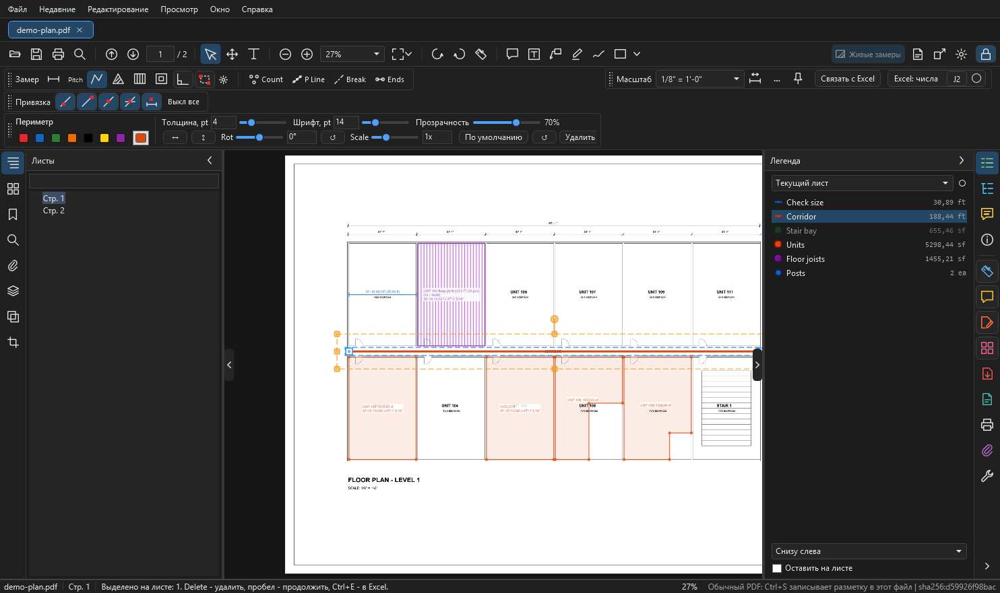
  <figcaption markdown="span">Щелчок по строке Corridor выделил линию на листе; строка Stair bay скрыта, площадь лестницы с листа ушла, значение осталось и потускнело.</figcaption>
</figure>

<figure markdown>
  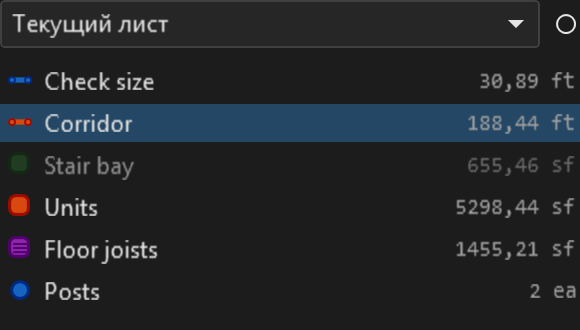{ width="360" }
  <figcaption markdown="span">Значок типа в цвете тейкофа, имя, итог.</figcaption>
</figure>

<figure markdown>
  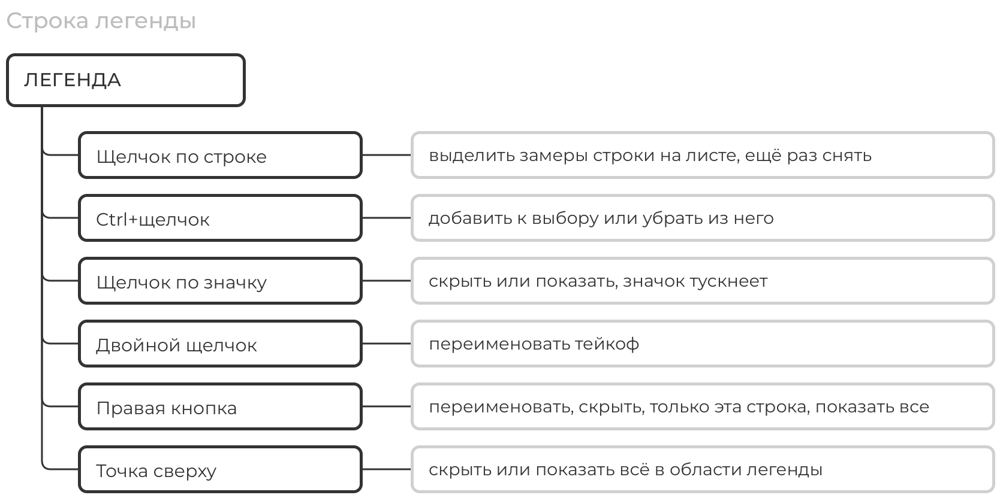
  <figcaption markdown="span">Что делает каждое действие со строкой.</figcaption>
</figure>

### Что в строке

- Одна строка соответствует одному типу, цвету и имени тейкофа. Сверху выбирается область: **Текущий лист** или **Весь PDF**.
- **Значок типа**, как в OurPlanCore: толстая линия с точками для расстояния и линии, скруглённый квадрат для площади, он же с балками для joists, точка для Count.
- **Числа**, как в легенде листа OurPlanCore: `ft` для линий, `sf` для площадей и joists, `ea` для штук и обычных комментариев. Без масштаба строка пишет число отрезков или точек. В Настройках, "Числа в легенде", можно включить единицы замеров (ft-in и другие).
- Каждый замер считается в своём масштабе, если он задан, иначе в масштабе листа. Замеры без масштаба к физическим длинам и площадям не прибавляются, они указаны отдельно.
- Содержимое самого чертежа, такеоффы снимка OurPlanCore и кропы в легенду не входят.

### Что можно сделать

| Действие | Что происходит |
| --- | --- |
| щелчок по строке | выделяет её замеры на листе, повторный снимает. Выделенный на листе замер тоже подсвечивает свою строку |
| ++ctrl++ и щелчок | добавляет к выбору или убирает из него |
| щелчок по значку | скрывает или показывает тейкоф в области легенды; значок тускнеет, у частично скрытого он наполовину светлый |
| точка справа сверху | скрывает или показывает всё в области легенды; залита, пока показано всё |
| двойной щелчок | переименовать: введите имя, ++enter++. Щелчок вне поля тоже сохраняет, ++esc++ отменяет, пустое имя возвращает стандартное. ++ctrl+z++ отменяет, ++ctrl+s++ записывает имя в PDF |
| правая кнопка | Переименовать, Скрыть или Показать, Только эта строка, Показать все |

Если замеры на другом листе (область "Весь PDF"), щелчок перейдёт на него; если они за краем экрана, вид сдвинется, масштаб не изменится.

### Что значит "скрыт" { #hidden }

Скрыть значит убрать с экрана, и только. Это не шаг ++ctrl+z++ и не несохранённое изменение, сама пометка в PDF не переписывается.

| Где | Что со скрытым замером |
| --- | --- |
| на листе | не виден, не выбирается, к нему не цепляется привязка и его не режет вырез. Правая кнопка по листу: "Показать скрытые замеры" |
| в легенде | строка на месте, значение тусклое и входит в сумму |
| кнопка Excel, ++ctrl+e++, ++ctrl+t++ | не входит в экспорт по области легенды; строка состояния пишет, сколько не вошло |
| "Сохранить как", вжечь в лист | не впечатывается |
| ++ctrl+s++, "Сохранить как" с редактируемыми | остаётся в файле; видимость запоминается в профиле и переходит на новую версию файла |
| печать | **печатается, если уже записан в файл**: печать рисует пометки файла, скрыт замер в OurPDF или нет |

Если при закрытии файла ответить "Нет", видимость, заданная после последнего сохранения, возвращается вместе с черновиком.

### Оставить на листе { #pinned }

<figure markdown>
  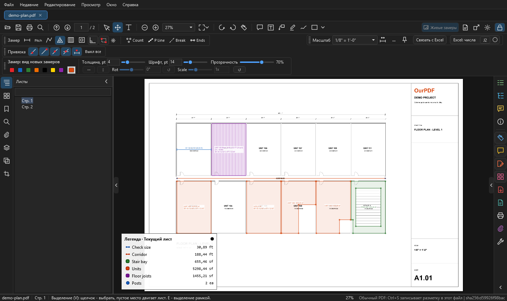
  <figcaption markdown="span">Галочка включена, панель справа закрыта: легенда стоит в углу листа.</figcaption>
</figure>

Галочка "Оставить на листе" внизу вкладки "Легенда". Легенда остаётся в углу листа белой полупрозрачной панелью с чёрным текстом, как в OurPlanCore, в любом инструменте. Угол выбирается списком над галочкой, по умолчанию снизу слева. Значки, точка, щелчки и меню там работают так же, как во вкладке. Это экранная панель: при сохранении и печати в лист она не добавляется.

## Excel: вставка в открытую книгу { #excel }

<figure markdown>
  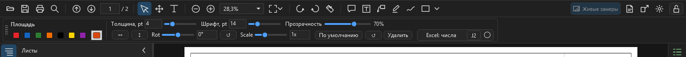
  <figcaption markdown="span">Замок открыт, выделена площадь: блок вида пришёл с кнопкой Excel, переключателем J2 и кругом формата. При закрытом замке кнопка стоит в блоке "Масштаб".</figcaption>
</figure>

1. Откройте книгу Excel и выберите ячейку, с которой должна начаться вставка.
2. Вернитесь в OurPDF и выделите нужные замеры. Без выделения экспортируется область легенды: текущий лист или весь PDF, без скрытых.
3. Нажмите кнопку Excel, ++ctrl+e++ или ++ctrl+t++. Сохраните книгу в Excel: OurPDF её не сохраняет и не закрывает.

| Команда | Что записывается |
| --- | --- |
| ++ctrl+e++ | один столбец: число |
| ++ctrl+t++ | три столбца: имя или цвет, число, единица |
| кнопка Excel | формат задаёт круг справа: выключен - числа, включён - три столбца |
| joists, в любом режиме | ровно два столбца: количество и длина, одинаковые длины объединяются |

**J2** (синяя значит включена): длина до 8 футов включительно округляется вверх до целого фута, длиннее 8 футов вверх до чётного. Только при экспорте, геометрия не меняется. По умолчанию выключена.

Экспорт пишет поверх значений в целевых ячейках: проверьте ячейку и свободное место. Нет открытой книги, ячейки защищены или объединены, книга только для чтения: вставка не получится, строка состояния скажет почему.

## Список замеров и отдельный файл Excel { #list }

<figure markdown>
  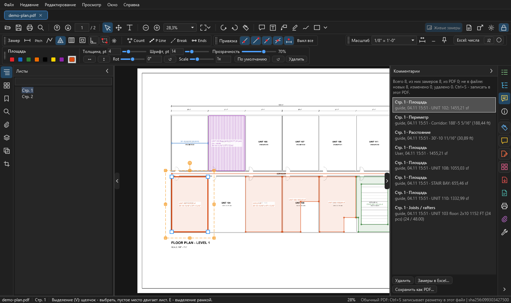
  <figcaption markdown="span">Вкладка "Комментарии": все замеры и пометки со значениями. Сверху итог: сколько замеров, сколько из PDF и что ещё не записано в файл. Внизу кнопки `Удалить`, `Замеры в Excel...`, `Сохранить как PDF...`.</figcaption>
</figure>

1. Откройте вкладку **"Комментарии"** на полосе справа.
2. Сверху итог: "Всего N, из них замеров N, из PDF N; не в файле: новых, изменено, удалено. Ctrl+S - записать в этот PDF".
3. Каждая строка: страница, тип, автор, время, подпись и значение. Щелчок по строке показывает замер на листе.
4. **"Замеры в Excel..."** сохраняет книгу `<имя PDF> - замеры.xlsx`, лист "Замеры", по строке на замер.

Колонки Excel: `Лист`, `Стр.`, `Тип`, `Значение`, `Ед.`, `Подпись`, `Метка`, `Масштаб`, `Источник масштаба`, `Точек`, `Автор`, `Создано`.

То же из меню: `Файл > Экспорт разметки измерений в Excel`, правая кнопка при линейке или `Экспорт PDF > Замеры в Excel` на полосе справа. Если замеров нет, строка состояния подскажет включить разметку измерений и измерить что-нибудь.

## Меню правой кнопки { #context-menu }

При линейке (инструмент Измерение):

| Пункт | Что делает |
| --- | --- |
| Завершить измерение, Отменить измерение | пока замер рисуется |
| Направление вдоль длинной стороны, Отменить joists | на шаге направления joists |
| Изменить масштаб и точность | окно "Масштаб и точность" |
| Изменить разметку ярлыка | подпись выбранного замера |
| Показать скрытые замеры (N) | когда есть скрытые в легенде |
| Включить / Отключить разметку измерений | выключено: на листе остаётся только последний замер и не сохраняется |
| Включить / Отключить орто | как ++f8++ |
| Box: двумя углами прямоугольника | как ++f9++ |
| Скрыть / Показать подписи замеров на листе | значения на листе |
| Длины линий только при наведении (LF) | или всегда на листе |
| Вырез из площади | как ++x++ |
| Скрыть / Показать линейки | линейки по краям листа |
| Привязать к содержимому страницы | привязка вкл и выкл целиком |
| Экспорт разметки измерений в Excel | как кнопка "Замеры в Excel" |
| Установки | окно Настроек |
| Скрыть окно сведений, Скрыть панель инструментов "Измерение" | сведения в нижней строке и вторая линия панели (то же, что замок) |

По выбранному замеру (инструмент Выделение): удалить точку или грань под курсором, вырез из площади, изменить текст, удалить, отменить, скрыть подписи замеров, записать разметку в этот PDF.

Внизу любого меню правой кнопки: масштаб вида 25 % - 400 %, "Реальный размер" (100 % = размер листа, как в Acrobat), по размеру страницы, по ширине, по содержимому.

## Замеры из Acrobat, Bluebeam и других программ { #from-pdf }

- Пометки, которые уже есть в PDF, при открытии становятся пометками OurPDF: замеры Acrobat, Bluebeam, Nitro в их масштабе, карандаш, тексты и выноски, фигуры, облака, ломаные. Их можно выделять, двигать, править и удалять; значения пересчитываются и совпадают с тем, что показывала та программа.
- Замер, сделанный в другом масштабе на том же листе, хранит свой масштаб.
- Зачёркивания, штампы, ссылки, ответы и скрытые аннотации остаются такими, как их рисует PDF. Исключение: штамп-кроп OurPDF ([Кроп](crop.md#pdf)).
- Выключить приём: Настройки, "Принимать пометки из PDF при открытии".
- После ++ctrl+s++ Acrobat сам перерисовывает замеры по их свойствам, поэтому OurPDF пишет их так, чтобы и там был наш вид: цвет, толщина, прозрачность, точки на концах, площадь без сплошной заливки. Замеры, записанные раньше по-старому (площадь в Acrobat была залита целиком), перезаписываются в новом виде при следующем ++ctrl+s++ этого файла.
- Вырезы площадей сохраняются в файле и возвращаются в OurPDF; в Acrobat площадь видна контуром.

## Если что-то не так { #troubleshooting }

| Что видно | Почему и что делать |
| --- | --- |
| значения в дюймах "на бумаге" | у листа нет масштаба: задайте его ([Масштаб](#scale)) |
| размер не совпадает с размерной цепочкой | неверный масштаб или лист распечатан не в масштабе: откалибруйте по известному размеру |
| курсор не цепляется к линии | выключен тип привязки или вся привязка ("Привязать к содержимому страницы"), либо линия на скрытом слое |
| ++tab++ ничего не берёт | точка уже поставлена: Tab работает до первой точки; или курсор не на линии чертежа (у сканов линий нет) |
| у линии не видно длины | длины линий показываются при наведении; подписать всегда можно в Настройках |
| вырез отрезал не ту площадь | без выбора режутся все площади под вырезом: сначала выберите нужные, ++ctrl+z++ отменит весь вырез |
| ++delete++ удалил весь замер | точки не были выбраны: сначала щелчок по точке или грани |
| замеры не видны в Acrobat или на печати | они ещё в профиле OurPDF: нажмите ++ctrl+s++ ([Сохранение](comments-save.md#save)) |
| в Excel не все замеры | без выделения идёт область легенды без скрытых: проверьте область и значки |
| не видно блоков | замок открыт: нажмите линейку или закройте замок ([Замок](window.md#lock)) |

## См. также

- [Окно программы](window.md)
- [Комментарии и сохранение](comments-save.md)
- [Горячие клавиши](shortcuts.md): все клавиши и отличия от OurPlanCore
- [Инструменты замера OurPlanCore](../reference/ourplancore-tools.md), [Правка и привязки OurPlanCore](../reference/ourplancore-editing.md)
- Что мерить: [SQFT 1st-5th Floors](../work/sqfts/1st2nd.md), [Joist](../work/horizontal/floor-framing/joist.md), [Exterior](../work/vertical/walls/exterior.md)
