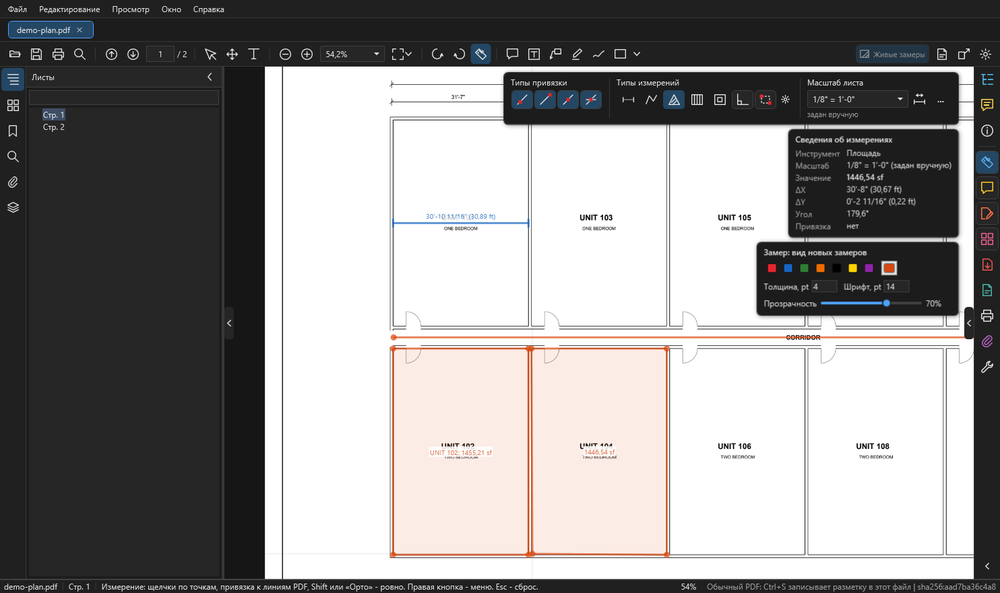
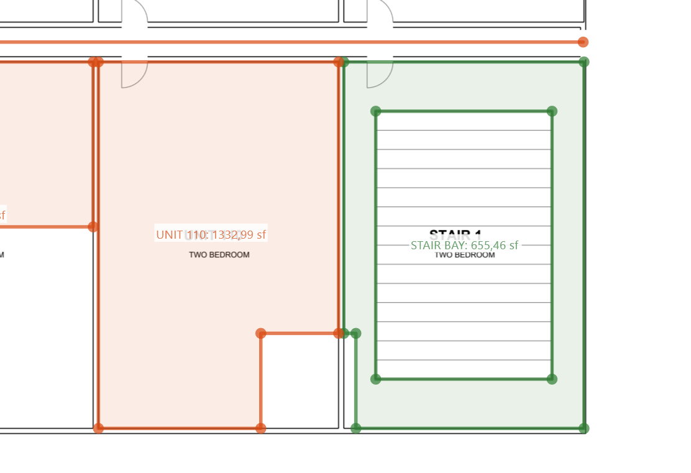
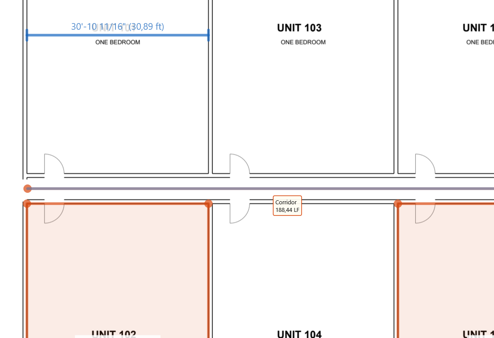
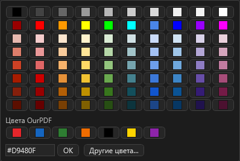
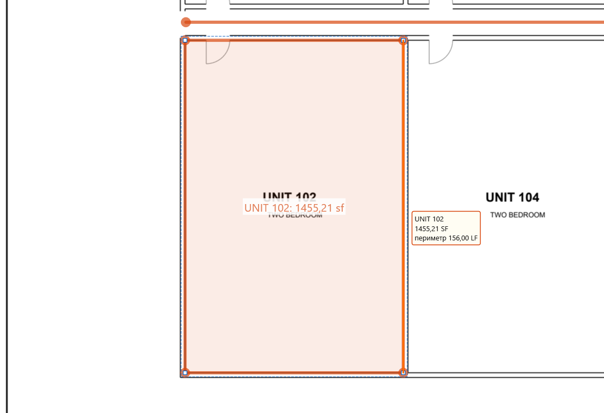
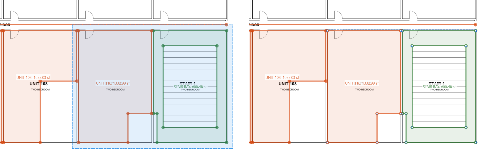

# Измерения

Главная часть OurPDF. Замеры как в Acrobat (расстояние, периметр, площадь) плюс то, к чему привыкли в OurPlanCore: клавиши `R`, `L`, `A`, `J`, `X`, `C`, режимы Орто и Box, Tab по линии чертежа, вырезы, joists и extra joists, сдвиг граней, выделение рамкой, длины в LF при наведении. Здесь по шагам: масштаб, панель, каждый вид замера, правка, удаление точек, список и Excel.

<figure markdown>
  
  <figcaption markdown="span">Включено измерение площади. Справа сверху панель "Измерение" (типы привязки, типы измерений, масштаб листа), под ней "Сведения об измерениях" и карточка вида новых замеров. Комната UNIT 102 уже измерена (подпись в sf), UNIT 104 обводится сейчас, через курсор идут направляющие.</figcaption>
</figure>

## Коротко { #summary }

| Задача | Клавиша | Как | Что получится |
| --- | --- | --- | --- |
| включить измерение | ++ctrl+shift+m++ | кнопка-линейка на панели или справа на полосе | панель "Измерение" справа сверху |
| размер между двумя точками | ++r++ | два щелчка | длина `12'-6" (12.50 ft)` |
| длина стены, ломаная | ++l++ | щелчки по точкам, ++c++, ++enter++ или двойной щелчок | длина ломаной в LF |
| площадь комнаты | ++a++ | щелчки по углам, замкнуть | SF по центру площади |
| joists / rafters | ++j++ | обвести площадь, две точки вдоль балок | штуки и длины расчётом OurPlanCore |
| вырез из площади | ++x++ | рамка или многоугольник поверх площади | дырка, откус или деление |
| прямоугольник двумя углами | ++f9++ | режим Box для площади, линии, joists, выреза | замер по двум углам |
| строго по горизонтали или вертикали | ++f8++ | режим Орто; ++shift++ временно | ровная линия |
| взять линию чертежа целиком | ++tab++ | навести на линию до первой точки | грань, потом контур |

Штук (Count), Beam и Openings в OurPDF нет: это инструменты OurPlanCore.

## Масштаб и калибровка { #scale }

Без масштаба значения пишутся в дюймах на бумаге. Масштаб хранится у каждого листа отдельно и влияет только на замеры OurPDF: такеоффы OurPlanCore он не меняет.

### Выбрать или ввести масштаб

1. Включите измерение: ++ctrl+shift+m++ или кнопка-линейка.
2. В поле "Масштаб листа" справа сверху выберите значение из списка:
    - архитектурные `1/32" = 1'-0"` до `3" = 1'-0"`;
    - инженерные `1" = 10'` до `1" = 200'`;
    - метрические `1:1` до `1:1000`.
3. Или впишите свой: `1/8" = 1'-0"`, `1" = 20'`, `1:100`, `1 in = 8 ft` и нажмите ++enter++.
4. Под полем видно, откуда масштаб: "задан вручную", "по калибровке", "из замеров в PDF" или "из OurPlanCore". Пока масштаба нет, там написано "не задан: выберите, введите или Калибровать".

Масштаб берите из штампа или подписи под видом (`SCALE: 1/8" = 1'-0"`), потом проверьте его одним замером по размерной цепочке.

### Калибровать по известному размеру

Нужно, когда масштаб на листе не указан или лист распечатан не в масштабе.

1. Нажмите кнопку калибровки справа от поля масштаба.
2. Щёлкните начало и конец отрезка известной длины, например размерной линии.
3. В окне "Калибровка масштаба" введите реальную длину: `12'-6"`, `25'`, `3.5 m`.
4. В строке состояния появится "Масштаб листа по калибровке: ...".

### Масштаб и точность для всех листов

Кнопка `...` рядом с полем открывает окно "Масштаб и точность" (то же в меню правой кнопки при линейке: "Изменить масштаб и точность").

| Поле | Варианты |
| --- | --- |
| Масштаб листа | список или свой текст; у снимков OurPlanCore есть пункт "Как в OurPlanCore" |
| Единицы | футы-дюймы (`12'-6"`), футы (`12.50 ft`), дюймы, метры, сантиметры, миллиметры |
| Точность | знаменатель дюйма для ft-in или знаки после запятой |
| Применить | к этому листу или ко всем листам документа |

Замер, принятый из PDF другой программы, сохраняет свой масштаб, как в Acrobat. У снимков проектов OurPlanCore масштаб по умолчанию берётся из OurPlanCore.

## Панель "Измерение" { #panel }

Появляется справа сверху, когда включена линейка. Три группы:

| Группа | Кнопки |
| --- | --- |
| Типы привязки | четыре кнопки: к контурам (любая точка линии), к конечным точкам, к средним точкам, к пересечениям. По умолчанию включены все |
| Типы измерений | расстояние (++r++), периметр или линия (++l++), площадь (++a++), joists (++j++), вырез из площади (++x++); дальше режимы Орто (++f8++) и Box (++f9++) и шестерёнка joists: тип, шаг и уклон новых балок |
| Масштаб листа | поле со списком, кнопка калибровки, кнопка `...` (масштаб и точность), под полем источник масштаба |

Под панелью окно **"Сведения об измерениях"**: инструмент, масштаб, значение, ΔX, ΔY, угол, тип привязки. Его и саму панель можно спрятать правой кнопкой: "Скрыть окно сведений об измерениях", "Скрыть панель инструментов Измерение".

## Привязки { #snap }

- Курсор цепляется к линиям чертежа. Пока точка привязана, линия подсвечивается фиолетовым, а значок у курсора показывает тип привязки.
- Четыре типа включаются и выключаются кнопками "Типы привязки". Все сразу: правая кнопка, "Привязать к содержимому страницы".
- Радиус привязки задаётся в Настройках: "Радиус привязки, px", по умолчанию 10 (от 2 до 40).
- К линиям скрытых слоёв PDF привязка не цепляется ([Слои](pages-edit.md#layers)).
- Через курсор при измерении идут тонкие горизонтальная и вертикальная **направляющие**, как в OurPlanCore. Выключаются в Настройках: "Направляющие у курсора при измерении".

## Расстояние: размер между двумя точками { #distance }

Зачем: проверить масштаб, снять размер, который не подписан на чертеже.

1. Нажмите ++r++ (или кнопку "Расстояние" в панели).
2. Щёлкните начало и конец.
3. Замер готов сразу после второго щелчка. Длина пишется как `12'-6"` и в скобках футы.

Расстояние рисуется размерной линией, как Ruler в OurPlanCore: засечки поперёк концов, а размер всегда подписан на листе (у периметра длина видна при наведении).

## Линия и периметр: длина по точкам { #line }

Зачем: длина стены, ломаной, периметр комнаты в LF.

1. Нажмите ++l++ (кнопка "Периметр").
2. Щёлкайте по точкам по оси стены, угол за углом.
3. Закончите: ++c++ (как в OurPlanCore), ++enter++ или двойной щелчок.
4. ++backspace++ убирает последнюю точку, ++esc++ отменяет весь замер.

Для прямоугольного периметра включите Box (++f9++): линия в Box рисуется двумя углами и получается замкнутым прямоугольником по периметру.

## Площадь: комната, этаж, балкон { #area }

Зачем: SF комнаты, этажа, балкона.

1. Нажмите ++a++ (кнопка "Площадь").
2. Щёлкайте по углам контура.
3. Замкните: щелчок по первой точке, двойной щелчок, ++enter++ или ++c++.
4. Значение в sf появится по центру площади, за вычетом вырезов.
5. Чтобы подписать комнату, дважды щёлкните по замеру и введите подпись (`UNIT 102`): она пишется перед значением.

Быстрее: прямоугольник через Box (++f9++, два угла) или замкнутый контур комнаты через ++tab++ ([Tab](#tab)).

## Box: прямоугольник двумя углами (F9) { #box }

Как в OurPlanCore. Режим действует на площадь, линию, joists и вырез.

1. Нажмите ++f9++ или кнопку Box в панели.
2. Выберите тип (++a++, ++l++, ++j++ или ++x++).
3. Щёлкните первый угол: прямоугольник тянется за курсором.
4. Щёлкните противоположный угол.
5. Ещё раз ++f9++ возвращает рисование по точкам.

Линия в Box - замкнутый прямоугольник по периметру. Box можно включить по умолчанию в Настройках: "Box: площадь, линия и вырез двумя углами (F9)".

## Орто: строго по горизонтали или вертикали (F8) { #ortho }

- ++f8++ или кнопка Орто в панели ведёт линию строго по горизонтали или вертикали.
- ++shift++ делает то же на время, пока зажат. При включённом Орто ++shift++, наоборот, отпускает линию.
- Орто можно включить по умолчанию в Настройках: "Орто по умолчанию (Shift инвертирует)".

## Tab: взять линию чертежа целиком { #tab }

Как edge snap в OurPlanCore: вместо щелчков по углам берёте линию или контур, уже нарисованный в PDF.

<figure markdown>
  
  <figcaption markdown="span">Слева: один ++tab++, подсвечена грань (`pdf edge`). Справа: второй ++tab++, замкнутый контур комнаты UNIT 106 (`pdf contour`). Щелчок сразу даёт площадь комнаты.</figcaption>
</figure>

1. Выберите тип замера и **не ставьте ни одной точки**.
2. Наведите курсор на линию чертежа и нажмите ++tab++: подсветится **грань** (эта линия).
3. Ещё раз ++tab++: **контур**, вся цепочка линий; если она замыкается, то **замкнутый контур** комнаты.
4. Дальше ++tab++ перебирает полилинии и соседние грани и возвращается к обычным точкам.
5. **Щелчок берёт** то, что подсвечено. ++esc++ отменяет.

Что получается по типам:

| Тип | Грань | Цепочка |
| --- | --- | --- |
| площадь, вырез, joists | | замкнутый контур сразу становится площадью (или вырезом, или зоной joists); открытая цепочка ставит свои точки, дальше щёлкайте как обычно |
| периметр | грань | вся цепочка, замкнутая с возвратом в первую точку |
| расстояние | расстояние по грани | периметр по цепочке |

Наведение на другую линию начинает снова с точек, как в OurPlanCore. Двери и небольшие разрывы в стенах контур перепрыгивает.

## Joists и rafters { #joists }

<figure markdown>
  
  <figcaption markdown="span">Балки 2x10 через 16" в UNIT 103: количество, длины и подпись считает код OurPlanCore. Подпись `UNIT 103 floor: 2x10 1152 FT (24 pcs)`.</figcaption>
</figure>

Зачем: штуки и длины joists или rafters по зоне, тем же расчётом, что в OurPlanCore (J Area).

### Настроить новые балки

1. В панели "Измерение" нажмите шестерёнку рядом с типами.
2. Заполните окно "Joists / rafters: новые площади":

| Поле | Что писать |
| --- | --- |
| Тип (подпись) | `2x10`, `11 7/8 TJI` |
| Шаг, дюймы (o.c.) | `16`, `19.2`, `24` |
| Уклон (rafters) | пусто - плоские joists; для rafters `6:12`, `6/12` или `4` (= 4:12), длины считаются по скату |
| Округление длины | без округления, вверх до фута, вверх до чётного фута, вверх до 2 футов |
| Крайняя балка у дальнего края | галка |
| Подробная подпись | длины по группам: заказ, без уклона, по уклону |
| Длина у каждой балки | галка |

### Нарисовать зону

1. Нажмите ++j++.
2. Обведите площадь по углам и замкните (или ++f9++ и два угла, или ++tab++ по контуру).
3. Поставьте две точки вдоль балок. ++enter++ (или правая кнопка, "Направление вдоль длинной стороны") кладёт балки вдоль длинной стороны.
4. На листе появятся балки и подпись вида `2x10 64 FT (8 pcs)`: тип, общая длина, штуки.

Двойной щелчок по готовой зоне открывает те же настройки для неё ("Joists / rafters: эта площадь"): подпись перед итогом и галка "Задать направление заново (две точки вдоль балок)".

### Extra joists (D)

1. Выделите зону joists (++v++ и щелчок).
2. Нажмите ++d++.
3. Щёлкайте внутри зоны: каждая лишняя балка встаёт по направлению joists и подсвечивается.
4. ++shift++ и щелчок убирает ближайшую extra.
5. ++d++ или ++esc++: выход.

Extra идут в итог и отдельным блоком "Extra" в ноте.

### Меню правой кнопки у зоны joists

| Пункт | Что делает |
| --- | --- |
| Добавить extra joists (щелчками) | то же, что ++d++ |
| Убрать все extra joists | удаляет все extra этой зоны |
| Копировать ноту joists | подпись и список длин со штуками текстом, для Excel или письма |
| Настройки joists | окно настроек этой зоны |

Правила, что считать joists: [Joist](../work/horizontal/floor-framing/joist.md). Тот же инструмент в OurPlanCore: [J Area](../reference/ourplancore-tools.md#jarea).

## Вырез из площади { #cut }

<figure markdown>
  
  <figcaption markdown="span">Лестница вырезана из площади STAIR BAY (дырка), у UNIT 110 откушен угол под кладовку. Значения в sf уже за вычетом вырезов.</figcaption>
</figure>

Зачем: шахта, лестница, open to below внутри площади; угол, который не входит в комнату.

1. Включите вырез: пятая кнопка в "Типах измерений", ++x++ или правая кнопка по площади, "Вырез из площади".
2. Протяните рамку или щёлкайте по углам (замкнуть: первая точка, двойной щелчок, ++enter++).
3. Результат зависит от того, где прошёл вырез:
    - внутри площади получается **дырка**;
    - через край кусок **откусывается**;
    - поперёк всей площади она **делится на две**.
4. Если перед вырезом площади были выбраны, режутся только они. Иначе режутся все площади и joists, которых коснулся вырез.
5. Режим остаётся включённым для следующего выреза. Один ++ctrl+z++ отменяет весь вырез.

Точки и грани вырезов тянутся так же, как у самой площади. Если удалить все точки выреза, пропадёт сам вырез.

## Значения: подписи и наведение { #values }

<figure markdown>
  
  <figcaption markdown="span">У линий длина появляется в рамке у курсора при наведении ("Corridor 188,44 LF"). Над площадью рамка показывает SF и периметр в LF.</figcaption>
</figure>

- **Площадь** подписана на листе по центру. Подпись замера (например `UNIT 102`) пишется перед значением: двойной щелчок по замеру или правая кнопка, "Изменить разметку ярлыка".
- **Расстояние** - размерная линия: засечки на концах, размер всегда на листе.
- **Линии** (периметр, а в живом слое снимка и линии OurPlanCore) показывают длину в LF только при наведении, рамкой у курсора поверх всего.
- **Над площадью** рамка при наведении показывает SF и периметр в LF.
- Подписать линии на листе всегда: Настройки, "Длины линий (LF) на листе" = "всегда подписаны", или правая кнопка при линейке, снять галку "Длины линий только при наведении (LF)".
- Скрыть все подписи значений: правая кнопка, "Скрыть подписи замеров". Значения останутся в списке и в окне сведений.
- Рамку при наведении можно выключить в Настройках: "Значение замера в рамке у курсора при наведении".

## Вид замеров: цвет, толщина, шрифт { #style }

Карточка справа сверху: семь быстрых цветов (красный, синий, зелёный, оранжевый, чёрный, жёлтый, фиолетовый), **квадратик палитры**, толщина и шрифт в пунктах, прозрачность.

- Пока выбрана линейка, карточка задаёт вид **новых** замеров ("Замер: вид новых замеров").
- Если выбран замер, меняется **он сам**.
- По умолчанию у всех замеров, площадей тоже: цвет оранжевый `#D9480F`, толщина 4, шрифт 14, прозрачность 70 %.
- Квадратик палитры открывает любой цвет: сетка, "Цвета OurPDF", поле `#RRGGBB` и кнопка "Другие цвета" (окно цветов Windows). Такой же квадратик есть у каждого цвета в Настройках.

<figure markdown>
  { width="400" }
  <figcaption markdown="span">Палитра квадратика: сетка цветов, цвета OurPDF, поле #RRGGBB и окно цветов Windows.</figcaption>
</figure>

Замеры рисуются как в Acrobat, но без стрелок: на концах и в вершинах кружки.

## Правка готовых замеров { #edit }

<figure markdown>
  
  <figcaption markdown="span">Выбранная площадь: белые квадратики - её точки; грань под курсором подсвечена оранжевым, её можно тянуть. Рядом рамка наведения: SF и периметр.</figcaption>
</figure>

1. Включите **Выделение** (++v++, обычный режим, в нём программа открывается).
2. Щёлкните по замеру: он выбран, его точки показаны белыми квадратиками. ++ctrl++ и щелчок добавляет к выбору. Щелчок по пустому месту двигает лист.
3. Под курсором подсвечивается то, что возьмёт щелчок: весь замер, у выбранного его грань (оранжевым) или точка.
4. Правьте:

| Что тянуть | Что происходит |
| --- | --- |
| точку | значение пересчитывается, точка цепляется к линиям чертежа |
| грань | обе точки грани идут за мышью, соседние грани тянутся; ++shift++ - строго по горизонтали или вертикали |
| весь замер | тянуть изнутри площади или с ++alt++ |

Ещё:

- ++delete++ без выбранных точек удаляет весь замер.
- ++ctrl+c++ и ++ctrl+v++ копируют и вставляют замеры и комментарии; на другой лист вставка идёт в то же место.
- Стрелки сдвигают выбранное.
- ++ctrl+z++ отменяет, ++ctrl+y++ повторяет. Меню `Редактирование` показывает, какое действие отменится.

## Удалить точку или грань { #delete-points }

<figure markdown>
  
  <figcaption markdown="span">Выбранная площадь UNIT 108, щелчок по внутреннему углу выбрал эту точку (оранжевая). ++delete++ удалит только её, соседние грани соединятся напрямую.</figcaption>
</figure>

1. Выберите замер (++v++, щелчок).
2. Щёлкните по его точке: она станет оранжевой. Щелчок по грани выбирает обе её точки.
3. ++ctrl++ и щелчок добавляет ещё точки или грани.
4. Нажмите ++delete++: удаляются выбранные точки, а не весь замер. Соседние точки соединяются напрямую.
5. ++esc++ снимает выбор точек, ++ctrl+z++ возвращает удалённое.

То же через правую кнопку по точке или грани: "Удалить точку", "Удалить грань (её две точки)", "Удалить выбранные точки (N)".

Ограничения: у площади остаётся минимум 3 точки, у линии 2. Точки выреза тоже удаляются; все точки выреза убирают сам вырез.

## Выделение рамкой (E) { #frame }

<figure markdown>
  
  <figcaption markdown="span">Клавиша ++e++: рамка по пустому месту. Слева направо выделяет то, что целиком внутри; справа налево - всё, что рамка задела (как в OurPlanCore).</figcaption>
</figure>

1. Нажмите ++e++: включится выделение рамкой.
2. Протяните рамку по пустому месту:
    - **слева направо** выделяется то, что целиком внутри;
    - **справа налево** выделяется всё, что рамка задела.
3. ++ctrl++ с рамкой добавляет к выбору. Щелчок по пустому месту снимает выбор.
4. Дальше ++delete++ удаляет, перетаскивание сдвигает, ++ctrl+c++ копирует.
5. ++v++ возвращает обычное выделение, где пустое место двигает лист.

Средняя и правая кнопки мыши двигают лист всегда, в любом режиме.

## Список замеров и Excel { #list }

<figure markdown>
  
  <figcaption markdown="span">Вкладка "Комментарии": все замеры и пометки со значениями. Сверху итог: сколько замеров, сколько из PDF и что ещё не записано в файл. Внизу кнопки `Удалить`, `Замеры в Excel...`, `Сохранить как PDF...`.</figcaption>
</figure>

1. Откройте вкладку **"Комментарии"** на полосе справа.
2. Сверху итог: "Всего N, из них замеров N, из PDF N; не в файле: новых, изменено, удалено. Ctrl+S - записать в этот PDF".
3. Каждая строка: страница, тип, автор, время, подпись и значение. Щелчок по строке показывает замер на листе.
4. **"Замеры в Excel..."** сохраняет книгу `<имя PDF> - замеры.xlsx`, лист "Замеры", по строке на замер.

Колонки Excel: `Лист`, `Стр.`, `Тип`, `Значение`, `Ед.`, `Подпись`, `Метка`, `Масштаб`, `Источник масштаба`, `Точек`, `Автор`, `Создано`.

То же из меню: `Файл > Экспорт разметки измерений в Excel`, правая кнопка при линейке или `Экспорт PDF > Замеры в Excel` на полосе справа. Если замеров нет, строка состояния подскажет включить разметку измерений и измерить что-нибудь.

## Меню правой кнопки { #context-menu }

При линейке (инструмент Измерение):

| Пункт | Что делает |
| --- | --- |
| Завершить измерение, Отменить измерение | пока замер рисуется |
| Направление вдоль длинной стороны, Отменить joists | на шаге направления joists |
| Изменить масштаб и точность | окно "Масштаб и точность" |
| Изменить разметку ярлыка | подпись выбранного замера |
| Включить / Отключить разметку измерений | выключено: на листе остаётся только последний замер и не сохраняется |
| Включить / Отключить орто | как ++f8++ |
| Box: двумя углами прямоугольника | как ++f9++ |
| Скрыть / Показать подписи замеров на листе | значения на листе |
| Длины линий только при наведении (LF) | или всегда на листе |
| Вырез из площади | как ++x++ |
| Скрыть / Показать линейки | линейки по краям листа |
| Привязать к содержимому страницы | привязка вкл и выкл целиком |
| Экспорт разметки измерений в Excel | как кнопка "Замеры в Excel" |
| Установки | окно Настроек |
| Скрыть окно сведений, Скрыть панель Измерение | убрать лишнее с листа |

По выбранному замеру (инструмент Выделение): удалить точку или грань под курсором, вырез из площади, изменить текст, удалить, отменить, скрыть подписи замеров, записать разметку в этот PDF.

Внизу любого меню правой кнопки: масштаб вида 25 % - 400 %, "Реальный размер" (100 % = размер листа, как в Acrobat), по размеру страницы, по ширине, по содержимому.

## Замеры из Acrobat, Bluebeam и других программ { #from-pdf }

- Пометки, которые уже есть в PDF, при открытии становятся пометками OurPDF: замеры Acrobat, Bluebeam, Nitro в их масштабе, карандаш, тексты и выноски, фигуры, облака, ломаные. Их можно выделять, двигать, править и удалять; значения пересчитываются и совпадают с тем, что показывала та программа.
- Замер, сделанный в другом масштабе на том же листе, хранит свой масштаб.
- Зачёркивания, штампы, ссылки, ответы и скрытые аннотации остаются такими, как их рисует PDF.
- Выключить приём: Настройки, "Принимать пометки из PDF при открытии".
- После ++ctrl+s++ Acrobat сам перерисовывает замеры по их свойствам, поэтому OurPDF пишет их так, чтобы и там был наш вид: цвет, толщина, прозрачность, точки на концах, площадь без сплошной заливки. Замеры, записанные раньше по-старому (площадь в Acrobat была залита целиком), перезаписываются в новом виде при следующем ++ctrl+s++ этого файла.
- Вырезы площадей сохраняются в файле и возвращаются в OurPDF; в Acrobat площадь видна контуром.

## Если что-то не так { #troubleshooting }

| Что видно | Почему и что делать |
| --- | --- |
| значения в дюймах "на бумаге" | у листа нет масштаба: задайте его ([Масштаб](#scale)) |
| размер не совпадает с размерной цепочкой | неверный масштаб или лист распечатан не в масштабе: откалибруйте по известному размеру |
| курсор не цепляется к линии | выключен тип привязки или вся привязка ("Привязать к содержимому страницы"), либо линия на скрытом слое |
| ++tab++ ничего не берёт | точка уже поставлена: Tab работает до первой точки; или курсор не на линии чертежа (у сканов линий нет) |
| у линии не видно длины | длины линий показываются при наведении; подписать всегда можно в Настройках |
| вырез отрезал не ту площадь | без выбора режутся все площади под вырезом: сначала выберите нужные, ++ctrl+z++ отменит весь вырез |
| ++delete++ удалил весь замер | точки не были выбраны: сначала щелчок по точке или грани |
| замеры не видны в Acrobat | они ещё в профиле OurPDF: нажмите ++ctrl+s++ ([Сохранение](comments-save.md#save)) |

## См. также

- [Окно программы](window.md)
- [Комментарии и сохранение](comments-save.md)
- [Горячие клавиши](shortcuts.md): все клавиши и отличия от OurPlanCore
- [Инструменты замера OurPlanCore](../reference/ourplancore-tools.md), [Правка и привязки OurPlanCore](../reference/ourplancore-editing.md)
- Что мерить: [SQFT 1st-5th Floors](../work/sqfts/1st2nd.md), [Joist](../work/horizontal/floor-framing/joist.md), [Exterior](../work/vertical/walls/exterior.md)
