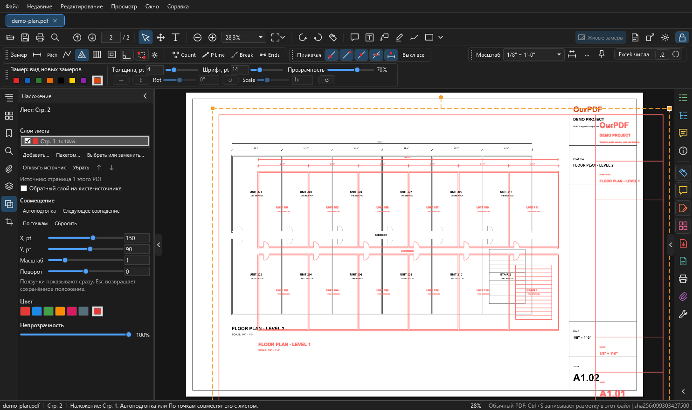
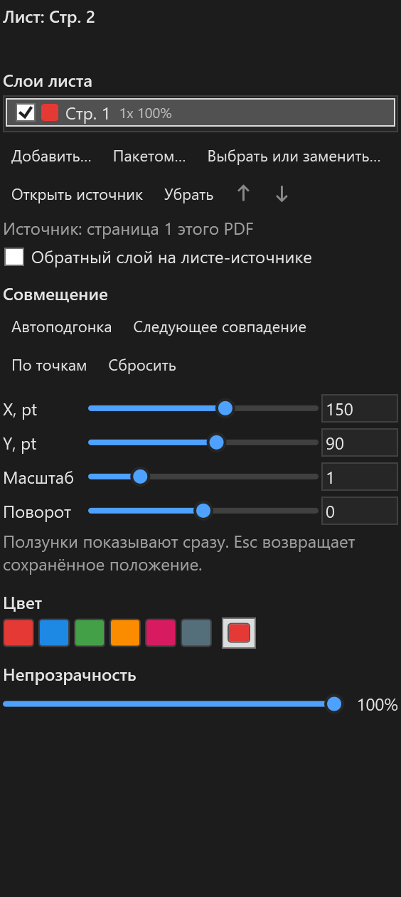
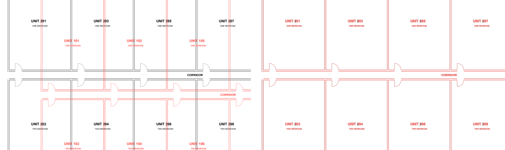
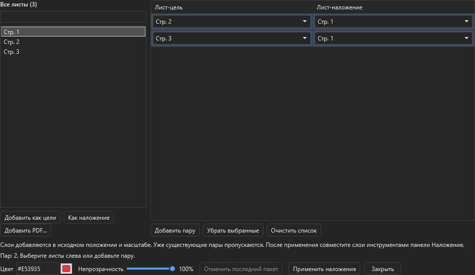
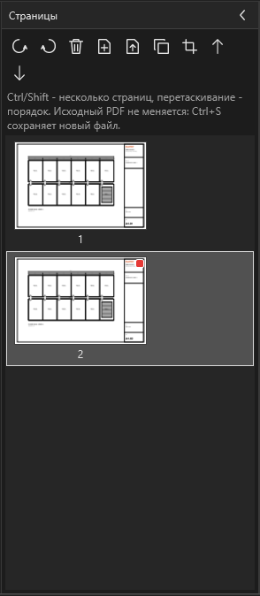

# Sheet overlay

Another sheet lies over the current one as a colored semi-transparent layer: the paper disappears, the lines become colored. This is how you compare revisions, floors, or a plan against an elevation. One sheet can have several layers. Here, step by step: add a layer, align it with the sheet, what is saved and what is not.

<figure markdown>
  
  <figcaption markdown="span">The "Overlay" icon on the left strip. Sheet 1 lies over sheet 2, shifted on purpose: red lines and the orange frame of the active layer.</figcaption>
</figure>

<figure markdown>
  
  <figcaption markdown="span">The usual order of working with a layer.</figcaption>
</figure>

!!! warning "What an overlay does not do"
    ++ctrl+s++ does **not write** the overlay into the PDF, and it does **not print**. Layers live in the app profile on this computer. They get into a file only through "Save As", the burn-into-sheet option ([below](#save)).

## Add a layer { #add }

1. Open the sheet you want to put another one over.
2. Click the "Overlay" icon on the left strip.
3. `Add...`, then one of two:
    - **Page of this PDF**: pick the sheet in the window;
    - **Page of another PDF**: pick the file, then the page. The file opens read-only.
4. The layer lands on the sheet in red, at its original position and scale. Next you need to [align](#fit) it.

The same, faster: right-click a sheet in the "Sheets" list or a thumbnail.

| Menu item | What it does |
| --- | --- |
| Use as Overlay | changes the source of the active layer to this sheet |
| Add as Overlay | puts a new layer on the open sheet |
| Overlay Properties... | opens the panel with the sheet's layers |
| Clear Current Sheet Overlay | removes the active layer |
| Batch Overlay... | [batch window](#batch) |

A sheet cannot lie on itself: the app tells you to pick another one. While a layer uses a file of another PDF, another app cannot overwrite that file, as with any PDF open in OurPDF.

## What is in the panel { #panel }

<figure markdown>
  { width="320" }
  <figcaption markdown="span">Sheet layers, buttons, alignment, color and opacity.</figcaption>
</figure>

| What | How it works |
| --- | --- |
| Layers of this sheet | the top one in the list is drawn over the rest. The checkbox shows and hides a layer, on the right the scale and opacity or "hidden". The selected row is the active layer; a click on the sheet does not select a layer |
| `Choose or Replace...` | another source for the selected layer, the position is kept |
| `Open Source` | goes to the source sheet or opens the other file |
| `Remove`, up and down arrows | removes the layer, changes the order. Same via right-click on the layer row |
| Reciprocal layer | [below](#reciprocal), off by default |
| X, Y, Scale, Rotation | the slider shows the change at once, the box takes a value on ++enter++. X and Y in sheet points, scale keeps the layer center |
| Color | six quick colors and the palette square. The first layer on a sheet is red, the next ones take a free color |
| Opacity | from 5 to 100 %, 100 % by default |

++esc++ restores the saved position. `Reset` sets X and Y to 0, scale 1, rotation 0.

## Align the layer with the sheet { #fit }

<figure markdown>
  
  <figcaption markdown="span">Left, the layer is shifted; right, after Auto Fit: the walls line up, only the unit numbers differ.</figcaption>
</figure>

### Auto Fit

1. Select the layer in the list.
2. Press `Auto Fit` (or right-click the sheet, "Auto Fit Overlay").
3. The app finds the position from the lines of both sheets, for scans from the image. The result and the confidence go to the status bar.
4. On a sheet with few lines, the status bar says there are too few lines. Then align by points.

### Next Match

Cycles through other pages of the source document (up to 160) by similarity and aligns right away; on a tie, nearer pages come first. The first press takes longer, after that the order is known. Use it when it is unclear which sheet would fit best.

### Edit by Points

1. `Edit by Points` (or right-click the sheet, "Fit by 2 Points").
2. Click a point on the overlay, for example a building corner.
3. Click where that point should land on the sheet: the layer moves.
4. A second pair of points, farther from the first, sets the scale and rotation.
5. ++esc++ after the first pair finishes, the layer stays moved.

Points snap to the lines of both sheets.

### With the mouse: the frame

While the "Overlay" panel is open, the active layer has an orange frame on the sheet.

| What to drag | What happens |
| --- | --- |
| inside the frame | moves the layer |
| a square corner | scales around the center |
| the round handle above the top edge | rotates around the center |

The panel shows the values as you go, releasing saves, ++esc++ during the move reverts.

- The frame takes presses only in the **Select** and **Hand** tools. With the ruler or a comment tool, clicks stay with the tool and the frame is drawn without handles, so you can measure over the layer.
- Pressing a measurement or comment over the layer selects it rather than moving the layer. Handles of a selected markup win over the frame.
- While the panel is open, a left click on empty space inside the frame moves the layer, not the sheet. The wheel and the middle and right buttons move the sheet as usual.
- Panel closed: no frame.

### Without the panel: Ctrl+Alt { #keys }

| Action | How | With ++shift++ |
| --- | --- | --- |
| move with the mouse | ++ctrl+alt++ and drag inside the layer | 4 times finer |
| nudge | ++ctrl+alt++ and arrows, 6 pt | 1 pt |
| scale | ++ctrl+alt+plus++ or ++ctrl+alt+minus++, x1.05 | x1.01 |
| rotate | ++ctrl+alt++ and `[` or `]`, 1 degree | 0.25 degree |
| reset position | ++ctrl+alt+0++ | |

The keys can be reassigned in Settings, like any others ([Keyboard shortcuts](shortcuts.md#remap)).

## Undo { #undo }

++ctrl+z++ undoes the layer position interleaved with measurements: one move, a slider release, a key press, `Reset`, Auto Fit or a point-fit step equals one step. ++ctrl+y++ redoes.

- Source, color, opacity and layer order have no undo.
- The history works like that of measurements: ++ctrl+s++ and page edits start a new one.
- An overlay does not count as an unsaved change: it adds no asterisk to the tab and no question on close.

## Reciprocal layer { #reciprocal }

The checkbox "Reciprocal layer on the source sheet" in the panel and in Settings, off by default (the same in OurPlanCore now).

- On: a layer of sheet B on sheet A gives sheet B a layer of sheet A with the reverse position, same color, opacity and visibility.
- An edit on one sheet goes to the other. `Remove` removes both.
- Works only between pages of the same PDF.
- A sheet that already has other layers is not touched; the status bar says so.

## Batch Overlay { #batch }

<figure markdown>
  
  <figcaption markdown="span">All sheets on the left, "target sheet" and "overlay sheet" pairs on the right.</figcaption>
</figure>

Many sheets at once, for example a whole revision over the old plan set.

1. The `Batch...` button in the panel, `Edit > Batch Overlay...` or right-click a sheet.
2. Select sheets on the left, `Add as targets`: one row per sheet.
3. Select one sheet on the left, select rows on the right, `Use as overlay`. Each row also has its own lists.
4. `Add PDF...` adds pages of another file; they can only be overlays, targets always come from the open PDF.
5. Color and opacity are shared for the batch.
6. `Apply overlays`. Before the first write, all pairs are checked: a sheet on itself or an empty row stops the whole batch. Repeated and already existing pairs are skipped and counted.
7. The layers land at their original position and scale, then align them as usual.

`Undo last batch` restores the layers exactly as they were; if the layers changed after the batch, it refuses. A new file version (++ctrl+s++) or closing the file ends this undo.

## How it shows on thumbnails { #thumbs }

<figure markdown>
  { width="240" }
  <figcaption markdown="span">Thumbnails have small colored squares: one per layer, pale means hidden.</figcaption>
</figure>

## What is saved and what is not { #save }

| Where | What happens to the layers |
| --- | --- |
| app profile | position, color and order are in `%APPDATA%\OurPDF\overlays`, separately for each file. On another computer there will be no layers |
| ++ctrl+s++ | not written to the PDF |
| "Save As", editable comments | not included in the copy |
| "Save As", burned into the sheet | visible layers are burned in under the markups; such a copy opens without layers, so they are not drawn twice |
| printing | not printed. Need them on paper: do "Save As" with burn-in and print that file |
| page edits | layers rotate with their page and follow the source page. If the source is deleted, the row says "(source removed)": replace the source or remove the layer |

Layers are drawn over the drawing and under crops, measurements and comments. Measurement snapping does not catch them. Works in continuous scroll and in separate view windows.

## If something is wrong { #troubleshooting }

| What you see | Why and what to do |
| --- | --- |
| no frame | the "Overlay" panel is closed, the layer is hidden or has no source |
| a frame without handles | a measure or comment tool is on: press ++v++ or ++h++ |
| a click on the sheet does not select another layer | that is by design: the active layer is picked in the panel list |
| Auto Fit says there are too few lines | align by points |
| the layer did not print | overlays do not print: "Save As" with burn-in |
| "(source removed)" | the source page was deleted by a page edit: `Choose or Replace...` or `Remove` |

## See also

- [Crop to sheet and new sheets](crop.md)
- [Pages, editing, layers](pages-edit.md)
- [Comments and saving](comments-save.md#where)
- [Keyboard shortcuts](shortcuts.md#overlay)
