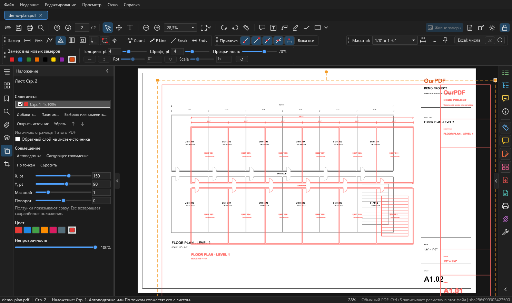
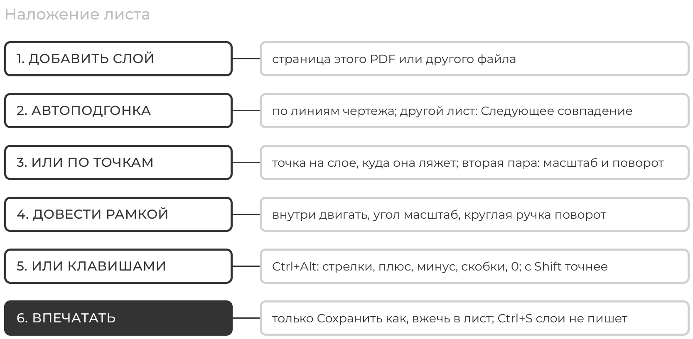
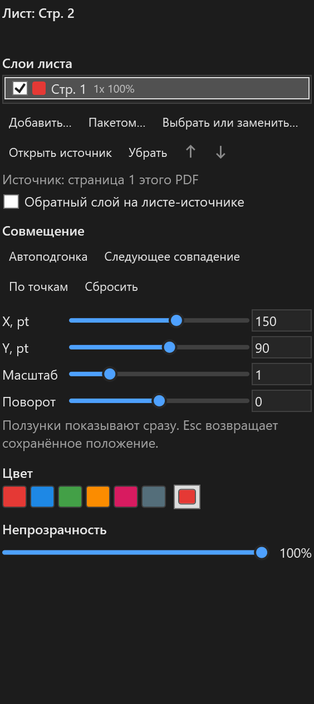
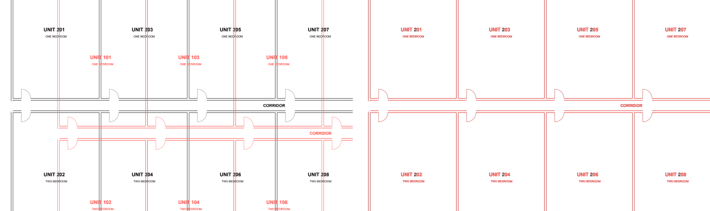
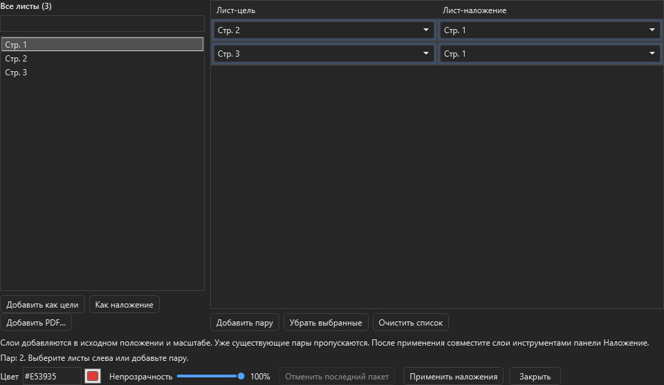
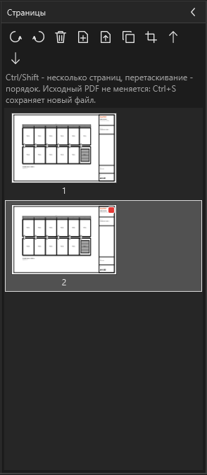

# Наложение листов

Другой лист лежит поверх текущего цветным полупрозрачным слоем: бумага исчезает, линии становятся цветными. Так сравнивают ревизии, этажи или план с фасадом. На одном листе может быть несколько слоёв. Здесь по шагам: добавить слой, совместить его с листом, что сохраняется и что нет.

<figure markdown>
  
  <figcaption markdown="span">Значок "Наложение" на левой полосе. На листе 2 лежит лист 1, специально сдвинутый: красные линии и оранжевая рамка активного слоя.</figcaption>
</figure>

<figure markdown>
  
  <figcaption markdown="span">Обычный порядок работы со слоем.</figcaption>
</figure>

!!! warning "Что наложение не делает"
    ++ctrl+s++ наложение в PDF **не пишет**, и на печать оно **не идёт**. Слои живут в профиле программы на этом компьютере. В файл они попадают только через "Сохранить как", вариант с вжиганием в лист ([ниже](#save)).

## Добавить слой { #add }

1. Откройте лист, поверх которого нужно положить другой.
2. Нажмите значок "Наложение" на левой полосе.
3. `Добавить...`, затем одно из двух:
    - **Страница этого PDF**: выберите лист в окне;
    - **Страница другого PDF**: выберите файл, затем страницу. Файл открывается только для чтения.
4. Слой лёг на лист красным в исходном положении и масштабе. Дальше его нужно [совместить](#fit).

То же быстрее: правая кнопка по листу в списке "Листы" или по миниатюре.

| Пункт меню | Что делает |
| --- | --- |
| Использовать как наложение | меняет источник активного слоя на этот лист |
| Добавить как наложение | кладёт новый слой на открытый лист |
| Свойства наложения... | открывает панель на листе со слоями |
| Убрать наложение текущего листа | убирает активный слой |
| Наложения пакетом... | [окно пакета](#batch) |

Лист не может лежать сам на себе: программа скажет выбрать другой. Пока слой пользуется файлом другого PDF, другая программа не сможет этот файл перезаписать, как и любой PDF, открытый в OurPDF.

## Что есть в панели { #panel }

<figure markdown>
  { width="320" }
  <figcaption markdown="span">Слои листа, кнопки, совмещение, цвет и непрозрачность.</figcaption>
</figure>

| Что | Как работает |
| --- | --- |
| Слои листа | верхний в списке рисуется поверх остальных. Галочка показывает и скрывает слой, справа масштаб и непрозрачность или "скрыт". Выбранная строка и есть активный слой; щелчком по листу слой не выбирается |
| `Выбрать или заменить...` | другой источник у выбранного слоя, положение сохраняется |
| `Открыть источник` | переходит на лист-источник или открывает другой файл |
| `Убрать`, стрелки вверх и вниз | убирает слой, меняет порядок. То же правой кнопкой по строке слоя |
| Обратный слой | [ниже](#reciprocal), по умолчанию выключен |
| X, Y, Масштаб, Поворот | ползунок показывает сразу, поле принимает значение по ++enter++. X и Y в пунктах листа, масштаб держит центр слоя |
| Цвет | шесть быстрых цветов и квадратик палитры. Первый слой на листе красный, следующие берут свободный цвет |
| Непрозрачность | от 5 до 100 %, по умолчанию 100 % |

++esc++ возвращает сохранённое положение. `Сбросить` ставит X и Y 0, масштаб 1, поворот 0.

## Совместить слой с листом { #fit }

<figure markdown>
  
  <figcaption markdown="span">Слева слой сдвинут, справа после автоподгонки: стены легли одна в другую, различаются только номера квартир.</figcaption>
</figure>

### Автоподгонка

1. Выберите слой в списке.
2. Нажмите `Автоподгонка` (или правая кнопка по листу, "Автоподгонка наложения").
3. Программа ищет положение по линиям обоих листов, для сканов по картинке. Результат и уверенность пишутся в строке состояния.
4. На листе с малым числом линий строка состояния скажет, что линий мало. Тогда совмещайте по точкам.

### Следующее совпадение

Перебирает другие страницы документа-источника (до 160) по похожести и сразу совмещает, при равенстве ближние страницы идут первыми. Первое нажатие считает дольше, дальше порядок уже известен. Нужно, когда неясно, какой лист лёг бы лучше.

### По точкам

1. `По точкам` (или правая кнопка по листу, "Подгонка по 2 точкам").
2. Щёлкните точку на наложении, например угол здания.
3. Щёлкните, куда эта точка должна лечь на листе: слой сдвинется.
4. Вторая пара точек, подальше от первой, задаёт масштаб и поворот.
5. ++esc++ после первой пары заканчивает работу, слой остаётся сдвинутым.

Точки цепляются к линиям обоих листов.

### Мышью: рамка

Пока открыта панель "Наложение", у активного слоя на листе оранжевая рамка.

| Что тянуть | Что происходит |
| --- | --- |
| внутри рамки | двигает слой |
| квадратный угол | масштаб вокруг центра |
| круглая ручка над верхним краем | поворот вокруг центра |

Панель показывает значения на ходу, отпускание сохраняет, ++esc++ во время движения возвращает.

- Рамка берёт нажатия только в инструментах **Выделение** и **Рука**. С линейкой или комментарием щелчки остаются инструменту, а рамка рисуется без ручек, так что поверх слоя можно мерить.
- Нажатие на замер или комментарий над слоем выбирает его, а не двигает слой. Ручки выбранной пометки важнее рамки.
- Пока панель открыта, левая кнопка по пустому месту внутри рамки двигает слой, а не лист. Колесо, средняя и правая кнопки двигают лист как обычно.
- Панель закрыта: рамки нет.

### Без панели: Ctrl+Alt { #keys }

| Действие | Как | С ++shift++ |
| --- | --- | --- |
| двигать мышью | ++ctrl+alt++ и тянуть внутри слоя | в 4 раза точнее |
| сдвиг | ++ctrl+alt++ и стрелки, 6 pt | 1 pt |
| масштаб | ++ctrl+alt+plus++ или ++ctrl+alt+minus++, x1.05 | x1.01 |
| поворот | ++ctrl+alt++ и `[` или `]`, 1 градус | 0,25 градуса |
| сброс положения | ++ctrl+alt+0++ | |

Клавиши переназначаются в Настройках, как любые другие ([Горячие клавиши](shortcuts.md#remap)).

## Отмена { #undo }

++ctrl+z++ отменяет положение слоя вперемешку с замерами: одно движение, отпускание ползунка, нажатие клавиши, `Сбросить`, автоподгонка или шаг по точкам равны одному шагу. ++ctrl+y++ возвращает.

- Источник, цвет, непрозрачность и порядок слоёв отмены не имеют.
- История живёт как у замеров: ++ctrl+s++ и правка страниц начинают новую.
- Наложение не считается несохранённым изменением: звёздочки во вкладке и вопроса при закрытии из-за него нет.

## Обратный слой { #reciprocal }

Галочка "Обратный слой на листе-источнике" в панели и в Настройках, по умолчанию выключена (в OurPlanCore сейчас так же).

- Включена: слой с листа Б на листе А даёт листу Б слой с листа А с обратным положением, тем же цветом, непрозрачностью и видимостью.
- Правка на одном листе идёт на другой. `Убрать` убирает оба.
- Работает только между страницами одного PDF.
- Лист, на котором уже лежат другие слои, не трогается; строка состояния об этом скажет.

## Наложения пакетом { #batch }

<figure markdown>
  
  <figcaption markdown="span">Слева все листы, справа пары "лист-цель" и "лист-наложение".</figcaption>
</figure>

Много листов сразу, например вся ревизия поверх старого комплекта.

1. Кнопка `Пакетом...` в панели, `Редактирование > Наложения пакетом...` или правая кнопка по листу.
2. Выберите листы слева, `Добавить как цели`: по строке на лист.
3. Выберите один лист слева, выделите строки справа, `Как наложение`. В каждой строке есть и свои списки.
4. `Добавить PDF...` добавляет страницы другого файла; они могут быть только наложением, цели всегда из открытого PDF.
5. Цвет и непрозрачность общие на пакет.
6. `Применить наложения`. Перед первой записью проверяются все пары: лист сам на себе или пустая строка останавливают весь пакет. Повторные и уже существующие пары пропускаются и считаются.
7. Слои ложатся в исходном положении и масштабе, дальше совмещайте их как обычно.

`Отменить последний пакет` возвращает слои точно как были; если слои менялись после пакета, откажется. Новая версия файла (++ctrl+s++) или закрытие файла эту отмену заканчивают.

## Как это видно на миниатюрах { #thumbs }

<figure markdown>
  { width="240" }
  <figcaption markdown="span">На миниатюрах маленькие цветные квадратики: по одному на слой, бледный значит скрыт.</figcaption>
</figure>

## Что сохраняется и что нет { #save }

| Куда | Что происходит со слоями |
| --- | --- |
| профиль программы | положение, цвет и порядок лежат в `%APPDATA%\OurPDF\overlays`, отдельно для каждого файла. На другом компьютере слоёв не будет |
| ++ctrl+s++ | в PDF не пишутся |
| "Сохранить как", редактируемые комментарии | в копию не идут |
| "Сохранить как", вжечь в лист | видимые слои впечатываются под пометками; такая копия открывается уже без слоёв, чтобы они не рисовались дважды |
| печать | не печатаются. Нужны на бумаге: сделайте "Сохранить как" с вжиганием и напечатайте этот файл |
| правка страниц | слои поворачиваются со своей страницей и идут за страницей-источником. Если источник удалён, строка пишет "(источник удалён)": замените источник или уберите слой |

Слои рисуются над чертежом и под кропами, замерами и комментариями. Привязка замеров их не ловит. Работает в сплошной прокрутке и в отдельных окнах вида.

## Если что-то не так { #troubleshooting }

| Что видно | Почему и что делать |
| --- | --- |
| нет рамки | панель "Наложение" закрыта, слой скрыт или у него нет источника |
| рамка без ручек | включён инструмент замера или комментария: нажмите ++v++ или ++h++ |
| щелчок по листу не выбирает другой слой | так и задумано: активный слой выбирается в списке панели |
| автоподгонка пишет, что линий мало | совмещайте по точкам |
| слой не напечатался | наложение не печатается: "Сохранить как" с вжиганием |
| "(источник удалён)" | страницу-источник удалили правкой страниц: `Выбрать или заменить...` или `Убрать` |

## См. также

- [Кроп на лист и новые листы](crop.md)
- [Страницы, правка, слои](pages-edit.md)
- [Комментарии и сохранение](comments-save.md#where)
- [Горячие клавиши](shortcuts.md#overlay)
