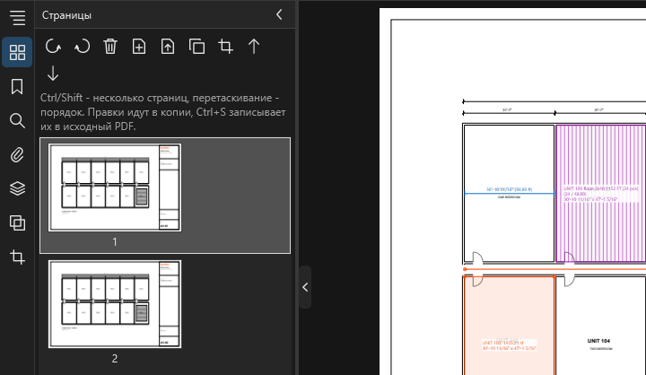

# Pages, PDF editing, layers, search

Here: how to reorder, rotate, delete and extract pages, edit sheet content, turn PDF layers on and off, search text and open OurPlanCore projects and snapshots. Everything that changes the PDF itself goes into a modified copy: the source file is not touched until you save. Another sheet over this one: [Sheet overlay](overlay.md). A detail onto another sheet and new sheets: [Crop to sheet](crop.md).

<figure markdown>
  
  <figcaption markdown="span">The "Pages" tab: thumbnails and buttons to rotate, delete, insert, extract, duplicate, crop and move. The hint above the thumbnails: Ctrl or Shift selects several pages, dragging changes the order.</figcaption>
</figure>

## Modified copy: the general rule { #working-copy }

- Editing pages and content goes into a **modified copy**: the source PDF does not change until you save, and the tab gets a `*`.
- ++ctrl+z++ and ++ctrl+y++ - steps back and forward.
- Comments, measurements, crops and overlays move together with their pages. Markups accepted from the PDF too; deleted ones stay deleted.
- ++ctrl+s++ writes the modified copy **into the source file** under the same name: it checks the result and that the original has not changed, and puts a copy of the previous file into backups. The setting "Ctrl+S after editing pages or content" switches it to a new file. "Save As" writes a new file. When you close such a tab, the app asks whether to save it.
- Bookmarks and page labels are not carried into the modified copy; layers are not kept after page edits (rotate, delete and so on).
- An OurPlanCore project snapshot becomes a regular PDF after page edits (the app warns you), the original snapshot stays as it was.

## The "Pages" tab on the left { #pages-tab }

Narrow thumbnails and buttons above them:

| Button | What it does |
| --- | --- |
| rotate counterclockwise and clockwise | rotates the selected pages (changes the pages, not the view) |
| delete | deletes the selected pages (++delete++) |
| insert | inserts pages from a file after the selected one |
| extract | the selected pages to a new PDF, with comments |
| duplicate | copies the selected pages |
| crop | drag a frame over the sheet |
| up, down | moves the selected pages |

- ++ctrl++ and ++shift++ select several pages, dragging changes the order.
- Pages can be dragged out with the mouse into a folder, and PDFs from a folder can be dropped into the list, as in the "Organize Pages" grid.
- Pages can also be cropped from the menu: `Edit > Crop pages`.

## Organize Pages { #organize }

Like "Organize Pages" in Acrobat: a grid of pages instead of the sheet.

1. Open the pink **"Organize Pages"** icon on the right strip or `Edit > Organize Pages`.
2. It has its own toolbar at the top: left, right, delete, insert, extract, duplicate, undo, redo, a size slider (or ++ctrl++ and the wheel).
3. Select pages: click, ++ctrl++, ++shift++, a mouse frame, ++ctrl+a++. On hover a page shows rotate and delete buttons.
4. Drag pages to change the order: a blue bar shows where they will go.
5. Double-click or ++enter++ opens a page, ++esc++ or "Close" returns to the sheet.

Exchanging pages with folders:

- Drag the selected pages **to the desktop or a folder**: a `Name (pp. 3-5).pdf` appears there with these pages and their comments.
- A PDF from a folder dropped into the grid is inserted where you dropped it.
- The same works between two OurPDF windows.

## Edit PDF: sheet content { #edit-pdf }

Edits the drawing itself: text, lines, images. Turned on with the orange **"Edit PDF"** icon on the right strip or `Edit > Edit PDF content`. A strip appears above the sheet: Select, Text, Image, Delete in frame, White-out, Select all, Delete, Close. Its right side says what is selected.

### Select and move

1. **Select** mode: a click takes one object (text, line, image, block).
2. A frame **left to right** takes everything wholly inside (blue); **right to left** everything it touches (green dashed, as in AutoCAD).
3. ++ctrl++ or ++shift++ add to the selection, ++ctrl++ and click removes, ++ctrl+a++ - the whole sheet, ++esc++ - clear the selection. The selection is outlined in pink.
4. Move by dragging or with the arrow keys: 1 pt steps, with ++shift++ 10 pt. Consecutive arrow presses are one edit (one ++ctrl+z++).
5. ++delete++ deletes the selection.

### Fix text on the sheet

1. Double-click the text (or ++enter++ if one text item is selected).
2. A box appears over it with the same font, size and slant.
3. ++enter++ writes, ++esc++ cancels, empty text deletes the item.

If the embedded font lacks a typed character, the text is set in an installed font of the same family (Arial, Trebuchet MS, Calibri), and if there is none, in the fallback font from Settings.

### Add and remove

| Mode | How |
| --- | --- |
| Text | click on the sheet and type: new text in the sheet itself |
| Image | pick a file, drag a frame (proportions kept) or click: width from Settings |
| Delete in frame | everything wholly inside the frame is deleted |
| White-out | the frame is covered with a solid fill, white by default |

Added text, an image and a fill become one small block over the sheet: it can be moved or deleted as a whole. Fixed text that could not be rewritten in place also becomes such a block. Blocks (forms) move and delete as a whole; objects inside a shared form cannot be edited one by one.

### How edits are saved

- An edit changes only its own operators in the sheet, everything else stays byte for byte.
- After each edit the sheet is re-read and checked. If anything changed beyond what was intended, the edit is undone, the document stays as it was, and the reason goes to the status bar.
- The app redraws a whole sheet only when there is no other way, with the same check. On CAD drawings this can be lossy, and then the edit is not made.
- Same as with pages: the source PDF does not change until you save, edits go into the modified copy, ++ctrl+s++ writes into the source file.

Settings, section "Edit PDF": arrow steps and the pause between presses, fonts, colors of new text and fill, right-to-left frame, image size ([Settings](view-settings.md#settings)).

## PDF layers { #layers }

Like "Layers" in Acrobat. The stack-of-sheets icon on the left strip or the "PDF layers" command.

- The list mirrors the PDF's own layer tree; in merged plan sets the layers are grouped by source file.
- The **eye** on a row shows and hides the layer, the eye on a group all its layers. Layers locked in the PDF (padlock) cannot be toggled; in a radio group, turning a layer on turns its neighbors off.
- Buttons at the top: show all, hide all (what is in the list right now: the name filter and "Only layers of this page" narrow it), restore as in the file.
- **The layer selected in the list is highlighted on the sheet** in crimson (a group, all its layers) and stays highlighted when you go to another page. ++esc++ clears the selection and the highlight.
- Row menu: show only this layer, hide or show all layers with the same name on all sheets, highlight the layer on the sheet.

### Which layer

1. Press the crosshair button "Which layer".
2. Click a line or text on the sheet.
3. The panel selects the layer, and everything it draws is highlighted on the sheet. ++esc++ - exit.

What matters:

- Visibility is remembered for this file in the OurPDF profile and comes back at the next opening; the PDF itself does not change.
- Hidden layers are not printed, do not show in thumbnails, and measurement snapping does not catch them.
- "Save As" without editing (flatten) turns hidden layers off in the new PDF; with editable comments it keeps the visibility set in the file.
- In an encrypted PDF, layers are only shown and cannot be toggled.

## Trace a layer as an area or a line { #layer-trace }

A fast way to take the area of a hatch (stone base, siding, roofing) or its outline, if the hatch sits on its own PDF layer.

1. The "Layers" tab on the left, pick the layer in the list: it highlights on the sheet.
2. The "Trace layer as areas" button: each separate zone of the layer on this sheet (for example, each hatched elevation wall) becomes its own area, windows inside are subtracted as cutouts.
3. Or the "Trace layer as lines" button: the outline of each zone becomes a line in LF.
4. Check the result on the sheet and in the "Comments" list; one ++ctrl+z++ removes the whole trace.

The hatch merges into a solid zone if its lines are closer than the gap from Settings ("Trace layer: merge hatch lines with gaps up to", 6 pt by default). If the layer broke into many small zones, increase the gap; if neighboring walls stuck together into one, decrease it.

## Search { #search }

1. ++ctrl+f++ or the magnifier button: the "Search" tab opens on the left.
2. Type the text. PDF text and the names of sheets, takeoffs and measurements are searched.
3. ++enter++ - next, ++shift+f3++ (in the box ++shift+enter++) - previous. Since version 1.0, ++f3++ turns snapping to measurements on and off, as in OurPlanCore.
4. Checkboxes: match case, whole word.

The app does not OCR scans without a text layer; their number is written in the search results.

## Sheets, bookmarks, attachments, properties { #other-panels }

- **Sheets** (left): page tree with sheet names and a name filter.
- **Bookmarks** (left): the PDF table of contents.
- **Attachments** (left, or the icon on the right strip): files inside the PDF, a button to save the selected one to a file. Attachments are never launched.
- **Properties** (right): document and sheet information.

## OurPlanCore projects and snapshots { #snapshots }

OurPDF shows OurPlanCore data view only: the project itself does not change, takeoffs are edited only in OurPlanCore.

### Open an .ourplan project

- `Open`, drag the file into the window, or "Open with" OurPDF.
- The project opens in a `Name.ourplan` tab, view only: sheets, takeoffs, measurements with quantities, joists, annotations, sheet overlays.
- The first opening builds the view (a large project takes up to a minute), the next one is instant until the project is saved again.

### Make a project snapshot

A snapshot (formerly called a "shadow") is a light PDF with the data of a saved project.

1. Press **"Project snapshot from .ourplan"** on the right of the toolbar (also in the `File` menu and on the right strip).
2. Pick a saved project.
3. Pick where to save it. By default `Documents\OurPDF\Снимки` (the folder name is Russian), outside the jobs folder.
4. The project does not change.

### Work with a snapshot

- On the right, the takeoff tree with quantities, a name filter and the "This sheet only" checkbox.
- A click on a takeoff highlights its measurements on the sheet and its row in the legend.
- The "Select" tool picks a measurement with a click on the sheet or on a legend row. A click on a measurement on the sheet opens the takeoff tree on the right, expands its folders and shows the takeoff. Folders you expanded stay expanded when you pick another takeoff.
- **Live measurements** (the button on the right of the toolbar):
    - on: OurPDF draws the measurements from the data itself, only on sheets with a verified binding; OurPlanCore lines in the live layer also show LF on hover;
    - off: the view saved in the PDF is shown.
- Whether live measurements are on by default: Settings, "OurPlanCore project snapshots: live measurements by default".
- Any other app (Acrobat and so on) shows a snapshot as a regular PDF with an "OurPlanCore Measurements" layer.
- You can put your own OurPDF markups over a snapshot, but ++ctrl+s++ does not write into a snapshot: save with "Save As".

## See also

- [The app window](window.md)
- [Comments and saving](comments-save.md)
- [Sheet overlay](overlay.md), [Crop to sheet and new sheets](crop.md)
- [Sheets (Pages) in OurPlanCore](../reference/ourplancore-pages.md)
- [PDF and delivery in OurPlanCore](../reference/ourplancore-pdf.md)
