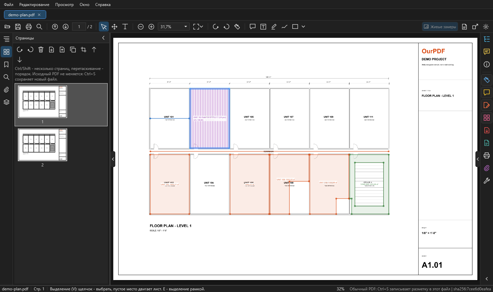

# Страницы, правка PDF, слои, поиск

Здесь: как переставить, повернуть, удалить и вытащить страницы, поправить содержимое листа, включать и выключать слои PDF, искать текст и открывать проекты и снимки OurPlanCore. Всё, что меняет сам PDF, идёт в изменённой копии: исходный файл не трогается.

<figure markdown>
  
  <figcaption markdown="span">Вкладка "Страницы": миниатюры и кнопки поворота, удаления, вставки, извлечения, дублирования, обрезки и перемещения. Подсказка над миниатюрами: Ctrl или Shift выбирают несколько страниц, перетаскивание меняет порядок, исходный PDF не меняется.</figcaption>
</figure>

## Изменённая копия: общее правило { #working-copy }

- Правка страниц и содержимого идёт в **изменённой копии**: исходный PDF не меняется, во вкладке появляется `*`.
- ++ctrl+z++ и ++ctrl+y++ - шаги назад и вперёд.
- Комментарии и замеры переезжают вместе со своими страницами. Пометки, принятые из PDF, тоже; удалённые остаются удалёнными.
- ++ctrl+s++ или "Сохранить как" для изменённой копии пишет **новый файл**. При закрытии такой вкладки программа спросит, сохранить ли её.
- В изменённую копию не переносятся закладки и метки страниц; слои после правки страниц (поворот, удаление и т. п.) не сохраняются.
- Снимок проекта OurPlanCore после правки страниц становится обычным PDF (программа предупредит), исходный снимок остаётся как был.

## Вкладка "Страницы" слева { #pages-tab }

Узкие миниатюры и кнопки над ними:

| Кнопка | Что делает |
| --- | --- |
| повернуть против и по часовой | поворачивает выбранные страницы (меняет страницы, не вид) |
| удалить | удаляет выбранные страницы (++delete++) |
| вставить | вставляет страницы из файла после выбранной |
| извлечь | выбранные страницы в новый PDF, с комментариями |
| дублировать | копирует выбранные страницы |
| обрезать | протянуть рамку по листу |
| выше, ниже | перемещает выбранные страницы |

- ++ctrl++ и ++shift++ выбирают несколько страниц, перетаскивание меняет порядок.
- Страницы можно вытащить мышью в папку и бросить в список PDF из папки, как в сетке "Систематизировать страницы".
- Обрезать страницы можно и из меню: `Редактирование > Обрезать страницы`.

## Систематизировать страницы { #organize }

Как "Систематизировать страницы" в Acrobat: сетка страниц вместо листа.

1. Откройте розовый значок **"Систематизировать страницы"** на полосе справа или `Редактирование > Систематизировать страницы`.
2. Сверху своя панель: влево, вправо, удалить, вставить, извлечь, дублировать, отменить, повторить, ползунок размера (или ++ctrl++ и колесо).
3. Выберите страницы: щелчок, ++ctrl++, ++shift++, рамка мышью, ++ctrl+a++. При наведении у страницы появляются кнопки поворота и удаления.
4. Перетащите страницы, чтобы поменять порядок: синяя черта показывает, куда они встанут.
5. Двойной щелчок или ++enter++ открывает страницу, ++esc++ или "Закрыть" возвращает к листу.

Обмен страницами с папками:

- Перетащите выбранные страницы **на рабочий стол или в папку**: там появится `Имя (стр. 3-5).pdf` с этими страницами и их комментариями.
- PDF из папки, брошенный в сетку, вставляется в место, куда его опустили.
- То же работает между двумя окнами OurPDF.

## Редактировать PDF: содержимое листа { #edit-pdf }

Правит сам чертёж: надписи, линии, картинки. Включается оранжевым значком **"Редактировать PDF"** на полосе справа или `Редактирование > Редактировать содержимое PDF`. Над листом появляется полоса: Выбор, Текст, Картинка, Удалить в рамке, Закрасить, Выделить всё, Удалить, Закрыть. Справа на ней написано, что выбрано.

### Выбрать и сдвинуть

1. Режим **Выбор**: щелчок берёт один объект (надпись, линию, картинку, блок).
2. Рамка **слева направо** берёт всё, что целиком внутри (синяя); **справа налево** - всё, что она задевает (зелёная пунктирная, как в AutoCAD).
3. ++ctrl++ или ++shift++ добавляют к выбранному, ++ctrl++ и щелчок убирает, ++ctrl+a++ - весь лист, ++esc++ - снять выбор. Выбранное обведено розовым.
4. Сдвиньте перетаскиванием или стрелками: шаг 1 pt, с ++shift++ 10 pt. Нажатия стрелок подряд - одна правка (один ++ctrl+z++).
5. ++delete++ удаляет выбранное.

### Поправить текст на листе

1. Дважды щёлкните по надписи (или ++enter++, если выбрана одна надпись).
2. Поверх неё появится поле тем же шрифтом, размером и наклоном.
3. ++enter++ записывает, ++esc++ отменяет, пустой текст удаляет надпись.

Если во встроенном шрифте нет набранной буквы, надпись набирается установленным шрифтом той же гарнитуры (Arial, Trebuchet MS, Calibri), а если такого нет, шрифтом замены из Настроек.

### Добавить и убрать

| Режим | Как |
| --- | --- |
| Текст | щелчок на листе и набор: новая надпись в самом листе |
| Картинка | выбрать файл, протянуть рамку (пропорции сохраняются) или щёлкнуть: ширина из Настроек |
| Удалить в рамке | всё, что целиком внутри рамки, удаляется |
| Закрасить | рамка закрывается сплошной заливкой, по умолчанию белой |

Добавленный текст, картинка и заливка становятся одним небольшим блоком поверх листа: его можно сдвинуть или удалить целиком. Исправленная надпись, если её нельзя было переписать на месте, тоже становится таким блоком. Блоки (формы) двигаются и удаляются целиком; объекты внутри общей формы по одному не правятся.

### Как правка сохраняется

- Правка меняет в листе только свои операторы, всё остальное остаётся байт в байт.
- После каждой правки лист перечитывается и сверяется. Если изменилось что-то сверх задуманного, правка отменяется, документ остаётся как был, причина пишется в строке состояния.
- Перерисовку целого листа программа делает только когда иначе нельзя, с той же проверкой. На чертежах из CAD она бывает с потерями, и тогда правка не делается.
- Как и со страницами: исходный PDF не меняется, правки в изменённой копии, ++ctrl+s++ пишет новый файл.

Настройки, раздел "Редактирование PDF": шаги стрелок и пауза между нажатиями, шрифты, цвета нового текста и заливки, рамка справа налево, размер картинок ([Настройки](view-settings.md#settings)).

## Слои PDF { #layers }

Как "Слои" в Acrobat. Значок стопки листов на левой полосе или команда "Слои PDF".

- Список повторяет дерево слоёв самого PDF; в склеенных комплектах слои сгруппированы по исходным файлам.
- **Глаз** у строки показывает и прячет слой, глаз у группы - все её слои. Закреплённые в PDF слои (замок) не переключаются; в радиогруппе включённый слой выключает соседей.
- Кнопки сверху: показать все, скрыть все (то, что сейчас в списке: фильтр по имени и "Только слои этой страницы" сужают его), вернуть как в файле.
- **Выбранный в списке слой подсвечивается на листе** малиновым (группа - все её слои) и остаётся подсвеченным при переходе на другую страницу. ++esc++ снимает выбор и подсветку.
- Меню строки: показать только этот слой, скрыть или показать все слои с таким же именем на всех листах, подсветить слой на листе.

### Чей это слой

1. Нажмите кнопку с прицелом "Чей это слой".
2. Щёлкните по линии или тексту на листе.
3. Панель выделит слой, а на листе подсветится всё, что он рисует. ++esc++ - выйти.

Что важно:

- Видимость запоминается для этого файла в профиле OurPDF и возвращается при следующем открытии; сам PDF не меняется.
- Скрытые слои не печатаются, не попадают в миниатюры, и к ним не цепляется привязка измерений.
- "Сохранить как" без возможности правки (flatten) выключает скрытые слои в новом PDF; с редактируемыми комментариями оставляет видимость, заданную в файле.
- В зашифрованном PDF слои только показываются, переключить их нельзя.

## Поиск { #search }

1. ++ctrl+f++ или кнопка-лупа: открывается вкладка "Поиск" слева.
2. Введите текст. Ищутся текст PDF и имена листов, такеоффов и замеров.
3. ++enter++ или ++f3++ - следующее, ++shift+f3++ (в поле ++shift+enter++) - предыдущее.
4. Галки: учитывать регистр, слово целиком.

Сканы без текстового слоя программа не распознаёт; их число пишется в результатах поиска.

## Листы, закладки, вложения, свойства { #other-panels }

- **Листы** (слева): дерево страниц с именами листов и фильтр по имени.
- **Закладки** (слева): оглавление PDF.
- **Вложения** (слева или значок на полосе справа): файлы внутри PDF, кнопка сохранить выбранное в файл. Вложения никогда не запускаются.
- **Свойства** (справа): сведения о документе и листе.

## Проекты и снимки OurPlanCore { #snapshots }

OurPDF показывает данные OurPlanCore только для просмотра: сам проект не меняется, takeoffs правятся только в OurPlanCore.

### Открыть проект .ourplan

- `Открыть`, перетащить файл в окно или "Открыть с помощью" OurPDF.
- Проект открывается вкладкой `Имя.ourplan` только для просмотра: листы, такеоффы, замеры с количествами, joists, аннотации, наложения листов.
- Первое открытие собирает вид (большой проект до минуты), повторное мгновенно, пока проект не сохранён заново.

### Сделать снимок проекта

Снимок (раньше назывался "тень") - лёгкий PDF с данными сохранённого проекта.

1. Нажмите **"Снимок проекта из .ourplan"** справа на панели инструментов (то же в меню `Файл` и на полосе справа).
2. Выберите сохранённый проект.
3. Выберите, куда сохранить. По умолчанию `Документы\OurPDF\Снимки`, вне папки джобов.
4. Проект при этом не меняется.

### Работать со снимком

- Справа дерево такеоффов с количествами, фильтр по имени и галка "Только этот лист".
- Щелчок по такеоффу подсвечивает его замеры на листе и строку в легенде.
- Инструмент "Выделение" выбирает замер щелчком по листу или по строке легенды. Щелчок по замеру на листе открывает справа дерево такеоффов, раскрывает его папки и показывает такеофф. Папки, которые вы раскрыли, остаются раскрытыми при выборе другого такеоффа.
- **Живые замеры** (кнопка справа на панели инструментов):
    - включены: OurPDF сам рисует замеры из данных, только на листах с проверенной привязкой; линии OurPlanCore в живом слое тоже показывают LF при наведении;
    - выключены: показан вид, сохранённый в PDF.
- Включать ли живые замеры по умолчанию: Настройки, "Снимки проектов OurPlanCore: живые замеры по умолчанию".
- Любая другая программа (Acrobat и т. д.) показывает снимок как обычный PDF со слоем "OurPlanCore Measurements".
- Поверх снимка можно ставить свои пометки OurPDF, но ++ctrl+s++ в снимок не пишет: сохраняйте через "Сохранить как".

## См. также

- [Окно программы](window.md)
- [Комментарии и сохранение](comments-save.md)
- [Листы (Pages) в OurPlanCore](../reference/ourplancore-pages.md)
- [PDF и сдача в OurPlanCore](../reference/ourplancore-pdf.md)
