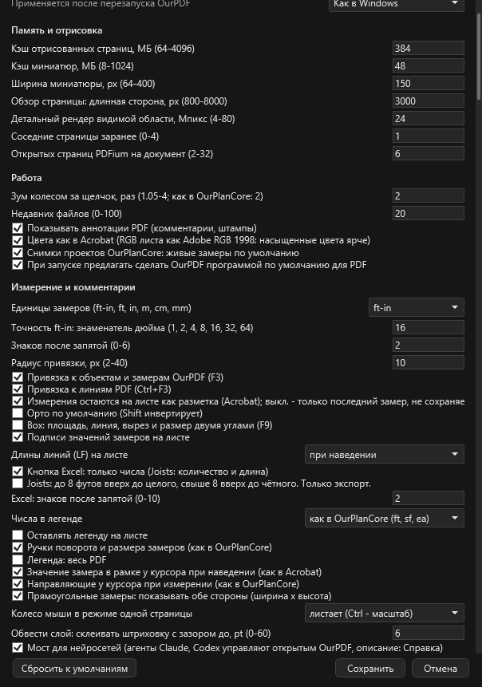

# View and settings

Here: how to view a sheet (scroll modes, zoom, rotation, full screen) and what is in the Settings window, section by section.

<figure markdown>
  { width="600" }
  <figcaption markdown="span">The OurPDF 1.0.1 Settings window, from "Memory and rendering" to the end of the measurement section: snaps, line lengths, Excel, numbers in the legend, legend on the sheet, rotation and resize handles, value box, guide lines, both sides of rectangles, mouse wheel, the "Trace layer" gap, AI agent bridge. At the bottom, "Reset to defaults", "Save", "Cancel". The interface on the picture is in Russian.</figcaption>
</figure>

## View modes { #view-modes }

The view button with an arrow on the toolbar (as in Acrobat):

| Mode | Key | What the wheel does |
| --- | --- | --- |
| Continuous scrolling, fit width | ++ctrl+3++ | all sheets as a strip; the wheel scrolls, ++ctrl++ and wheel zooms |
| Single page | ++ctrl+1++ | one sheet at a time, as in Acrobat: the wheel turns pages (a zoomed-in sheet scrolls to its edge first), ++ctrl++ and wheel zooms |
| Reading mode | ++ctrl+h++ | hides the panels |
| Full screen mode | ++ctrl+l++ | exit with ++esc++ |

The old "wheel zooms" behavior in single-page view is turned on in Settings: "Mouse wheel in single-page view" = "zoom".

## Zoom and rotation { #zoom }

- Fit page ++ctrl+0++, fit width ++ctrl+2++.
- Zoom in and out: ++ctrl+plus++, ++ctrl+minus++, the buttons and the percent zoom box on the toolbar.
- Right-click the sheet: zoom 25 % - 400 %, "Actual size" (100 % = the real sheet size, as in Acrobat), fit page, fit width, fit content.
- The wheel step is set in Settings: "Wheel zoom factor per notch", from 1.05 to 4, as in OurPlanCore 2.
- Rotate the view: ++ctrl+r++ clockwise, ++ctrl+shift+r++ counterclockwise. The PDF itself does not rotate; pages in the file can be rotated in the "Pages" tab ([Pages](pages-edit.md#pages-tab)).

## Move the sheet and turn pages { #navigation }

- Move the sheet: the "Hand" tool (++h++), the middle or right mouse button (in any tool), empty space in "Select" mode (++v++).
- Turn pages: ++page-up++, ++page-down++; first and last page ++home++, ++end++.
- Go to a page: ++ctrl+g++ or the page number box on the toolbar; you can type a page number or label.
- Rulers along the sheet edges: ++ctrl+alt+r++ or `View > Show rulers`.
- A separate view window of the same document: ++ctrl+shift+n++.
- Left and right panels: ++f4++, ++f5++ or the arrows on the sheet edges.

## Settings window { #settings }

Open it: ++ctrl+comma++, the gear button on the right of the toolbar or `Edit > Settings`. Sections from top to bottom:

| Section | What is set |
| --- | --- |
| Язык интерфейса / Interface language | Русский (Russian) or English; the new language takes effect after a restart, OurPDF offers to restart right away and reopens the same files |
| Appearance | as in Windows, light or dark; applied after a restart |
| Memory and rendering | rendered page cache (MB), thumbnail cache, thumbnail width, page overview (long side in px), detailed render of the visible area (MP), neighboring pages in advance, open PDFium pages per document |
| General | wheel zoom step (as in OurPlanCore: 2), number of recent files, show PDF annotations (comments, stamps), colors as in Acrobat (sheet RGB as Adobe RGB 1998: saturated colors brighter), live measurements of OurPlanCore snapshots by default, offer at start-up to make OurPDF the default app |
| Measure and comments | see the table below |
| Markups in the PDF itself (Ctrl+S) | accept markups from the PDF on open (Acrobat and Bluebeam measurements, pencil, text become editable), Ctrl+S after editing pages or content: save the original PDF under the same name, backups per file before Ctrl+S (1-50), the backup folder path and how much is there now, the "Open backup folder" button |
| Link to Excel behaviour | open workbook at once, closed one on ++ctrl+s++, backups, delay, time limit, small-number threshold for Auto Link ([Excel link](excel-link.md#settings)) |
| Sheet overlay | color of the first layer on a sheet, opacity of a new layer, memory for overlay images, reciprocal layer, dashed frame and crop badge ([Overlay](overlay.md), [Crop](crop.md)) |
| Blank sheets | width and height of a new sheet, list of paper sizes ([New sheets](crop.md#new-sheets)) |
| Edit PDF | arrow and ++shift++ plus arrow nudge (pt), the pause within which arrow presses count as one edit (ms), fallback font, font, size and color of new text, "White-out" color, width of an image placed with a click, maximum image size, right-to-left frame also takes touched objects (as in AutoCAD) |
| Keyboard shortcuts | all commands in a list: the default key and a box for your own ([Keyboard shortcuts](shortcuts.md#remap)) |

### The "Measure and comments" section { #settings-measure }

| Field | Default | What it changes |
| --- | --- | --- |
| Measurement units | ft-in | ft-in, ft, in, m, cm, mm |
| Precision for ft-in: inch denominator | 16 | 1, 2, 4, 8, 16, 32 or 64 |
| Decimal places | 2 | from 0 to 6 |
| Snap radius, px | 10 | from 2 to 40 |
| Snap to OurPDF objects and measurements | on | same as ++f3++ |
| Snap to PDF lines | on | same as ++ctrl+f3++ |
| Measurements stay on the sheet as markup | on | off: only the last measurement on the sheet, and it is not saved |
| Ortho by default | off | ++shift++ inverts |
| Box: area, line, cut and size by two corners | off | same as ++f9++ |
| Measurement value labels on the sheet | on | values on the sheet |
| Line lengths (LF) on the sheet | on hover | or "always labelled" |
| Excel button: values only | on | or three columns; same as the circle by the button |
| Joists: round up to whole feet through 8, even feet above 8 | off | J2, export only |
| Excel: decimal places | 2 | from 0 to 10 |
| Numbers in the legend | as in OurPlanCore (ft, sf, ea) | or in the measurement units |
| Keep legend on the sheet | off | same as the checkbox in the legend |
| Measurement rotation and resize handles | on | the orange frame around the selection |
| Legend: entire PDF | off | or the current sheet |
| Measurement value in a box by the pointer on hover | on | a box as in Acrobat |
| Guide lines through the pointer while measuring | on | lines as in OurPlanCore |
| Rectangular measurements: show both sides | on | width x height under the value |
| Mouse wheel in single-page view | turns pages | "turns pages (Ctrl zooms)" or "zoom" |
| Trace layer: join hatching with a gap up to, pt | 6 | from 0 to 60 ([Trace a layer](pages-edit.md#layer-trace)) |
| AI agent bridge | on | Claude and Codex agents drive the open OurPDF; takes effect after a restart ([AI agent control](ai.md)) |
| Measurement color | `#D9480F` | palette square next to it |
| Comment color | `#E5262B` | |
| Highlight color, note color | `#FFD400` | |
| Comment line width, pt | 2 | from 0.25 to 20 |
| Text font size, pt | 12 | from 4 to 96 |
| Comment author | empty | empty = the Windows user name |

Line width, font and opacity of new **measurements** (4, 14, 70 %) are set in the style block of the top toolbar while nothing is selected ([Measurement style](measure.md#style)). The top toolbar block layout is remembered by itself; to restore it: `Window > Reset toolbar` ([Top toolbar](window.md#top-panel)). The lock: the button at the end of the first row.

### Buttons at the bottom

- **Reset to defaults** restores everything as designed.
- **Save** applies. If a value is out of range, the app brings it into range and tells you what it changed.
- **Cancel** closes without changes.

## Default PDF app { #default-app }

1. `Help > Make OurPDF the default PDF app`.
2. OurPDF registers for PDF (for your user only) and opens Windows Settings.
3. Click "Set default" there: Windows lets only the user do that.

When OurPDF is already the default, the menu item shows "OurPDF opens PDFs by default".

## See also

- [The app window](window.md)
- [Keyboard shortcuts](shortcuts.md)
- [Measurements](measure.md)
