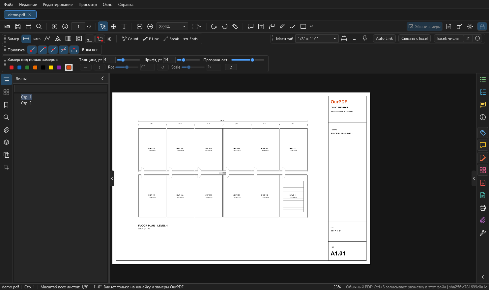
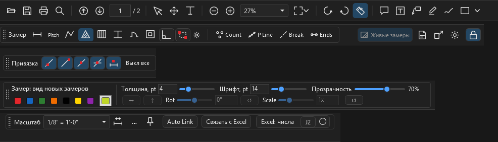
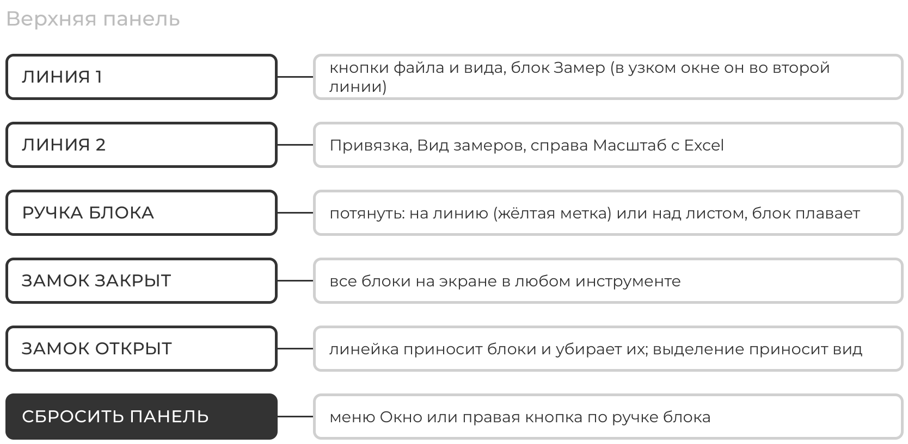
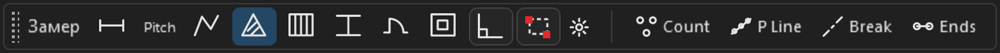
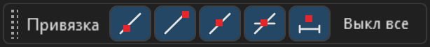
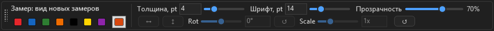
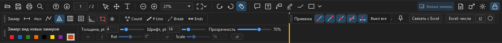
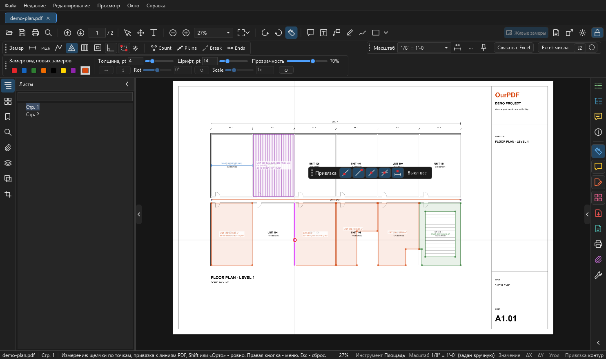
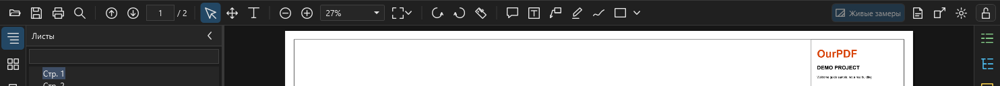
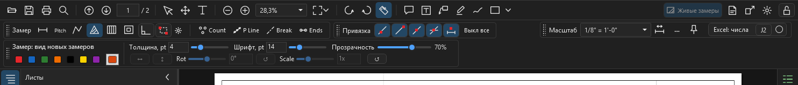

# The app window

Here: what is where in the OurPDF window, from the menu to the status bar. Use it to find a button fast; how to use it is covered on the [Measurements](measure.md), [Comments and saving](comments-save.md) and [Pages, editing, layers](pages-edit.md) pages.

<figure markdown>
  
  <figcaption markdown="span">At the top, the menu, the `demo-plan.pdf` file tab and two toolbar rows. On the left, a narrow tab strip and the "Sheets" panel, the sheet in the middle, the tab and tool strip on the right, the status bar at the bottom.</figcaption>
</figure>

## Menu { #menu }

| Menu | What is there |
| --- | --- |
| `File` | open, recent, save as (a new PDF with comments, the source does not change), export measurement markups to Excel, project snapshot from `.ourplan`, print, close document, exit |
| `Edit` | undo and redo (with the action name, for example "Undo: Markup properties"), delete comment, legend on the sheet, rotate and mirror measurements, continue takeoff, Count, Break, P Line, Ends, edit PDF content, organize pages, crop pages, overlay a sheet, batch overlays, crop to sheet, new blank sheet, new sheet from the visible area and from a frame, select and copy text, find, find next, settings |
| `View` | fit page, fit width, zoom in, zoom out, rotate view clockwise and counterclockwise, first, previous, next, last page, go to page, show or hide rulers, full screen |
| `Window` | new view window of the same document, "Reset toolbar", show or hide the left and right panels, open a specific panel tab ("Right: Comments", "Panel: Layers" and so on) |
| `Help` | keyboard shortcuts (++f1++), "How everything works" (the guide as a PDF), "For AI agents", keyboard shortcuts and settings, logs folder, default PDF app, about |

## First toolbar row { #toolbar }

Left to right:

| Group | Buttons |
| --- | --- |
| File | `Open` (++ctrl+o++), `Save As` (++ctrl+shift+s++, a new PDF with markups), `Print` (++ctrl+p++), `Find` (++ctrl+f++) |
| Pages | previous and next page (++page-up++, ++page-down++), the page number box: type a page number or label and ++enter++ (++ctrl+g++), the total page count next to it |
| Select | `Select` (++v++), `Hand` (++h++), select text with a frame (then ++ctrl+c++ copies the text) |
| Zoom | zoom out, zoom in, zoom box in percent, view button with an arrow: continuous scroll, single page, reading mode |
| Rotate | rotate view counterclockwise and clockwise (++ctrl+shift+r++, ++ctrl+r++); the PDF itself does not change |
| Measure | the ruler button: a toggle, pressing it again returns to "Select" ([Measurements](measure.md)) |
| Comments | note (++ctrl+6++), text on the sheet, highlight, freehand drawing, a shape with a picker arrow: rectangle, oval, cloud, arrow, line, polyline ([Comments](comments-save.md#comments)) |
| Right | `Live measurements` (for OurPlanCore snapshots), `Project snapshot from .ourplan`, separate view window (++ctrl+shift+n++), `Settings` (++ctrl+comma++), the second-row lock |

Every button has a hover tooltip: what it does and which key.

## Left tabs { #left-tabs }

A narrow strip of icons at the left edge. A click opens the panel, a second click on the same icon collapses it.

| Tab | What is there | Details |
| --- | --- | --- |
| `Sheets` | page tree with sheet names, filter by name; a click opens the sheet | |
| `Pages` | thumbnails; rotate selected pages, delete, insert from file, extract to a new PDF, duplicate, crop, move up and down. ++ctrl++ and ++shift++ select several, dragging changes the order | [Pages](pages-edit.md#pages-tab) |
| `Bookmarks` | the PDF table of contents | |
| `Search` | PDF text and sheet and takeoff names; ++enter++ next, ++shift+f3++ back, match case, whole word | [Search](pages-edit.md#search) |
| `Attachments` | files inside the PDF, a button to save the selected one; attachments are never launched | |
| `Layers` | PDF layers, as in Acrobat: the eye shows and hides a layer, buttons "show all", "hide all", "as in the file", "which layer", filter, only this page's layers | [PDF layers](pages-edit.md#layers) |
| `Overlay` | another sheet over this one as a colored semi-transparent layer: layers, alignment, color | [Sheet overlay](overlay.md) |
| `Crop` | a detail from one sheet onto another, the sheet's crops, new sheets | [Crop to sheet](crop.md) |

## Right strip { #right-rail }

Icons at the right edge, as in Acrobat. The top four open a panel on the right, the bottom ones turn on tools.

| Button | What it does |
| --- | --- |
| `Legend` | measurement totals by type, color and name: select, hide, rename, keep on the sheet ([Legend](measure.md#legend)) |
| `Takeoffs` | the takeoff tree of an OurPlanCore project snapshot with quantities, search by name, a "This sheet only" checkbox. The panel shows either the legend or the takeoffs. ++f5++ collapses the panel |
| `Comments` | a list of all markups and measurements in the document with their values; buttons `Delete`, `Measurements to Excel...`, `Save as PDF...` ([Measurement list](measure.md#list)) |
| `Properties` | document and sheet information |
| `Measure`, `Comment` | turn on tools, same as the buttons on the top toolbar |
| `Edit PDF` | move and delete sheet objects, edit and add text and images ([Editing the PDF](pages-edit.md#edit-pdf)) |
| `Organize Pages` | a grid of pages: order, rotate, delete, insert, extract, drag pages into a folder ([Pages](pages-edit.md#organize)) |
| `Export PDF` | a menu: PDF with comments (Save As), selected pages to a new PDF, measurements to Excel, [Excel link](excel-link.md), project snapshot from `.ourplan` |
| `Project snapshot` | project snapshot from `.ourplan` ([OurPlanCore snapshots](pages-edit.md#snapshots)) |
| `Print` | ++ctrl+p++ |
| `Attachments` | opens the "Attachments" tab on the left |
| `More tools` | a menu with all tools at once: measure, edit PDF, pages, note, Excel, save as, snapshot, rulers, new view window, print, attachments, settings |

## Top toolbar: two rows of blocks { #top-panel }

The floating measurement card is gone. Everything that belonged to it now sits in two rows under the menu, as blocks you can rearrange.

<figure markdown>
  
  <figcaption markdown="span">The layout as designed, a window about 1900 pixels wide. The first row holds the regular buttons and the "Measure" block; the second row has "Snap" and measurement style on the left, and "Scale" with the "Link to Excel" and Excel buttons on the right. If the window is not wide enough, the "Measure" block moves to the second row, "Snap" to the row below, and they come back when there is room.</figcaption>
</figure>

<figure markdown>
  
  <figcaption markdown="span">What sits where and what the lock does.</figcaption>
</figure>

### Four blocks { #blocks }

<figure markdown>
  
  <figcaption markdown="span">**Measure**: distance (++r++), Pitch, perimeter or line (++l++), area (++a++), joists (++j++), cut (++x++), Ortho (++f8++), Box (++f9++), joists gear; then Count (++p++), P Line, Break, Ends.</figcaption>
</figure>

<figure markdown>
  { width="340" }
  <figcaption markdown="span">**Snap**: to paths, to endpoints, to midpoints, to intersections, and a fifth button: to OurPDF objects and measurements. "All off" turns off all types at once and becomes "All on". ++f3++ turns snapping to measurements on and off, ++ctrl+f3++ to PDF lines, as in OurPlanCore.</figcaption>
</figure>

<figure markdown>
  
  <figcaption markdown="span">**Measurement style**: colors, line width and font with sliders, opacity. With nothing selected it sets the style of new measurements; with a selection it changes what is selected. The bottom row Rot, Scale, Mirror always stays in place, the toolbar does not jump.</figcaption>
</figure>

<figure markdown>
  { width="610" }
  <figcaption markdown="span">**Scale and Excel**: the sheet scale box, calibration, `...`, the pin, then the [Link to Excel](excel-link.md) button, the Excel button, J2 and the format circle.</figcaption>
</figure>

If only a crop is selected, the style block goes empty: color and line width do not apply to a crop. With the lock closed its spot stays empty, the sheet does not shift.

### Move a block { #move-block }

1. Grab the block by its **handle**: the dots at its left edge.
2. Drag it onto a toolbar row: a yellow vertical marker shows where it will go. Let go.
3. A block released over the sheet **floats** above the window. You can keep dragging it by the same handle and dock it back to a row.
4. The layout is remembered. **Reset toolbar**: `Window > Reset toolbar` or right-click the handle.

<figure markdown>
  
  <figcaption markdown="span">The "Snap" block being dragged along the second row: the yellow marker shows the spot.</figcaption>
</figure>

<figure markdown>
  
  <figcaption markdown="span">The "Snap" block released over the sheet, floating.</figcaption>
</figure>

### Lock { #lock }

The lock button at the end of the first row. Closed by default.

| Lock | What happens |
| --- | --- |
| closed | all blocks are always on screen, in any tool, the sheet does not jump |
| open | the second row is hidden, the sheet gets more room. The ruler button brings all blocks, pressing it again removes them and turns on "Select" |
| open, a measurement selected | the style block comes in with the "Link to Excel" and Excel buttons |
| open, lines selected | the "Measure" block with Break and P Line comes in too |
| open, a comment tool | the style block comes in |

The same toggle: right-click with the ruler on, "Hide the "Measure" toolbar". In reading mode and full screen there are no blocks.

<figure markdown>
  
  <figcaption markdown="span">Lock open, the "Select" tool: only the first row.</figcaption>
</figure>

<figure markdown>
  
  <figcaption markdown="span">Lock open, the ruler pressed: all blocks came in. In this window "Measure" sits in the second row because there is not enough room in the first.</figcaption>
</figure>

## Panels and windows { #panels }

- The arrows on the sheet edges and the keys ++f4++ (left panel), ++f5++ (right panel) collapse and expand the panels.
- Each file opens in a tab above the sheet. The tab of a modified copy (after editing pages or content) is marked `*`.
- A separate window of the same document: ++ctrl+shift+n++ or the button with a square and an arrow. Handy for keeping the plan on one monitor and the section on another.

## Status bar { #status-bar }

At the bottom, left to right: file name, page number, a hint for the current action, zoom in percent, document type.

While the ruler is on, the document type is replaced by **measurement info**: tool, scale and where it came from, value, ΔX, ΔY, angle, snap. To remove it: right-click with the ruler on, "Hide measurement info window".

<figure markdown>
  
  <figcaption markdown="span">Measurement info while a line is being drawn.</figcaption>
</figure>

- The hint changes with the tool: while measuring "click the points, snapping to PDF lines, Shift or Ortho keeps it straight. Right-click for the menu. Esc resets", while selecting "click to pick, empty space pans. E selects with a frame".
- The document type tells what ++ctrl+s++ will do: for an ordinary PDF "Ctrl+S writes the markups into this file"; for a modified copy "saves into the original PDF"; for an OurPlanCore snapshot saving works differently ([Saving](comments-save.md#save)).
- After any command, the result or the reason it failed is written here. Read the status bar when something did not work.

## See also

- [What OurPDF is](index.md)
- [Measurements](measure.md)
- [View and settings](view-settings.md)
- [Keyboard shortcuts](shortcuts.md)
