# Окно программы

Здесь: что где в окне OurPDF, от меню до строки состояния. Нужно, чтобы быстро найти кнопку; как ей пользоваться, расписано на страницах [Измерения](measure.md), [Комментарии и сохранение](comments-save.md) и [Страницы, правка, слои](pages-edit.md).

<figure markdown>
  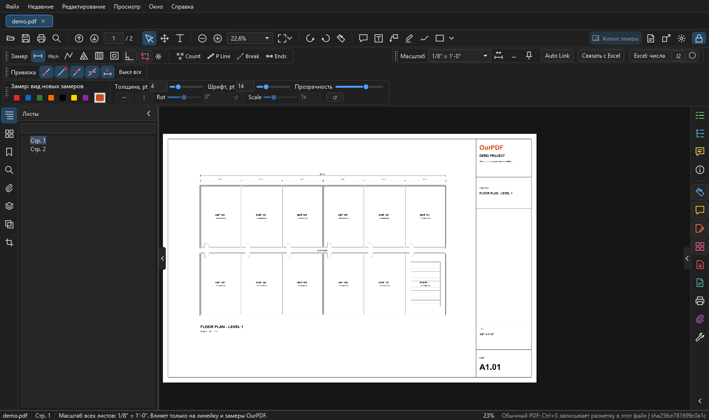
  <figcaption markdown="span">Сверху меню, вкладка файла `demo-plan.pdf` и две линии панели. Слева узкая полоса вкладок и панель "Листы", в центре лист, справа полоса вкладок и инструментов, внизу строка состояния.</figcaption>
</figure>

## Меню { #menu }

| Меню | Что там |
| --- | --- |
| `Файл` | открыть, недавние, сохранить как (новый PDF с комментариями, исходный не меняется), экспорт разметки измерений в Excel, снимок проекта из `.ourplan`, печать, закрыть документ, выход |
| `Редактирование` | отменить и повторить (с названием действия, например "Отменить: Свойства разметки"), удалить комментарий, легенда на листе, поворот и отражение замеров, продолжить тейкоф, Count, Break, P Line, Ends, редактировать содержимое PDF, систематизировать страницы, обрезать страницы, наложить лист, наложения пакетом, кроп на лист, новый чистый лист, новый лист из видимой области и из рамки, выделить и копировать текст, найти, найти далее, настройки |
| `Просмотр` | страница целиком, по ширине, увеличить, уменьшить, повернуть вид по и против часовой, первая, предыдущая, следующая, последняя страница, перейти к странице, показать или скрыть линейки, полноэкранный режим |
| `Окно` | новое окно вида того же документа, "Сбросить панель", показать или скрыть левую и правую панели, открыть нужную вкладку панели ("Справа: Комментарии", "Панель: Слои" и так далее) |
| `Справка` | горячие клавиши (++f1++), "Как всё работает" (руководство в PDF), "Для нейросетей", горячие клавиши и настройки, папка журналов, программа по умолчанию для PDF, о программе |

## Первая линия панели { #toolbar }

Слева направо:

| Группа | Кнопки |
| --- | --- |
| Файл | `Открыть` (++ctrl+o++), `Сохранить как` (++ctrl+shift+s++, новый PDF с пометками), `Печать` (++ctrl+p++), `Найти` (++ctrl+f++) |
| Страницы | предыдущая и следующая страница (++page-up++, ++page-down++), поле номера: ввести номер или метку страницы и ++enter++ (++ctrl+g++), рядом общее число страниц |
| Выбор | `Выделение` (++v++), `Рука` (++h++), выделение текста рамкой (потом ++ctrl+c++ копирует текст) |
| Масштаб вида | уменьшить, увеличить, поле масштаба в процентах, кнопка вида со стрелкой: сплошная прокрутка, по странице, режим чтения |
| Поворот | повернуть вид против и по часовой (++ctrl+shift+r++, ++ctrl+r++); сам PDF не меняется |
| Измерение | кнопка-линейка: переключатель, повторное нажатие возвращает в "Выделение" ([Измерения](measure.md)) |
| Комментарии | заметка (++ctrl+6++), текст на листе, маркер, рисование от руки, фигура со стрелкой выбора: прямоугольник, овал, облако, стрелка, линия, ломаная ([Комментарии](comments-save.md#comments)) |
| Справа | `Живые замеры` (для снимков OurPlanCore), `Снимок проекта из .ourplan`, отдельное окно вида (++ctrl+shift+n++), `Настройки` (++ctrl+comma++), замок второй линии |

У каждой кнопки есть подсказка при наведении: что делает и какая клавиша.

## Вкладки слева { #left-tabs }

Узкая полоса значков у левого края. Щелчок открывает панель, повторный щелчок по тому же значку сворачивает её.

| Вкладка | Что там | Подробно |
| --- | --- | --- |
| `Листы` | дерево страниц с именами листов, фильтр по имени; щелчок открывает лист | |
| `Страницы` | миниатюры; поворот выбранных страниц, удаление, вставка из файла, извлечение в новый PDF, дублирование, обрезка, перемещение выше и ниже. ++ctrl++ и ++shift++ выбирают несколько, перетаскивание меняет порядок | [Страницы](pages-edit.md#pages-tab) |
| `Закладки` | оглавление PDF | |
| `Поиск` | текст PDF и имена листов и такеоффов; ++enter++ дальше, ++shift+f3++ назад, учитывать регистр, слово целиком | [Поиск](pages-edit.md#search) |
| `Вложения` | файлы внутри PDF, кнопка сохранить выбранное; вложения никогда не запускаются | |
| `Слои` | слои PDF, как в Acrobat: глаз показывает и прячет слой, кнопки "показать все", "скрыть все", "как в файле", "чей это слой", фильтр, только слои этой страницы | [Слои PDF](pages-edit.md#layers) |
| `Наложение` | другой лист поверх этого, цветным полупрозрачным слоем: слои, совмещение, цвет | [Наложение листов](overlay.md) |
| `Кроп` | деталь с листа на другой лист, кропы листа, новые листы | [Кроп на лист](crop.md) |

## Полоса справа { #right-rail }

Значки у правого края, как в Acrobat. Верхние четыре открывают панель справа, нижние включают инструменты.

| Кнопка | Что делает |
| --- | --- |
| `Легенда` | итоги замеров по типу, цвету и имени: выделить, скрыть, переименовать, оставить на листе ([Легенда](measure.md#legend)) |
| `Такеоффы` | дерево такеоффов снимка проекта OurPlanCore с количествами, поиск по имени, галка "только этот лист". На панели открыта либо легенда, либо такеоффы. ++f5++ сворачивает панель |
| `Комментарии` | список всех пометок и замеров документа со значениями; кнопки `Удалить`, `Замеры в Excel...`, `Сохранить как PDF...` ([Список замеров](measure.md#list)) |
| `Свойства` | сведения о документе и листе |
| `Измерение`, `Комментарий` | включают инструменты, то же, что кнопки на панели сверху |
| `Редактировать PDF` | двигать и удалять объекты листа, править и добавлять текст и картинки ([Правка PDF](pages-edit.md#edit-pdf)) |
| `Систематизировать страницы` | сетка страниц: порядок, поворот, удаление, вставка, извлечение, перетаскивание страниц в папку ([Страницы](pages-edit.md#organize)) |
| `Экспорт PDF` | меню: PDF с комментариями (сохранить как), выбранные страницы в новый PDF, замеры в Excel, [связь с Excel](excel-link.md), снимок проекта из `.ourplan` |
| `Снимок проекта` | снимок проекта из `.ourplan` ([Снимки OurPlanCore](pages-edit.md#snapshots)) |
| `Печать` | ++ctrl+p++ |
| `Вложения` | открывает вкладку "Вложения" слева |
| `Другие инструменты` | меню со всеми инструментами сразу: измерение, правка PDF, страницы, заметка, Excel, сохранить как, снимок, линейки, новое окно вида, печать, вложения, настройки |

## Верхняя панель: две линии блоков { #top-panel }

Плавающей карточки измерений больше нет. Всё, что к ней относилось, стоит в двух линиях под меню: блоками, которые можно переставлять.

<figure markdown>
  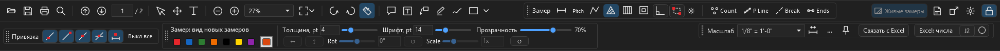
  <figcaption markdown="span">Раскладка как задумана, окно шириной около 1900 точек. В первой линии обычные кнопки и блок "Замер", во второй слева "Привязка" и вид замеров, справа "Масштаб" с кнопками "Связать с Excel" и Excel. Если окну не хватает ширины, блок "Замер" переходит во вторую линию, "Привязка" на линию ниже, и они возвращаются, когда место появится.</figcaption>
</figure>

<figure markdown>
  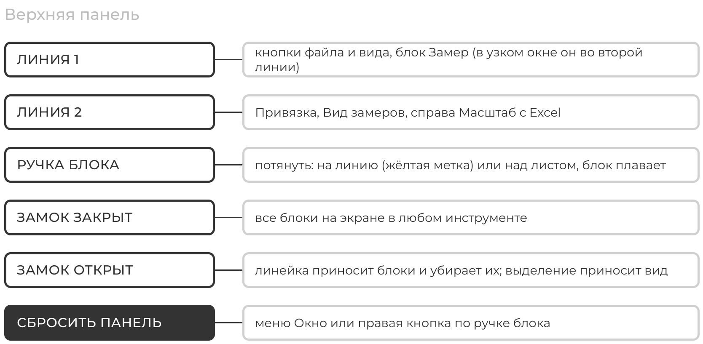
  <figcaption markdown="span">Что где стоит и что делает замок.</figcaption>
</figure>

### Четыре блока { #blocks }

<figure markdown>
  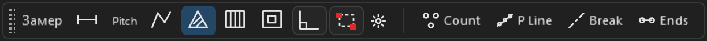
  <figcaption markdown="span">**Замер**: расстояние (++r++), Pitch, периметр или линия (++l++), площадь (++a++), joists (++j++), вырез (++x++), Орто (++f8++), Box (++f9++), шестерёнка joists; дальше Count (++p++), P Line, Break, Ends.</figcaption>
</figure>

<figure markdown>
  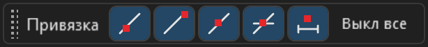{ width="340" }
  <figcaption markdown="span">**Привязка**: к контурам, к конечным точкам, к средним точкам, к пересечениям и пятая кнопка: к объектам и замерам OurPDF. "Выкл все" выключает все типы сразу и становится "Вкл все". ++f3++ включает и выключает привязку к замерам, ++ctrl+f3++ к линиям PDF, как в OurPlanCore.</figcaption>
</figure>

<figure markdown>
  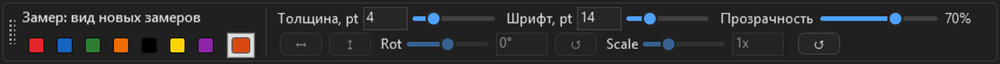
  <figcaption markdown="span">**Вид замеров**: цвета, толщина и шрифт с ползунками, прозрачность. Без выделения задаёт вид новых замеров, с выделением меняет выбранное. Нижний ряд Rot, Scale, Mirror стоит на месте всегда, панель не прыгает.</figcaption>
</figure>

<figure markdown>
  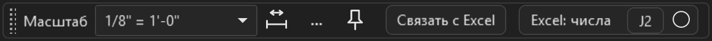{ width="610" }
  <figcaption markdown="span">**Масштаб и Excel**: поле масштаба листа, калибровка, `...`, булавка, затем кнопка [Связать с Excel](excel-link.md), кнопка Excel, J2 и круг формата.</figcaption>
</figure>

Если выбран только кроп, блок вида пустеет: цвет и толщина к кропу не относятся. При закрытом замке его место остаётся свободным, лист не сдвигается.

### Переставить блок { #move-block }

1. Возьмите блок за **ручку**: точки у его левого края.
2. Тяните на линию панели: жёлтая вертикальная метка показывает, куда он встанет. Отпустите.
3. Отпущенный над листом блок **плавает** поверх окна. Его можно тянуть дальше за ту же ручку и прилепить обратно к линии.
4. Раскладка запоминается. **Сбросить панель**: `Окно > Сбросить панель` или правая кнопка по ручке.

<figure markdown>
  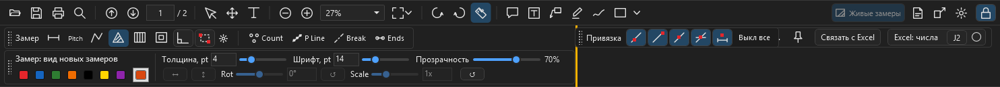
  <figcaption markdown="span">Блок "Привязка" тянут вдоль второй линии: жёлтая метка показывает место.</figcaption>
</figure>

<figure markdown>
  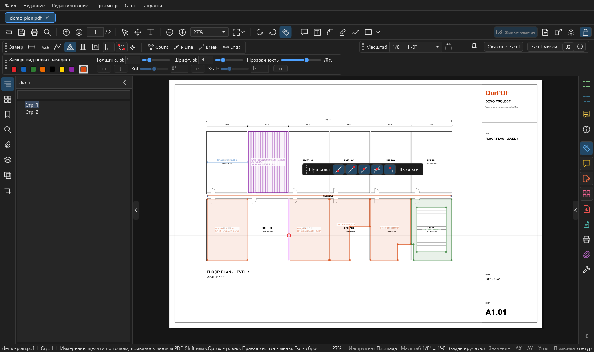
  <figcaption markdown="span">Блок "Привязка" отпущен над листом и плавает.</figcaption>
</figure>

### Замок { #lock }

Кнопка с замком в конце первой линии. По умолчанию закрыт.

| Замок | Что происходит |
| --- | --- |
| закрыт | все блоки всегда на экране, в любом инструменте, лист не прыгает |
| открыт | вторая линия скрыта, листу больше места. Кнопка-линейка приносит все блоки, повторное нажатие убирает их и включает "Выделение" |
| открыт, выбран замер | приходит блок вида с кнопками "Связать с Excel" и Excel |
| открыт, выбраны линии | ещё и блок "Замер" с Break и P Line |
| открыт, инструмент комментария | приходит блок вида |

То же переключение: правая кнопка при линейке, "Скрыть панель инструментов "Измерение"". В режиме чтения и на полном экране блоков нет.

<figure markdown>
  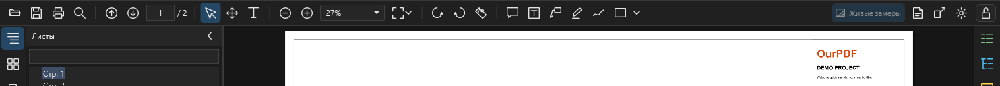
  <figcaption markdown="span">Замок открыт, инструмент "Выделение": только первая линия.</figcaption>
</figure>

<figure markdown>
  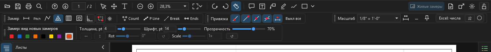
  <figcaption markdown="span">Замок открыт, нажата линейка: пришли все блоки. В этом окне "Замер" стоит во второй линии, потому что в первой ему не хватает места.</figcaption>
</figure>

## Панели и окна { #panels }

- Стрелки на краях листа и клавиши ++f4++ (левая панель), ++f5++ (правая панель) сворачивают и разворачивают панели.
- Каждый файл открывается вкладкой над листом. Вкладка изменённой копии (после правки страниц или содержимого) помечена `*`.
- Отдельное окно того же документа: ++ctrl+shift+n++ или кнопка с квадратом и стрелкой. Удобно держать план на одном мониторе, а разрез на другом.

## Строка состояния { #status-bar }

Внизу слева направо: имя файла, номер страницы, подсказка к текущему действию, масштаб вида в процентах, тип документа.

Пока включена линейка, вместо типа документа там **сведения об измерениях**: инструмент, масштаб и откуда он взят, значение, ΔX, ΔY, угол, привязка. Убрать: правая кнопка при линейке, "Скрыть окно сведений об измерениях".

<figure markdown>
  
  <figcaption markdown="span">Сведения об измерениях, пока рисуется линия.</figcaption>
</figure>

- Подсказка меняется с инструментом: при измерении "щелчки по точкам, привязка к линиям PDF, Shift или Орто - ровно. Правая кнопка - меню. Esc - сброс", при выделении "щелчок - выбрать, пустое место двигает лист. E - выделение рамкой".
- Тип документа говорит, что сделает ++ctrl+s++: у обычного PDF "Ctrl+S записывает разметку в этот файл"; у изменённой копии "сохранить в исходный PDF", у снимка OurPlanCore запись идёт иначе ([Сохранение](comments-save.md#save)).
- После любой команды здесь пишется результат или причина, почему не получилось. Читайте строку состояния, когда что-то не сработало.

## См. также

- [Что такое OurPDF](index.md)
- [Измерения](measure.md)
- [Вид и настройки](view-settings.md)
- [Горячие клавиши](shortcuts.md)
