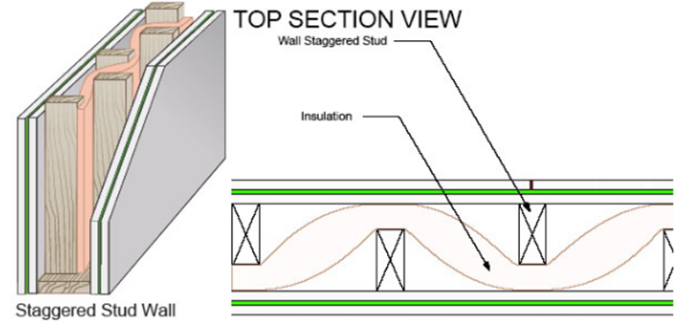
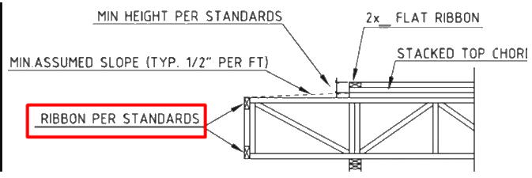
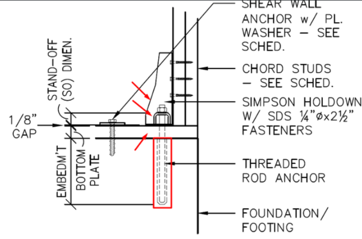

# Tips and key rules

Here: rules collected from corrections and comments on delivered jobs, grouped by topic. Many of them are not in general estimating guides: this is local memory. What the mistake looks like and how to catch it is on the [Common mistakes](../start/common-mistakes.md) page; here you get only the rule.

## Walls and studs { #studs }

- The wall height in the name and in the stud row = floor-to-floor minus subfloor, minus floor system depth. The plates (one bottom and two top) are **not deducted**: this is the height of the assembled wall, and the template picks the stud from it. Deduct only extra boards beyond those three when the section shows them. Floor-to-floor and ceiling height are not this height; check against the section of each building. Example: `11'-1" floor-to-floor - 22" truss - 3/4" subfloor = 9'-2 1/4"`. On COM, the exact height to 1/8" goes in E of the stud row. [Exterior Walls, height](../work/vertical/walls/exterior.md#stud-height).
- Wall type (ext, corr, dem, party) is set by the wall schedule segments, not by the group: a piece of demising inside the exterior line stays demising.
- P.T. bottom plate only on concrete and masonry. Double bottom plate only where the detail shows it.
- Stud factors: [Stud spacing factors](formulas.md#stud-spacing-factors), `12 / 16 / 24 = 1.4667 / 1.1 / 0.625`. Joists use a different table (`12 / spacing`). The numbers are not repeated here.
- Corridor 2x4 staggered = two rows at 16" o.c., 2x6 plates. Bearing walls on lower floors may need double studs: count them as Extra per the floor's stud schedule.
- Metal walls: even when metal is by others, the row or the note `Metal studs are by others` stays. Client list: [Client rules, Metal Studs](../start/client-rules.md#metal-studs).
- Shafts are always in the workbook, material per the drawings (a CMU elevator is not a wood shaftliner).
- Interior drywall, interior insulation and sound batt are not counted in frame scope; insulation only exterior, outside the sheathing, even on CMU. Exterior gypsum (parking, mech) is counted.

<figure markdown>
  
  <figcaption markdown="span">Staggered stud wall: two rows of 2x4 studs on shared 2x6 plates. In the workbook, two rows of studs at 16" o.c. and 2x6 plates.</figcaption>
</figure>

## FRT { #frt }

FRT is driven by the construction type from the Code Compliance Summary, not by a generic note.

| Construction type | What is FRT |
| --- | --- |
| Type III | everything in the exterior wall plane: studs, plates, headers, blocking, sheathing; wood walls below the podium. LVL, PSL, LSL are not allowed in this plane, do not write `LVL FRT` |
| Type V-A, V-B | no general FRT; only where a detail explicitly requires it |
| Any | parapets and exterior blocking same as the exterior wall; subfloor: 2' or 4' strips along the perimeter of its own floor; demising shear wall sheathing is regular unless the schedule says FRT; stair and shaft walls are often FRT per detail |

`FRT` and `FRTW` on a drawing are the same requirement. The note `all wood materials at exterior to be FRT` = all loose plywood on the exterior is FRT, with `verify`.

## Sheathing and WRB { #sheathing }

- `19/32" = 5/8"`, not `1/2"`. Applies to plywood and OSB.
- Which sheet governs. The product of the exterior sheathing and barrier (Zip, OSB, Ply, Densglass, WRB) comes from the wall types on Arch. Thickness, panel grade, which walls are sheathed and on which sides come from Structural (general notes, shear wall schedule). A structural thickness wins over an arch one; Zip on the arch sheets overrides the structural note, but with a note. Any conflict = a header note naming both sheets. `7/16" Zip` on S and `Zip R-3` on A are one product, not a conflict.
- The sheathing name comes from the project: `LP FlameBlock 2-sided` is not `7/16 OSB FRT`; do not turn `5/8 EXT. SHEATHING` into Ply without a reason; `CDX` only if the spec says so.
- The exterior barrier is called WRB or Air Barrier, not Vapor Barrier; the product per spec (fluid-applied is not Tyvek).
- Read spec tables to the end: WS-1 (walls) and WRS-1 (roof) are different tables.
- Layers per the detail arrows: a double arrow to one hatch = two layers, each on its own row.
- Panel job: one side of sheathing is in the panel; count only the required second side. The exterior side of an SW is already in ext walls, only the interior side is needed; label a double-sided SW "both sides", G = sum of the two faces without another x2. `P` in the mark = perforated, not two sides.
- Subtract openings from sheathing, WRB, insulation, Z-girt and the foundation line on their own floor and only once. Windows under 4' are not subtracted.
- H-clips are not needed with T&G or with decking thicker than the spec threshold; otherwise per support spacing, not "4 per sheet". [H-clips](../work/horizontal/roof-framing/h-clips.md).
- The measured area must reach Excel and update after edits in the app.

## Wall panels { #wall-panels }

Full breakdown, scope table and exceptions under concrete and in reconstruction: [Wall Panels](../work/vertical/walls/wall-panels.md).

- In panelized scope, walls next to CMU can be panels. Being next to CMU or named `furring wall` does not by itself make a wall stick-framed and is not a reason for optional framing.
- Not panels: walls under a concrete slab, inside existing frames, short walls and walls with an irregular slope. Exterior build-up walls can be an exception: check the construction and scope, do not exclude all build-ups automatically.
- Furring under siding and insulation are separate items with their own scope: [Furring](../work/vertical/walls/furring.md).
- Headers inside panels are not drawn; only flush headers separately; on export, headers go into the wall block of the floor below.

## Rim, ribbon, blocking { #rim-board }

| Mistake | Correct |
| --- | --- |
| `1-3/4 LVL Rim` when LVL is not specified | `11-7/8" Rim`; LSL named - `11-7/8" LSL Rim` |
| Rim line in the tree split into 16' pieces | one line for the whole detail. In the workbook `Rim Board` is in 16' boards (`=CEILING(G/D,1)`, D `16`): the formula does the splitting. On an EWP-only job rim stays in LFT with factor `1.05` |
| Ribbon board with top chord bearing trusses | blocking between trusses, often `(2) 2x6` |

- `1-3/4 LVL Rim` only when a deck or corridor frame attaches to the rim. With I-joists, engineered rim only. Roof TJI also need rim.
- Walls 10' and taller get two rows of blocking. Blocking, drywall blocking, ribbon, ledger in a framing list are in 16' boards (`=CEILING(G/D,1)`); blocking in walls is in LFT. Waste goes into the formula once ([Rim, ribbon, blocking](formulas.md#rim-ribbon-blocking-ledger)).
- Ledger and its fasteners on separate rows per detail (3 SDWS per truss end at 16"), entered on their own floor.
- Piggyback trusses: `2x6` sleepers between the truss tops.

<figure markdown>
  
  <figcaption markdown="span">Ribbon per the truss manufacturer's standard on top chord: with top chord bearing, count blocking between trusses instead of ribbon.</figcaption>
</figure>

## Hangers, ties, holdowns { #dhu-dgu-vs-its }

- `DHU / DGU` only where joists hang over a firewall at stairs, elevators, shafts; a regular demising wall with gypsum under the floor framing gets `ITS`. DHU is much more expensive, flag those stacks separately for review.
- Hangers on both ends of every joist, by assembly; `Zmax` on the exterior; ties to trusses under the sheathing without `Zmax`. Row format: [Hangers, how to write them](hangers.md#dfl-format).
- Roof-to-wall ties along all bearing lines, spacing = truss spacing, `H3` on both sides of the truss and base ties at every stud, if the detail says so.
- Holdowns: to concrete one, through wood floor framing two; over a beam, no transfer holdown is needed (client instruction); do not delete hardware the engineer explicitly shows. The block goes at the end of the floor's wall section: [Blocks](dfl-blocks.md#holdowns).
- `A35 / LTP4` on shear walls per the SW schedule and details: if the schedule names them, count by spacing.
- Spread shear wall anchors by spacing, SW mark in E, type and size from the anchorage schedule in B; do not swap a wedge anchor for Titen HD without a reason; plate washers per the table: when the schedule names a model (`BP 5/8-3`, `BPS 1/2-3`), write it; `3x3 Square` only when no model is named.

<figure markdown>
  
  <figcaption markdown="span">Holdown detail at the foundation: threaded rod anchor, holdown on chord studs, plate washer on the SW anchor. To concrete, one row `Holdowns (1) btm`.</figcaption>
</figure>

## Roof { #roof }

- Pitch from the sheet, applied once; each building has its own. Do not add overframe automatically.
- Eaves: all segments; canopy is not part of eave and rake. Frame for Eave per the section: an aluminum fascia is not counted.
- `Truss Bracing` for roof trusses: over the whole plan area under the trusses, garage included; a stick roof gets no row. `Bracing for Trusses` for floor trusses: by lines about every 10', not over bearing walls and not where joists are stick or TJI. Formulas: [Truss bracing](formulas.md#truss-bracing).
- Kickers only where they are on a detail; firewall and gable kickers per the detail spacing.
- Soffit: count wood framing, not aluminum soffit; 5/8" exterior gypsum on canopies and porch; both soffit areas go into sheathing and WRB.
- Attic draft stop separate from fireblock, by roof plan zones, row in `Gable Walls`; do not copy it from the shear total.
- Parapets per the details, wrapping around the rim, real cut layout, coping on its own row or in Drip Edge.

## Beams, posts, stairs { #framing }

- Every beam mark on every floor where it is shown; PSL under beam ends per the schedule.
- The beam name in the app carries the length rounded by the Beam tool: up to 8' round up to the whole foot, longer to the even foot.
- Cap and base for every post per detail; a continuous post once, on the top floor it supports.
- Nailer on a steel beam: 3x DF on top, 2x on the bottom separately; bolts per the beams of their own floor.
- Bolts, washers, nuts with separate formulas; one washer per bolt, two when there is wood on both sides; nails are not counted; screws need no washers or nuts.
- Multiply stairs by the number of stairs; two flights - 2x12 stringers, not the LVL from the template; `2x12 Tread` and `1x8 Riser`.
- Do not forget small structures: roof hatch curb, mechanical platforms, sign backing, trash enclosure, railings with hardware; kitchen and bath blocking.

## Balconies and porch { #deck }

- Outdoor lumber of a porch, balcony and deck is always P.T., roofed or not; plain lumber only inside the building envelope. Composite railing as a system, painted wood railing by component; two posts per balcony.
- Porch is counted separately from balconies; fill porch SQFT on the Front Page even when the porch is under a balcony.
- Porch ceiling joists + ledger + hangers are required; framing not shown - a note. Full list: [Balcony, porch and holdown blocks](dfl-blocks.md).

## Doors { #doors }

- Unit entry doors from the corridor are usually fire rated: `3070 Entry`, `2670 FCW`, `3070 HM C-lbl`; row format `3070 1 unit MARK FIRE LABEL`.
- Doors wider than 4' as double: `5070` = `(2)2670`. Hardware numbers do not go into the takeoff.
- Casing in LFT on three sides of the door; interior door jambs are counted as points by unit, grouped by the adjacent wall section (a point at `2x6` = 2x6 jamb).

## Interior trims { #trims }

- Room schedule: wood base only (`Wd`); exclude tile base.
- Corridors, lobbies and other common areas separately: the trim type can differ from the units.
- Crowns are included when interior trim scope is active. Trims not specified - `not specified`, do not make them up.

## Formatting and output { #formatting }

- Floors separately, even identical ones; section header `4th Floor Framing List is the same as 3rd Floor` instead of a note.
- Units: `LFT`, not `FT`; caps, bases, connectors in `pcs`. The label matches the calculation; E = the correct sheet or detail; inches with the `"` sign.
- A different grade on its own row; copied detail labels corrected; `Schedule`, not `Shedule`; floors `1st`, `2nd`, `Loft`.
- Material from a separate spec gets the note `per customer note`. Delete unused rows, except formulas that feed the wall calculation.
- Do not swap count and length for joists; for duplexes and repeated buildings, check the multipliers twice.
- Full check before delivery: especially items with very large quantities, and "is anything doubled".

## See also

- [Common mistakes](../start/common-mistakes.md), [QA checklist](../start/quality-checklist.md), [Client rules](../start/client-rules.md)
- [Formulas and factors](formulas.md), [Notes in DFL](standard-notes.md), [Hangers](hangers.md)
