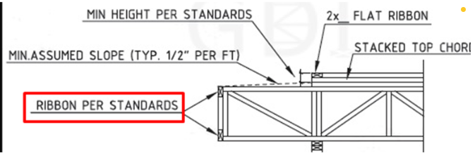

# Советы и важные вещи

Здесь: правила, собранные из правок и замечаний по сданным работам, по темам. Многих из них нет в общих гайдах по estimating: это локальная память. Как выглядит ошибка и как её ловить - на странице [Частые ошибки](../start/common-mistakes.md); здесь только правило.

## Стены и стойки { #studs }

- Высота стойки = floor-to-floor минус subfloor, минус глубина перекрытия, минус plates. Floor-to-floor и отметка потолка высотой стойки не являются; проверять по разрезу каждого дома. Пример: `11'1" wall - 22" truss - 3/4" subfloor = 9'2" stud`. На COM точная высота до 1/8" в E строки студов.
- Тип стены (ext, corr, dem, party) определяется по участкам wall schedule, не группой: кусок demising внутри наружной линии остаётся demising.
- Нижняя plate P.T. только на бетоне и кладке. Двойная нижняя plate только там, где показывает деталь.
- Факторы studs: [Stud spacing factors](formulas.md#stud-spacing-factors), `12 / 16 / 24 = 1.4667 / 1.1 / 0.625`. Joists считаются по другой таблице (`12 / spacing`). Здесь числа не дублируются.
- Corridor 2x4 staggered = два ряда на 16" o.c., plates 2x6. Bearing walls нижних этажей могут требовать double studs: считать как Extra по stud schedule этажа.
- Металлические стены: даже когда metal by others, строка или нота `Metal studs are by others` остаётся. Список клиентов - [Правила клиентов, Metal Studs](../start/client-rules.md#metal-studs).
- Шахты всегда в книге, материал по чертежу (лифт из CMU - не деревянный shaftliner).
- Внутренний гипсокартон, внутренний утеплитель и sound batt во frame-scope не считаем; утеплитель только наружный после обшивки, даже на CMU. Наружный гипс (паркинг, mech) считается.

<figure markdown>
  
  <figcaption markdown="span">Staggered stud wall: два ряда стоек 2x4 на общих plates 2x6. В книге два ряда studs на 16" o.c. и plates 2x6.</figcaption>
</figure>

## FRT { #frt }

FRT задаёт тип конструкции из Code Compliance Summary, а не условная нота.

| Тип конструкции | Что FRT |
| --- | --- |
| Type III | всё в плоскости наружной стены: studs, plates, headers, blocking, sheathing; деревянные стены ниже podium. LVL, PSL, LSL в этой плоскости запрещены, `LVL FRT` не пишется |
| Type V-A, V-B | общего FRT нет; только где деталь прямо требует |
| Любой | parapets и exterior blocking как наружная стена; subfloor: полосы 2' или 4' по периметру своего этажа; demising shear wall sheathing обычная, если schedule не говорит FRT; стены лестниц и шахт часто FRT по детали |

`FRT` и `FRTW` на чертеже - одно требование. Нота `all wood materials at exterior to be FRT` = весь loose plywood снаружи FRT с `verify`.

## Обшивка и WRB { #sheathing }

- `19/32" = 5/8"`, не `1/2"`. Относится к plywood и OSB.
- Структурный лист главнее по толщине; Zip по арх превалирует над структурной нотой, но с нотой. `7/16" Zip` на S и `Zip R-3` на A - один продукт, не расхождение.
- Название обшивки проектное: `LP FlameBlock 2-sided` не равно `7/16 OSB FRT`; `5/8 EXT. SHEATHING` не превращать в Ply без основания; `CDX` только если так в спецификации.
- Наружный барьер называется WRB или Air Barrier, не Vapor Barrier; продукт по спецификации (fluid-applied - не Tyvek).
- Таблицы спецификации читать до конца: WS-1 (стены) и WRS-1 (кровля) - разные таблицы.
- Слои по стрелкам детали: двойная стрелка на один штрих = два слоя, каждый своей строкой.
- Panel-job: одна сторона обшивки в панели; считать только требуемую вторую. Наружная сторона SW уже в ext walls, нужна только внутренняя; двусторонний SW подписывать "с двух сторон", G = сумма двух лиц без ещё одного x2. `P` у марки = perforated, не две стороны.
- Проёмы вычитать из обшивки, WRB, утеплителя, Z-girt и линии фундамента по своему этажу и один раз. Окна меньше 4' не вычитаются.
- H-clips не нужны при T&G и при настиле толще порога спецификации; иначе по шагу опор, не "4 на лист". [H-clips](../work/horizontal/roof-framing/h-clips.md).
- Измеренная площадь должна дойти до Excel и обновиться после правок в программе.

## Wall panels { #wall-panels }

Полный разбор, таблица scope и исключения под бетоном и при reconstruction: [Wall Panels](../work/vertical/walls/wall-panels.md).

- В panelized scope стены рядом с CMU могут быть панелями. Соседство с CMU и имя `furring wall` сами по себе не делают стену stick и не основание для optional framing.
- Не панели: стены под concrete slab, внутри existing frames, короткие и с irregular slope. Exterior build-up walls могут быть исключением - проверить конструкцию и scope, не исключать все build-ups автоматически.
- Furring под siding и insulation - отдельные элементы по своему scope: [Furring](../work/vertical/walls/furring.md).
- Headers внутри панелей не рисуются; отдельно только flush; при экспорте headers встают в блок стен этажа ниже.

## Rim, ribbon, blocking { #rim-board }

| Ошибка | Как правильно |
| --- | --- |
| `1-3/4 LVL Rim`, когда LVL не указан | `11-7/8" Rim`; LSL назван - `11-7/8" LSL Rim` |
| Rim разбит на куски по 16' | rim в LFT с фактором `1.05` (EWP) или `1.1` |
| Ribbon board при top chord bearing trusses | blocking между фермами, часто `(2) 2x6` |

- `1-3/4 LVL Rim` только когда к rim крепится deck или corridor frame. С I-joists только engineered rim. Rim нужен и у roof TJI.
- Стены 10' и выше - два ряда blocking. Blocking, drywall blocking, ribbon, ledger - LFT с 10% waste один раз ([Rim, ribbon, blocking](formulas.md#blocking-formulas)).
- Ledger и его крепёж отдельными строками по детали (3 SDWS на торец фермы на 16"), вход по своему этажу.
- Piggyback trusses: sleepers `2x6` между верхними частями ферм.

<figure markdown>
  
  <figcaption markdown="span">Ribbon по стандарту производителя ферм на top chord: при top chord bearing вместо ribbon считается blocking между фермами.</figcaption>
</figure>

## Hangers, ties, holdowns { #dhu-dgu-vs-its }

- `DHU / DGU` только там, где joists висят над firewall у лестниц, лифтов, шахт; обычная demising с гипсом под перекрытием - `ITS`. DHU заметно дороже, помечать стояки отдельно для проверки.
- Hangers на оба конца каждого joist, по сборкам; снаружи `Zmax`; ties к фермам под обшивкой без `Zmax`. Формат записи - [Hangers, как записывать](hangers.md#dfl-format).
- Roof-to-wall ties по всем линиям опирания, шаг = шаг ферм, `H3` с обеих сторон фермы и base ties у каждой стойки, если деталь так даёт.
- Holdowns: к бетону один, через деревянное перекрытие два; над балкой transfer holdown не нужен (указание клиента); явно показанный инженером крепёж не удалять. Блок в конце секции стен этажа: [Блоки](dfl-blocks.md#holdowns).
- `A35 / LTP4` на shear walls по SW schedule и деталям: если schedule их называет, считать по шагу.
- Анкеры shear walls разносить по шагу, в E марка SW, в B тип и размер из anchorage schedule; wedge anchor на Titen HD не менять без основания; plate washers по таблице, не универсальные 3x3.

<figure markdown>
  
  <figcaption markdown="span">Деталь holdown у фундамента: threaded rod anchor, holdown на chord studs, plate washer на анкере SW. К бетону одна строка `Holdowns (1) btm`.</figcaption>
</figure>

## Кровля { #roof }

- Уклон с листа, применяется один раз; у каждого корпуса свой. Overframe не добавлять автоматом.
- Eaves все участки; canopy не входит в eve и rake. Frame for Eave по разрезу: алюминиевый карниз не считается.
- Truss bracing на всю площадь под крышей, включая гараж.
- Kickers только там, где они есть на детали; firewall и gable kickers по шагу детали.
- Soffit: деревянный каркас считаем, алюминиевый soffit нет; 5/8" exterior gypsum на canopies и porch; обе площади soffit идут в обшивку и WRB.
- Draft stop чердака отдельно от fireblock, по зонам roof plan, строка в `Gable Walls`; не копировать из суммы shear.
- Парапеты по узлам с заходом вокруг rim, раскрой реальный, coping отдельной строкой или в Drip Edge.

## Балки, посты, лестницы { #framing }

- Каждая марка балки на каждом этаже, где показана; PSL под концами балок по schedule.
- Имя балки в программе несёт длину с округлением инструмента Beam: до 8' вверх до целого фута, длиннее до чётного.
- Cap и base на каждую стойку по детали; непрерывный пост один раз на верхнем этаже, который он держит.
- Nailer на стальной балке: сверху 3x DF, снизу отдельно 2x; болты по балкам своего этажа.
- Болты, шайбы, гайки раздельными формулами; одна шайба на болт, две при дереве с обеих сторон; гвозди не считать; у screws шайбы и гайки не нужны.
- Лестницы умножать на число лестниц; два марша - stringers 2x12, не LVL из шаблона; `2x12 Tread` и `1x8 Riser`.
- Мелкие конструкции не забывать: roof hatch curb, mechanical platforms, sign backing, trash enclosure, ограждения с крепежом; blocking кухни и ванной.

## Балконы и porch { #deck }

- Posts на улице всегда P.T.; под крышей обычные. Railing composite как система, wood painted поэлементно; два поста на балкон.
- Porch считается отдельно от балконов; porch SQFT на Front Page заполнять даже при porch над балконом.
- Ceiling joists porch + ledger + hangers обязательны; каркас не показан - нота. Полный состав: [Блоки балконов, porch и holdowns](dfl-blocks.md).

## Двери { #doors }

- Unit entry doors из коридора обычно fire rated: `3070 Entry`, `2670 FCW`, `3070 HM C-lbl`; формат строки `3070 1 unit MARK FIRE LABEL`.
- Двери шире 4' как двойные: `5070` = `(2)2670`. Hardware numbers в takeoff не идут.
- Casing в LFT по трём сторонам двери; jambs межкомнатных дверей считать точками по юнитам, группа по сечению соседней стены (точка у `2x6` = jamb 2x6).

## Interior trims { #trims }

- Room schedule: только wood base (`Wd`); tile base исключать.
- Corridors, lobbies и другие common areas отдельно: trim type может отличаться от units.
- Crowns включаются, когда interior trim scope активен. Trims не указаны - `not specified`, не придумывать.

## Formatting и output { #formatting }

- Этажи отдельно, даже одинаковые; заголовок секции `4th Floor Framing List is the same as 3rd Floor` вместо ноты.
- Единицы: `LFT`, не `FT`; caps, bases, коннекторы в `pcs`. Подпись совпадает с расчётом; E = правильный лист или деталь; дюймы со знаком `"`.
- Другой сорт отдельной строкой; copied detail labels поправлены; `Schedule`, не `Shedule`; этажи `1st`, `2nd`, `Loft`.
- Материал из отдельной спецификации - нота `per customer note`. Unused rows удалять, кроме формул, которые питают расчёт стен.
- Не менять местами count и length для joists; для duplex и повторяющихся корпусов множители проверять дважды.
- Полная проверка перед сдачей: особенно позиции, которых очень много, и "ничего ли не задвоено".

## См. также

- [Частые ошибки](../start/common-mistakes.md), [QA checklist](../start/quality-checklist.md), [Правила клиентов](../start/client-rules.md)
- [Формулы и факторы](formulas.md), [Ноты в DFL](standard-notes.md), [Hangers](hangers.md)
