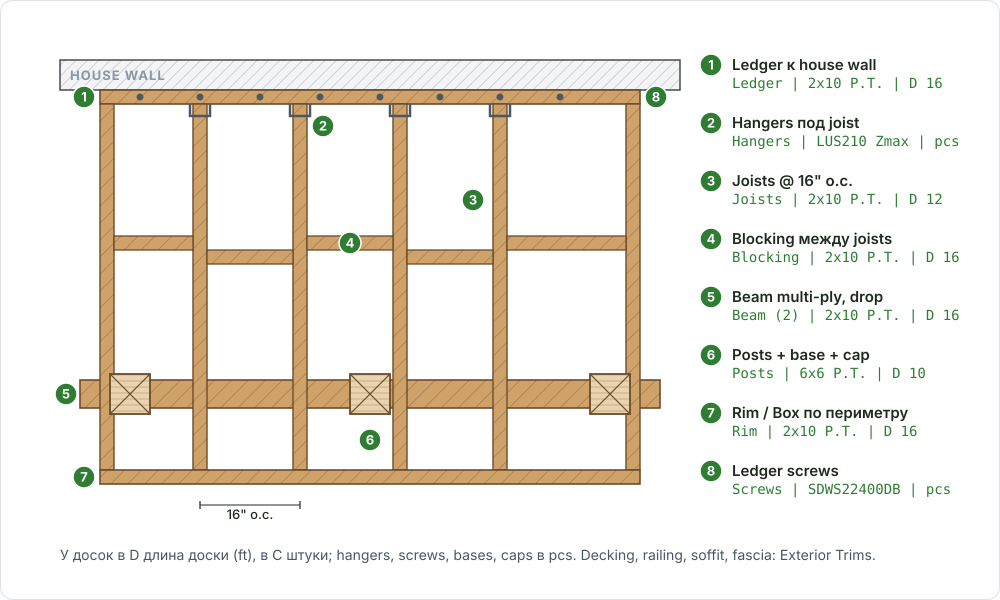
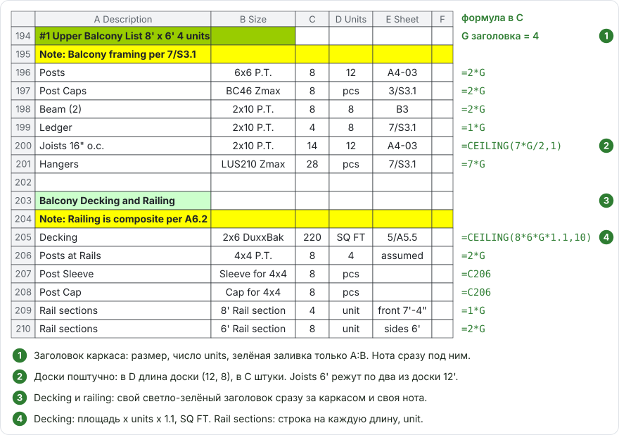
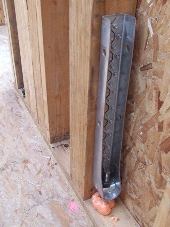

# Balcony, porch and holdown blocks in the DFL

Here: how to lay out a balcony block, a porch block and a holdown block in the workbook the way it is done in delivered jobs. A block = a header with a fill, notes under it, rows with formulas, white blank rows between groups. A block is inserted as a copy of a reference (the template's block `#1` or a block from a previous delivery), not typed by hand.

!!! warning "New group formatting rules (November 2026)"
    A group sits inside Framing, preferably right after the framing list of its floor. Decking, railing and trims come right after the framing **under their own headers**. Notes go only under a header. Full rule with a diagram: [File format, groups](dfl-overview.md#groups).

<figure markdown>
  
  <figcaption markdown="span">Balcony framing: ledger at the wall, joists with hangers, beam on posts, box or rim around the perimeter. Each element is its own row in the block.</figcaption>
</figure>

## Before the blocks

1. A second block in the same workbook: [Duplicate Block](ewood-tab.md#duplicate) copies it with its own units. The first block: open a delivered job with a similar balcony or porch and see how the block is laid out there.
2. Count the types separately: balconies by size and number of posts, porch separately from balconies (a porch has its own count, it does not mirror the balconies). The number of instances comes from the doors on the floor plans, multiplied by the floors, cross-checked against the deck joist callouts on the S plans: a door without wood joists means a concrete or truss balcony, which is a different block.
3. Take the takeoffs from OurPlanCore: areas `sqfts/blcny`, `sqfts/porch`, block points (one takeoff per type, a point per instance, `xN` in the name), holdowns from `shear walls/<floor>/holdowns`.
4. Read all connection details on S to the end: beam to post, floor edge, beam to beam.

## Block formatting

| Element | How |
| --- | --- |
| Balcony header | `="#N Upper Balcony List W' x D' "&G&" unit"&H`, fill A:B, bold black; the template fill is `FABF8F`, in the reference books group headers are green `99CC00`; use green for a new header ([what is not settled yet](dfl-overview.md#open)); a terrace over a garage is `Upper Balcony/Terrace List` |
| Porch header | `#N Porch Framing List W' x D'`, fill A:B green `99CC00`, bold black |
| Ground deck header | must contain `Deck` and `Frame` or `Framing`, plus the level and location: `Rear Ground Deck Frame`, `Ground Deck Framing List (left)`. The program does not recognize `Rear Deck` |
| Text in the header | only in A, columns B-F empty; put the detail or sheet in a note under the header |
| Several of the same type | state the location: which balcony is where, which porch |
| Units | G of the header = number of instances; area rows parse W and D from the header and multiply by the header's G |
| Notes | under the header, not above it; prefix and yellow fill ([Notes](dfl-overview.md#notes)) |
| Decking, railing, trims | right after the framing, each under its own header row: `Balcony Railing`, `Ground Deck Decking (rear)`, `Canopy Trims`, `Decking and Railing`, `Porch Trims` |
| Blank rows | white, formatted from a white blank row; fill only on notes and the header |
| Zeros | delete rows with C = 0 and empty template rows |

## Balcony block

<figure markdown>
  
  <figcaption markdown="span">A filled block: framing header with size and units, the note under it, framing rows, then `Decking and Railing` under its own header. On the right the column C formula, G = units from the header. Callouts on the picture are in Russian.</figcaption>
</figure>

| Row | How to count | Source |
| --- | --- | --- |
| `Posts` | `P.T.`, per the plan: usually 2, a corner or recessed balcony may carry 1 | plan, S detail |
| `Post Bases` | model per detail (`ABA66 Zmax`, `ABU66 Zmax`) | S detail |
| `Post Caps` | by beam plies: 3-ply `BCS2-3/6 Zmax`, 2-ply `BC46 Zmax`; model per schedule, not the default | S detail, schedule |
| `Beam` front and sides | plies as the leading multiplier in C (`=3*...`, `=2*...`); beam codes from the project legend (example: balcony `2x12 P.T.` B3/B4, porch `2x10` B1/B2) | beam schedule |
| `Ledger` + screws | screws `SDWS22400DB`, 3 per point (`=CEILING(...,3)`) | ledger detail |
| `Box` | only if the beam is not flush; a flush beam replaces box and rim | S plan |
| `Joists` | `2x12 P.T.` or `2x10 P.T.`, count `W*12/16+1`; a long board in D (14') and `/2` in C, do not multiply short D values | S plan |
| `End Joists` | the outer joists in a different size, hangers `LUC210 Zmax` (concealed flanges) | S detail |
| `Hangers` | `LUS210 Zmax` joist to ledger; `HUC212-2 Zmax` beam to beam; LVL beam `HUC410 Zmax` | S details |
| Beam to post connections | `ML210Z`, `HL33Z`, through bolts + washers + nuts, SDS: each on its own row, E = detail | S details |
| `Decking` | under its own header; `2x6 DuxxBak`, SQ FT: area of one balcony x units x 1.1 (`=CEILING(W*D*G*1.1,10)`, under 50 round to an even number), E = detail; `5/4x6` only on a terrace over a garage (there: subfloor `3/4" Ply` + sleepers `2x4 P.T.` + `5/4x6`) | A detail |
| `Fascia`, `Soffits`, `Post Wrap`, flashing | under the trims header (`Balcony Trims`), only if trim is in scope; Frame only: do not insert | scope |

Concrete and truss balconies (living space below, LW concrete) are not part of the wood block: bases = 0 on those stacks and a `counted separately` note.

## Railing

A balcony always has railing: either as a system or by component, per the detail. Do not mix them on one balcony. Railing rows go right after the framing under their own header (`Balcony Railing` or a shared `Decking and Railing`), with the note about the system under it.

| Type | Rows |
| --- | --- |
| Composite, Azek, system | note about the system + `Posts at Rails 4x4 P.T.` (`=2*G`, two per balcony) + `Post Sleeve` + `Post Cap` + `Rail sections`: one row per section length, B `8' Rail section`, D `unit`, E the side and its real length (`front 7'-4"`). One section per span between posts; the section length is the next stock length above the side |
| Wood painted, by component | `Posts at Rails 4x4 P.T.` (`=2*G`) + `Balustrades =EVEN(G*2.2)*units` (`pcs`) + `Rails (top & bottom) =EVEN(G*2.2)*units` (`LFT`) + `Cap Rail =EVEN(G*1.1)*units` (`LFT`), where G = railing length of one balcony in LFT (the perimeter less the wall side), units = G of the block header |
| Aluminum, metal | note `Note: Aluminum railing materials are by others; verify components.`; material is not counted |

System types and what they include: [Rails & Decking](../work/exterior-trims/rails-decking.md).

## Porch block

- `Ceiling Joists 16" o.c.` + ledger + hangers are required and go separately from the rafters.
- Porch framing not shown on the drawings: a note right under the header: `Note: Porch framing is not specified; all framing assumed; verify.`
- A porch over a balcony with a truss roof: only `Posts` + `Beams` (+ caps), units = stacks, remove the template's rafters and ridge.
- Porch ceiling with a rated assembly (the section names a UL or GA assembly): one row `Soffit Gypsum (2)`, B `5/8" Type X`, C `=CEILING(G*2*1.1,2)*units`, D `SQ FT`, where G = area of one porch. The two layers are in the label and as `*2` once; never two gypsum rows. An open porch with no ceiling shown gets no row.
- Rafter block of a real porch roof: box + ledger + sub fascia, ridge beam per detail.
- Outdoor lumber of a porch, balcony, deck and canopy is always `P.T.`: posts, beams, joists, ledger, rafters, railing posts, roofed or not. Plain lumber only inside the building envelope (a bay floor, interior posts). Hardware outdoors and on P.T. takes `Zmax` ([Hangers](hangers.md#dfl-format)).

## Holdown block { #holdowns }

Location: in the wall section of the floor whose shear walls the holdown serves (`1st Floor Walls`, `2nd Floor Walls`), not in the Framing List. The block goes at the end of the section: after the last `Tape` row (under Box Sheathing), with a blank row before and after.

| Row | C | When |
| --- | --- | --- |
| `Holdowns (1) btm` | `=G` | to concrete, bottom level, as drawn on the plan |
| `Holdowns (2) btm top` | `=G*2` | through a wood floor: one below, one above |

- B = model per the SW schedule (`HDU5-SDS2.5`), G = number of points from OurPlanCore, E = SW mark (`SW-2`). One row per model.
- A holdown over a beam does not need a transfer holdown below (client instruction); do not delete hardware the engineer shows explicitly. Threaded rod only if shown.
- Holdowns not marked on the plan: `TBD HD` + note `Note: Locations of shear walls and holdowns are assumed; verify.`
- Shear wall anchors: A as text `SW Anchor Bolts 12" o.c.`, B the size from the anchorage schedule (`1/2" Ø x 4" emb Titen HD`), E the SW mark, spacing in H from the sill and sole plate anchorage table; washers as one row `=SUM(...)` with the model (`BP1/2-3`). Do not replace a wedge anchor with Titen HD without a basis; count only for 1st floor SWs to concrete; a double-sided SW gets double anchorage. Details: [Anchor Bolts](../work/deck/anchor-bolts.md), [Shear Wall](../work/vertical/sheathing/shear-wall.md).

<figure markdown>
  
  <figcaption markdown="span">Holdown at the base of a shear wall stud, anchored into concrete: the `Holdowns (1) btm` row. Photo: Thester11, CC BY-SA 3.0, [source](https://commons.wikimedia.org/wiki/File:HoldDown.JPG)</figcaption>
</figure>

## Common mistakes

- A balcony block without its own unit multiplier, or with a multiplier from another block.
- A note above the block header; decking and railing directly under the framing header; the group moved to the end of the worksheet.
- Porch mirrored from the balconies instead of counted separately; porch SQFT on the Front Page empty.
- Three posts per railing instead of two; system and component railing mixed.
- Balcony hangers without `Zmax`; cap `BCS2-3/6` on everything regardless of plies.
- One holdown through a wood floor instead of two; the model not from the table of its own building.

All mistakes: [Deck, porch, balconies](../start/common-mistakes.md#deck), [Shear walls and holdowns](../start/common-mistakes.md#holdowns).

## Example

```text
A                          B                  C                              D      E
#2 Upper Balcony List 8' x 6'   4 unit                                             (header G = 4)
Posts                      6x6 P.T.           =2*G                           10     S4.1
Post Caps                  BC46 Zmax          =2*G                           pcs    3/S4.1
Beam (2)                   2x12 P.T.          =1*2*G                         8      B3
Joists 16" o.c.            2x12 P.T.          =CEILING((8*12/16+1)/2,1)*G    12     28 pcs 6'
Hangers                    LUS210 Zmax        =7*G                           pcs    7/S4.1

Balcony Decking and Railing                                                        (its own header)
Note: Railing is composite per A6.2; posts, sleeves, caps and rail sections counted.
Decking                    2x6 DuxxBak        =CEILING(8*6*G*1.1,10)         SQ FT  5/A5.5
Posts at Rails             4x4 P.T.           =2*G                           4      assumed
Rail sections              8' Rail section    =1*G                           unit   front 7'-4"
Rail sections              6' Rail section    =2*G                           unit   sides 6'
```

What this gives for 4 balconies:

- `Posts`: 2 x 4 = 8 posts, D holds the post length 10'. `Beam (2)`: one two-ply beam per balcony, 1 x 2 x 4 = 8 boards of 8'.
- `Joists`: an 8' width at 16" o.c. takes 8 x 12 / 16 + 1 = 7 joists of 6'. Two 6' pieces are cut from a 12' board, so 4 boards per balcony, 16 in all; D holds the board length 12, the piece count goes to E.
- `Hangers`: a joist hangs on a hanger at the ledger, its other end sits on the beam: 7 x 4 = 28.
- `Decking`: 8 x 6 x 4 x 1.1 = 211.2, rounded up to 10 = 220 SQ FT.
- `Rail sections`: one section per span between posts, the section length is the next stock length above the side. The 7'-4" front takes one 8' section, the two 6' sides take two 6' sections. For 4 balconies: 4 and 8.

## See also

- [Frame (deck/porch/balcony)](../work/deck/deck-porch-balcony-frame.md), [Railing](../work/deck/railing.md), [Rails & Decking](../work/exterior-trims/rails-decking.md)
- [How the DFL workbook works](dfl-overview.md), [Notes in the DFL](standard-notes.md), [Hardware catalog](hardware-catalog.md)
