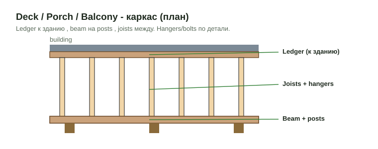
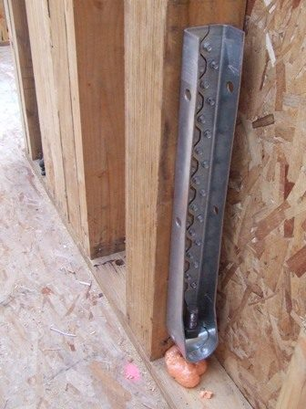

# Блоки балконов, porch и holdowns в DFL

Здесь: как расписать в книге блок балкона, блок porch и блок holdowns так, как это делается в сданных работах. Блок = заголовок с заливкой, ноты под ним, строки с формулами, белые пустые строки между группами. Блок вставляется копией эталона (блок `#1` шаблона или блок из прошлой сдачи), а не набирается руками.

<figure markdown>
  
  <figcaption markdown="span">Каркас балкона: ledger у стены, joists с hangers, beam на posts, box или rim по периметру. Каждый элемент - своя строка блока.</figcaption>
</figure>

## Перед блоками

1. Открыть сданную работу с похожим балконом или porch и посмотреть, как блок расписан там.
2. Посчитать типы отдельно: балконы по размеру и числу постов, porch отдельно от балконов (у porch свой счёт, он не зеркалит балконы). Количество экземпляров - по дверям на планах этажей, умноженное на этажи, со сверкой с deck-joist callouts на S-планах: дверь без деревянных joists - бетонный или ферменный балкон, это другой блок.
3. Замеры взять из OurPlanCore: площади `sqfts/blcny`, `sqfts/porch`, точки блоков (одна позиция на тип, точка на экземпляр, `xN` в имени), holdowns из `shear walls/<этаж>/holdowns`.
4. Все детали соединений на S прочитать до конца: балка к посту, край перекрытия, балка в балку.

## Оформление блока

| Элемент | Как |
| --- | --- |
| Заголовок балкона | `="#N Upper Balcony List W' x D' "&G&" unit"&H`, заливка A:B оранжевая `FABF8F`, жирный чёрный; терраса над гаражом - `Upper Balcony/Terrace List` |
| Заголовок porch | `#N Porch Framing List W' x D'`, заливка A:B зелёная `99CC00`, жирный чёрный |
| Units | G заголовка = число экземпляров; площадные строки парсят W и D из заголовка и множат на G заголовка |
| Ноты | сразу под заголовком, стиль локальной ноты ([Ноты в DFL](standard-notes.md)) |
| Пустые строки | белые, формат с белой пустой строки; заливка только на нотах и заголовке |
| Нули | строки с C = 0 и пустые шаблонные строки удалить |

## Блок балкона

| Строка | Как считать | Откуда |
| --- | --- | --- |
| `Posts` | `P.T.`, по плану: обычно 2, угловой или нишевый балкон может нести 1 | план, S-деталь |
| `Post Bases` | модель по детали (`ABA66Z`, `ABU66 Zmax`) | S-деталь |
| `Post Caps` | по plies балки: 3-ply `BCS2-3/6 Zmax`, 2-ply `BC46 Zmax`; модель per schedule, не дефолт | S-деталь, schedule |
| `Beam` фронт и бока | plies ведущим множителем в C (`=3*...`, `=2*...`); коды балок из легенды проекта (пример: балкон `2x12 P.T.` B3/B4, porch `2x10` B1/B2) | beam schedule |
| `Ledger` + screws | screws `SDWS22400DB` по 3 на точку (`=CEILING(...,3)`) | деталь ledger |
| `Box` | только если балка не flush; flush-балка заменяет box и rim | S-план |
| `Joists` | `2x12 P.T.` или `2x10 P.T.`, счёт `W*12/16+1`; длинная доска в D (14') и `/2` в C, короткие D не плодить | S-план |
| `End Joists` | крайние joists другим сечением, hangers `LUC210 Zmax` (скрытые полки) | S-деталь |
| `Hangers` | `LUS210 Zmax` joist к ledger; `HUC212-2 Zmax` балка в балку; LVL-балка `HUC410 Zmax` | S-детали |
| Соединения балка к посту | `ML210Z`, `HL33Z`, through bolts + washers + nuts, SDS: каждое своей строкой, E = деталь | S-детали |
| `Decking` | `2x6 DuxxBak`, SQ FT, E = деталь; `5/4x6` только на террасе над гаражом (там subfloor `3/4" Ply` + sleepers `2x4 P.T.` + `5/4x6`) | A-деталь |
| `Fascia`, `Soffits`, `Post Wrap`, flashing | только если отделка в scope; Frame only - не вставлять | scope |

Бетонные и ферменные балконы (низ - жилое, LW concrete) в деревянный блок не входят: bases = 0 на этих стеках и нота `counted separately`.

## Перила

Railing всегда есть в блоке: либо системой, либо поэлементно, по детали. Не смешивать на одном балконе.

| Тип | Строки |
| --- | --- |
| Composite, Azek, система | нота про систему + `Posts at Rails 4x4 P.T.` (`=2*G`, два на балкон) + `Post Sleeve` + `Post Cap` + `Rail sections 6'` (фронт и бока отдельными строками) |
| Wood painted, поэлементно | `Posts at Rails 4x4 P.T.` (`=2*G`) + `Balustrades =EVEN(G*2.2)` + `Rails (top & bottom) =EVEN(G*2.2)` + `Cap Rail =EVEN(G*1.1)`, где G = LFT перил x units |
| Aluminum, metal | нота `Note: Aluminum railing materials are by others; verify components.`; материал не считаем |

Типы систем и их состав: [Rails & Decking](../work/exterior-trims/rails-decking.md).

## Блок porch

- `Ceiling Joists 16" o.c.` + ledger + hangers обязательны и идут отдельно от rafters.
- Каркас porch на чертежах не показан - нота сразу под заголовком: `Note: Porch framing is not specified; all framing assumed; verify.`
- Porch над балконом с кровлей на фермах: только `Posts` + `Beams` (+ caps), units = стеки, rafters и ridge из шаблона убрать.
- Потолок porch одной строкой `5/8" Gyp`, два слоя вшиты в формулу (`*2`), не две строки.
- Rafter-блок настоящей кровли porch: box + ledger + sub fascia, ridge beam по детали.
- Посты porch, балкона и перил на улице всегда `P.T.`; porch или балкон под крышей (закрытый) - обычный каркас, не P.T. Крепёж снаружи `Zmax` ([Hangers](hangers.md#dfl-format)).

## Блок holdowns { #holdowns }

Место: в секции стен того этажа, чьи shear walls держит holdown (`1st Floor Walls`, `2nd Floor Walls`), не в Framing List. Блок в конце секции: после последней строки `Tape` (под Box Sheathing), пустая строка до и после.

| Строка | C | Когда |
| --- | --- | --- |
| `Holdowns (1) btm` | `=G` | к бетону, нижний уровень, как нарисовано на плане |
| `Holdowns (2) btm top` | `=G*2` | через деревянное перекрытие: один снизу, другой сверху |

- B = модель по SW schedule (`HDU5-SDS2.5`), G = число точек из OurPlanCore, E = марка SW (`SW-2`). Строка на каждую модель.
- Holdown над балкой не требует transfer holdown ниже (указание клиента); явно показанный инженером крепёж не удалять. Threaded rod только если показан.
- Holdowns на плане не размечены: `TBD HD` + нота `Note: Locations of shear walls and holdowns are assumed; verify.`
- Анкеры shear walls: A текстом `SW Anchor Bolts 12" o.c.`, B размер из anchorage schedule (`1/2" Ø x 4" emb Titen HD`), E марка SW, шаг в H из таблицы sill and sole plate anchorage; washers одной строкой `=SUM(...)` с моделью (`BP1/2-3`). Wedge anchor не менять на Titen HD без основания; считать только для SW первого этажа к бетону; у двустороннего SW анкеровка двойная. Подробно: [Anchor Bolts](../work/deck/anchor-bolts.md), [Shear Wall](../work/vertical/sheathing/shear-wall.md).

<figure markdown>
  
  <figcaption markdown="span">Holdown у основания стойки shear wall, анкер в бетон: строка `Holdowns (1) btm`. Фото: Thester11, CC BY-SA 3.0, [источник](https://commons.wikimedia.org/wiki/File:HoldDown.JPG)</figcaption>
</figure>

## Частые ошибки

- Балконный блок без своего множителя units или с множителем из чужого блока.
- Porch зеркалён с балконов вместо отдельного счёта; porch SQFT на Front Page пуст.
- Три поста на перила вместо двух; система и поэлементный railing смешаны.
- Hangers балкона без `Zmax`; cap `BCS2-3/6` на всё подряд без учёта plies.
- Один holdown через деревянное перекрытие вместо двух; модель не из таблицы своего корпуса.

Все ошибки: [Deck, porch, балконы](../start/common-mistakes.md#deck), [Shear walls и holdowns](../start/common-mistakes.md#holdowns).

## Пример

```text
#2 Upper Balcony List 12' x 7'   4 unit            (G заголовка = 4)
Note: Railing is composite per A6.2; posts, sleeves, caps and rail sections counted.
Posts                      6x6 P.T.           =2*G       pcs   10'     S4.1
Post Caps                  BC46 Zmax          =2*G       pcs           3/S4.1
Beam (2)                   2x12 P.T.          =2*CEILING(12/14,1)*G    LFT   B3 S4.1
Joists 16" o.c.            2x12 P.T.          =CEILING((7*12/16+1)/2,1)*G   LFT  S4.1
Hangers                    LUS210 Zmax        =CEILING(10*G,2)         pcs   7/S4.1
Decking                    2x6 DuxxBak        =CEILING(12*7*1.1,10)*G  SQ FT 5/A5.5
Posts at Rails 4x4 P.T.    4x4 P.T.           =2*G       pcs   4'
Rail sections 6'           6' Rail section    =EVEN(19/6*G)  pcs
```

## См. также

- [Frame (deck/porch/balcony)](../work/deck/deck-porch-balcony-frame.md), [Railing](../work/deck/railing.md), [Rails & Decking](../work/exterior-trims/rails-decking.md)
- [DFL: как устроена книга](dfl-overview.md), [Ноты в DFL](standard-notes.md), [Hardware catalog](hardware-catalog.md)
