# How the DFL workbook works

Here: what the working Excel workbook (Detailed Frame List) is made of, what columns it has, in what order the sections go, how rows are tied to takeoffs in OurPlanCore, and how to format the file so the processing program reads it correctly.

!!! warning "New formatting rules (November 2026)"
    The worksheet is now read by a program: it goes by color, prefixes and words. The main changes: **a note without a prefix gets lost**, **any colored material row counts as an option**, **a note above a header goes into the previous block**. Everything with examples: [Source file format](#source-format).

<figure markdown>
  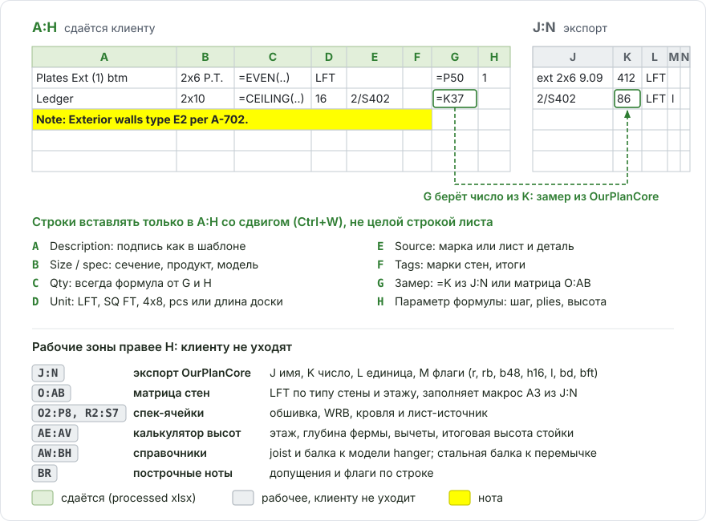
  <figcaption markdown="span">The Detailed Frame List worksheet: the delivered table A:H and the work areas right of H (export from the app, wall matrix, spec cells, height calculator, lookup tables). G takes its number from K of the export or from the matrix. Rows are inserted only in A:H.</figcaption>
</figure>

## What is where on this page { #map }

<div class="grid cards" markdown>

-   :material-layers-triple-outline:{ .lg .middle } **Section order**

    ---

    Which section follows which: a floor's framing, its blocks, its walls, the next floor.

    [See the order](#section-order)

-   :material-table-column:{ .lg .middle } **Columns and areas**

    ---

    What to write in A:H and what is calculated on the right.

    [Columns A:H](#columns-ah-delivered), [work areas](#zones)

-   :material-note-text-outline:{ .lg .middle } **Notes**

    ---

    Important, Note, Comment: where they go and what they look like.

    [Notes](#notes)

-   :material-palette-outline:{ .lg .middle } **Options and color**

    ---

    A colored row drops out of the main list, an orange one goes to review.

    [Options](#options), [revision](#review)

-   :material-home-floor-1:{ .lg .middle } **Balconies, porches, decks**

    ---

    How to name a block and where decking, railing and trims end up.

    [Groups](#groups), [where a block goes](#section-blocks)

-   :material-check-all:{ .lg .middle } **Before sending**

    ---

    13 items worth going through before delivering the file.

    [Checklist](#checklist)

</div>

## What it is

The DFL (Detailed Frame List) is an Excel workbook that holds all the material for a building: one workbook per building (`Bldng#A.xlsm`, `Bldng#B.xlsm`), the file name equals the Job Name on the Front Page. The workbook is made from the `TemplateCom.xlsm` template (it is in the app's updates folder) and already contains all the formulas, macros and the notes library. The client gets the processed `.xlsx` (formulas in A:F converted to values) together with a PDF of the takeoff sheets.

| Worksheet | What is on it |
| --- | --- |
| `Front Page` | Customer, Contact, Date, Total pages; areas by floor (`Basement`, `1st`, `2nd`, `Loft`), separate `Porches` and `Balconies` rows; Total SQFT |
| `Detailed Frame List` | the main worksheet: header, main notes, material table by section, work areas on the right |
| `Standarts` | library of notes and row labels (Labels), where the canonical wording comes from |
| `Mat List` | material list by family (sizes, grades) |

## Columns A:H (delivered)

| Column | What is in it | Example |
| --- | --- | --- |
| **A** | Description: the row label, as in the template ([Labels](takeoff-items.md)) | `Studs Ext 16" o.c.`, `Box Sheathing`, `Holdowns (2) btm top` |
| **B** | Size / spec: member size, product, hardware model | `2x6 P.T.`, `(2) 1 3/4 x 11 7/8 LVL`, `7/16" Zip`, `HHUS410 Zmax SK30 R` |
| **C** | Quantity: always a formula from G and H, never a number typed by hand | `=CEILING(G41/32*1.1,1)` |
| **D** | Unit: `LFT`, `SQ FT`, `4x8`, `pcs`, `50' rolls`. Write `LFT`, not `FT` | `LFT` |
| **E** | Source or explanation: sheet and detail, wall mark, stud height, purpose | `8/S3.0`, `SW-2`, `11' 8 3/8"`, `for Ext Walls` |
| **F** | Door or cased opening type tag, trim material type; the program ignores color in F, so it is used to mark a row ([File format](#rows)). Also wall mark tags | `Type A`, `IL326`, `IW2` |
| **G** | Takeoff from OurPlanCore: LF, SF or number of points | `=K37` |
| **H** | Formula parameter: spacing in inches, number of plies, height | `16`, `2` |

Wall height lives in E of the stud row (to 1/8"); wall names in the app use decimal feet. The SW mark and the source sheet also go in E, not in a note: a fact in the row means no note is needed ([Notes in the DFL](standard-notes.md)).

## Work areas on the right { #zones }

The worksheet uses up to 79 columns. Only A:F are labeled in the header, so the right side looks empty, but that is where heights, LF by wall type and hardware selection are calculated. Read the row in full.

| Area | Columns | What is there |
| --- | --- | --- |
| Export from the app | `J:N` | J the takeoff name as in the tree (`ext 2x6 10.70`, `4/S523`), K the number, L the unit, M flags for rim/blocking/hangers (`r`, `rb`, `b48`, `h16`, `l`, `bd`, `bft`) |
| Wall matrix | `O:AB` | LF by wall type and floor (`Ext2x6`, `Cor2x6`, `Dem2x4`...), filled by macro A3 from J:N; the Floor Walls rows reference it |
| Spec cells | `O2:P6`, `O7:P8`, `R2:S7` | `O3` wall sheathing, `O4` WRB, `O5` Zip, `O6` Zip Tape, `O8` subfloor; `R3` main roof, `R4` overframes, `R5` metal, `R6` flat, `R7` shingles. Next to them `P` and `S`: the source sheet as a bare reference: `S3.0`, `8/S3.0`, `A3.0 S2.5` |
| Height calculator | `AE:AV` | floor, truss depth, deductions (slab, beam, curb), resulting stud height |
| Lookup tables | `AW:BH` | rows 2-20: joist and beam to hanger model, steel beam to header; below that, hangers count by floor |
| Per-row notes | `BR` | assumptions and flags for the row (`Note: Trusses by others`) |

Spec cells are filled in from the PDF when the job is created, not before delivery: the E cells of the sheathing rows pull them with formulas (`=$P$3`, `=S3`), and one cell spreads across the whole worksheet. No source: leave `per page` and put the assumption in a main note. Details: [Notes in the DFL, spec cells](standard-notes.md#spec-cells).

!!! warning "Insert rows only in A:H"
    A new row is added as cells A:H with a shift down (the Ctrl+W macro), not as a whole worksheet row. A whole row shifts the right-hand areas, and the height and wall matrix formulas stop matching the data. Deleting is also only A:H with a shift up (Ctrl+Q). [Macros and hotkeys](excel-hotkeys.md).

## Section order

The `Detailed Frame List` worksheet reads top to bottom, the way the building goes up.

!!! tip "In short"
    **Foundation, 1st floor framing, 1st floor blocks, 1st floor walls, 2nd floor framing, blocks, walls** and so on to the top. Then loft, gables, parapets, shafts, Wall Materials, roof, trim.

    Fill in the template as usual: its sections are in a different order, and Process Excels makes the right order in the finished copy.

<figure markdown>
  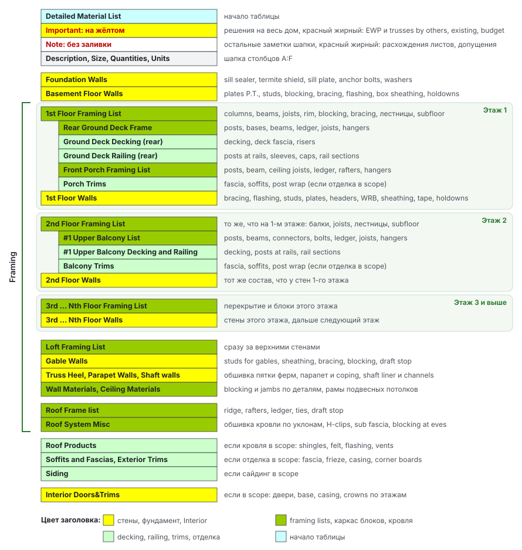
  <figcaption markdown="span">All sections and blocks top to bottom in the finished file, in construction order.</figcaption>
</figure>

### What a section is made of in Excel { #section-anatomy }

A section takes columns A:H and runs from its header to the header of the next section.

| What | What it looks like in Excel | Example |
| --- | --- | --- |
| Header | bold text in A, colored fill, B-F empty. One blank row before it, no blank row right under it | `1st Floor Walls` |
| Note under the header | right under the header, yellow fill on A:F | `Note: Floor Trusses are by others` |
| Material rows | A label, B size or product, C quantity, D unit, E sheet or detail | `Bracing Ext Walls`, `2x4`, `76`, `14` |
| Row group | rows of one assembly go together, one blank row between groups | hangers right after their joists |
| Note inside a section | above the rows it refers to, bold without fill, a blank row above it | `Note: Optional garage headers added; verify` |
| Stair count | bold row without fill, number in G, ending in H | `Note: 2 Stairs`, G `2`, H `s` |

The header color hints at the kind of section:

| Color | Which sections |
| --- | --- |
| Yellow `FFFF00`, A only | `Foundation Walls`, floor walls, `Gable Walls`, `Truss Heel`, `Parapet Walls`, `Shaft walls`, `Interior Doors&Trims` |
| Green `99CC00`, A or A:B | framing lists, framing of balconies, porches, decks and canopies, `Wall Materials`, `Roof Frame list`, `Roof System Misc` |
| Light green `CCFFCC`, A only | group decking, railing and trims, `Soffits and Fascias`, `Exterior Trims`, `Siding` |

### What follows what { #section-list }

| # | Header in A | What is in this section | Where the takeoff comes from in OurPlanCore |
| --- | --- | --- | --- |
| 1 | `Detailed Material List`, header notes, `Description` | decisions for the building: construction type, FRT, sheathing, what is by others. The `Description` row is the column header | - |
| 2 | `Foundation Walls` | sill sealer, termite shield, sill plate, anchor bolts at spacing, washers | 1st floor `walls`, `shear walls` |
| 3 | `Basement Floor Walls` | P.T. plates, studs, blocking, bracing, flashing, box sheathing, holdowns | `walls/base floor walls` |
| 4 | `1st Floor Framing List` | columns and posts, beams, joists, rim and ribbon, blocking, bracing for trusses, draft stop, stairs, subfloor and panel adhesive at the end | `framing/1st framing/beams, joists, details, stairs`, `sqfts/1st` |
| 5 | 1st floor groups: `Ground Deck...`, `Front Porch...`, `Canopy...`, `1st Floor Balcony...` | the group's framing, under it decking, railing and trims with their own headers ([Groups](#groups), [Blocks](dfl-blocks.md)) | `sqfts/porch`, `sqfts/deck`, block points |
| 6 | `1st Floor Walls` | bracing, flashing, studs, plates, headers, WRB, wall sheathing and tape, box sheathing and tape, `Holdowns` at the end | `walls/<floor> floor walls/<category size height>`, `openings`, `shear walls/<floor>/holdowns` |
| 7 | `2nd Floor Framing List`, 2nd floor groups, `2nd Floor Walls` | the same for the 2nd floor. Groups with `Upper` in the name go here | the same 2nd floor folders, `sqfts/blcny` |
| 8 | Likewise `3rd ... Nth` | framing, groups, walls of each next floor | the same folders by floor |
| 9 | `Loft Framing List` | loft framing, right after the top walls | `framing/loft framing` |
| 10 | `Gable Walls #1 / #2` | studs for gables, sheathing, bracing, blocking; after a blank row `Draft Stop` | `gables/gable stick`, `gables/gable trusses`, `gables/gable trusses/draft stop` |
| 11 | `Truss Heel`, `Parapet Walls`, `Shaft walls` | truss heel sheathing; parapet plates, studs and sheathing, coping; shaft liner and channels | `trussheel`, `parapets/<zone>/prpt Hout Hin Wtop`, shaft walls |
| 12 | `Wall Materials`, `Ceiling Materials` | blocking and jambs per details, suspended ceiling framing | `details`, RCP takeoffs |
| 13 | `Roof Frame list`, `Roof System Misc` | ridge, rafters, ties; roof sheathing by pitch, H-clips, frame for rakes and soffits, sub fascia, blocking at eves. Framing ends here | `framing/roof framing`, `sqfts/rf 6`, `sqfts/flat`, `eves rakes/eves`, `eves rakes/rakes` |
| 14 | `Roof Products`, `Soffits and Fascias`, `Exterior Trims`, `Siding` | only if trim is in scope | `trims`, `siding` |
| 15 | `Interior Doors&Trims` | only if in scope; bold labels without color by floor `1st Floor`, `2nd Floor` | `trims`, `units` |

Sections not needed for the scope are removed by the macros `A9_Fame_only` (framing only) and `A9_1_wall_panel` (panel building), and empty and zero rows are deleted before delivery.

### What it looks like on the worksheet { #section-sheet }

<figure markdown>
  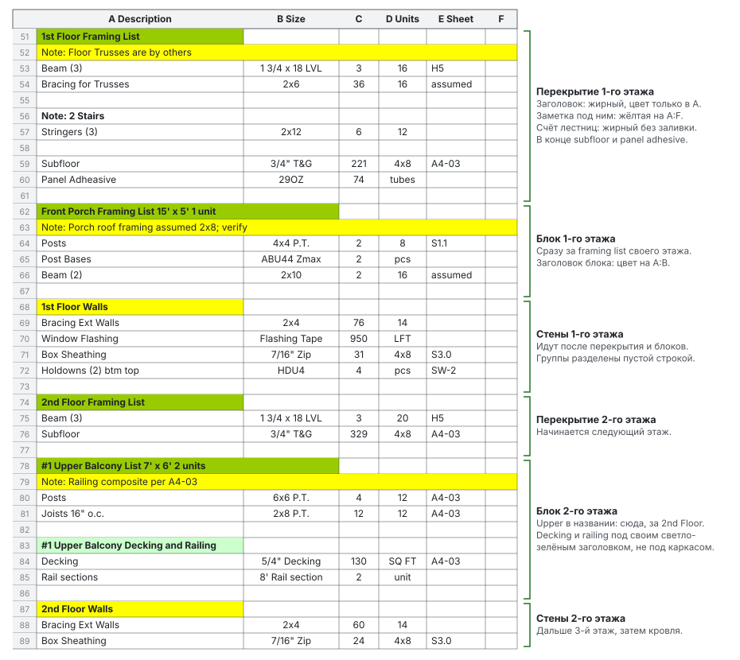
  <figcaption markdown="span">Two floors in the finished file: framing, the floor's own block, walls, the next floor's framing. Sample data.</figcaption>
</figure>

### Template and finished file { #section-template }

In the template everything is arranged by type of work: all walls first, then all framing, blocks at the very end. In the finished file the same content is arranged by floor.

| Template, where you fill in | Finished file after Process Excels |
| --- | --- |
| `Foundation Walls`, `Basement Floor Walls` | the same |
| `1st`, `2nd`, `3rd Floor Walls` in a row | `1st Floor Framing List`, 1st floor groups, `1st Floor Walls` |
| `Gable Walls`, `Truss Heel`, `Parapet Walls`, `Shaft walls`, `Wall Materials` | `2nd Floor Framing List`, 2nd floor groups, `2nd Floor Walls` |
| `1st`, `2nd`, `3rd Floor Framing List` in a row, `Loft Framing List` | `3rd Floor Framing List`, groups, `3rd Floor Walls`, `Loft Framing List` |
| `Roof Frame list`, `Roof System Misc` | `Gable Walls`, `Truss Heel`, `Parapet Walls`, `Shaft walls`, `Wall Materials` |
| balcony, porch, deck, canopy blocks | `Roof Frame list`, `Roof System Misc` |
| `Roof Products` and trim | the same |

!!! warning "Do not rearrange sections by hand"
    Formulas and the right-hand areas are tied to the template rows. Process Excels moves only columns A:H and only in the finished copy; the working workbook stays as it is.

!!! success "Quantities do not change"
    After the move, the program checks all materials, the `Front Page` and the `Mat List`. If something does not match, the file is not created. What changed is recorded in the `dfl_rules_report.txt` report next to the finished files.

!!! note "Rows J:L stay where they are"
    In the finished file, for moved sections they no longer sit next to their rows. The G-to-K references are correct, but checking takeoffs is easier in the working workbook.

### Where a block goes { #section-blocks }

!!! tip "Put the level in the block name"
    The program takes the block's floor from the header. No level: the block goes to the 1st floor.

| In the block name | Where it goes | Example |
| --- | --- | --- |
| floor number | after that floor's framing list | `#1 1st Floor Balcony List`, `2nd Floor Porch Framing List` |
| `Upper` | after `2nd Floor Framing List` | `#1 Upper Balcony List` |
| no level, or `Ground` | after `1st Floor Framing List` | `Front Porch Framing List`, `Ground Deck Framing List (left)`, `Rear Canopy Framing List` |
| `Roof` | before the roof sections | `Roof Deck Framing`, `Side Roof Framing List` |

Several blocks on the same floor go in the order they were in the template. Decking, railing and trims go right after the framing of their block.

### Special cases { #section-cases }

| Case | What the finished file will have |
| --- | --- |
| First floor on a slab | `1st Floor Framing List` stays with one note `Note: First Floor is on the concrete slab`, the 1st floor blocks come after it |
| Concrete first floor | `1st Floor Walls Materials at Concrete` in place of the 1st floor walls, then `2nd Floor Framing List` |
| Identical floors | the headers `4th Floor Framing List is the same as 3rd Floor`, `3rd Floor Walls is the same as 2nd Floor Walls` go in the same order as regular ones |
| One list for two floors | `1st - 2nd Floors Framing List` goes before `1st Floor Walls` |
| A floor has framing but no walls of its own | the framing list goes after the walls of the floor below |
| No framing list for the floor in question | the block goes after the nearest framing list below |
| The building has no framing list at all | blocks go before the roof sections |

## How OurPlanCore takeoffs become rows

The XL strip in the app writes takeoffs into the workbook and runs the workbook's macros (details on the buttons: [OurPlanCore, Estimating and export](ourplanecore.md)). The general flow is the same for all buttons:

1. A takeoff from the tree goes into the `J:N` work area next to its section: name in J, number in K, unit in L.
2. A workbook macro spreads J:N into A:H rows: `A3` calculates walls into the `O:AB` matrix, `C_BeamsSort`, `C_JoistsSort`, `C_HeadersSort`, `C_PostsSort` write the framing rows, `C_RimBoardBlockingHangers` expands the M flags into rim, blocking, hangers, ledger.
3. G of the row keeps a link to the takeoff (`=K37`), C calculates from G and H. So a takeoff corrected in the app and exported again changes the quantity by itself.

| XL button | What it takes from the tree | Where it goes in the workbook |
| --- | --- | --- |
| `SF` | `sqfts/1st, 2nd, base, rf 6, flat, blcny, porch` | Front Page, subfloor, roof areas by pitch |
| `WL` | `walls/<floor> floor walls/*` | O:AB matrix, Floor Walls rows (studs, plates, bracing, sheathing) |
| `GB`, `TH`, `PP`, `E/R` | `gables`, `trussheel`, `parapets`, `eves rakes` | Gable Walls, Truss Heel, Parapet Walls, Roof Products |
| `OP` | `openings/<floor>/WxH d gd` | Ext. Headers by width (`up to 48"`, `60"`, `72"`, `over 72"`), flashing |
| `SH`, `SW`, `SHF`, `UN` | sheathing from J or the legend, `shear walls`, shafts, `units` | A7 sheathing, Holdowns into the floor's wall block, Shaft walls, units table |
| `FR` (= `PS`, `BM`, `HD`, `JS`, `DT`, `ST`) | `framing/<floor> framing/posts, beams, headers, joists, details, stairs` | the floor's Floor Framing List; headers into the wall block of the floor below; details into J:M with flags |
| `BL` | `sqfts/blcny`, `sqfts/porch` | blocks `#N Upper Balcony List`, `#N Porch Framing List` |
| `LG` | project legend | `H5 - (2) 1 3/4 x 11 7/8 LVL` (size by code), `4/S523 = b24` (detail flags), `wall sheathing = 7/16" Zip no insulation` |

Beam, post and header codes (`H5`, `B2`, `C5`) without a legend go into the workbook as a code instead of a size: fill in the legend before export, per the project schedule.

## Front Page and SQFT

- Floor areas come from `sqfts` and go to the Front Page row by row; the floor above the last full floor is written `Loft`, not `5th`.
- `Porches` and `Balconies` have their own rows. A porch over a balcony does not cancel the porch row: fill in both.
- Customer, Contact, Date, Total pages filled in before delivery; Total SQFT is not 0.

## Source file format { #source-format }

Here: how to format the file before sending it for processing. The rules come from the estimator guide (November 2026) and its two reference files.

**Why.** The processing program builds a summary list from the worksheet and assigns product codes to materials. It does not understand what rows mean and relies on color, prefixes and keywords. Extra text in a header or a colored row changes the result: the material ends up in the wrong group or drops out of the main list. A well-formatted file is processed in a few minutes instead of half an hour.

You already do most of this. Only two things are really new: **three note levels** and **the new color logic**.

!!! note "Automation does not replace these rules"
    When the file is processed (Process Excels, Merge DFL), automation can fix some of the formatting. But only the estimator knows what counts as an option, what level a note has and what type a door is, so the estimator follows the rules.

### Section and subsection headers { #headers }

Header: **bold text + colored fill + name in column A + columns B-F empty**. A blank row before the header.

- Bold alone is not enough: a bold row without fill counts as a regular row.
- Text in B-F, even one word, breaks the header. Put the explanation in a note under it.
- Section names are standard (as in the template). Subsections inside Framing can be named as needed, same formatting.
- A bold label without color inside a section is fine as a regular row: `1st Floor` among the doors, `Living rm Trims:` before a group of panels.

<figure markdown>
  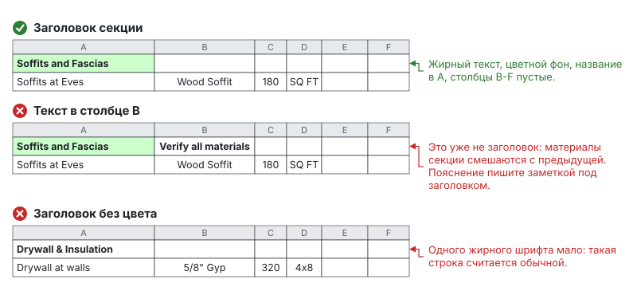
  <figcaption markdown="span">A correct header, one with text in B, and one without color.</figcaption>
</figure>

Colors in the reference files (the guide does not set a specific color, the fill itself is required):

| Color | Where in the reference files |
| --- | --- |
| Yellow `FFFF00`, A only | `Foundation Walls`, `Shaft Walls`, `1st Floor Walls`, `Interior Doors&Trims` |
| Green `99CC00`, A or A:B | framing lists, group framing (`Porch Framing List 4pcs`, `Ground Deck Framing List (left)`, `Pergola 4 pcs`), `Roof Frame list`, `Roof System Misc` |
| Light green `CCFFCC`, A only | `Decking`, `Decking and Railing`, `Porch Trims`, `Pergola Trims`, `Soffits and Fascias`, `Exterior Trims`, `Siding` |

### Groups: deck, porch, balconies, canopy { #groups }

The framing, trims, decking and railing of these structures sit **inside the Framing section as subsections, right after the Framing List of their floor**: a 2nd floor balcony after `2nd Floor Framing List`, a porch and a ground deck after `1st Floor Framing List`, a roof deck before the roof. Groups moved to the very end of the worksheet get added up wrongly with the other material and have to be sorted out by hand.

- **Ground deck framing:** the name must contain `Deck` and `Frame` or `Framing`, plus the level and location. Right: `Rear Ground Deck Frame`, `Roof Deck Framing`, `Ground Deck Framing List (left)`. Wrong: `Rear Deck`.
- **Trims, Decking, Railing:** each block gets its own header row, not directly under the framing header. Right: `Balcony Railing`, `Ground Deck Decking (rear)`, `Canopy Trims`, `Decking and Railing`, `Porch Trims`. Wrong: `Ground deck`, `Balcony deck`, `Ground Rail`.
- If there are several balconies, porches or decks, state the location: which one is where.

<figure markdown>
  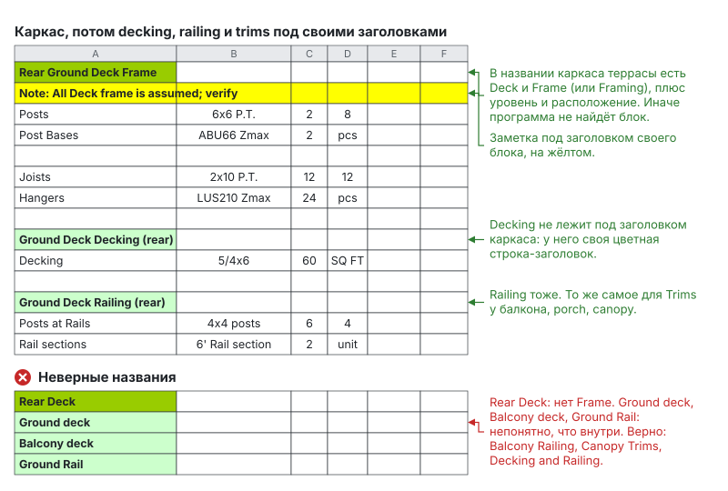
  <figcaption markdown="span">Ground deck group: framing with a note, then decking and railing under their own headers.</figcaption>
</figure>

What it looks like in the reference file:

```text
First Floor Framing List                  green
Ground Deck Framing List (left)           green, A:B
Note: All Deck frame is assumed to verify yellow, A:F
Posts, Post Bases, Post Caps, Beams, Ledger, Joists, Hangers, Stringers, Flashing
Decking and Railing                       light green
Note: Decking is composite per elevation  yellow, A:F
Note: Railing per detail page A4.04       yellow, A:F
Decking, Posts at Rails, Post Sleeve, Post cap, Rail sections, Post Wrap, Deck Fascia, Lattice
1st Floor Walls                           yellow
```

### Notes { #notes }

A note = a row with a prefix in A, columns B-F empty. Per the guide all notes have a yellow fill, and a row without it does not make it into the final file as a note. Our practice:

- **In the worksheet header** (above `Description`): `Important:` red bold on yellow, a regular `Note:` red bold without fill.
- **Right under a section header:** yellow fill on A:F.
- **Inside a section above its rows**, and the count row `Note: 2 Stairs`: bold without fill, as before.

| Prefix | When | Look | Examples |
| --- | --- | --- | --- |
| `Important:` | a global decision: if the client misses it, the price shifts a lot. The program moves these notes to the top of the final worksheet | red bold on yellow | EWP by others, trusses by others, addition only, part of the building is existing, two sheathing systems |
| `Note:` | important, but the price does not change for the whole worksheet | black on yellow, bold in the reference files | client and plan disagree, a different LVL size `assumed` |
| `Comment:` | a passing remark about one small element | black on yellow, bold in the reference files | where the headers came from, client and plan agree |

A simple level check: what happens if the client does not read it? Half the building counted for nothing or not counted: `Important`. One product instead of another: `Note`. Nothing significant: `Comment`.

<figure markdown>
  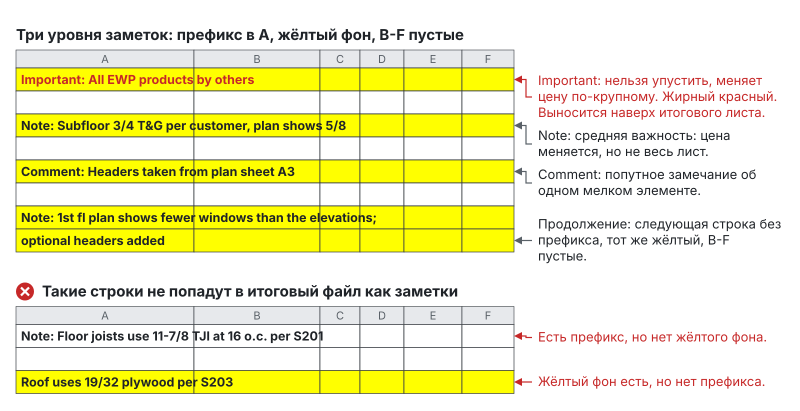
  <figcaption markdown="span">Important, Note, Comment and a note continuation. At the bottom: rows that will not reach the final file.</figcaption>
</figure>

- **Continuation:** the next row right below, no prefix, the same yellow fill, B-F empty. A second note with a prefix also works.
- **Placement:** always **under** the header of its section. The program reads everything under a header up to the next header; a note above a header goes into the previous block. This applies to notes about balcony railing and decking too.
- **A note above an option block** goes right above the colored rows, inside its own section ([Options](#options)).
- **Be specific:** when the file is assembled, duplicates are removed and similar notes are merged. The note gets separated from its block and must read on its own: not `No changes in this area`, but `No changes for the 1st floor walls`. If the note is obviously about the floor of its subsection, the floor need not be repeated, but the text must stay clear outside the worksheet.
- **Pages and details in column E**: leave them as they are: that is comment level, they do not go to the final worksheet.

<figure markdown>
  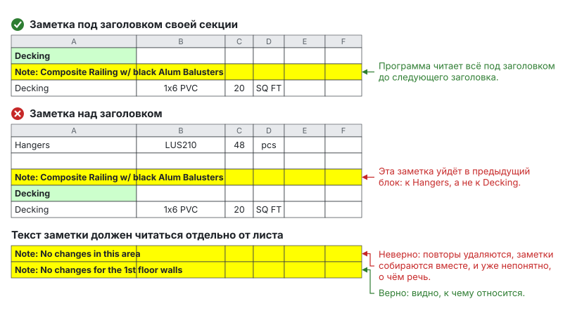
  <figcaption markdown="span">A note under the header and above the header; vague and specific text.</figcaption>
</figure>

How to write the text itself and when a note is not needed: [Notes in the DFL](standard-notes.md).

### Options and color { #options }

!!! danger "The color logic has changed"
    Any colored material row now counts as **an option and is excluded from the main list**. The only exception: orange. Do not color materials for any other reason.

An option is defined by **the fill color of the whole row**, not by the word `optional`. Without color the row goes into the main list as required material, even if A or E says `optional`.

- **Color:** one color per option, not white and not orange, light so the text is readable.
- **Uniqueness:** within a section, one color = one option. Two blocks of the same color in one section merge, whatever they are called. In another section the same color is processed independently.
- **Different options:** clearly different colors (blue and green, not two shades of pink).
- **A blank row** inside a colored block stays in the block if the color continues.
- **End of the block:** the color changes, turns white or disappears, or a header comes up.
- **Name:** optionally a row above the colored rows, B-F empty: `Option 1`, `Optional Railing`, `Option Cupola`. Without it the program names them `Option 1`, `Option 2`.

<figure markdown>
  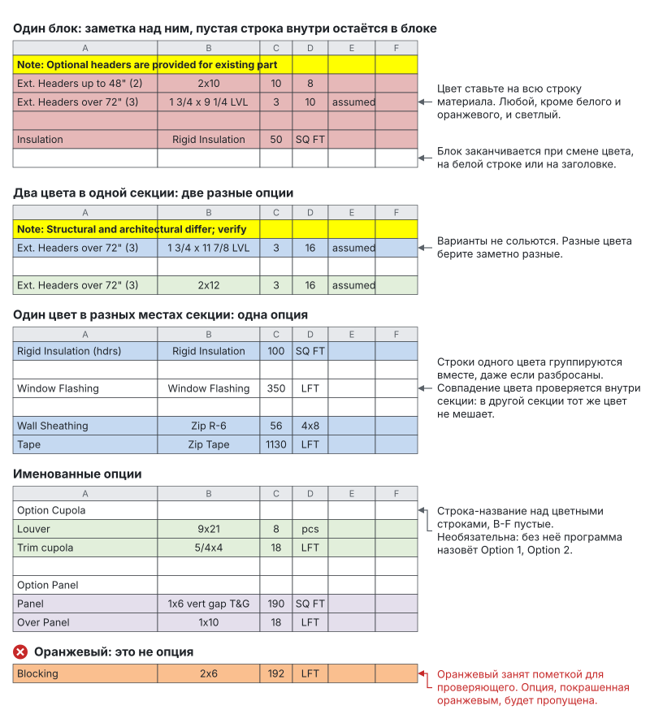
  <figcaption markdown="span">One block with a blank row inside, two colors, a scattered option, named options, an orange row.</figcaption>
</figure>

Typical cases from the reference files:

| Case | How it is formatted |
| --- | --- |
| The plans show two sheathing systems | `Important: Two options of wall sheathing cited...`, below it `Wall Sheathing (opt.1)` and `Tape` in one color, `Wall Sheathing (opt.2)` and `Vapor barrier` in another |
| The whole roof is in question | `Note: Roof materials optional, verify if apply`, all rows of the section in one color |
| Old part of the building | `Note: Optional for existing, verify if apply`, soffits, fascia, frieze for that part in one color |
| A door is not listed in the schedule | `Note: Door not listed, verify if apply`, the row in color |

**Existing part.** If the plan makes it clear that everything is new, count and write it as is. If old roofing, siding or trims remain and there is doubt: the new part as regular rows, the old part as a separate option block in one color, plus a note on what was counted.

**Marking without an option:**

- A row for review: orange `FABF8F` (draws the reviewer's attention).
- Any other visual mark: color only in the column F cell, the program ignores it.

### Review and revision { #review }

In a revision, do not color whole rows: they will become options.

- A value changed: color **only that cell** (or the several cells that changed), any color.
- A row added or changed entirely: **color only in column F**.

<figure markdown>
  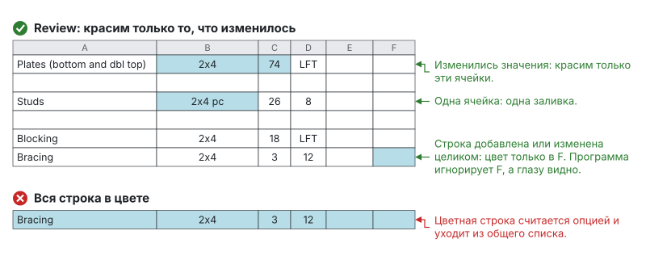
  <figcaption markdown="span">Changed cells and a new row; a whole row in color is wrong.</figcaption>
</figure>

### Microgroups { #microgroups }

Post wraps, panels, corner boards and similar assemblies are often ordered pre-made, so their materials are kept together and not mixed with the rest. A group is defined by its first row.

1. **The row above** the group: blank, a label or a header. It cannot be a material row.
2. **The first row** starts in A with the group word: `Corner Board`, `Panel`, `Planter Box`, `Post Wrap`, `Pilaster Wrap`, `Column Wrap`, `Lattice`. Any description after that. B-D as usual.
3. **End:** a row where A, B and C are empty, or a header.

No separate header is needed. Add a picture for a complex assembly (column, panel) so the client can choose: build it or buy it complete.

<figure markdown>
  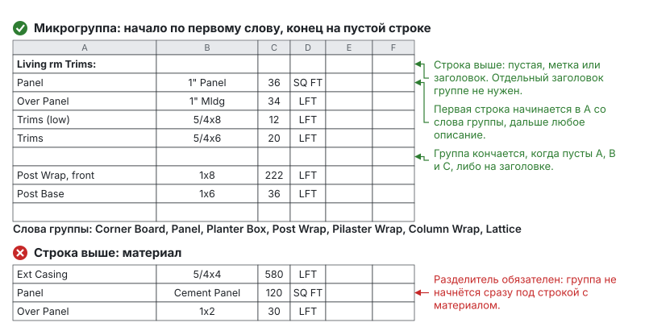
  <figcaption markdown="span">A Panel group after a label, a Post Wrap group after a blank row; wrong: a group right under a material row.</figcaption>
</figure>

### Individual rows { #rows }

| What | Rule | Right | Wrong |
| --- | --- | --- | --- |
| Hardware | a specific name in A; the location, if critical, after the name | `Hangers`, `Bolts`, `Washers`, `Ties`, `Post Caps`, `Anchor Bolts` | `Beam-to-Post`, `Opening`, `Stud`, `Hardware`, `Metal`, `Misc.` |
| Insulation | the full word in column B, otherwise it lands in another group | `Batt Insulation R-21`, `1-1/2 Rigid Insulation` | `Batt R-21`, `1-1/2 Rigid`, `Insul.` |
| Flitch beam | the steel plate as a separate row right after the wood beam (in the reference file also under Ridge) | `Beam (4) Dropped` + `Steel plate (1)`, B `1/4x14` | the plate at the end of the list |
| Detail with a picture | pictures in order (`Detail 1` or `Det. 1`), the material row has the reference in B | `22x42x6, det. 2`, `3" Crown, det.1` | a picture without a number, reference only in E |
| Doors, cased openings | different types: a tag in F starting with the word `Type`; the physical kind and rating stay in B | F `Type A`; B `21080 pocket`, `2880 FR s/cl` | `A` without the word Type |
| Trim with a material type | different material types in F | B `3"`, F `IL326`, `MD-01` | type lost, everything merged into one `3" crown` |

Sheet references without a picture (`1/A423`, `2/pA421`) stay in E, as before.

<figure markdown>
  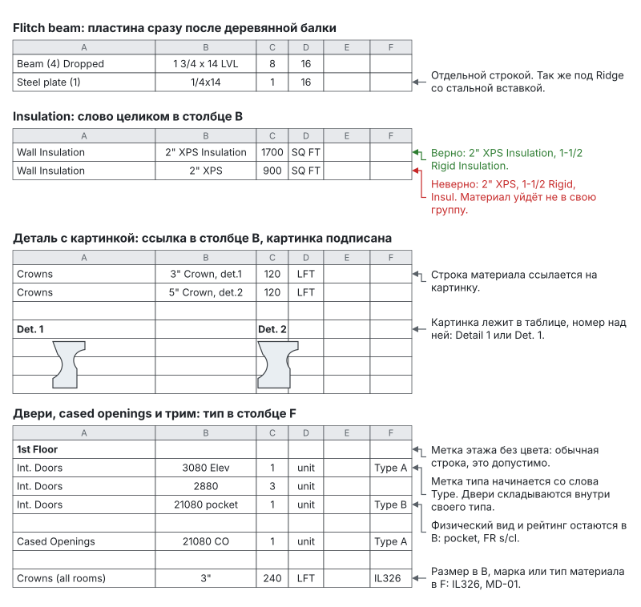
  <figcaption markdown="span">Flitch beam, Insulation, a detail with a picture, door and trim types.</figcaption>
</figure>

Additions from reviewing the guide:

- **Trim with a mark on the plan:** the mark can go right in B instead of the size, since it is the product name. If you write the size in B, the mark goes in F.
- **Similar profiles of the same size** (two 6" crowns): they will be added together when the file is assembled. Write `6" Crown, det.1` and `6" Crown, det.2`, with a picture whose arrow points to the right profile. Write the same profile the same way in different details, so it adds up.
- **Length with steel:** at 14'5" the steel plate is 15, the wood beam may be 16.
- **Commercial doors:** public areas and corridors separately from doors inside units, state the rating. Glass doors are not always labeled as such: when in doubt, `(glass?)` in B.
- **Roofing:** if the plan clearly shows the whole roof as new, say so and do not make it an option.

### Checklist before sending { #checklist }

- [ ] 1. Headers: bold font, colored fill, B-F empty. Bold alone is not enough.
- [ ] 2. The name of a deck's framing contains `Deck` and `Frame` or `Framing`.
- [ ] 3. Each Trims, Decking, Railing block has its own header with the right name, and does not sit directly under the framing header.
- [ ] 4. Important, Note, Comment have the right prefix, yellow fill, B-F empty. Important ones are bold red.
- [ ] 5. Option rows: a color unique within the section, not orange and not white.
- [ ] 6. Materials are not colored for any reason other than options. Orange to get the reviewer's attention; in a review, color in F or in the changed cell.
- [ ] 7. Post Wrap, Panel, Corner Board, Planter Box, Lattice: the first row starts with the group word; above it a blank row, a label or a header.
- [ ] 8. Every insulation row has the word `Insulation` in B.
- [ ] 9. Hardware has a specific name in A, not `Hardware`, `Metal`, `Misc.`
- [ ] 10. Flitch beam steel plates as a separate row right after the wood beam.
- [ ] 11. Material rows that belong to a detail picture reference it in B.
- [ ] 12. Door and cased opening type tags in F, starting with the word `Type`.
- [ ] 13. Exterior and interior trim: different material types in F (`MD-01`).

### What is not settled yet { #open }

These are questions we do not have an answer to yet. What is written here is not a rule, just what is known today.

| Question | What is known |
| --- | --- |
| Which exact color counts as orange | the guide gives no color code. For a review mark we use `FABF8F`. Light peach `FCE5D7` appears as an option in the guide's picture, so do not use peach shades for options. Make group headers green `99CC00`, as in the reference files |
| Notes without yellow | the reference file has a red `Note:` without fill at the top, while the guide text says rows without yellow get lost. We do it as described in [Notes](#notes). If such notes start disappearing from the final worksheet, we will change the rule |
| More than half the worksheet changed | not described in the guide. As before: one note in the header, no highlighting |

Where the review session and the guide disagree, the guide wins:

| Topic | At the review session | In the guide |
| --- | --- | --- |
| Header color | "just for style" | required |
| One color per option | across the whole worksheet | within a section |
| Wall insulation | `Wall Insulation` in A and the word in B | only the word in B |
| Group keywords | also `Flower Box` | `Pilaster Wrap`, `Column Wrap`, `Lattice`; no `Flower Box` |
| Floor in a note | once "not needed if the note is in the floor's subsection", another time "write the floor" | example `No changes for the 1st floor walls` |
| `Comment:` | - | text and reference file: yellow fill; in one of the guide's pictures it has no fill |

## Pre-delivery check

- [ ] Units in D (`LFT`, `pcs`, `SQ FT`, `4x8`), the label matches the calculation (`Plates (2)` with H = 2).
- [ ] C is a formula from its own block everywhere: its own header, its own unit multiplier, its own floor; no references to another block after copying a floor.
- [ ] Spec cells O/P and R/S filled in; E of the sheathing rows shows the sheet, not formula text.
- [ ] No junk in the calculation area in any column, not only A:H (a letter in O gives `#VALUE!`).
- [ ] Zero and empty template rows deleted; notes do not contradict rows.
- [ ] The measured area made it to Excel and was updated after edits in the app.
- [ ] Processed `.xlsx` checked against the `.xlsm`: notes and rows in place.
- [ ] Formatting checked against the [file format checklist](#checklist): headers, notes, options, groups.

## Common mistakes

- Copying a whole floor with formulas that look at another floor or someone else's header.
- A quantity as a number instead of a formula: it will not update on the next export.
- Inserting a whole worksheet row instead of A:H: the right-hand areas shifted.
- `FT` in D, `5th` instead of `Loft`, porch SQFT on the Front Page not filled in.
- Spec cells left until delivery: half the E cells reference `per page`.
- A note without the `Important:`, `Note:` or `Comment:` prefix: it will not make it into the final file.
- A note above the block header: it goes into the previous block.
- `(optional)` as a word without color: the option goes into the main list as required material.
- A whole row colored in a revision or "for personal use": it becomes an option and disappears from the main list.
- A block without a level in its name: it goes to the 1st floor, even if it is on the 2nd.

All workbook mistakes: [Common mistakes, Excel DFL and notes](../start/common-mistakes.md#excel).

## Example

```text
A                          B                 C                         D      E          G      H
1st Floor Walls
Note: Exterior walls are type E2 per A-702; studs 9' 1 1/8" per 3/A-300.
Plates Ext (1) btm         2x6 P.T.          =EVEN(G33*H33*1.1)        LFT    A-702      412    1
Plates Ext (2) dbl top     2x6               =EVEN(G34*H34*1.1)        LFT    A-702      412    2
Studs Ext 16" o.c.         2x6               =CEILING(G35*1.1,1)       pcs    9' 1 1/8"  412
Wall Sheathing             =$O$3             =CEILING(G41/32*1.1,1)    4x8    =$P$3      3760
Tape                       =$O$6             =CEILING(G41*0.4*1.1,10)  LFT               3760
Holdowns (2) btm top       HDU5-SDS2.5       =G44*2                    pcs    SW-2       6
```

## See also

- [Notes in the DFL](standard-notes.md), [Row labels and format](takeoff-items.md), [Balcony, porch and holdown blocks](dfl-blocks.md)
- [Excel macros and hotkeys](excel-hotkeys.md), [Formulas and factors](formulas.md)
- [OurPlanCore: Estimating and export](ourplanecore.md), [Workflow](../start/workflow.md), [QA checklist](../start/quality-checklist.md)
