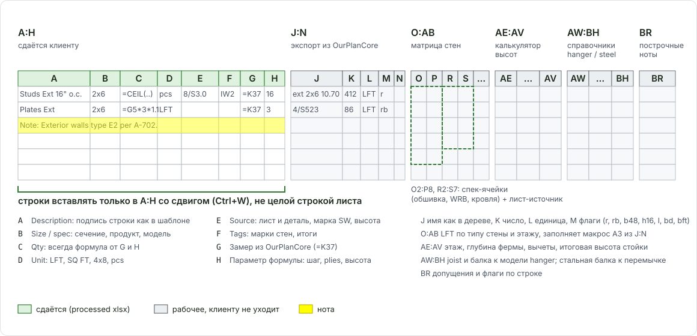
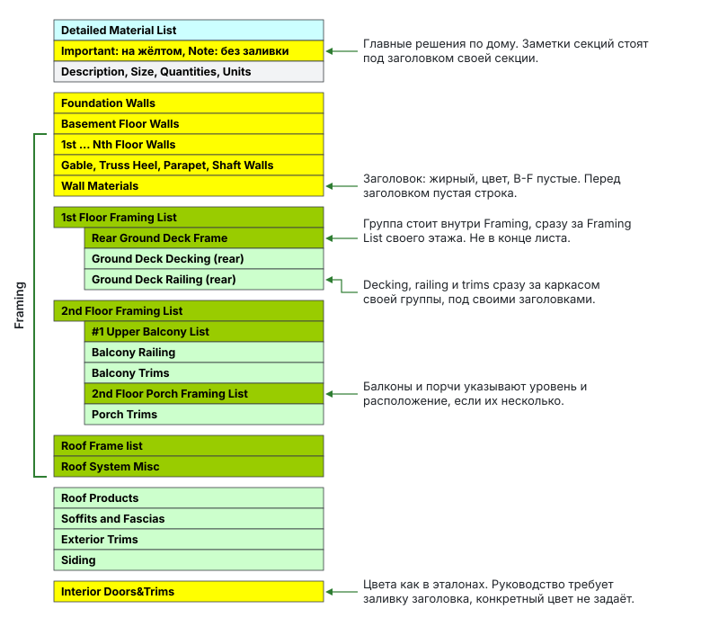
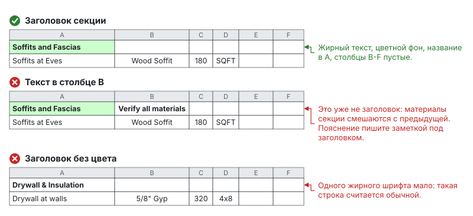
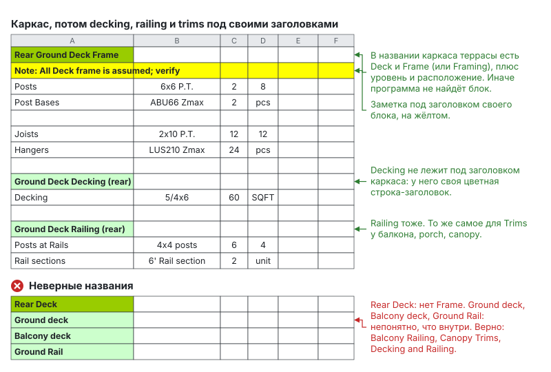
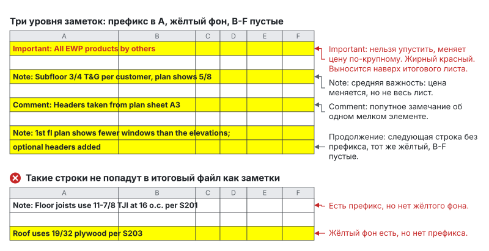
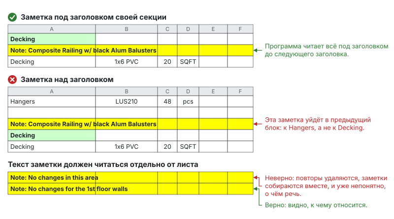
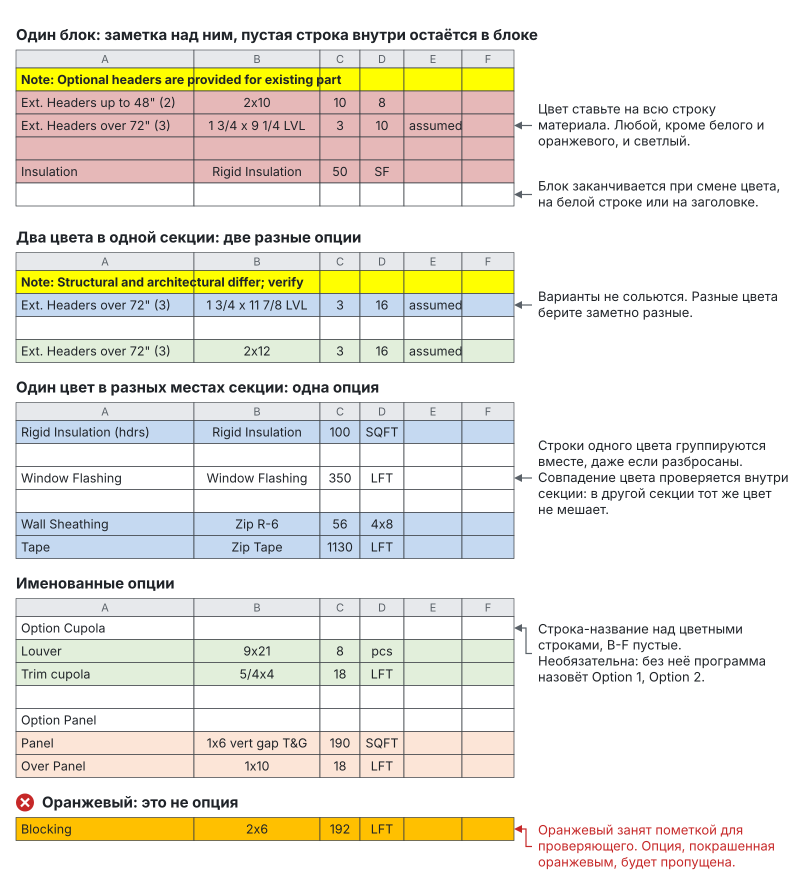
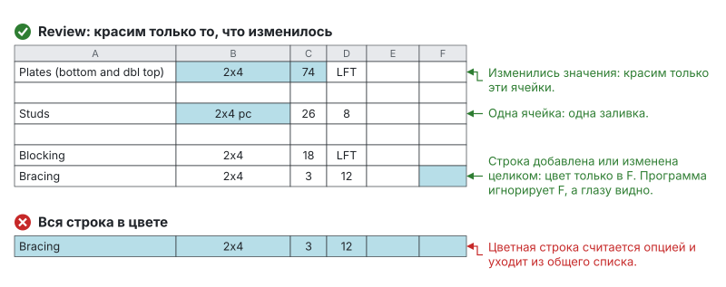
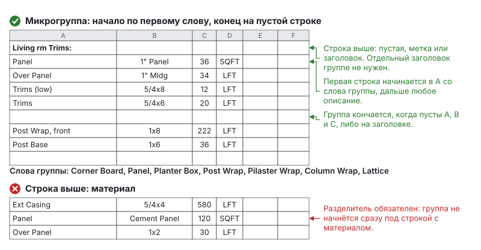
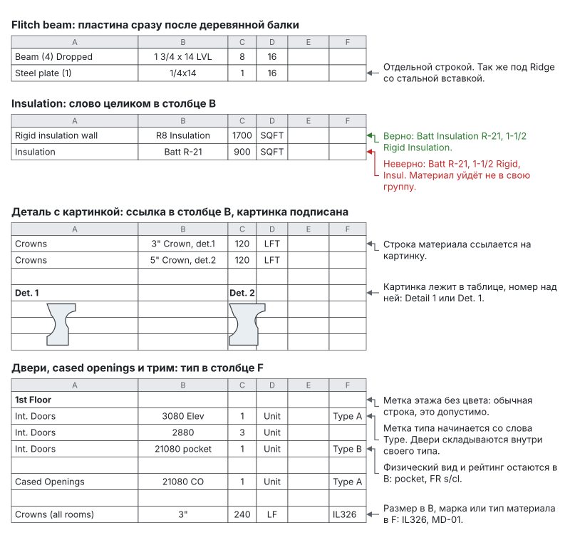

# DFL: как устроена книга

Здесь: из чего состоит рабочая книга Excel (Detailed Frame List), какие в ней колонки, в каком порядке идут секции, как строки связаны с замерами в OurPlanCore и как оформить файл, чтобы его правильно прочитала программа обработки.

!!! warning "Новые правила оформления (ноябрь 2026)"
    Лист теперь читает программа: она ориентируется на цвет, префиксы и слова. Изменилось главное: **заметка без жёлтого фона или без префикса теряется**, **любая цветная строка материала считается опцией**, **заметка над заголовком уходит в предыдущий блок**. Всё с примерами: [Формат исходного файла](#source-format).

<figure markdown>
  
  <figcaption markdown="span">Лист Detailed Frame List: слева сдаваемая таблица A:H, справа рабочие зоны (экспорт из программы, матрица стен, спек-ячейки, калькулятор высот, справочники). Строки вставляются только в A:H.</figcaption>
</figure>

## Что это

DFL (Detailed Frame List) - книга Excel, в которой лежит весь материал по дому: одна книга на корпус (`Bldng#A.xlsm`, `Bldng#B.xlsm`), имя файла равно Job Name на Front Page. Книга делается из шаблона `TemplateCom.xlsm` (лежит в папке обновлений программы) и уже содержит все формулы, макросы и библиотеку нот. Клиенту уходит processed `.xlsx` (формулы в A:F переведены в значения) вместе с PDF листов с замерами.

| Лист книги | Что на нём |
| --- | --- |
| `Front Page` | Customer, Contact, Date, Total pages; площади по этажам (`Basement`, `1st`, `2nd`, `Loft`), отдельные строки `Porches` и `Balconies`; Total SQFT |
| `Detailed Frame List` | главный лист: шапка, главные ноты, таблица материалов по секциям, справа рабочие зоны |
| `Standarts` | библиотека нот и подписей строк (Labels), откуда берутся канонические формулировки |
| `Mat List` | номенклатура материалов по семействам (размеры, сорта) |

## Колонки A:H (то, что сдаётся)

| Колонка | Что в ней | Пример |
| --- | --- | --- |
| **A** | Description: подпись строки, как в шаблоне ([Labels](takeoff-items.md)) | `Studs Ext 16" o.c.`, `Box Sheathing`, `Holdowns (2) btm top` |
| **B** | Size / spec: сечение, продукт, модель крепежа | `2x6 P.T.`, `(2) 1 3/4 x 11 7/8 LVL`, `7/16" Zip`, `HHUS410 Zmax SK30 R` |
| **C** | Quantity: всегда формула от G и H, не число руками | `=CEILING(G41/32*1.1,1)` |
| **D** | Единица: `LFT`, `SQ FT`, `4x8`, `pcs`, `50' rolls`. Пиши `LFT`, не `FT` | `LFT` |
| **E** | Источник или пояснение: лист и деталь, марка стены, высота стойки, назначение | `8/S3.0`, `SW-2`, `11' 8 3/8"`, `for Ext Walls` |
| **F** | Метка типа двери или cased opening, тип материала трима; цвет в F программа игнорирует, поэтому им отмечают строку ([Формат файла](#rows)). Также теги марок стен | `Type A`, `IL326`, `IW2` |
| **G** | Замер из OurPlanCore: LFT, SQ FT или число точек | `=K37` |
| **H** | Параметр формулы: шаг в дюймах, число plies, высота | `16`, `2` |

Высота стены живёт в E строки студов (до 1/8"), в именах стен в программе - десятичные футы. Марка SW и лист-источник тоже идут в E, а не в ноту: факт в строке означает, что нота не нужна ([Ноты в DFL](standard-notes.md)).

## Рабочие зоны справа { #zones }

Лист использует до 79 колонок. В шапке подписаны только A:F, поэтому правая часть выглядит пустой, но именно там считаются высоты, LFT по типам стен и подбор крепежа. Читать строку надо целиком.

| Зона | Колонки | Что там |
| --- | --- | --- |
| Экспорт из программы | `J:N` | J имя позиции как в дереве (`ext 2x6 10.70`, `4/S523`), K число, L единица, M флаги для rim/blocking/hangers (`r`, `rb`, `b48`, `h16`, `l`, `bd`, `bft`) |
| Матрица стен | `O:AB` | LFT по типу стены и этажу (`Ext2x6`, `Cor2x6`, `Dem2x4`...), её заполняет макрос A3 из J:N; строки Floor Walls ссылаются сюда |
| Спек-ячейки | `O2:P6`, `O7:P8`, `R2:S7` | `O3` обшивка стен, `O4` WRB, `O5` Zip, `O6` Zip Tape, `O8` subfloor; `R3` main roof, `R4` overframes, `R5` metal, `R6` flat, `R7` shingles. Рядом `P` и `S` - лист-источник голой ссылкой: `S3.0`, `8/S3.0`, `A3.0 S2.5` |
| Калькулятор высот | `AE:AV` | этаж, глубина фермы, вычеты (slab, beam, curb), итоговая высота стойки |
| Справочники | `AW:BH` | строки 2-20: joist и балка к модели hanger, стальная балка к перемычке; ниже счёт hangers по этажам |
| Построчные ноты | `BR` | допущения и флаги по строке (`Note: Trusses by others`) |

Спек-ячейки заполняются при создании job из PDF, не перед сдачей: E-ячейки строк обшивок тянут их формулами (`=$P$3`, `=S3`), и одна ячейка расходится по всему листу. Нет источника - оставить `per page`, допущение вынести в главную ноту. Подробно: [Ноты в DFL, спек-ячейки](standard-notes.md#spec-cells).

!!! warning "Вставка строк только в A:H"
    Новая строка добавляется как ячейки A:H со сдвигом вниз (макрос Ctrl+W), не как целая строка листа. Целая строка сдвигает правые зоны, и формулы высот и матрицы стен перестают совпадать с данными. Удаление тоже только A:H со сдвигом вверх (Ctrl+Q). [Макросы и клавиши](excel-hotkeys.md).

## Порядок секций

Секция = заголовок с заливкой, под ним её заметки, строки с формулами, пустая белая строка между группами. Лишние секции под scope убирают макросы `A9_Fame_only` (только каркас) и `A9_1_wall_panel` (панельный дом), а пустые и нулевые строки удаляются перед сдачей.

<figure markdown>
  
  <figcaption markdown="span">Секции сверху вниз по ходу стройки: шапка с заметками, Foundation, этаж за этажом framing list с группами deck, балконов и porch и стены, потом фронтоны, парапеты, Wall Materials, кровля, отделка.</figcaption>
</figure>

| # | Секция | Что внутри | Замер в дереве OurPlanCore |
| --- | --- | --- | --- |
| 1 | Шапка `Detailed Material List`, главные ноты, `Description` | решения по дому: тип конструкции, FRT, обшивка, by others | - |
| 2 | `Foundation Walls` | sill sealer, termite shield, anchor bolts по шагу, washers | `walls` первого этажа, `shear walls` |
| 3 | `Basement Floor Walls` | plates P.T., studs, blocking (стик-фрейм под плитой) | `walls/base floor walls` |
| 4 | `1st ... Nth Floor Walls`, стены каждого этажа сразу за его framing list | bracing ext/cor/dem, flashing, studs, plates, headers, WRB, wall sheathing + tape, box sheathing + tape; в конце этажа блок `Holdowns` | `walls/<этаж> floor walls/<категория сечение высота>`, `openings`, `shear walls/<этаж>/holdowns` |
| 5 | `Gable Walls #1 / #2` | studs for gables, sheathing, bracing, blocking; после пустой строки `Draft Stop` | `gables/gable stick`, `gables/gable trusses`, `gables/gable trusses/draft stop` |
| 6 | `Parapet Walls` | plates, studs, обшивка по трём сторонам, blocking, coping | `parapets/<зона>/prpt Hout Hin Wtop` |
| 7 | `Truss Heel Sheathing`, `Shaft walls` | полоса обшивки пятки ферм; shaft liner и channels | `trussheel`, стены шахт |
| 8 | `1st ... Nth Floor Framing List` перед стенами своего этажа; `Loft Framing List` за верхними стенами; `Wall Materials`, `Roof Frame list` в конце Framing | beams, joists, hangers, rim, ribbon, blocking, ties, stair, subfloor, panel adhesive | `framing/<этаж> framing/beams, joists, details, stairs`, `sqfts/<этаж>` |
| 9 | Группы: `Rear Ground Deck Frame`, `#N Upper Balcony List`, `#N Porch Framing List`, `Canopy Framing List` | внутри Framing, после framing list своего этажа; decking, railing, trims за каркасом под своими заголовками ([Группы](#groups), [Блоки](dfl-blocks.md)) | `sqfts/blcny`, `sqfts/porch`, точки блоков |
| 10 | `Roof System Misc`, `Roof Products` | обшивка кровли по уклонам, H-clips, insulation, frame for rakes и soffits, sub fascia, blocking at eves, ties | `sqfts/rf 6`, `sqfts/flat`, `eves rakes/eves`, `eves rakes/rakes` |
| 11 | `Soffits and Fascias`, `Exterior Trims`, `Siding` | только если отделка в scope | `trims`, `siding` |
| 12 | `Interior Doors&Trims`, `Drywall & Insulation` | только если в scope | `trims`, `units` |

**Порядок в готовом файле идёт по ходу стройки:** перекрытие этажа (framing list с его группами), потом стены этого этажа, потом перекрытие следующего. Так же стоит и в файлах-эталонах. В шаблоне заполняйте как обычно: Process Excels расставит секции и группы сам.

## Как замеры из OurPlanCore становятся строками

Полоса XL в программе пишет замеры в книгу и запускает макросы книги (подробно про кнопки: [OurPlanCore, Estimating и экспорт](ourplanecore.md)). Общая схема одна для всех кнопок:

1. Замер из дерева попадает в рабочую зону `J:N` рядом со своей секцией: имя в J, число в K, единица в L.
2. Макрос книги раскладывает J:N по строкам A:H: `A3` считает стены в матрицу `O:AB`, `C_BeamsSort`, `C_JoistsSort`, `C_HeadersSort`, `C_PostsSort` пишут строки framing, `C_RimBoardBlockingHangers` разворачивает флаги M в rim, blocking, hangers, ledger.
3. В строке G остаётся ссылка на замер (`=K37`), C считает из G и H. Поэтому замер, исправленный в программе и выгруженный повторно, меняет количество сам.

| Кнопка XL | Что берёт из дерева | Куда в книге |
| --- | --- | --- |
| `SF` | `sqfts/1st, 2nd, base, rf 6, flat, blcny, porch` | Front Page, subfloor, площади кровли по уклонам |
| `WL` | `walls/<этаж> floor walls/*` | матрица O:AB, строки Floor Walls (studs, plates, bracing, sheathing) |
| `GB`, `TH`, `PP`, `E/R` | `gables`, `trussheel`, `parapets`, `eves rakes` | Gable Walls, Truss Heel, Parapet Walls, Roof Products |
| `OP` | `openings/<этаж>/WxH d gd` | Ext. Headers по ширине (`up to 48"`, `60"`, `72"`, `over 72"`), flashing |
| `SH`, `SW`, `SHF`, `UN` | обшивка из J или легенды, `shear walls`, шахты, `units` | A7 обшивка, Holdowns в блок стен этажа, Shaft walls, таблица units |
| `FR` (= `PS`, `BM`, `HD`, `JS`, `DT`, `ST`) | `framing/<этаж> framing/posts, beams, headers, joists, details, stairs` | Floor Framing List этажа; headers в блок стен этажа ниже; details в J:M с флагами |
| `BL` | `sqfts/blcny`, `sqfts/porch` | блоки `#N Upper Balcony List`, `#N Porch Framing List` |
| `LG` | легенда проекта | `H5 - (2) 1 3/4 x 11 7/8 LVL` (размер по коду), `4/S523 = b24` (флаги детали), `wall sheathing = 7/16" Zip no insulation` |

Коды балок, стоек и перемычек (`H5`, `B2`, `C5`) без легенды уйдут в книгу кодом вместо размера: легенду заполняют до экспорта, по schedule проекта.

## Front Page и SQFT

- Площади этажей приходят из `sqfts` и уходят на Front Page построчно; этаж над последним полным этажом пишется `Loft`, а не `5th`.
- `Porches` и `Balconies` - свои строки. Porch над балконом не отменяет строку порча: заполнять обе.
- Customer, Contact, Date, Total pages заполнены до сдачи; Total SQFT не равен 0.

## Формат исходного файла { #source-format }

Здесь: как оформить файл перед сдачей на обработку. Правила из руководства сметчика (ноябрь 2026) и двух файлов-эталонов к нему.

**Зачем.** Программа обработки собирает из листа сводный список и подставляет к материалам коды продукции. Она не понимает смысла строк и опирается на цвет, префиксы и ключевые слова. Лишний текст в заголовке или цветная строка меняют результат: материал попадёт не в ту группу или пропадёт из общего списка. Хорошо оформленный файл обрабатывается за несколько минут вместо получаса.

Большую часть этого вы уже делаете. Действительно нового две вещи: **три уровня заметок** и **новая логика цвета**.

!!! note "Автоматика не заменяет эти правила"
    При обработке файла (Process Excels, Merge DFL) автоматика может поправить часть оформления. Но что считать опцией, какой уровень у заметки и какой тип у двери, знает только сметчик, поэтому правила соблюдает он.

### Заголовки секций и подсекций { #headers }

Заголовок: **жирный текст + цветной фон + название в столбце A + столбцы B-F пустые**. Перед заголовком пустая строка.

- Одного жирного шрифта мало: жирная строка без фона считается обычной.
- Текст в B-F, даже одно слово, ломает заголовок. Пояснение пишите заметкой под ним.
- Названия секций стандартные (как в шаблоне). Подсекции внутри Framing можно называть как нужно, оформление то же.
- Жирная метка без цвета внутри секции допустима как обычная строка: `1st Floor` среди дверей, `Living rm Trims:` перед группой панелей.

<figure markdown>
  
  <figcaption markdown="span">Заголовок правильный, с текстом в B и без цвета.</figcaption>
</figure>

Цвета в эталонах (конкретный цвет руководство не задаёт, обязателен сам фон):

| Цвет | Где в эталонах |
| --- | --- |
| Жёлтый `FFFF00`, только A | `Foundation Walls`, `Shaft Walls`, `1st Floor Walls`, `Interior Doors&Trims` |
| Зелёный `99CC00`, A или A:B | framing lists, каркас групп (`Porch Framing List 4pcs`, `Ground Deck Framing List (left)`, `Pergola 4 pcs`), `Roof Frame list`, `Roof System Misc` |
| Светло-зелёный `CCFFCC`, только A | `Decking`, `Decking and Railing`, `Porch Trims`, `Pergola Trims`, `Soffits and Fascias`, `Exterior Trims`, `Siding` |

### Группы: deck, porch, балконы, canopy { #groups }

Каркас, trims, decking и railing этих конструкций лежат **внутри секции Framing как подсекции, сразу после Framing List своего этажа**: балкон второго этажа за `2nd Floor Framing List`, порч и ground deck за `1st Floor Framing List`, roof deck перед кровлей. Вынесенные в самый конец листа группы неверно складываются с остальным материалом, их приходится разбирать вручную.

- **Каркас ground deck:** в названии обязательно `Deck` и `Frame` или `Framing`, плюс уровень и расположение. Верно: `Rear Ground Deck Frame`, `Roof Deck Framing`, `Ground Deck Framing List (left)`. Неверно: `Rear Deck`.
- **Trims, Decking, Railing:** у каждого блока своя строка-заголовок, не прямо под заголовком каркаса. Верно: `Balcony Railing`, `Ground Deck Decking (rear)`, `Canopy Trims`, `Decking and Railing`, `Porch Trims`. Неверно: `Ground deck`, `Balcony deck`, `Ground Rail`.
- Если балконов, порчей или деков несколько, указывайте расположение: где какой.

<figure markdown>
  
  <figcaption markdown="span">Группа ground deck: каркас с заметкой, потом decking и railing под своими заголовками.</figcaption>
</figure>

Как это выглядит в эталоне:

```text
First Floor Framing List                  зелёный
Ground Deck Framing List (left)           зелёный, A:B
Note: All Deck frame is assumed to verify жёлтый, A:F
Posts, Post Bases, Post Caps, Beams, Ledger, Joists, Hangers, Stringers, Flashing
Decking and Railing                       светло-зелёный
Note: Decking is composite per elevation  жёлтый, A:F
Note: Railing per detail page A4.04       жёлтый, A:F
Decking, Posts at Rails, Post Sleeve, Post cap, Rail sections, Post Wrap, Deck Fascia, Lattice
1st Floor Walls                           жёлтый
```

### Заметки { #notes }

Заметка = строка с префиксом в A, столбцы B-F пустые. По руководству у всех заметок жёлтый фон, а строка без него в итоговый файл как заметка не попадает. У нас так:

- **В шапке листа** (выше `Description`): `Important:` красный жирный на жёлтом, обычная `Note:` красная жирная без заливки.
- **Сразу под заголовком секции:** жёлтый фон на A:F.
- **Внутри секции над своими строками** и строка счёта `Note: 2 Stairs`: жирная без заливки, как раньше.

| Префикс | Когда | Вид | Примеры |
| --- | --- | --- | --- |
| `Important:` | глобальное решение: если клиент его пропустит, цена уедет по-крупному. Программа выносит такие заметки наверх итогового листа | красный жирный на жёлтом | EWP by others, trusses by others, addition only, часть дома существующая, две системы обшивки |
| `Note:` | важно, но цена меняется не на весь лист | чёрный на жёлтом, в эталонах жирный | клиент и план расходятся, `assumed` другой размер LVL |
| `Comment:` | попутное замечание об одном мелком элементе | чёрный на жёлтом, в эталонах жирный | откуда взяты хедеры, клиент и план совпадают |

Простая проверка уровня: что будет, если клиент этого не прочитает? Полдома посчитано зря или не посчитано: `Important`. Один продукт вместо другого: `Note`. Ничего существенного: `Comment`.

<figure markdown>
  
  <figcaption markdown="span">Important, Note, Comment и продолжение заметки. Внизу строки, которые не дойдут до итогового файла.</figcaption>
</figure>

- **Продолжение:** следующая строка сразу ниже, без префикса, тот же жёлтый фон, B-F пустые. Можно и второй заметкой с префиксом.
- **Место:** всегда **под** заголовком своей секции. Программа читает всё под заголовком до следующего заголовка, заметка над ним уйдёт в предыдущий блок. Это касается и заметок про railing и decking балкона.
- **Заметка над блоком опции** стоит сразу над цветными строками, внутри своей секции ([Опции](#options)).
- **Конкретно:** при сборке повторы удаляются, а похожие заметки объединяются. Заметка оторвётся от блока и должна читаться сама: не `No changes in this area`, а `No changes for the 1st floor walls`. Если заметка и так очевидно про этаж своей подсекции, этаж можно не повторять, но текст должен оставаться понятным вне листа.
- **Страницы и детали в столбце E** оставляйте как есть: это уровень comment, в итоговый лист они не идут.

<figure markdown>
  
  <figcaption markdown="span">Заметка под заголовком и над заголовком; расплывчатый и конкретный текст.</figcaption>
</figure>

Как написать сам текст и когда заметка не нужна: [Ноты в DFL](standard-notes.md).

### Опции и цвет { #options }

!!! danger "Изменилась логика цвета"
    Любая цветная строка материала теперь считается **опцией и исключается из общего списка**. Единственное исключение: оранжевая. Не красьте материалы ни по какой другой причине.

Опцию определяет **цвет фона всей строки**, а не слово `optional`. Без цвета строка уйдёт в общий список как обязательный материал, даже если в A или E написано `optional`.

- **Цвет:** единый на опцию, не белый и не оранжевый, светлый, чтобы читался текст.
- **Уникальность:** внутри секции один цвет = одна опция. Два блока одного цвета в одной секции сливаются, как бы они ни назывались. В другой секции тот же цвет обрабатывается независимо.
- **Разные опции:** заметно разные цвета (синий и зелёный, а не два оттенка розового).
- **Пустая строка** внутри цветного блока остаётся в блоке, если цвет продолжается.
- **Конец блока:** цвет сменился, стал белым или пропал, либо встретился заголовок.
- **Название:** по желанию строка над цветными строками, B-F пустые: `Option 1`, `Optional Railing`, `Option Cupola`. Без неё программа назовёт `Option 1`, `Option 2`.

<figure markdown>
  
  <figcaption markdown="span">Один блок с пустой строкой внутри, два цвета, разбросанная опция, именованные опции, оранжевая строка.</figcaption>
</figure>

Типичные случаи из эталонов:

| Случай | Как оформлено |
| --- | --- |
| На планах две системы обшивки | `Important: Two options of wall sheathing cited...`, ниже `Wall Sheathing (opt.1)` и `Tape` одним цветом, `Wall Sheathing (opt.2)` и `Vapor barrier` другим |
| Вся кровля под вопросом | `Note: Roof materials optional, verify if apply`, все строки секции одним цветом |
| Старая часть дома | `Note: Optional for existing, verify if apply`, soffits, fascia, frieze для этой части одним цветом |
| Дверь не указана в schedule | `Note: Door not listed, verify if apply`, строка в цвете |

**Существующая часть.** Если по плану ясно, что всё новое, считайте и пишите как есть. Если остаётся старая кровля, сайдинг или тримы и есть сомнения: новая часть обычными строками, старая отдельным блоком-опцией одного цвета и заметка, что считали.

**Пометка без опции:**

- Строка на проверку: оранжевый цвет `FABF8F` (внимание проверяющего).
- Любая другая пометка для глаз: цвет только в ячейке столбца F, программа её игнорирует.

### Review и ревизия { #review }

В ревизии нельзя красить строки целиком: они станут опциями.

- Изменилось значение: красьте **только эту ячейку** (или несколько изменившихся ячеек), цвет любой.
- Строка добавлена или изменена целиком: **цвет только в столбце F**.

<figure markdown>
  
  <figcaption markdown="span">Изменённые ячейки и новая строка; вся строка в цвете неверно.</figcaption>
</figure>

### Микрогруппы { #microgroups }

Post wrap, panels, corner boards и похожие узлы часто заказывают готовыми, поэтому их материалы держат вместе и не смешивают с остальными. Группу определяет её первая строка.

1. **Строка выше** группы: пустая, метка или заголовок. Строкой с материалом она быть не может.
2. **Первая строка** начинается в A со слова группы: `Corner Board`, `Panel`, `Planter Box`, `Post Wrap`, `Pilaster Wrap`, `Column Wrap`, `Lattice`. Дальше любое описание. B-D как обычно.
3. **Конец:** строка, в которой пусты A, B и C, либо заголовок.

Отдельный заголовок не нужен. Сложный узел (колонна, панель) сопровождайте картинкой, чтобы клиент мог выбрать: собирать или купить целиком.

<figure markdown>
  
  <figcaption markdown="span">Группа Panel после метки, группа Post Wrap после пустой строки; неверно: группа сразу под материалом.</figcaption>
</figure>

### Отдельные строки { #rows }

| Что | Правило | Верно | Неверно |
| --- | --- | --- | --- |
| Hardware | конкретное название в A; расположение, если критично, после названия | `Hangers`, `Bolts`, `Washers`, `Ties`, `Post Caps`, `Anchor Bolts` | `Beam-to-Post`, `Opening`, `Stud`, `Hardware`, `Metal`, `Misc.` |
| Insulation | слово целиком в столбце B, иначе чужая группа | `Batt Insulation R-21`, `1-1/2 Rigid Insulation` | `Batt R-21`, `1-1/2 Rigid`, `Insul.` |
| Flitch beam | стальная пластина отдельной строкой сразу после деревянной балки (в эталоне также под Ridge) | `Beam (4) Dropped` + `Steel plate (1)`, B `1/4x14` | пластина в конце списка |
| Деталь с картинкой | картинки по порядку (`Detail 1` или `Det. 1`), в строке материала ссылка в B | `22x42x6, det. 2`, `3" Crown, det.1` | картинка без номера, ссылка только в E |
| Двери, cased openings | разные типы: метка в F со слова `Type`; физический вид и рейтинг остаются в B | F `Type A`; B `21080 pocket`, `2880 FR s/cl` | `A` без слова Type |
| Trim с типом материала | разные типы материала в F | B `3"`, F `IL326`, `MD-01` | тип потерян, всё сложилось в один `3" crown` |

Ссылки на листы без картинки (`1/A423`, `2/pA421`) остаются в E, как раньше.

<figure markdown>
  
  <figcaption markdown="span">Flitch beam, Insulation, деталь с картинкой, типы дверей и трима.</figcaption>
</figure>

Дополнения с разбора руководства:

- **Trim с маркой на плане:** марку можно писать прямо в B вместо размера, она и есть название продукта. Если в B вы пишете размер, марка идёт в F.
- **Похожие профили одного размера** (две crown по 6"): при сборке они сложатся. Пишите `6" Crown, det.1` и `6" Crown, det.2`, картинка со стрелкой на нужный профиль. Один и тот же профиль в разных деталях записывайте одинаково, чтобы он сложился.
- **Длина со сталью:** при 14'5" стальная пластина 15, деревянная балка может быть 16.
- **Коммерческие двери:** public areas и коридоры отдельно от дверей внутри юнитов, указывайте рейтинг. Стеклянные двери не всегда так и подписаны: при сомнении `(glass?)` в B.
- **Кровля:** если план прямо показывает всю новую кровлю, напишите это и не делайте опцию.

### Чек-лист перед отправкой { #checklist }

- [ ] 1. Заголовки: жирный шрифт, цветной фон, B-F пустые. Одного жирного мало.
- [ ] 2. В названии каркаса террасы есть `Deck` и `Frame` или `Framing`.
- [ ] 3. У каждого блока Trims, Decking, Railing свой заголовок и верное название, они не лежат прямо под заголовком каркаса.
- [ ] 4. У Important, Note, Comment верный префикс, жёлтый фон, B-F пустые. Important жирные красные.
- [ ] 5. Строки опций: уникальный в секции цвет, не оранжевый и не белый.
- [ ] 6. Материалы не закрашены ни по какой причине, кроме опций. Для внимания проверяющего оранжевый; в review цвет в F или в изменённой ячейке.
- [ ] 7. Post Wrap, Panel, Corner Board, Planter Box, Lattice: первая строка начинается со слова группы; выше пустая строка, метка или заголовок.
- [ ] 8. Во всех строках изоляции в B есть слово `Insulation`.
- [ ] 9. У hardware в A конкретное название, не `Hardware`, `Metal`, `Misc.`
- [ ] 10. Стальные пластины flitch-балок отдельной строкой сразу после деревянной балки.
- [ ] 11. Строки материалов, относящиеся к картинке детали, ссылаются на неё в B.
- [ ] 12. Метки типов дверей и cased openings в F, начинаются со слова `Type`.
- [ ] 13. Exterior и interior trim: разные типы материалов в F (`MD-01`).

### Что пока не уточнено { #open }

Это вопросы, на которые у нас ещё нет ответа. Написанное здесь не правило, а то, что известно на сегодня.

| Вопрос | Что известно |
| --- | --- |
| Какой именно цвет считается оранжевым | кода цвета в руководстве нет. Для пометки на проверку берём `FABF8F`. Светло-персиковый `FCE5D7` на картинке руководства стоит как опция, поэтому для опций персиковые оттенки не берите. Заголовки групп делайте зелёными `99CC00`, как в эталонах |
| Заметки без жёлтого | в эталоне наверху есть `Note:` красным без заливки, а текст руководства говорит, что строки без жёлтого теряются. Делаем как описано в [Заметках](#notes). Если такие заметки начнут пропадать из итогового листа, правило поменяем |
| Изменено больше половины листа | в руководстве не описано. Как раньше: одна заметка в шапке, без подсветки |

Где разбор и руководство расходятся, главным считается руководство:

| Тема | На разборе | В руководстве |
| --- | --- | --- |
| Цвет заголовка | "чисто для стиля" | обязателен |
| Один цвет на опцию | по всему листу | внутри секции |
| Утепление в стенах | `Wall Insulation` в A и слово в B | только слово в B |
| Ключевые слова групп | ещё `Flower Box` | `Pilaster Wrap`, `Column Wrap`, `Lattice`; `Flower Box` нет |
| Этаж в заметке | один раз "не надо, если заметка в подсекции этажа", другой раз "пишите этаж" | пример `No changes for the 1st floor walls` |
| `Comment:` | - | текст и эталон: жёлтый фон; на одной картинке руководства он без заливки |

## Проверка перед сдачей

- [ ] Единицы в D (`LFT`, `pcs`, `SQ FT`, `4x8`), подпись совпадает с расчётом (`Plates (2)` при H = 2).
- [ ] C везде формула от своего блока: свой header, свой множитель units, свой этаж; без ссылок на чужой блок после копирования этажа.
- [ ] Спек-ячейки O/P и R/S заполнены, E строк обшивок показывает лист, а не текст формулы.
- [ ] Мусора в расчётной зоне нет по всем колонкам, не только A:H (буква в O даёт `#VALUE!`).
- [ ] Нулевые и пустые шаблонные строки удалены; ноты не противоречат строкам.
- [ ] Измеренная площадь дошла до Excel и обновлена после правок в программе.
- [ ] Processed `.xlsx` сверен с `.xlsm`: ноты и строки на месте.
- [ ] Оформление проверено по [чек-листу формата файла](#checklist): заголовки, заметки, опции, группы.

## Частые ошибки

- Копирование этажа целиком с формулами, которые смотрят в другой этаж или чужой header.
- Количество числом вместо формулы: при повторном экспорте оно не обновится.
- Вставка целой строки листа вместо A:H: правые зоны поехали.
- `FT` в D, `5th` вместо `Loft`, porch SQFT на Front Page не заполнен.
- Спек-ячейки оставлены на сдачу: половина E-ячеек со ссылкой `per page`.
- Заметка без жёлтого фона или без префикса: в итоговый файл не попадёт.
- Заметка над заголовком блока: уйдёт в предыдущий блок.
- `(optional)` словом без цвета: опция уйдёт в общий список как обязательный материал.
- Вся строка покрашена в ревизии или "для себя": станет опцией и исчезнет из общего списка.

Все ошибки по книге: [Частые ошибки, Excel DFL и ноты](../start/common-mistakes.md#excel).

## Пример

```text
A                          B                 C                         D      E          G      H
1st Floor Walls
Note: Exterior walls are type E2 per A-702; studs 9' 1 1/8" per 3/A-300.
Plates Ext (1) btm         2x6 P.T.          =EVEN(G33*H33*1.1)        LFT    A-702      412    1
Plates Ext (2) dbl top     2x6               =EVEN(G34*H34*1.1)        LFT    A-702      412    2
Studs Ext 16" o.c.         2x6               =CEILING(G35*1.1,1)       pcs    9' 1 1/8"  412
Wall Sheathing             =$O$3             =CEILING(G41/32*1.1,1)    4x8    =$P$3      3760
Tape                       =$O$6             =CEILING(G41*0.4*1.1,10)  LFT               3760
Holdowns (2) btm top       HDU5-SDS2.5       =G44*2                    pcs    SW-2       6
```

## См. также

- [Ноты в DFL](standard-notes.md), [Подписи строк и формат](takeoff-items.md), [Блоки балконов, porch и holdowns](dfl-blocks.md)
- [Макросы и клавиши Excel](excel-hotkeys.md), [Формулы и факторы](formulas.md)
- [OurPlanCore: Estimating и экспорт](ourplanecore.md), [Workflow](../start/workflow.md), [QA checklist](../start/quality-checklist.md)
