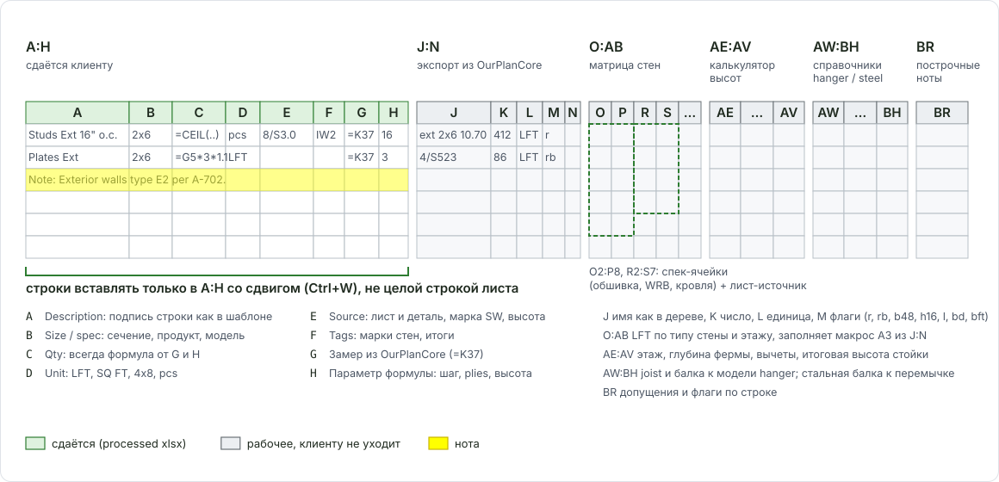
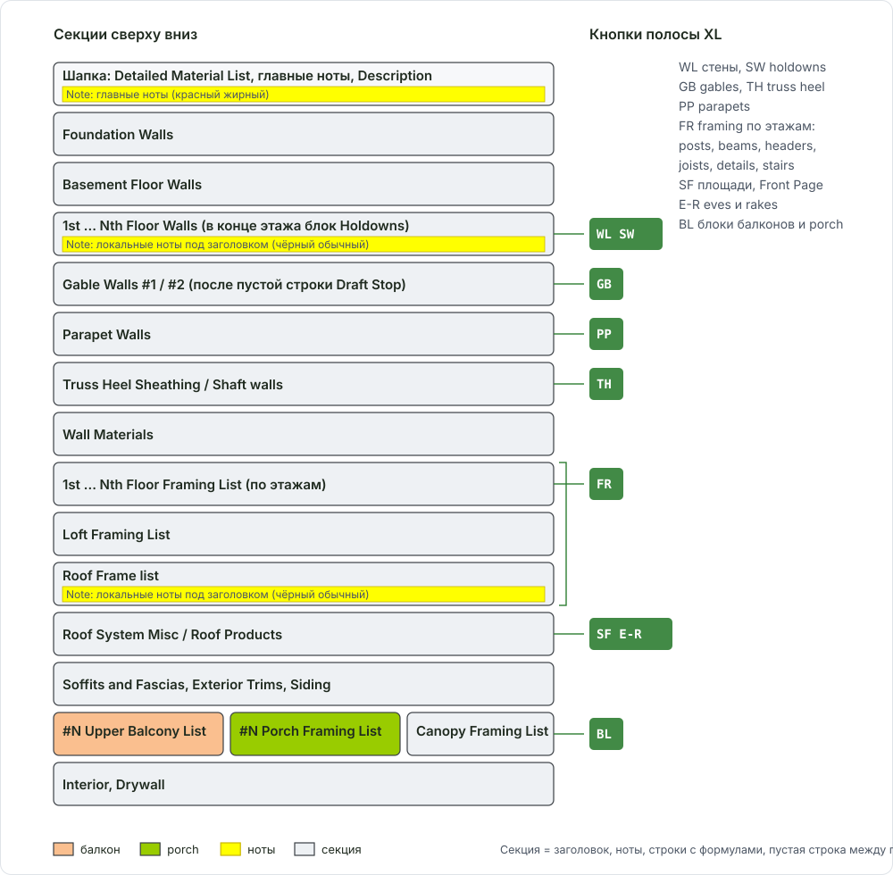

# DFL: как устроена книга

Здесь: из чего состоит рабочая книга Excel (Detailed Frame List), какие в ней колонки, в каком порядке идут секции и как строки связаны с замерами в OurPlanCore.

<figure markdown>
  
  <figcaption markdown="span">Лист Detailed Frame List: слева сдаваемая таблица A:H, справа рабочие зоны (экспорт из программы, матрица стен, спек-ячейки, калькулятор высот, справочники). Строки вставляются только в A:H.</figcaption>
</figure>

## Что это

DFL (Detailed Frame List) - книга Excel, в которой лежит весь материал по дому: одна книга на корпус (`Bldng#A.xlsm`, `Bldng#B.xlsm`), имя файла равно Job Name на Front Page. Книга делается из шаблона `TemplateCom.xlsm` (лежит в папке обновлений программы) и уже содержит все формулы, макросы и библиотеку нот. Клиенту уходит processed `.xlsx` (формулы в A:F переведены в значения) вместе с PDF листов с замерами.

| Лист книги | Что на нём |
| --- | --- |
| `Front Page` | Customer, Contact, Date, Total pages; площади по этажам (`Basement`, `1st`, `2nd`, `Loft`), отдельные строки `Porches` и `Balconies`; Total SQFT |
| `Detailed Frame List` | главный лист: шапка, главные ноты, таблица материалов по секциям, справа рабочие зоны |
| `Standarts` | библиотека нот и подписей строк (Labels), откуда берутся канонические формулировки |
| `Mat List` | номенклатура материалов по семействам (размеры, сорта) |

## Колонки A:H (то, что сдаётся)

| Колонка | Что в ней | Пример |
| --- | --- | --- |
| **A** | Description: подпись строки, как в шаблоне ([Labels](takeoff-items.md)) | `Studs Ext 16" o.c.`, `Box Sheathing`, `Holdowns (2) btm top` |
| **B** | Size / spec: сечение, продукт, модель крепежа | `2x6 P.T.`, `(2) 1 3/4 x 11 7/8 LVL`, `7/16" Zip`, `HHUS410 Zmax SK30 R` |
| **C** | Quantity: всегда формула от G и H, не число руками | `=CEILING(G41/32*1.1,1)` |
| **D** | Единица: `LFT`, `SQ FT`, `4x8`, `pcs`, `50' rolls`. Пиши `LFT`, не `FT` | `LFT` |
| **E** | Источник или пояснение: лист и деталь, марка стены, высота стойки, назначение | `8/S3.0`, `SW-2`, `11' 8 3/8"`, `for Ext Walls` |
| **F** | Теги марок стен, итоги | `IW2` |
| **G** | Замер из OurPlanCore: LFT, SQ FT или число точек | `=K37` |
| **H** | Параметр формулы: шаг в дюймах, число plies, высота | `16`, `2` |

Высота стены живёт в E строки студов (до 1/8"), в именах стен в программе - десятичные футы. Марка SW и лист-источник тоже идут в E, а не в ноту: факт в строке означает, что нота не нужна ([Ноты в DFL](standard-notes.md)).

## Рабочие зоны справа { #zones }

Лист использует до 79 колонок. В шапке подписаны только A:F, поэтому правая часть выглядит пустой, но именно там считаются высоты, LFT по типам стен и подбор крепежа. Читать строку надо целиком.

| Зона | Колонки | Что там |
| --- | --- | --- |
| Экспорт из программы | `J:N` | J имя позиции как в дереве (`ext 2x6 10.70`, `4/S523`), K число, L единица, M флаги для rim/blocking/hangers (`r`, `rb`, `b48`, `h16`, `l`, `bd`, `bft`) |
| Матрица стен | `O:AB` | LFT по типу стены и этажу (`Ext2x6`, `Cor2x6`, `Dem2x4`...), её заполняет макрос A3 из J:N; строки Floor Walls ссылаются сюда |
| Спек-ячейки | `O2:P6`, `O7:P8`, `R2:S7` | `O3` обшивка стен, `O4` WRB, `O5` Zip, `O6` Zip Tape, `O8` subfloor; `R3` main roof, `R4` overframes, `R5` metal, `R6` flat, `R7` shingles. Рядом `P` и `S` - лист-источник голой ссылкой: `S3.0`, `8/S3.0`, `A3.0 S2.5` |
| Калькулятор высот | `AE:AV` | этаж, глубина фермы, вычеты (slab, beam, curb), итоговая высота стойки |
| Справочники | `AW:BH` | строки 2-20: joist и балка к модели hanger, стальная балка к перемычке; ниже счёт hangers по этажам |
| Построчные ноты | `BR` | допущения и флаги по строке (`Note: Trusses by others`) |

Спек-ячейки заполняются при создании job из PDF, не перед сдачей: E-ячейки строк обшивок тянут их формулами (`=$P$3`, `=S3`), и одна ячейка расходится по всему листу. Нет источника - оставить `per page`, допущение вынести в главную ноту. Подробно: [Ноты в DFL, спек-ячейки](standard-notes.md#spec-cells).

!!! warning "Вставка строк только в A:H"
    Новая строка добавляется как ячейки A:H со сдвигом вниз (макрос Ctrl+W), не как целая строка листа. Целая строка сдвигает правые зоны, и формулы высот и матрицы стен перестают совпадать с данными. Удаление тоже только A:H со сдвигом вверх (Ctrl+Q). [Макросы и клавиши](excel-hotkeys.md).

## Порядок секций

Секция = заголовок с заливкой, под ним локальные ноты, строки с формулами, пустая белая строка между группами. Лишние секции под scope убирают макросы `A9_Fame_only` (только каркас) и `A9_1_wall_panel` (панельный дом), а пустые и нулевые строки удаляются перед сдачей.

<figure markdown>
  
  <figcaption markdown="span">Секции сверху вниз: шапка с нотами, стены по этажам, фронтоны и парапеты, Wall Materials с framing lists по этажам, кровля, отделка, блоки балконов и porch.</figcaption>
</figure>

| # | Секция | Что внутри | Замер в дереве OurPlanCore |
| --- | --- | --- | --- |
| 1 | Шапка `Detailed Material List`, главные ноты, `Description` | решения по дому: тип конструкции, FRT, обшивка, by others | - |
| 2 | `Foundation Walls` | sill sealer, termite shield, anchor bolts по шагу, washers | `walls` первого этажа, `shear walls` |
| 3 | `Basement Floor Walls` | plates P.T., studs, blocking (стик-фрейм под плитой) | `walls/base floor walls` |
| 4 | `1st ... Nth Floor Walls` | bracing ext/cor/dem, flashing, studs, plates, headers, WRB, wall sheathing + tape, box sheathing + tape; в конце этажа блок `Holdowns` | `walls/<этаж> floor walls/<категория сечение высота>`, `openings`, `shear walls/<этаж>/holdowns` |
| 5 | `Gable Walls #1 / #2` | studs for gables, sheathing, bracing, blocking; после пустой строки `Draft Stop` | `gables/gable stick`, `gables/gable trusses`, `gables/gable trusses/draft stop` |
| 6 | `Parapet Walls` | plates, studs, обшивка по трём сторонам, blocking, coping | `parapets/<зона>/prpt Hout Hin Wtop` |
| 7 | `Truss Heel Sheathing`, `Shaft walls` | полоса обшивки пятки ферм; shaft liner и channels | `trussheel`, стены шахт |
| 8 | `Wall Materials` с `1st ... Nth Floor Framing List`, `Loft Framing List`, `Roof Frame list` | beams, joists, hangers, rim, ribbon, blocking, ties, stair, subfloor, panel adhesive | `framing/<этаж> framing/beams, joists, details, stairs`, `sqfts/<этаж>` |
| 9 | `Roof System Misc`, `Roof Products` | обшивка кровли по уклонам, H-clips, insulation, frame for rakes и soffits, sub fascia, blocking at eves, ties | `sqfts/rf 6`, `sqfts/flat`, `eves rakes/eves`, `eves rakes/rakes` |
| 10 | `Soffits and Fascias`, `Exterior Trims`, `Siding` | только если отделка в scope | `trims`, `siding` |
| 11 | `#N Upper Balcony List`, `#N Porch Framing List`, `Canopy Framing List` | блок на каждый тип балкона и porch ([Блоки](dfl-blocks.md)) | `sqfts/blcny`, `sqfts/porch`, точки блоков |
| 12 | `Interior Doors&Trims`, `Drywall & Insulation` | только если в scope | `trims`, `units` |

## Как замеры из OurPlanCore становятся строками

Полоса XL в программе пишет замеры в книгу и запускает макросы книги (подробно про кнопки: [OurPlanCore, Estimating и экспорт](ourplanecore.md)). Общая схема одна для всех кнопок:

1. Замер из дерева попадает в рабочую зону `J:N` рядом со своей секцией: имя в J, число в K, единица в L.
2. Макрос книги раскладывает J:N по строкам A:H: `A3` считает стены в матрицу `O:AB`, `C_BeamsSort`, `C_JoistsSort`, `C_HeadersSort`, `C_PostsSort` пишут строки framing, `C_RimBoardBlockingHangers` разворачивает флаги M в rim, blocking, hangers, ledger.
3. В строке G остаётся ссылка на замер (`=K37`), C считает из G и H. Поэтому замер, исправленный в программе и выгруженный повторно, меняет количество сам.

| Кнопка XL | Что берёт из дерева | Куда в книге |
| --- | --- | --- |
| `SF` | `sqfts/1st, 2nd, base, rf 6, flat, blcny, porch` | Front Page, subfloor, площади кровли по уклонам |
| `WL` | `walls/<этаж> floor walls/*` | матрица O:AB, строки Floor Walls (studs, plates, bracing, sheathing) |
| `GB`, `TH`, `PP`, `E/R` | `gables`, `trussheel`, `parapets`, `eves rakes` | Gable Walls, Truss Heel, Parapet Walls, Roof Products |
| `OP` | `openings/<этаж>/WxH d gd` | Ext. Headers по ширине (`up to 48"`, `60"`, `72"`, `over 72"`), flashing |
| `SH`, `SW`, `SHF`, `UN` | обшивка из J или легенды, `shear walls`, шахты, `units` | A7 обшивка, Holdowns в блок стен этажа, Shaft walls, таблица units |
| `FR` (= `PS`, `BM`, `HD`, `JS`, `DT`, `ST`) | `framing/<этаж> framing/posts, beams, headers, joists, details, stairs` | Floor Framing List этажа; headers в блок стен этажа ниже; details в J:M с флагами |
| `BL` | `sqfts/blcny`, `sqfts/porch` | блоки `#N Upper Balcony List`, `#N Porch Framing List` |
| `LG` | легенда проекта | `H5 - (2) 1 3/4 x 11 7/8 LVL` (размер по коду), `4/S523 = b24` (флаги детали), `wall sheathing = 7/16" Zip no insulation` |

Коды балок, стоек и перемычек (`H5`, `B2`, `C5`) без легенды уйдут в книгу кодом вместо размера: легенду заполняют до экспорта, по schedule проекта.

## Front Page и SQFT

- Площади этажей приходят из `sqfts` и уходят на Front Page построчно; этаж над последним полным этажом пишется `Loft`, а не `5th`.
- `Porches` и `Balconies` - свои строки. Porch над балконом не отменяет строку порча: заполнять обе.
- Customer, Contact, Date, Total pages заполнены до сдачи; Total SQFT не равен 0.

## Проверка перед сдачей

- [ ] Единицы в D (`LFT`, `pcs`, `SQ FT`, `4x8`), подпись совпадает с расчётом (`Plates (2)` при H = 2).
- [ ] C везде формула от своего блока: свой header, свой множитель units, свой этаж; без ссылок на чужой блок после копирования этажа.
- [ ] Спек-ячейки O/P и R/S заполнены, E строк обшивок показывает лист, а не текст формулы.
- [ ] Мусора в расчётной зоне нет по всем колонкам, не только A:H (буква в O даёт `#VALUE!`).
- [ ] Нулевые и пустые шаблонные строки удалены; ноты не противоречат строкам.
- [ ] Измеренная площадь дошла до Excel и обновлена после правок в программе.
- [ ] Processed `.xlsx` сверен с `.xlsm`: ноты и строки на месте.

## Частые ошибки

- Копирование этажа целиком с формулами, которые смотрят в другой этаж или чужой header.
- Количество числом вместо формулы: при повторном экспорте оно не обновится.
- Вставка целой строки листа вместо A:H: правые зоны поехали.
- `FT` в D, `5th` вместо `Loft`, porch SQFT на Front Page не заполнен.
- Спек-ячейки оставлены на сдачу: половина E-ячеек со ссылкой `per page`.

Все ошибки по книге: [Частые ошибки, Excel DFL и ноты](../start/common-mistakes.md#excel).

## Пример

```text
A                          B                 C                         D      E          G      H
1st Floor Walls
Note: Exterior walls are type E2 per A-702; studs 9' 1 1/8" per 3/A-300.
Plates Ext (1) btm         2x6 P.T.          =EVEN(G33*H33*1.1)        LFT    A-702      412    1
Plates Ext (2) dbl top     2x6               =EVEN(G34*H34*1.1)        LFT    A-702      412    2
Studs Ext 16" o.c.         2x6               =CEILING(G35*1.1,1)       pcs    9' 1 1/8"  412
Wall Sheathing             =$O$3             =CEILING(G41/32*1.1,1)    4x8    =$P$3      3760
Tape                       =$O$6             =CEILING(G41*0.4*1.1,10)  LFT               3760
Holdowns (2) btm top       HDU5-SDS2.5       =G44*2                    pcs    SW-2       6
```

## См. также

- [Ноты в DFL](standard-notes.md), [Подписи строк и формат](takeoff-items.md), [Блоки балконов, porch и holdowns](dfl-blocks.md)
- [Макросы и клавиши Excel](excel-hotkeys.md), [Формулы и факторы](formulas.md)
- [OurPlanCore: Estimating и экспорт](ourplanecore.md), [Workflow](../start/workflow.md), [QA checklist](../start/quality-checklist.md)
