# E-Wood tab in Excel

Here: what each button on the E-Wood tab does, how to copy a block and insert a shared one, what each line of the Check report means, and what is applied where at delivery. The same instructions are in a PDF, opened by the `More > Instruction` button on the tab. The rules for the rows themselves are in [How the DFL workbook works](dfl-overview.md).

<figure markdown>
  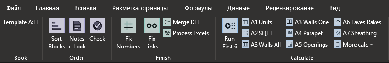
  <figcaption markdown="span">E-Wood tab, left part: Book, Order, Finish, Calculate</figcaption>
</figure>

<figure markdown>
  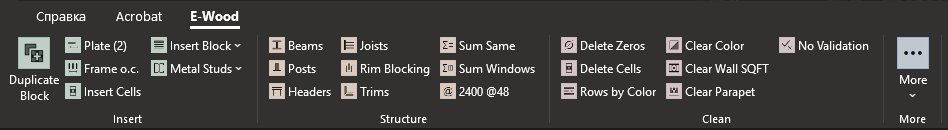
  <figcaption markdown="span">Right part: Insert, Structure, Clean, More. In a narrow window Excel collapses the groups on the right into one button, with the same macros inside.</figcaption>
</figure>

The tab is installed on the computer once and works with any DFL workbook. The workbook itself and the macros inside it do not change.

<figure markdown>
  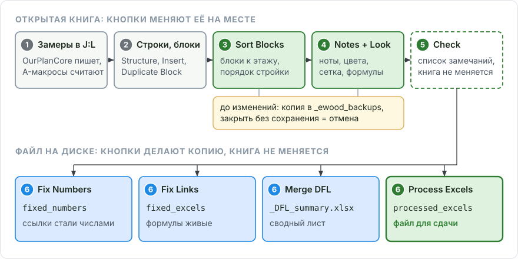
  <figcaption markdown="span">Workbook path. Sort Blocks and Notes + Look change the open workbook, Fix and Process make a copy.</figcaption>
</figure>

!!! note "Undo"
    `Sort Blocks` and `Notes + Look` first save the workbook and put a copy in `_ewood_backups`, and leave the result unsaved. Don't like it: close the workbook without saving. Ctrl+Z does not undo regular macros, that is how Excel works.

## Installation { #install }

How to install:

1. Copy `EWoodTools-Setup.exe` to the computer: one file, everything is inside.
2. Close Excel: the installer does not run while any Excel is open.
3. Run the file and press `Install`. Windows may ask: "More info", then "Run anyway".
4. Open a DFL workbook: the E-Wood tab is on the ribbon, with the workbook template on its left.
5. The DeepSeek key is entered separately and is needed only for the English check and `Improve Note`.

One file installs the tab, the tools, the rules and the instructions. Only Excel 2010 or newer is needed, no admin rights and no Python.

- **Update:** the same steps with the new file. **Remove:** the same file, `Uninstall` button.
- **The DeepSeek key** is stored for the Windows user and does not go into the installer. Without it everything works except the English check in `Fix` and `Improve Note`.
- **While a button is running,** the status bar at the bottom says what Excel is busy with. There are no windows; a message appears only if something went wrong.

## The tab by group { #groups }

| Group | What is in it |
| --- | --- |
| **Book** | the template of the open workbook: `Template A:H`, `Template A:G (old)`, `Template A:F (old)`, `Template unknown`, `Not a DFL book` |
| **Order** | work on the open workbook: `Sort Blocks`, `Notes + Look`, `Check` |
| **Finish** | work on the saved file and make copies: `Fix Numbers`, `Fix Links`, `Merge DFL`, `Process Excels` |
| **Calculate** | calculation from takeoffs: `Run First 6`, A1 ... A9 |
| **Insert** | `Duplicate Block`, individual rows, the `Insert Block` and `Metal Studs` menus |
| **Structure** | sorting beams, posts, headers, joists, details, and sums |
| **Clean** | deleting zeros and gray rows, clearing tables |
| **More** | `Improve Note`, `Check English`, date, multiply, instructions, report, key, About |

## Three templates { #templates }

The tab detects the template from the workbook contents. It decides which columns may be moved.

| Template | Rows | What works |
| --- | --- | --- |
| `TemplateCom` | A:H | everything |
| `0.Template 05.23` | A:G | `Order`, `Finish`, `More` and macros that do not care: `A1 Units`, `Trims`, `Sum Same`, `Sum Windows`, `2400 @48`, `Insert Cells`, `Delete Cells`, `No Validation`, `Improve Note`, `Multiply` |
| `1.Template` | A:F | the same |
| unknown | no `Description` row | `Finish`, `More` and the same macros, `Order` grayed out |
| not a DFL | no worksheet | the hotkeys belong to Excel again |

The other buttons are grayed out on old templates and their hotkeys are not taken: such a macro would write over the table on the right. On old templates the rules move rows only within their own range.

## Calculation from takeoffs { #calculate }

Usually the A macros are run by OurPlanCore through the XL strip buttons. Here they are needed to recalculate one group. Select the list in J:L.

| | Button | Hotkey | What it does |
| --- | --- | --- | --- |
| { width="22" } | **Run First 6** |  | A2 ... A6 in a row, A1 last, on the selected list in J:L. A full manual run; usually OurPlanCore does it. |
| { width="22" } | **A1 Units** |  | Units table by floor from the selected takeoff rows. |
| { width="22" } | **A2 SQFT** |  | Floor, gable and truss heel areas, roof pitches. |
| { width="22" } | **A3 Walls All** |  | Walls of all floors from J:L into the O:AB matrix and the Floor Walls rows. `(2)` in the name multiplies the length. |
| { width="22" } | **A3 Walls One** |  | The same for one floor. |
| { width="22" } | **A4 Parapet** |  | Parapet table. Select 2 columns: text and LF length. |
| { width="22" } | **A5 Openings** |  | Openings by width into header and flashing bins. Select 2 columns: text and quantity. |
| { width="22" } | **A6 Eaves Rakes** |  | Eaves, rakes, returns and canopy. Select 2 columns: text and LF length. |
| { width="22" } | **A7 Sheathing** |  | Based on the text in J above the Floor Framing List (Zip, OSB, no insulation) keeps the right sheathing rows and writes the spec cell. |
| { width="22" } | **A8 Split Suffixes** |  | Splits a wall name into a base for A3 and a suffix with the detail. |
| { width="22" } | **A9 Wall Panel** |  | Panel building scope: the panel rows stay in Floor Walls. Do not rerun on a filled workbook: it deletes rows. |
| { width="22" } | **A9 Frame Only** |  | Frame scope: removes the trim blocks. Do not rerun on a filled workbook: it deletes rows. |

## Structure { #structure }

| | Button | Hotkey | What it does |
| --- | --- | --- | --- |
| { width="22" } | **Beams** | ++ctrl+shift+b++ | Beams from mark and length pairs into Beam rows, with a legend at the end of the selection. |
| { width="22" } | **Posts** | ++ctrl+shift+p++ | Posts by mark, with code and grade in E. |
| { width="22" } | **Headers** | ++ctrl+shift+h++ | Headers into width bins: up to 48", 60", 72", over 72". |
| { width="22" } | **Joists** | ++ctrl+shift+j++ | Joists from count and length pairs. Identical lengths are added together. |
| { width="22" } | **Rim Blocking** |  | Rim, ribbon, blocking, hangers, screws, ties, anchor bolts and ledger by the flags in M. |
| { width="22" } | **Trims** |  | Trim of one element, multiplied by the quantity. |
| { width="22" } | **Sum Same** | ++ctrl+shift+f++ | Adds up identical rows. Select 3 columns: label, number, unit. |
| { width="22" } | **Sum Windows** |  | Adds up values next to openings for A5. |
| { width="22" } | **2400 @48** |  | Fills in values from a 2-column list: key and value. |

## Clean { #clean }

| | Button | Hotkey | What it does |
| --- | --- | --- | --- |
| { width="22" } | **Delete Zeros** | ++ctrl+e++ | Deletes rows with C = 0, only in A:H. |
| { width="22" } | **Delete Cells** | ++ctrl+q++ | Deletes cells A:H with a shift up. |
| { width="22" } | **Rows by Color** | ++ctrl+shift+d++ | Deletes the template's gray placeholder rows. |
| { width="22" } | **Clear Color** |  | Gray fill turns white. |
| { width="22" } | **Clear Wall SQFT** |  | Clears wall areas before a new calculation. |
| { width="22" } | **Clear Parapet** |  | Clears the parapet table. |
| { width="22" } | **No Validation** | ++ctrl+shift+v++ | Removes drop-down lists. |

## More { #more }

| | Button | Hotkey | What it does |
| --- | --- | --- | --- |
| { width="22" } | **Improve Note** | ++ctrl+shift+i++ | Rewrites the selected note following the samples on the Standards worksheet. Needs a DeepSeek key. Check the result by eye. |
| { width="22" } | **Check English** | ++ctrl+shift+t++ | Checks the English in the selection, Excel's spell check window. |
| { width="22" } | **Insert Date** | ++ctrl+shift+o++ | Inserts the date. |
| { width="22" } | **Multiply** | ++ctrl+m++ | Multiplies the selected cells by an address, for example by the G of the block header. |
| { width="22" } | **Instruction** |  | Opens these instructions. |
| { width="22" } | **Open Report** |  | Opens the latest report for this workbook. |
| { width="22" } | **DeepSeek Key** |  | Saves the DeepSeek key on this computer, for this Windows user. |
| { width="22" } | **About** |  | Version, where the files are, Excel language, separators, workbook template. |

## Duplicate Block { #duplicate }

A second balcony, porch or canopy almost always repeats the first one: a copy from the same workbook matches 76-91% of the rows. Copying by hand leaves references to another block, and the quantity is calculated from someone else's units. This button copies correctly.

| | Button | Hotkey | What it does |
| --- | --- | --- | --- |
| { width="22" } | **Duplicate Block** |  | Copies the block under the cursor right below it: next number, its own units, links to takeoffs cleared. |

How to copy a block:

1. Put the cursor in the block: on the header or any row under it.
2. Press `Duplicate Block`: the copy lands right under the block, the cursor is on its header.
3. Fix the header: the size in the text and the units in G.
4. Link the cleared G cells to your own takeoffs.
5. Remove extra rows, fix the counts in the C formulas.
6. Press `Delete Zeros`: rows with C = 0 go away.

At the end, `Check` shows anything that still uses someone else's units.

=== "Before: block #1"

    <figure markdown>
      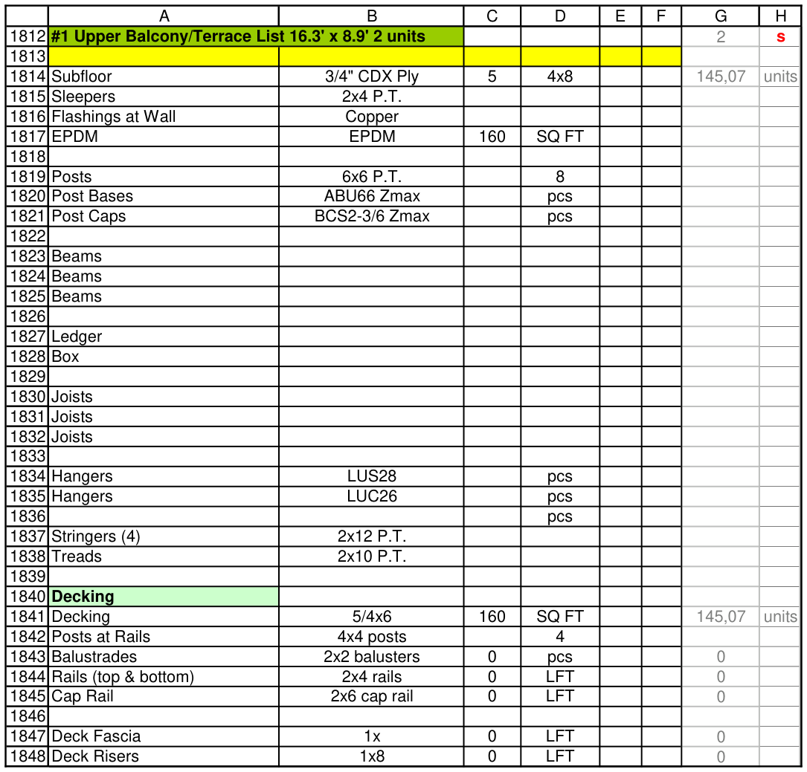
      <figcaption markdown="span">Balcony block in the template: header with units in G, rows, green Decking and Balcony Trims inside the block.</figcaption>
    </figure>

=== "After: copy #2"

    <figure markdown>
      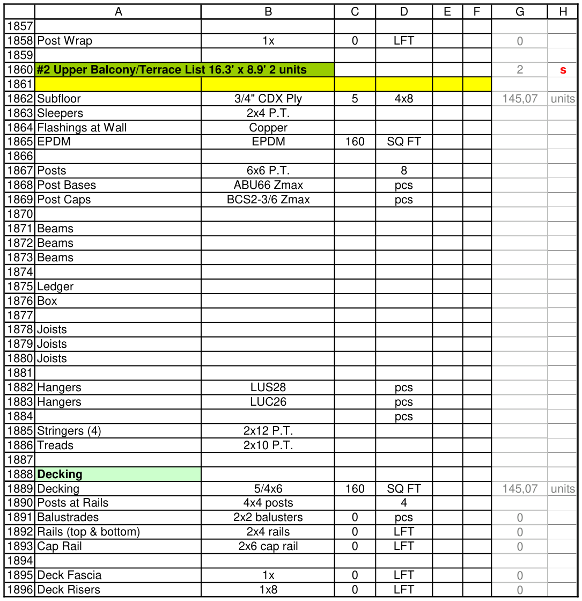
      <figcaption markdown="span">The copy landed under the block after one blank row: number #2, its own units, the same rows and subsections.</figcaption>
    </figure>

The copy's formulas calculate from its own header and its own rows (C in block #1 and in the copy):

| Block #1 | Copy #2 |
| --- | --- |
| `=CEILING((G1814)*1.1/32,1)` | `=CEILING((G1862)*1.1/32,1)` |
| `=CEILING((G1814)*1.1,10)` | `=CEILING((G1862)*1.1,10)` |
| `=CEILING((G1841)*1.1,10)` | `=CEILING((G1889)*1.1,10)` |
| `=EVEN(G1843*2.2)` | `=EVEN(G1891*2.2)` |

| What | How |
| --- | --- |
| Boundaries | a block with units in the header's G is copied whole, together with the green `Decking` and `Trims`, up to the next header. Cursor on the green header itself: only that subsection, the units stay from its block |
| Number | `#2 Upper Balcony...` becomes the next free number of this kind. Without `#` the name stays as is, rename it yourself |
| Units | all `$G$` references to the header in the copy point to its own header. So does the header reference in H, so the `Decking` area reads the size from the new header |
| Links to takeoffs | a G linking outside the block (`=K36`) is cleared: that is the old block's takeoff. C becomes 0 until you link a new one |
| Numbers in G | typed-in numbers are copied. The status bar says how many. Check them |
| What it leaves alone | everything to the right of A:H stays in place, the clipboard does not change, one blank row before and after the copy |

!!! warning "The button does not check the block against the drawing"
    The copy's posts, beams and hangers are the same as the source's. Check them against the plan.

## Insert Block { #insert }

A menu for blocks that have no sample in this workbook. Balconies, porches and canopies do not exist in a generic form: a generic version guesses 0-18% of the rows. For them use [Duplicate Block](#duplicate) or a block from a similar project. The menu rows come from delivered workbooks: only what holds from project to project.

| | Button | Hotkey | What it does |
| --- | --- | --- | --- |
| { width="22" } | **Balcony** |  | A balcony block from the command `b 12x30` or `b 12.5x6.5 u2` (width, length, units). The command is taken from the active cell if that is what it holds, otherwise the program asks. |
| { width="22" } | **Shaft Walls** |  | Two blocks at once: Shaft walls (CH + J) and Shaft Fire walls (H + C). Delete Zeros removes the unneeded one. |
| { width="22" } | **Decking + Wood Railing** |  | Decking, Posts at Rails, Post Cap, Balustrades, Rails, Cap Rail. For wood railing. |
| { width="22" } | **Decking + Cable Railing** |  | Decking, Posts at Rails, Post Sleeve, Post Cap, Cables, Cap Rail. For cable railing. |
| { width="22" } | **Decking + Sleeve Railing** |  | Decking, Posts at Rails, Post Sleeve, Post Cap, Rail sections. For pre-made sections on sleeves. |
| { width="22" } | **Pavers** |  | Pavers header, a by others note and a Pavers row. |
| { width="22" } | **Jambs** |  | A Jambs row, G is taken from Perimeter Total in the openings table. Writes the Wall Materials header only if the workbook does not have one. |
| { width="22" } | **Bolts** |  | Four rows: Blocking, Anchor Bolts, Washers, Nuts. Spacing and layers in H, G empty. |

How they write:

- **Where:** into the selected row; whatever was below shifts down. Only A:H. Blank rows before and after are added automatically; no blank row under a header.
- **Nothing is typed into G:** while G is empty, C = 0, and `Delete Zeros` removes whatever was not needed. The macro used to put `G=50` or `174`, and such numbers went to the client as takeoffs.
- **Count:** `=0*$G$<header>`. Replace 0 with the quantity per block. Sleeves and caps repeat the number of posts, `Rails` and `Cap Rail` repeat the length of the row above.
- **Units:** inserted inside a block with units, the formulas pick up the `$G$` of its header by themselves. Outside such a block there are no units.
- **Look:** a regular material row, black text, black grid, gray G:H, header color as in the templates.

What each item writes (on a copy of the template, G not filled in yet, so C = 0):

=== "Shaft Walls"

    <figure markdown>
      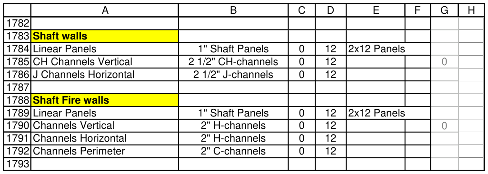
      <figcaption markdown="span">Two blocks at once: Shaft walls (CH + J) and Shaft Fire walls (H + C). CH channels take the panel area. Delete Zeros removes the unneeded block.</figcaption>
    </figure>

=== "Decking + Wood"

    <figure markdown>
      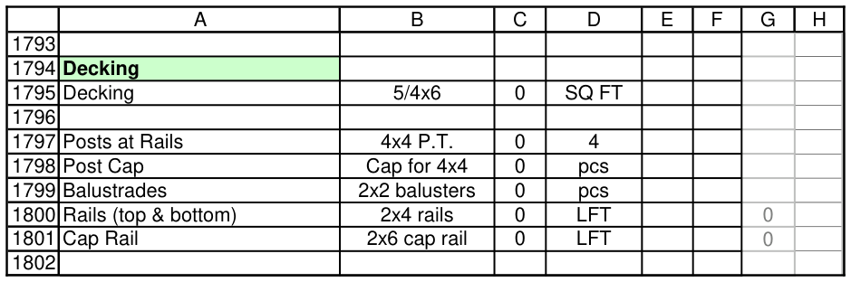
      <figcaption markdown="span">Decking, posts, caps, balusters, rails, cap rail. Rails and Cap Rail take the length of the row above.</figcaption>
    </figure>

=== "Decking + Cable"

    <figure markdown>
      
      <figcaption markdown="span">Decking, posts, sleeves, caps, cables in 9 rows, cap rail.</figcaption>
    </figure>

=== "Decking + Sleeve"

    <figure markdown>
      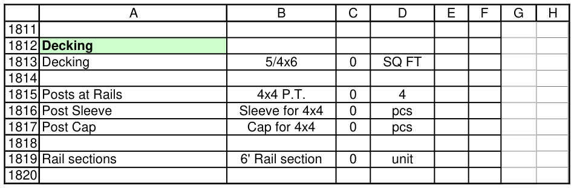
      <figcaption markdown="span">Decking, posts, sleeves, caps, pre-made railing sections.</figcaption>
    </figure>

=== "Inside a block"

    <figure markdown>
      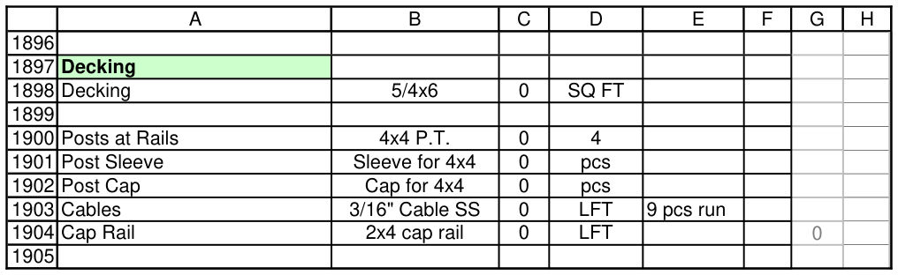
      <figcaption markdown="span">The same Decking + Cable inside a balcony block: the formulas multiply by the units of its header automatically.</figcaption>
    </figure>

=== "Pavers"

    <figure markdown>
      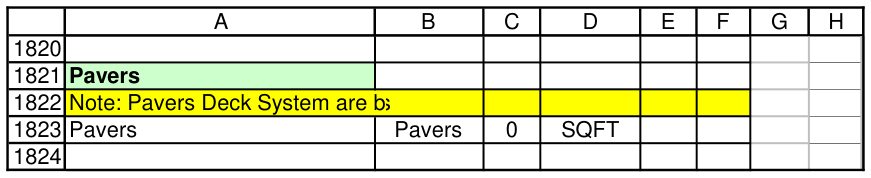
      <figcaption markdown="span">Header, a by others note and one Pavers row, as in delivered workbooks.</figcaption>
    </figure>

=== "Bolts"

    <figure markdown>
      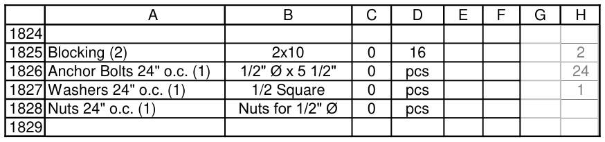
      <figcaption markdown="span">Blocking, Anchor Bolts, Washers, Nuts. Spacing and layers in H, labels are built from H, G empty.</figcaption>
    </figure>

=== "Jambs"

    <figure markdown>
      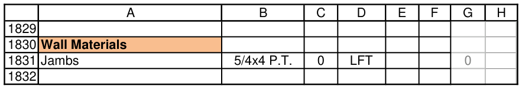
      <figcaption markdown="span">A Jambs row, G from Perimeter Total in the openings table. The workbook had no Wall Materials, so the header was written too.</figcaption>
    </figure>

Other inserts:

| | Button | Hotkey | What it does |
| --- | --- | --- | --- |
| { width="22" } | **Plate (2)** | ++ctrl+r++ | A Plate (2) 2x4 P.T. row under the selected one. G empty, C calculates once G is filled in. |
| { width="22" } | **Frame o.c.** | ++ctrl+t++ | A Frame o.c. row under the selected one. |
| { width="22" } | **Insert Cells** | ++ctrl+w++ | Inserts cells A:H with a shift down. Only this way, never a whole row: the right-hand areas will not shift. |
| { width="22" } | **Metal Studs** |  | Tracks, Deflection Tracks and Mtl Studs from the table on the right. Asks for spacing, height and floor. |
| { width="22" } | **Metal 16 o.c.** |  | The same at 16" spacing. |
| { width="22" } | **Metal 24 o.c.** |  | The same at 24" spacing. |

## Sort Blocks and Notes + Look { #order }

They work on the open workbook. First they save it and put a copy in `_ewood_backups` next to the workbook, then make the changes and leave the result unsaved. Closing without saving means undo. Report: `_ewood_backups\<name>_report.txt`.

| | Button | Hotkey | What it does |
| --- | --- | --- | --- |
| { width="22" } | **Sort Blocks** |  | Order: blocks to their floor, construction order, Decking and Railing headers, deck names, microgroups, one blank row each. |
| { width="22" } | **Notes + Look** |  | Formatting: notes, headers, colors, grid, options, size formula, CEILING. |
| { width="22" } | **Check** |  | Changes nothing. Makes a list of what a person has to decide and opens it. |

**Sort Blocks**, order:

- blocks go right after the framing list of their floor, trims after their block, `Roof Deck` and `Side Roof` before the roof;
- construction order: 1st Floor Framing List, 1st Floor Walls, 2nd Floor Framing List and so on;
- `Decking` and `Railing` get their own header, deck framing gets the `Ground` level; no location: that goes into the report;
- washers in `Foundation Walls` go under their anchors, microgroups start after a blank row, one blank row at a time, none under a header.

**Notes + Look**, formatting:

- notes: prefixes, notes under the header of their section, `Important:` on top, drawing status first, color by placement;
- headers: colors, text from E moved into a `Comment:` under the header, color under all of the text;
- rows: material black without fill, options in their own color, review marks in F, black grid A:F, gray G:H, height, alignment;
- formulas: the block size formula reads the same in any language, `CEILING.MATH` is written as `CEILING`. If the number would change, the row stays and goes into the report. Gable screws stay as they are.

!!! note "While the button is running"
    Do not copy anything in other programs: rows are moved through the clipboard, and there is only one per computer. If a copy collides, the check will see it and the workbook will go back to its saved state. Nothing is lost.

## Check { #check }

Changes nothing. Each line of the report: worksheet row number, code, and what is wrong. These are candidates: a person decides, from the drawing. A row you checked and kept will keep showing up: an empty list is not required.

How to work through the list: first what changes numbers, then the rest.

1. Press `Check`: the list opens by itself, the file is in `_ewood_backups`.
2. Go top to bottom: `ERR-CELL` and `BLOCK-REF` first, they change numbers.
3. Compare the row with the drawing: the list only shows, you decide.
4. Fix it; `Notes + Look` and `Delete Zeros` clear some codes by themselves.
5. Press `Check` again: what is left is what you kept on purpose.

This is what report lines look like (example):

```text
r129 BLOCK-REF: C counts the units of r110 '#1 Upper Balcony/Terrace List 10.5' x 5.5' 4 units', this block starts at r128 (Beams (2) and 10 more rows)
r332 POST-COUNT: 14 post bases against 28 posts in this block (#1 Upper Balcony/Terrace List 17' x 6' 14 units)
r181 ROUNDING: 30 pcs, CEILING to 10: under 50 canon rounds to 2, unless that many go per point (Ties 24" o.c.)
r3 SPEC-CELL: P3 still says 'per page': fill it from the plans
r81 STOCK: D=9: over 8 ft only even stock, 10 (Studs Ext | 2x8)
r20 C-ZERO: C is 0: delete the row with Delete Zeros (Anchor Bolts 48" o.c.)
```

To find a row: Ctrl+G and the address, for example `A129`.

| Code | What it means | What to do |
| --- | --- | --- |
| `BLOCK-REF` | the row counts the units of another block; the block was copied by hand | replace `$G$` with the header of its own block, unless there is a reason |
| `BLOCK-UNITS` | C is not multiplied by the block's units, while other rows are | multiply, or leave it if it is a total for the whole building |
| `POST-COUNT` | `Post Bases` and `Posts` in the block do not match | check against the plan, some posts may have no base |
| `SAME-BLOCK` | two blocks are identical per unit | one block, add up the units |
| `G-DEFAULT` | G equals what the macro used to enter by itself (50, 100, 174) | enter the takeoff or clear it |
| `JL-ORPHAN` | a detail is measured in J:L, but no row uses or mentions it | write a row with the sheet in E, or a note on why not |
| `ERR-CELL` | an error `#REF!`, `#VALUE!` or other in any cell of the worksheet | find the cause: an error on the right can zero out a row |
| `SPEC-CELL` | a spec cell still says `per page`, `TBD` or `assumed` | fill it in from the drawing; an item the building does not have may stay |
| `C-ZERO` | C = 0 | `Delete Zeros` or enter G |
| `ROUNDING` | under 50 pieces, not rounded to 2 | round to 2, unless the hardware goes N pieces per point |
| `STOCK` | odd length over 8 ft | the next even length |
| `C-CEILING` | `CEILING.MATH` in C | `Notes + Look` or `Fix` rewrites it automatically |
| `FORMULA-LOCALE` | the size formula reads wrong in another language | `Notes + Look`, `Fix` and `Process` rewrite it automatically |
| `NOTE-LEN` | note longer than 80 characters, ceiling 100 | a second `Note:` row |
| `NOTE-EQ`, `NOTE-ABBR` | an = sign in the note, abbreviations `shtg`, `btm pl`, `o/` | full words |
| `NOTE-GLUE`, `NOTE-RANGE` | sheet attached with a dash, a sheet range with a hyphen | `per <sheet>`, `S203 thru S206` |
| `PLACEHOLDER` | a leftover placeholder: `per page` or an ellipsis at the end | fill it in or delete it |
| `E-DOUBLED`, `E-TEXT` | a doubled member described in E, a sentence in E | `(2)` at the end of A; E holds only the sheet or mark |
| `B-LVL`, `B-GRADE`, `B-APA` | how LVL, lumber grade and `APA` are written in B | `1 3/4 x 14 LVL`; grade and `APA` are not written |
| `B-ZMAX`, `B-TBD` | `ABU66Z`, `TBD` from the template | model, space, `Zmax`. `DTT2Z`, `TBD HD`, `TBD Decking` do not count |
| `A-NAME`, `A-STUDS` | hardware has no real name, `Studs` outside Floor Walls | a real name; outside Floor Walls write `Frame` |
| `NO-DESCRIPTION` | column A has no `Description` row | template unknown, restore the row |

## Fix, Merge, Process { #finish }

They work on the file on disk and ask whether to save changes. The workbook itself does not change; the result goes into a separate folder next to it.

| | Button | Hotkey | What it does |
| --- | --- | --- | --- |
| { width="22" } | **Fix Numbers** |  | A copy of the workbook: rules, English check, links turn into numbers. Folder `fixed_numbers`, .xlsx file. |
| { width="22" } | **Fix Links** |  | A copy of the workbook: the same, with live formulas. Folder `fixed_excels`, same format. |
| { width="22" } | **Merge DFL** |  | Summary worksheet `<name>_DFL_summary.xlsx` next to the workbook. |
| { width="22" } | **Process Excels** |  | All workbooks in this folder into `processed_excels`, links turn into numbers. This is the delivery file. |

What is applied where:

| What | Sort, Notes | Fix | Process, Merge |
| --- | --- | --- | --- |
| Notes, block order, headers, colors, review marks, blank rows | yes | yes | yes |
| Size formula in all languages | yes | yes | yes |
| Grid, row look, color under all text, `92D050` to `99CC00`, `CEILING` | yes | yes | no |
| Washers under anchors | yes | no | no |
| English and typos, DeepSeek | no | yes | no |
| Links to numbers | no | `Fix Numbers` | `Process` |

**English check in Fix.** DeepSeek rewrites the notes, a second pass rejects any change of meaning, numbers and marks stay. In labels it fixes typos based on past jobs. B and product codes are only shown in the report. Inaccuracies go into the report as `[check]`. Without a key notes are not checked; the report says so, and the rest gets done.

**If the check failed:** a material row was lost, or Front Page or Mat List values or pictures changed. The workbook is not created; the reason is in the report. For Process, the report `dfl_rules_report.txt` and `SQ FT.txt` are in `processed_excels`.

## Header colors { #colours }

As in the `0.Template 05.23` and `1.Template` templates.

| Color | Where |
| --- | --- |
| <span style="background:#FFFF00;color:#000;padding:1px 8px;border:1px solid #ccc">FFFF00</span> | walls: `Foundation Walls`, `Floor Walls`, `Gable Walls`, `Parapet Walls`, `Shaft walls`, `Interior Doors&Trims` |
| <span style="background:#99CC00;color:#000;padding:1px 8px;border:1px solid #ccc">99CC00</span> | framing: Floor Framing List, balconies, porch, deck, `Roof Frame list`, `Roof System Misc` |
| <span style="background:#CCFFCC;color:#000;padding:1px 8px;border:1px solid #ccc">CCFFCC</span> | inside blocks and trim: `Decking`, `Balcony Trims`, `Porch Trims`, `Pavers`, `Roof Products`, `Soffits and Fascias`, `Exterior Trims`, `Siding` |
| <span style="background:#FABF8F;color:#000;padding:1px 8px;border:1px solid #ccc">FABF8F</span> | orange only calls the reviewer. `Wall Materials` and `Ceiling Materials` in the working workbook use it for now. At delivery the orange header becomes `99CC00`, for `Shaft walls` `FFFF00` |

Light green `92D050` on a header is changed to `99CC00` by `Fix` and `Notes + Look`.

## Two languages { #languages }

Excel and Windows can be Russian or English. The tab gives the same cells on both: numbers in formulas and labels are read the same way, not according to the computer's settings.

- **The block size formula** used to read `10.3` according to the computer's region: in another language it came out as 0 or billions. Now `TemplateCom`, `TemplateResidential` and the `Balcony` macro use the new formula. Old workbooks are fixed by `Notes + Look`, `Fix`, `Process` and `Merge`.
- **If a value was wrong,** the report will have `[warn]` with the row number: look at that block.
- **Another computer behaves differently:** press `More > About` and send what it says. It shows the language and separators.

Tested on an Excel that behaves like an English one. A real English Excel has not been tested.

## If something is wrong { #trouble }

| What you see | What to do |
| --- | --- |
| The button is grayed out | an old template, or the workbook is not a DFL: see the `Book` group |
| `Go to the sheet Detailed Frame List first` | go to that worksheet: the button moves rows only there |
| `No block here` | the cursor is above the first header or below the end of the list |
| `Put the cursor on a block below Description` | the cursor is in the workbook header, not in the list |
| `The previous button is still working` | wait for the previous button to finish, watch the status bar |
| `... stopped before it finished` | close the workbook without saving and press again; a copy is in `_ewood_backups` |
| `This book is open read-only` | close it and open it for editing |
| `Save this book to a folder on this computer first` | the workbook is new or opened from the internet: save it to a folder |
| `The tools folder was not found` | run the installer again |
| `Some rows were not parsed. Nothing was changed` | `Sum Windows` did not understand a row, it names which ones: fix the text |
| `Row 'Perimeter Total ...' not found` | this workbook has no openings table |
| `No AI key on this computer` | `More > DeepSeek Key` |
| `Close Excel and run this again` | the installer sees a running Excel, including a hidden one: check Task Manager |
| No tab | close Excel, run the installer again. `File`, `Options`, `Add-ins`: `EWoodTools` should be there |
| The right-hand areas shifted | a whole worksheet row was inserted. Undo, then `Insert Cells`: only A:H |

## Hotkeys { #keys }

They work only in DFL workbooks. In old templates only the hotkeys of suitable macros; in other workbooks the hotkeys belong to Excel.

| Hotkey | Button | Hotkey | Button |
| --- | --- | --- | --- |
| ++ctrl+r++ | Plate (2) | ++ctrl+shift+b++ | Beams |
| ++ctrl+t++ | Frame o.c. | ++ctrl+shift+p++ | Posts |
| ++ctrl+w++ | Insert Cells | ++ctrl+shift+h++ | Headers |
| ++ctrl+q++ | Delete Cells | ++ctrl+shift+j++ | Joists |
| ++ctrl+e++ | Delete Zeros | ++ctrl+shift+f++ | Sum Same |
| ++ctrl+m++ | Multiply | ++ctrl+shift+d++ | Rows by Color |
| ++ctrl+shift+i++ | Improve Note | ++ctrl+shift+v++ | No Validation |
| ++ctrl+shift+t++ | Check English | ++ctrl+shift+o++ | Insert Date |

## Where things are { #where }

| What | Where |
| --- | --- |
| Installer | `EWoodTools-Setup.exe`, everything inside: tab, tools, rules, instructions |
| Program on the computer | `%LOCALAPPDATA%\EWoodTools`, folders `addin` and `tools` |
| Copy before `Sort Blocks` and `Notes + Look`, report | `_ewood_backups` next to the workbook |
| `Fix Links`, `Fix Numbers` | `fixed_excels`, `fixed_numbers` next to the workbook, report in the same place |
| `Process` | `processed_excels` next to the workbooks |
| `Merge` | `<name>_DFL_summary.xlsx` next to the workbook |
| DeepSeek key | a Windows user variable, does not go into files or the installer |

## See also

- [Excel macros and hotkeys](excel-hotkeys.md): all macros by stage
- [How the DFL workbook works](dfl-overview.md), [Balcony, porch and holdown blocks](dfl-blocks.md), [Notes in the DFL](standard-notes.md)
