# Вкладка E-Wood в Excel

Здесь: что делает каждая кнопка вкладки E-Wood, как скопировать блок и вставить общий, что значит каждая строка отчёта Check и что где применяется при сдаче. Та же инструкция лежит в PDF, на вкладке кнопка `More > Instruction`. Правила самих строк описаны в [DFL: как устроена книга](dfl-overview.md).

<figure markdown>
  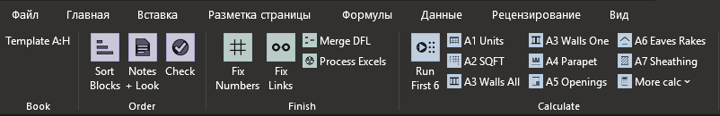
  <figcaption markdown="span">Вкладка E-Wood, левая часть: Book, Order, Finish, Calculate</figcaption>
</figure>

<figure markdown>
  
  <figcaption markdown="span">Правая часть: Insert, Structure, Clean, More. На узком окне Excel сворачивает группы справа в одну кнопку, внутри те же макросы.</figcaption>
</figure>

Вкладка ставится на компьютер один раз и работает с любой книгой DFL. Сама книга и макросы внутри неё не меняются.

<figure markdown>
  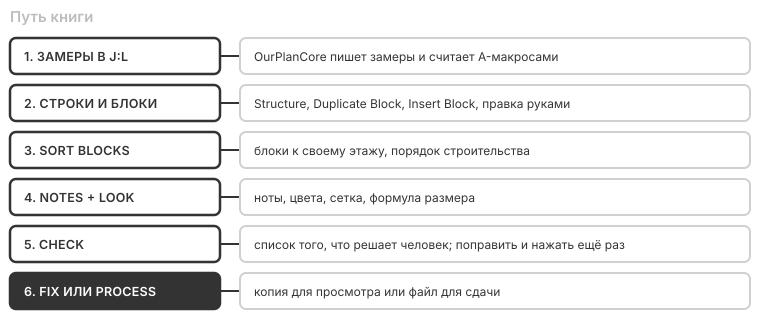
  <figcaption markdown="span">Путь книги. Sort Blocks и Notes + Look меняют открытую книгу, Fix и Process делают копию.</figcaption>
</figure>

!!! note "Отмена"
    `Sort Blocks` и `Notes + Look` сначала сохраняют книгу и кладут копию в `_ewood_backups`, а результат оставляют несохранённым. Не понравилось: закройте книгу без сохранения. Обычные макросы Ctrl+Z не отменяет, это свойство Excel.

## Установка { #install }

<figure markdown>
  
  <figcaption markdown="span">Один файл ставит вкладку, инструменты, правила и инструкцию. Нужен только Excel 2010 или новее, без прав администратора и Python.</figcaption>
</figure>

- **Обновить:** тот же порядок с новым файлом. **Удалить:** тот же файл, кнопка `Uninstall`.
- **Ключ DeepSeek** хранится у пользователя Windows и в установщик не попадает. Без него всё работает, кроме проверки английского в `Fix` и `Improve Note`.
- **Пока кнопка работает,** в строке состояния внизу написано, чем занят Excel. Окон нет, сообщение появляется, только если что-то пошло не так.

## Вкладка по группам { #groups }

| Группа | Что в ней |
| --- | --- |
| **Book** | шаблон открытой книги: `Template A:H`, `Template A:G (old)`, `Template A:F (old)`, `Template unknown`, `Not a DFL book` |
| **Order** | работают с открытой книгой: `Sort Blocks`, `Notes + Look`, `Check` |
| **Finish** | работают с сохранённым файлом и делают копии: `Fix Numbers`, `Fix Links`, `Merge DFL`, `Process Excels` |
| **Calculate** | расчёт по замерам: `Run First 6`, A1 ... A9 |
| **Insert** | `Duplicate Block`, отдельные строки, меню `Insert Block` и `Metal Studs` |
| **Structure** | сортировка балок, постов, перемычек, joists, деталей и суммы |
| **Clean** | удаление нулей и серых строк, очистка таблиц |
| **More** | `Improve Note`, `Check English`, дата, умножение, инструкция, отчёт, ключ, About |

## Три шаблона { #templates }

Вкладка сама определяет шаблон по содержимому книги. От него зависит, какие столбцы можно двигать.

| Шаблон | Строки | Что работает |
| --- | --- | --- |
| `TemplateCom` | A:H | всё |
| `0.Template 05.23` | A:G | `Order`, `Finish`, `More` и макросы, которым всё равно: `A1 Units`, `Trims`, `Sum Same`, `Sum Windows`, `2400 @48`, `Insert Cells`, `Delete Cells`, `No Validation`, `Improve Note`, `Multiply` |
| `1.Template` | A:F | то же |
| неизвестный | нет строки `Description` | `Finish`, `More` и те же макросы, `Order` серый |
| не DFL | нет листа | клавиши снова принадлежат Excel |

Остальные кнопки на старых шаблонах серые и их клавиши не заняты: такой макрос записал бы поверх таблицы справа. Правила на старых шаблонах двигают строки только в своём диапазоне.

## Расчёт по замерам { #calculate }

Обычно A-макросы запускает OurPlanCore кнопками полосы XL. Здесь они нужны для повторного расчёта одной группы. Выделяйте список в J:L.

| | Кнопка | Клавиша | Что делает |
| --- | --- | --- | --- |
| { width="22" } | **Run First 6** |  | A2 ... A6 подряд, A1 последним, по выделенному списку в J:L. Полный прогон руками, обычно его делает OurPlanCore. |
| { width="22" } | **A1 Units** |  | Таблица units по этажам из выделенных строк такеоффа. |
| { width="22" } | **A2 SQFT** |  | Площади этажей, gable и truss heel, уклоны кровли. |
| { width="22" } | **A3 Walls All** |  | Стены всех этажей из J:L в матрицу O:AB и строки Floor Walls. `(2)` в имени множит длину. |
| { width="22" } | **A3 Walls One** |  | То же для одного этажа. |
| { width="22" } | **A4 Parapet** |  | Таблица парапетов. Выделите 2 колонки: текст и длина LFT. |
| { width="22" } | **A5 Openings** |  | Проёмы по ширине в корзины headers и flashing. Выделите 2 колонки: текст и количество. |
| { width="22" } | **A6 Eaves Rakes** |  | Карнизы, rakes, returns и canopy. Выделите 2 колонки: текст и длина LFT. |
| { width="22" } | **A7 Sheathing** |  | По тексту в J над Floor Framing List (Zip, OSB, no insulation) оставляет нужные строки обшивки и пишет спек-ячейку. |
| { width="22" } | **A8 Split Suffixes** |  | Делит имя стены на основу для A3 и суффикс с деталью. |
| { width="22" } | **A9 Wall Panel** |  | Scope панельного дома: в Floor Walls остаются строки панелей. На заполненной книге не повторять: удаляет строки. |
| { width="22" } | **A9 Frame Only** |  | Scope Frame: убирает блоки отделки. На заполненной книге не повторять: удаляет строки. |

## Structure { #structure }

| | Кнопка | Клавиша | Что делает |
| --- | --- | --- | --- |
| { width="22" } | **Beams** | ++ctrl+shift+b++ | Балки из пар марка и длина в строки Beam, с легендой в конце выделения. |
| { width="22" } | **Posts** | ++ctrl+shift+p++ | Посты по марке, с кодом и сортом в E. |
| { width="22" } | **Headers** | ++ctrl+shift+h++ | Перемычки по корзинам ширины: up to 48", 60", 72", over 72". |
| { width="22" } | **Joists** | ++ctrl+shift+j++ | Joists из пар число и длина. Одинаковые длины складываются. |
| { width="22" } | **Rim Blocking** |  | Rim, ribbon, blocking, hangers, screws, ties, anchor bolts и ledger по флагам в M. |
| { width="22" } | **Trims** |  | Отделка одного элемента, умноженная на количество. |
| { width="22" } | **Sum Same** | ++ctrl+shift+f++ | Складывает одинаковые строки. Выделите 3 колонки: подпись, число, единица. |
| { width="22" } | **Sum Windows** |  | Складывает значения рядом с проёмами для A5. |
| { width="22" } | **2400 @48** |  | Проставляет значения по списку из 2 колонок: ключ и значение. |

## Clean { #clean }

| | Кнопка | Клавиша | Что делает |
| --- | --- | --- | --- |
| { width="22" } | **Delete Zeros** | ++ctrl+e++ | Удаляет строки с C = 0, только в A:H. |
| { width="22" } | **Delete Cells** | ++ctrl+q++ | Удаляет ячейки A:H со сдвигом вверх. |
| { width="22" } | **Rows by Color** | ++ctrl+shift+d++ | Удаляет серые строки-заглушки шаблона. |
| { width="22" } | **Clear Color** |  | Серая заливка становится белой. |
| { width="22" } | **Clear Wall SQFT** |  | Очищает площади стен перед новым расчётом. |
| { width="22" } | **Clear Parapet** |  | Очищает таблицу парапетов. |
| { width="22" } | **No Validation** | ++ctrl+shift+v++ | Снимает выпадающие списки. |

## More { #more }

| | Кнопка | Клавиша | Что делает |
| --- | --- | --- | --- |
| { width="22" } | **Improve Note** | ++ctrl+shift+i++ | Переписывает выделенную ноту по образцам листа Standards. Нужен ключ DeepSeek. Результат проверьте глазами. |
| { width="22" } | **Check English** | ++ctrl+shift+t++ | Проверка английского в выделении, окно проверки орфографии Excel. |
| { width="22" } | **Insert Date** | ++ctrl+shift+o++ | Ставит дату. |
| { width="22" } | **Multiply** | ++ctrl+m++ | Домножает выделенные ячейки на адрес, например на G заголовка блока. |
| { width="22" } | **Instruction** |  | Открывает эту инструкцию. |
| { width="22" } | **Open Report** |  | Открывает последний отчёт по этой книге. |
| { width="22" } | **DeepSeek Key** |  | Сохраняет ключ DeepSeek на этом компьютере, для этого пользователя Windows. |
| { width="22" } | **About** |  | Версия, где лежат файлы, язык Excel, разделители, шаблон книги. |

## Duplicate Block { #duplicate }

Второй балкон, porch или canopy почти всегда повторяет первый: копия из той же книги совпадает на 76-91% строк. Копирование руками оставляет ссылки на чужой блок, и количество считается по чужим единицам. Эта кнопка копирует правильно.

| | Кнопка | Клавиша | Что делает |
| --- | --- | --- | --- |
| { width="22" } | **Duplicate Block** |  | Копирует блок под курсором прямо под ним: следующий номер, свои единицы, ссылки на замеры очищены. |

<figure markdown>
  
  <figcaption markdown="span">Шесть шагов. В конце Check покажет, если что-то всё ещё считает чужие единицы.</figcaption>
</figure>

=== "До: блок #1"

    <figure markdown>
      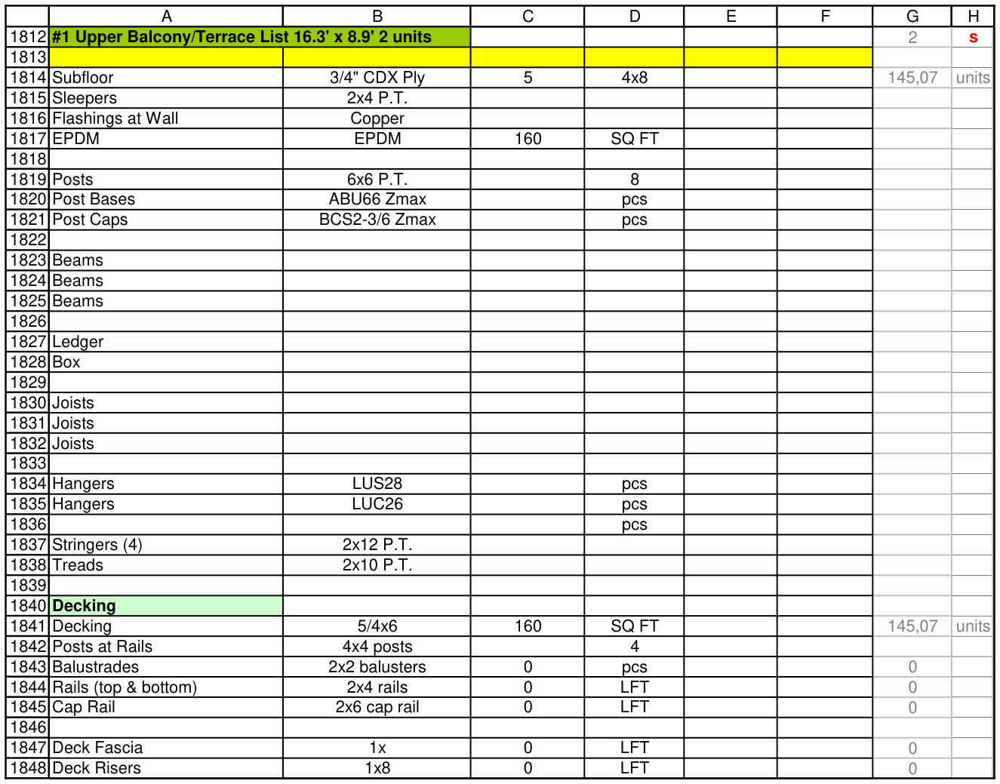
      <figcaption markdown="span">Блок балкона в шаблоне: заголовок с units в G, строки, зелёные Decking и Balcony Trims внутри блока.</figcaption>
    </figure>

=== "После: копия #2"

    <figure markdown>
      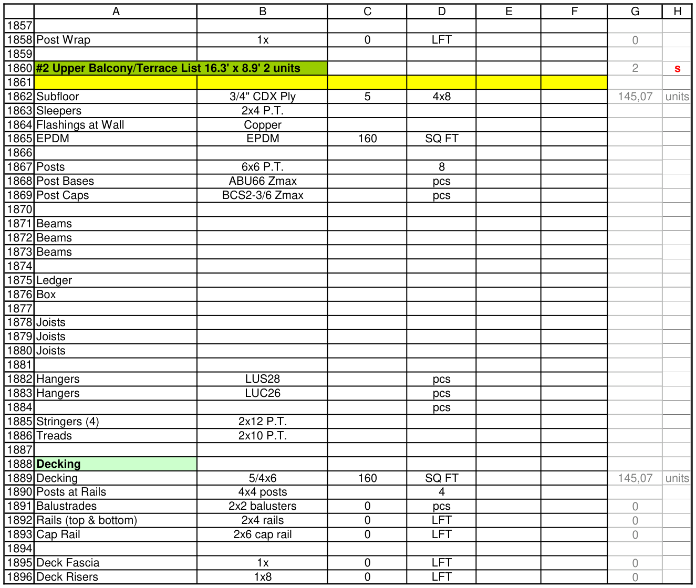
      <figcaption markdown="span">Копия встала под блоком через одну пустую строку: номер #2, свои units, те же строки и подсекции.</figcaption>
    </figure>

Формулы копии считают по своему заголовку и своим строкам (C в блоке #1 и в копии):

| Блок #1 | Копия #2 |
| --- | --- |
| `=CEILING((G1814)*1.1/32,1)` | `=CEILING((G1862)*1.1/32,1)` |
| `=CEILING((G1814)*1.1,10)` | `=CEILING((G1862)*1.1,10)` |
| `=CEILING((G1841)*1.1,10)` | `=CEILING((G1889)*1.1,10)` |
| `=EVEN(G1843*2.2)` | `=EVEN(G1891*2.2)` |

| Что | Как |
| --- | --- |
| Границы | блок с units в G заголовка копируется целиком, вместе с зелёными `Decking` и `Trims`, до следующего заголовка. Курсор на самом зелёном заголовке: только эта подсекция, единицы остаются от её блока |
| Номер | `#2 Upper Balcony...` становится следующим свободным номером этого вида. Без `#` имя остаётся как есть, переименуйте сами |
| Единицы | все `$G$` заголовка в копии указывают на её собственный заголовок. Ссылка на заголовок в H тоже, поэтому площадь `Decking` читает размер из нового заголовка |
| Ссылки на замеры | G со ссылкой наружу блока (`=K36`) очищается: это замер старого блока. C становится 0, пока не свяжете новый |
| Числа в G | вписанные числа копируются. Сколько их, пишет строка состояния. Проверьте их |
| Что не трогает | всё правее A:H остаётся на месте, буфер обмена не меняется, пустые строки по одной до и после копии |

!!! warning "Кнопка не сверяет блок с чертежом"
    Посты, балки и hangers копии такие же, как у источника. Сверьте их с планом.

## Insert Block { #insert }

Меню для блоков, у которых нет образца в этой книге. Балконы, porch и canopy в общем виде не существуют: общий вариант угадывает 0-18% строк. Для них [Duplicate Block](#duplicate) или блок из похожего проекта. Строки меню взяты из сданных книг: только то, что держится от проекта к проекту.

| | Кнопка | Клавиша | Что делает |
| --- | --- | --- | --- |
| { width="22" } | **Balcony** |  | Балконный блок по команде `b 12x30` или `b 12.5x6.5 u2` (ширина, длина, units). Команда берётся из активной ячейки, если там именно она, иначе программа спросит. |
| { width="22" } | **Shaft Walls** |  | Сразу два блока: Shaft walls (CH + J) и Shaft Fire walls (H + C). Лишний уберёт Delete Zeros. |
| { width="22" } | **Decking + Wood Railing** |  | Decking, Posts at Rails, Post Cap, Balustrades, Rails, Cap Rail. Для перил из дерева. |
| { width="22" } | **Decking + Cable Railing** |  | Decking, Posts at Rails, Post Sleeve, Post Cap, Cables, Cap Rail. Для перил на тросах. |
| { width="22" } | **Decking + Sleeve Railing** |  | Decking, Posts at Rails, Post Sleeve, Post Cap, Rail sections. Для готовых секций на втулках. |
| { width="22" } | **Pavers** |  | Заголовок Pavers, нота by others и строка Pavers. |
| { width="22" } | **Jambs** |  | Строка Jambs, G берётся из Perimeter Total в таблице проёмов. Заголовок Wall Materials пишет, только если его нет в книге. |
| { width="22" } | **Bolts** |  | Четыре строки: Blocking, Anchor Bolts, Washers, Nuts. Шаг и слои в H, G пустой. |

Как они пишут:

- **Куда:** в выделенную строку, что было ниже, сдвигается. Только A:H. Пустые строки до и после ставятся сами, под заголовком пустой строки нет.
- **В G ничего не вписано:** пока G пустой, C = 0, и `Delete Zeros` убирает то, что не понадобилось. Раньше макрос ставил `G=50` или `174`, и такие числа уходили клиенту как замеры.
- **Счёт:** `=0*$G$<заголовок>`. Вместо 0 впишите количество на один блок. Втулки и колпаки повторяют число постов, `Rails` и `Cap Rail` повторяют длину строки выше.
- **Единицы:** вставили внутрь блока с units, формулы сами считают `$G$` его заголовка. Вне такого блока единиц нет.
- **Вид:** обычная строка материала, чёрный текст, чёрная сетка, серые G:H, цвет заголовка как в шаблонах.

Что пишет каждый пункт (на копии шаблона, G ещё не заполнен, поэтому C = 0):

=== "Shaft Walls"

    <figure markdown>
      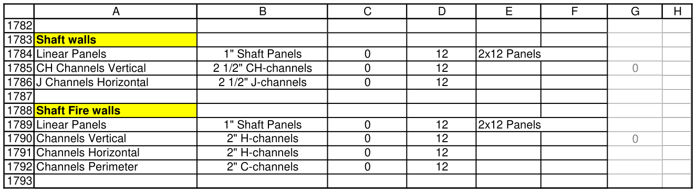
      <figcaption markdown="span">Два блока сразу: Shaft walls (CH + J) и Shaft Fire walls (H + C). CH channels берут площадь панелей. Лишний блок уберёт Delete Zeros.</figcaption>
    </figure>

=== "Decking + Wood"

    <figure markdown>
      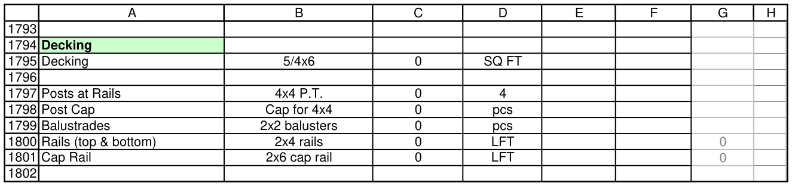
      <figcaption markdown="span">Decking, посты, колпаки, балясины, рейки, поручень. Rails и Cap Rail берут длину строки выше.</figcaption>
    </figure>

=== "Decking + Cable"

    <figure markdown>
      
      <figcaption markdown="span">Decking, посты, втулки, колпаки, тросы по 9 рядов, поручень.</figcaption>
    </figure>

=== "Decking + Sleeve"

    <figure markdown>
      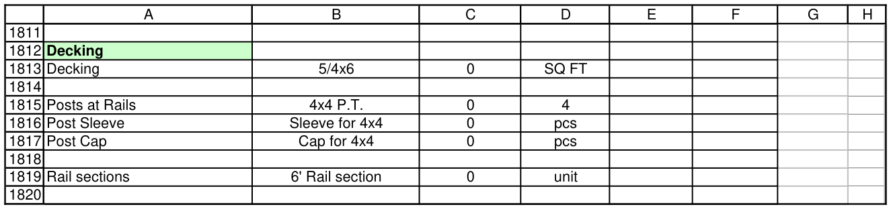
      <figcaption markdown="span">Decking, посты, втулки, колпаки, готовые секции перил.</figcaption>
    </figure>

=== "Внутри блока"

    <figure markdown>
      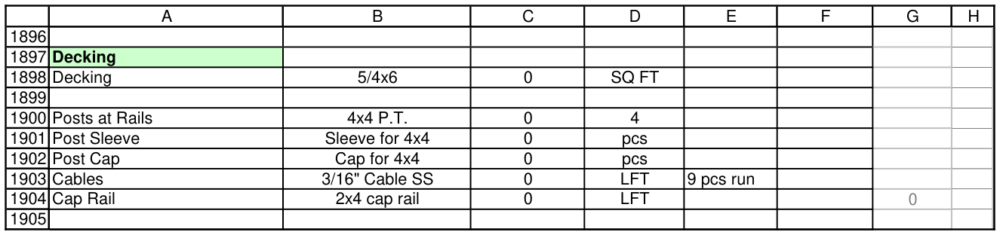
      <figcaption markdown="span">Тот же Decking + Cable внутри блока балкона: формулы сами умножают на units его заголовка.</figcaption>
    </figure>

=== "Pavers"

    <figure markdown>
      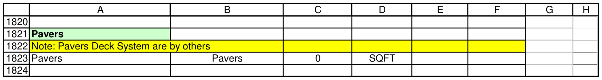
      <figcaption markdown="span">Заголовок, нота by others и одна строка Pavers, как в сданных книгах.</figcaption>
    </figure>

=== "Bolts"

    <figure markdown>
      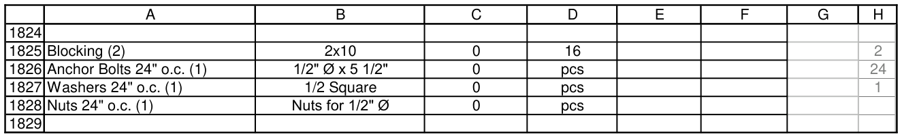
      <figcaption markdown="span">Blocking, Anchor Bolts, Washers, Nuts. Шаг и слои в H, подписи собираются из H, G пустой.</figcaption>
    </figure>

=== "Jambs"

    <figure markdown>
      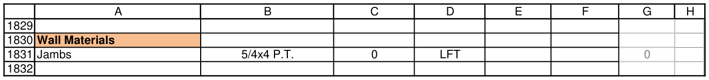
      <figcaption markdown="span">Строка Jambs, G из Perimeter Total в таблице проёмов. В книге не было Wall Materials, поэтому заголовок тоже записан.</figcaption>
    </figure>

Другие вставки:

| | Кнопка | Клавиша | Что делает |
| --- | --- | --- | --- |
| { width="22" } | **Plate (2)** | ++ctrl+r++ | Строка Plate (2) 2x4 P.T. под выделенной. G пустой, C считается, когда вписан G. |
| { width="22" } | **Frame o.c.** | ++ctrl+t++ | Строка Frame o.c. под выделенной. |
| { width="22" } | **Insert Cells** | ++ctrl+w++ | Вставляет ячейки A:H со сдвигом вниз. Только так, не целой строкой: правые зоны не поедут. |
| { width="22" } | **Metal Studs** |  | Tracks, Deflection Tracks и Mtl Studs по таблице справа. Спросит шаг, высоту и этаж. |
| { width="22" } | **Metal 16 o.c.** |  | То же с шагом 16". |
| { width="22" } | **Metal 24 o.c.** |  | То же с шагом 24". |

## Sort Blocks и Notes + Look { #order }

Работают с открытой книгой. Сначала сохраняют её и кладут копию в `_ewood_backups` рядом с книгой, потом меняют, а результат оставляют несохранённым. Закрыть без сохранения значит отменить. Отчёт: `_ewood_backups\имя_report.txt`.

| | Кнопка | Клавиша | Что делает |
| --- | --- | --- | --- |
| { width="22" } | **Sort Blocks** |  | Порядок: блоки к своему этажу, порядок строительства, заголовки Decking и Railing, имена deck, микрогруппы, по одной пустой строке. |
| { width="22" } | **Notes + Look** |  | Оформление: ноты, заголовки, цвета, сетка, опции, формула размера, CEILING. |
| { width="22" } | **Check** |  | Ничего не меняет. Составляет список того, что решает человек, и открывает его. |

**Sort Blocks**, порядок:

- блоки встают сразу за framing list своего этажа, trims за своим блоком, `Roof Deck` и `Side Roof` перед кровлей;
- порядок строительства: 1st Floor Framing List, 1st Floor Walls, 2nd Floor Framing List и так далее;
- `Decking` и `Railing` получают свой заголовок, каркас deck получает уровень `Ground`; нет расположения: это попадёт в отчёт;
- шайбы в `Foundation Walls` встают под свои анкеры, микрогруппы начинаются после пустой строки, пустых строк по одной, под заголовком ни одной.

**Notes + Look**, оформление:

- ноты: префиксы, ноты под заголовком своей секции, `Important:` сверху, статус чертежей первым, цвет по месту;
- заголовки: цвета, текст из E в `Comment:` под заголовком, цвет под всем текстом;
- строки: материал чёрный без заливки, опции своим цветом, отметки ревью в F, чёрная сетка A:F, серые G:H, высота, выравнивание;
- формулы: формула размера блока читается одинаково на любом языке, `CEILING.MATH` записывается как `CEILING`. Если число стало бы другим, строка остаётся и попадает в отчёт. Gable screws остаются как есть.

!!! note "Пока кнопка работает"
    Не копируйте ничего в других программах: строки двигаются через буфер обмена, он один на компьютер. Если копирование совпало, проверка это увидит, и книга вернётся к сохранённому виду. Ничего не потеряется.

## Check { #check }

Ничего не меняет. Каждая строка отчёта: номер строки листа, код и что не так. Это кандидаты: решает человек, по чертежу. Строка, которую вы проверили и оставили, будет показываться и дальше: пустой список не обязателен.

<figure markdown>
  
  <figcaption markdown="span">Сначала то, что меняет числа, потом остальное.</figcaption>
</figure>

Так выглядят строки отчёта (пример):

```text
r129 BLOCK-REF: C counts the units of r110 '#1 Upper Balcony/Terrace List 10.5' x 5.5' 4 units', this block starts at r128 (Beams (2) and 10 more rows)
r332 POST-COUNT: 14 post bases against 28 posts in this block (#1 Upper Balcony/Terrace List 17' x 6' 14 units)
r181 ROUNDING: 30 pcs, CEILING to 10: under 50 canon rounds to 2, unless that many go per point (Ties 24" o.c.)
r3 SPEC-CELL: P3 still says 'per page': fill it from the plans
r81 STOCK: D=9: over 8 ft only even stock, 10 (Studs Ext | 2x8)
r20 C-ZERO: C is 0: delete the row with Delete Zeros (Anchor Bolts 48" o.c.)
```

Найти строку: Ctrl+G и адрес, например `A129`.

| Код | Что значит | Что делать |
| --- | --- | --- |
| `BLOCK-REF` | строка считает единицы другого блока, блок скопирован руками | заменить `$G$` на заголовок своего блока, если нет причины |
| `BLOCK-UNITS` | C не умножен на units блока, а другие строки умножены | умножить, или оставить, если это итог на весь дом |
| `POST-COUNT` | `Post Bases` и `Posts` в блоке не сходятся | сверить с планом, часть постов может стоять без базы |
| `SAME-BLOCK` | два блока одинаковы на один unit | один блок, сложить units |
| `G-DEFAULT` | G равен тому, что макрос вписывал сам (50, 100, 174) | вписать замер или очистить |
| `JL-ORPHAN` | деталь измерена в J:L, но её не использует и не упоминает ни одна строка | написать строку с листом в E или ноту, почему нет |
| `ERR-CELL` | ошибка `#REF!`, `#VALUE!` и другие в любой ячейке листа | найти причину: ошибка справа может обнулить строку |
| `SPEC-CELL` | спек-ячейка всё ещё `per page`, `TBD` или `assumed` | заполнить с чертежа; позиция, которой нет в доме, может остаться |
| `C-ZERO` | C = 0 | `Delete Zeros` или вписать G |
| `ROUNDING` | штуки меньше 50, округление не до 2 | округлить до 2, если крепёж не идёт по N штук на точку |
| `STOCK` | нечётная длина больше 8 ft | следующая чётная |
| `C-CEILING` | `CEILING.MATH` в C | `Notes + Look` или `Fix` перепишут сами |
| `FORMULA-LOCALE` | формула размера читается неверно на другом языке | `Notes + Look`, `Fix` и `Process` перепишут сами |
| `NOTE-LEN` | нота длиннее 80 знаков, потолок 100 | вторая строка `Note:` |
| `NOTE-EQ`, `NOTE-ABBR` | знак = в ноте, сокращения `shtg`, `btm pl`, `o/` | полные слова |
| `NOTE-GLUE`, `NOTE-RANGE` | лист через тире, диапазон листов через дефис | `per <лист>`, `S203 thru S206` |
| `PLACEHOLDER` | осталась заготовка: `per page` или многоточие в конце | заполнить или удалить |
| `E-DOUBLED`, `E-TEXT` | двойной элемент описан в E, предложение в E | `(2)` в конце A; в E только лист или марка |
| `B-LVL`, `B-GRADE`, `B-APA` | запись LVL, сорт дерева и `APA` в B | `1 3/4 x 14 LVL`; сорт и `APA` не пишутся |
| `B-ZMAX`, `B-TBD` | `ABU66Z`, `TBD` из шаблона | модель, пробел, `Zmax`. `DTT2Z`, `TBD HD`, `TBD Decking` не считаются |
| `A-NAME`, `A-STUDS` | у hardware нет настоящего имени, `Studs` вне Floor Walls | настоящее имя; вне Floor Walls пишется `Frame` |
| `NO-DESCRIPTION` | в столбце A нет строки `Description` | шаблон неизвестен, вернуть строку |

## Fix, Merge, Process { #finish }

Работают с файлом на диске и спросят, сохранить ли изменения. Сама книга не меняется, результат лежит в отдельной папке рядом с ней.

| | Кнопка | Клавиша | Что делает |
| --- | --- | --- | --- |
| { width="22" } | **Fix Numbers** |  | Копия книги: правила, проверка английского, ссылки становятся числами. Папка `fixed_numbers`, файл .xlsx. |
| { width="22" } | **Fix Links** |  | Копия книги: то же, формулы живые. Папка `fixed_excels`, тот же формат. |
| { width="22" } | **Merge DFL** |  | Сводный лист `имя_DFL_summary.xlsx` рядом с книгой. |
| { width="22" } | **Process Excels** |  | Все книги этой папки в `processed_excels`, ссылки становятся числами. Это файл для сдачи. |

Что где применяется:

| Что | Sort, Notes | Fix | Process, Merge |
| --- | --- | --- | --- |
| Ноты, порядок блоков, заголовки, цвета, отметки ревью, пустые строки | да | да | да |
| Формула размера на всех языках | да | да | да |
| Сетка, вид строк, цвет под всем текстом, `92D050` в `99CC00`, `CEILING` | да | да | нет |
| Шайбы под анкеры | да | нет | нет |
| Английский и опечатки, DeepSeek | нет | да | нет |
| Ссылки в числа | нет | `Fix Numbers` | `Process` |

**Проверка английского в Fix.** DeepSeek переписывает ноты, второй проход отклоняет изменённый смысл, числа и марки остаются. В подписях он правит опечатки по прошлым работам. B и коды продуктов только показывает в отчёте. Неточности идут в отчёт как `[check]`. Без ключа ноты не проверяются, отчёт об этом скажет, остальное сделается.

**Если проверка не прошла:** потерялась строка материала, изменились значения Front Page или Mat List или картинки. Книга не создаётся, причина в отчёте. У Process отчёт `dfl_rules_report.txt` и `SQ FT.txt` лежат в `processed_excels`.

## Цвета заголовков { #colours }

Как в шаблонах `0.Template 05.23` и `1.Template`.

| Цвет | Где |
| --- | --- |
| <span style="background:#FFFF00;color:#000;padding:1px 8px;border:1px solid #ccc">FFFF00</span> | стены: `Foundation Walls`, `Floor Walls`, `Gable Walls`, `Parapet Walls`, `Shaft walls`, `Interior Doors&Trims` |
| <span style="background:#99CC00;color:#000;padding:1px 8px;border:1px solid #ccc">99CC00</span> | каркас: Floor Framing List, балконы, porch, deck, `Roof Frame list`, `Roof System Misc` |
| <span style="background:#CCFFCC;color:#000;padding:1px 8px;border:1px solid #ccc">CCFFCC</span> | внутри и отделка: `Decking`, `Balcony Trims`, `Porch Trims`, `Pavers`, `Roof Products`, `Soffits and Fascias`, `Exterior Trims`, `Siding` |
| <span style="background:#FABF8F;color:#000;padding:1px 8px;border:1px solid #ccc">FABF8F</span> | оранжевый только зовёт проверяющего. `Wall Materials` и `Ceiling Materials` в рабочей книге пока им. При сдаче оранжевый заголовок становится `99CC00`, у `Shaft walls` `FFFF00` |

Светло-зелёный `92D050` на заголовке `Fix` и `Notes + Look` меняют на `99CC00`.

## Два языка { #languages }

Excel и Windows бывают русскими и английскими. Вкладка даёт одинаковые ячейки на обоих: числа в формулах и метках читаются одинаково, а не по настройкам компьютера.

- **Формула размера блока** раньше читала `10.3` по региону компьютера: на другом языке получался 0 или миллиарды. Теперь в `TemplateCom`, `TemplateResidential` и в макросе `Balcony` стоит новая формула. Старые книги исправляют `Notes + Look`, `Fix`, `Process` и `Merge`.
- **Если значение было неверным,** в отчёте будет `[warn]` с номером строки: посмотрите этот блок.
- **Другой компьютер ведёт себя иначе:** нажмите `More > About` и пришлите, что там написано. Там язык и разделители.

Проверено на Excel, который ведёт себя как английский. Настоящий английский Excel не проверялся.

## Если что-то не так { #trouble }

| Что видите | Что делать |
| --- | --- |
| Кнопка серая | старый шаблон или книга не DFL: смотрите группу `Book` |
| `Go to the sheet Detailed Frame List first` | перейдите на этот лист: кнопка двигает строки только там |
| `No block here` | курсор над первым заголовком или ниже конца списка |
| `Put the cursor on a block below Description` | курсор в шапке книги, а не в списке |
| `The previous button is still working` | подождите конца предыдущей кнопки, смотрите строку состояния |
| `... stopped before it finished` | закройте книгу без сохранения и нажмите ещё раз, копия есть в `_ewood_backups` |
| `This book is open read-only` | закройте и откройте для правки |
| `Save this book to a folder on this computer first` | книга новая или открыта из интернета: сохраните в папку |
| `The tools folder was not found` | запустите установщик ещё раз |
| `Some rows were not parsed. Nothing was changed` | `Sum Windows` не понял строку, он назовёт какие: поправьте текст |
| `Row 'Perimeter Total ...' not found` | в этой книге нет таблицы проёмов |
| `No AI key on this computer` | `More > DeepSeek Key` |
| `Close Excel and run this again` | установщик видит запущенный Excel, в том числе скрытый: смотрите Диспетчер задач |
| Вкладки нет | закройте Excel, запустите установщик ещё раз. `Файл`, `Параметры`, `Надстройки`: должна быть `EWoodTools` |
| Правые зоны поехали | вставили целую строку листа. Отмена, потом `Insert Cells`: только A:H |

## Горячие клавиши { #keys }

Работают только в книгах DFL. В старых шаблонах только клавиши подходящих макросов, в остальных книгах клавиши принадлежат Excel.

| Клавиша | Кнопка | Клавиша | Кнопка |
| --- | --- | --- | --- |
| ++ctrl+r++ | Plate (2) | ++ctrl+shift+b++ | Beams |
| ++ctrl+t++ | Frame o.c. | ++ctrl+shift+p++ | Posts |
| ++ctrl+w++ | Insert Cells | ++ctrl+shift+h++ | Headers |
| ++ctrl+q++ | Delete Cells | ++ctrl+shift+j++ | Joists |
| ++ctrl+e++ | Delete Zeros | ++ctrl+shift+f++ | Sum Same |
| ++ctrl+m++ | Multiply | ++ctrl+shift+d++ | Rows by Color |
| ++ctrl+shift+i++ | Improve Note | ++ctrl+shift+v++ | No Validation |
| ++ctrl+shift+t++ | Check English | ++ctrl+shift+o++ | Insert Date |

## Где что лежит { #where }

| Что | Где |
| --- | --- |
| Установщик | `EWoodTools-Setup.exe`, внутри всё: вкладка, инструменты, правила, инструкция |
| Программа на компьютере | `%LOCALAPPDATA%\EWoodTools`, папки `addin` и `tools` |
| Копия перед `Sort Blocks` и `Notes + Look`, отчёт | `_ewood_backups` рядом с книгой |
| `Fix Links`, `Fix Numbers` | `fixed_excels`, `fixed_numbers` рядом с книгой, отчёт там же |
| `Process` | `processed_excels` рядом с книгами |
| `Merge` | `имя_DFL_summary.xlsx` рядом с книгой |
| Ключ DeepSeek | переменная пользователя Windows, в файлы и установщик не попадает |

## См. также

- [Макросы и клавиши Excel](excel-hotkeys.md): все макросы по этапам
- [DFL: как устроена книга](dfl-overview.md), [Блоки балконов, porch и holdowns](dfl-blocks.md), [Ноты в DFL](standard-notes.md)
