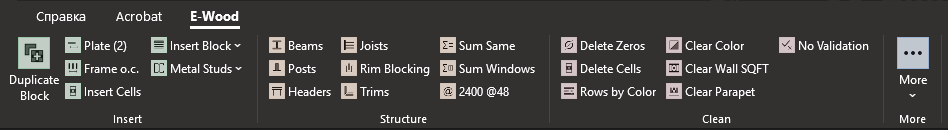
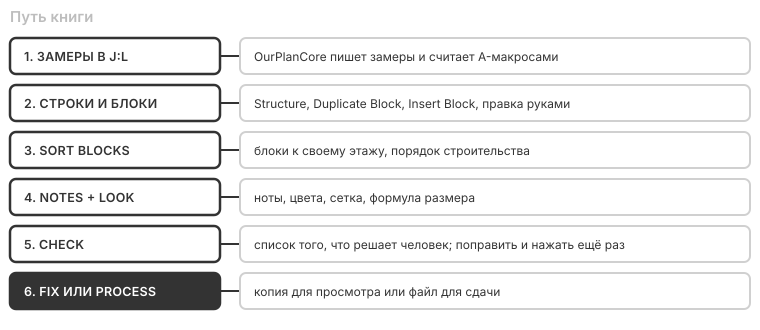

# Вкладка E-Wood в Excel

Здесь: что делает каждая кнопка вкладки E-Wood, как скопировать блок и вставить общий, что значит каждая строка отчёта Check и что где применяется при сдаче. Правила самих строк описаны в [DFL: как устроена книга](dfl-overview.md).

<figure markdown>
  
  
  <figcaption markdown="span">Вкладка E-Wood, разрезана надвое для экрана. На узком окне Excel сворачивает группы справа в одну кнопку, внутри те же макросы.</figcaption>
</figure>

Вкладка ставится на компьютер один раз и работает с любой книгой DFL. Сама книга и макросы внутри неё не меняются. Та же инструкция лежит в PDF: кнопка `More > Instruction`.

<figure markdown>
  
  <figcaption markdown="span">Путь книги. `Sort Blocks` и `Notes + Look` меняют открытую книгу, `Fix` и `Process` делают копию.</figcaption>
</figure>

## Установка { #install }

Один файл `EWoodTools-Setup.exe`, внутри всё: вкладка, инструменты, правила, инструкция. Его можно скопировать на любой компьютер.

1. Закройте Excel. Установщик не пойдёт, пока запущен любой Excel, в том числе скрытый.
2. Запустите файл, кнопка `Install`. Windows может предупредить о незнакомой программе: `Подробнее`, `Выполнить в любом случае`.
3. Откройте книгу DFL: на ленте появится вкладка E-Wood.

Нужен только Excel 2010 или новее. Права администратора и Python не нужны. Обновление: тот же порядок с новым файлом. Удаление: тот же файл, кнопка `Uninstall`.

Ключ DeepSeek нужен только для проверки английского в `Fix` и для `Improve Note`: `More > DeepSeek Key`. Он хранится у пользователя Windows и в установщик не попадает.

## Три шаблона { #templates }

Вкладка сама определяет шаблон по содержимому книги и пишет его слева, в группе `Book`. От шаблона зависит, какие столбцы можно двигать.

| Шаблон | Строки | Что работает |
| --- | --- | --- |
| `TemplateCom` | A:H | всё |
| `0.Template 05.23`, `1.Template` | A:G, A:F | `Order`, `Finish`, `More` и макросы, которым всё равно: `A1 Units`, `Trims`, `Sum Same`, `Sum Windows`, `2400 @48`, `Insert Cells`, `Delete Cells`, `No Validation`, `Improve Note`, `Multiply` |
| неизвестный, нет строки `Description` | | `Finish`, `More` и те же макросы, `Order` серый |
| не DFL, нет листа | | клавиши снова принадлежат Excel |

Остальные кнопки на старых шаблонах серые, их клавиши не заняты: такой макрос записал бы поверх таблицы справа.

## Duplicate Block { #duplicate }

Второй балкон, porch или canopy почти всегда повторяет первый: копия из той же книги совпадает на 76-91% строк. Копирование руками оставляет ссылки на чужой блок, и количество считается по чужим единицам. Эта кнопка копирует правильно.

1. Поставьте курсор на заголовок блока или на любую строку под ним.
2. Нажмите `Duplicate Block`. Копия встанет прямо под блоком, курсор на её заголовке.
3. Поправьте размер в заголовке и units в G.
4. Свяжите очищенные строки G со своими замерами.
5. Уберите лишнее и поправьте счёт в формулах C.
6. `Delete Zeros` уберёт строки с C = 0.

| Что | Как |
| --- | --- |
| Границы | Блок с units в G заголовка копируется целиком, вместе с зелёными `Decking` и `Trims`, до следующего заголовка. Курсор на самом зелёном заголовке: только эта подсекция, единицы остаются от её блока |
| Номер | `#2 Upper Balcony...` становится следующим свободным номером этого вида. Без `#` имя остаётся как есть, переименуйте сами |
| Единицы | Все `$G$129` в копии становятся `$G$154`, её собственным заголовком. `=A129` тоже, поэтому площадь `Decking` читает размер из нового заголовка |
| Ссылки на замеры | G со ссылкой наружу блока (`=K36`) очищается: это замер старого блока. C становится 0, пока не свяжете новый |
| Числа в G | Вписанные числа копируются. Сколько их, пишет строка состояния. Проверьте их |
| Что не трогает | Всё правее A:H остаётся на месте, буфер обмена не меняется |

!!! warning "Кнопка не сверяет блок с чертежом"
    Посты, балки и hangers копии такие же, как у источника. Сверьте их с планом.

## Insert Block { #insert }

Меню для блоков, у которых нет образца в этой книге. Балконы, porch и canopy в общем виде не существуют: общий вариант угадывает 0-18% строк. Для них [Duplicate Block](#duplicate) или блок из похожего проекта.

| Пункт | Что пишет |
| --- | --- |
| `Balcony` | балконный блок по команде `b 12x30` или `b 12.5x6.5 u2` (ширина, длина, units). Команда берётся из активной ячейки, если там именно она, иначе программа спросит |
| `Shaft Walls` | сразу два блока: `Shaft walls` (CH + J) и `Shaft Fire walls` (H + C). Лишний уберёт `Delete Zeros` |
| `Decking + Wood Railing` | `Decking`, `Posts at Rails`, `Post Cap`, `Balustrades`, `Rails (top & bottom)`, `Cap Rail` |
| `Decking + Cable Railing` | `Decking`, `Posts at Rails`, `Post Sleeve`, `Post Cap`, `Cables`, `Cap Rail` |
| `Decking + Sleeve Railing` | `Decking`, `Posts at Rails`, `Post Sleeve`, `Post Cap`, `Rail sections` |
| `Pavers` | заголовок, нота `by others` и строка `Pavers` |
| `Jambs` | строка `Jambs`, G из `Perimeter Total` в таблице проёмов. Заголовок `Wall Materials` пишет, только если его нет в книге |
| `Bolts` | `Blocking`, `Anchor Bolts`, `Washers`, `Nuts`. Шаг и слои в H, G пустой |

Как они пишут:

- **Куда:** в выделенную строку, что было ниже, сдвигается. Только A:H. Пустые строки до и после ставятся сами, под заголовком пустой строки нет.
- **В G ничего не вписано:** пока G пустой, C = 0, и `Delete Zeros` убирает то, что не понадобилось. Раньше макрос ставил `G=50` или `174`, и такие числа уходили клиенту как замеры.
- **Счёт:** `=0*$G$104`. Вместо 0 впишите количество на один блок. Втулки и колпаки повторяют число постов, `Rails` и `Cap Rail` повторяют длину строки выше.
- **Единицы:** вставили внутрь блока с units, формулы сами считают `$G$` его заголовка. Вне такого блока единиц нет.

Строки взяты из сданных книг: в меню только то, что держится от проекта к проекту.

## Sort Blocks и Notes + Look { #order }

Работают с открытой книгой. Сначала сохраняют её и кладут копию в `_ewood_backups` рядом с книгой, потом меняют, а результат оставляют несохранённым. Закрыть без сохранения значит отменить. Отчёт: `_ewood_backups\имя_report.txt`.

**Sort Blocks** - порядок:

- блоки встают сразу за framing list своего этажа, trims за своим блоком, `Roof Deck` и `Side Roof` перед кровлей;
- порядок строительства: 1st Floor Framing List, 1st Floor Walls, 2nd Floor Framing List и так далее;
- `Decking` и `Railing` получают свой заголовок, каркас deck получает уровень `Ground`; нет расположения: это попадёт в отчёт;
- шайбы в `Foundation Walls` встают под свои анкеры, микрогруппы начинаются после пустой строки, пустых строк по одной, под заголовком ни одной.

**Notes + Look** - оформление:

- ноты: префиксы, ноты под заголовком своей секции, `Important:` сверху, статус чертежей первым, цвет по месту;
- заголовки: цвета, текст из E в `Comment:` под заголовком, цвет под всем текстом;
- строки: материал чёрный без заливки, опции своим цветом, отметки ревью в F, чёрная сетка A:F, серые G:H, высота, выравнивание;
- формулы: формула размера блока читается одинаково на любом языке, `CEILING.MATH` записывается как `CEILING`. Если число стало бы другим, строка остаётся и попадает в отчёт. Gable screws остаются как есть.

!!! note "Пока кнопка работает"
    Не копируйте ничего в других программах: строки двигаются через буфер обмена, он один на компьютер. Если копирование совпало, проверка это увидит, и книга вернётся к сохранённому виду. Ничего не потеряется.

## Check { #check }

Ничего не меняет. Каждая строка отчёта: номер строки листа, код и что не так. Это кандидаты: решает человек, по чертежу. Строка, которую вы проверили и оставили, будет показываться и дальше: пустой список не обязателен.

| Код | Что значит | Что делать |
| --- | --- | --- |
| `BLOCK-REF` | строка считает единицы другого блока, блок скопирован руками | заменить `$G$` на заголовок своего блока, если нет причины |
| `BLOCK-UNITS` | C не умножен на units блока, а другие строки умножены | умножить, или оставить, если это итог на весь дом |
| `POST-COUNT` | `Post Bases` и `Posts` в блоке не сходятся | сверить с планом, часть постов может стоять без базы |
| `SAME-BLOCK` | два блока одинаковы на один unit | один блок, сложить units |
| `G-DEFAULT` | G равен тому, что макрос вписывал сам (50, 100, 174) | вписать замер или очистить |
| `JL-ORPHAN` | деталь измерена в J:L, но её не использует и не упоминает ни одна строка | написать строку с листом в E или ноту, почему нет |
| `ERR-CELL` | ошибка `#REF!`, `#VALUE!` и другие в любой ячейке листа | найти причину: ошибка справа может обнулить строку |
| `SPEC-CELL` | спек-ячейка всё ещё `per page`, `TBD` или `assumed` | заполнить с чертежа; позиция, которой нет в доме, может остаться |
| `C-ZERO` | C = 0 | `Delete Zeros` или вписать G |
| `ROUNDING` | штуки меньше 50, округление не до 2 | округлить до 2, если крепёж не идёт по N штук на точку |
| `STOCK` | нечётная длина больше 8 ft | следующая чётная |
| `C-CEILING` | `CEILING.MATH` в C | `Notes + Look` или `Fix` перепишут сами |
| `FORMULA-LOCALE` | формула размера читается неверно на другом языке | `Notes + Look`, `Fix` и `Process` перепишут сами |
| `NOTE-LEN` | нота длиннее 80 знаков, потолок 100 | вторая строка `Note:` |
| `NOTE-EQ`, `NOTE-ABBR` | знак = в ноте, сокращения `shtg`, `btm pl`, `o/` | полные слова |
| `NOTE-GLUE`, `NOTE-RANGE` | лист через тире, диапазон листов через дефис | `per <лист>`, `S203 thru S206` |
| `PLACEHOLDER` | осталась заготовка: `per page` или многоточие в конце | заполнить или удалить |
| `E-DOUBLED`, `E-TEXT` | двойной элемент описан в E, предложение в E | `(2)` в конце A; в E только лист или марка |
| `B-LVL`, `B-GRADE`, `B-APA` | запись LVL, сорт дерева и `APA` в B | `1 3/4 x 14 LVL`; сорт и `APA` не пишутся |
| `B-ZMAX`, `B-TBD` | `ABU66Z`, `TBD` из шаблона | модель, пробел, `Zmax`. `DTT2Z`, `TBD HD`, `TBD Decking` не считаются |
| `A-NAME`, `A-STUDS` | у hardware нет настоящего имени, `Studs` вне Floor Walls | настоящее имя; вне Floor Walls пишется `Frame` |
| `NO-DESCRIPTION` | в столбце A нет строки `Description` | шаблон неизвестен, вернуть строку |

Сначала смотрите `ERR-CELL` и `BLOCK-REF`: они меняют числа.

## Fix, Merge, Process { #finish }

Работают с файлом на диске и спросят, сохранить ли изменения. Сама книга не меняется, результат лежит в отдельной папке рядом с ней.

| Кнопка | Результат |
| --- | --- |
| `Fix Links` | `fixed_excels\`, тот же формат, формулы живые, отчёт рядом |
| `Fix Numbers` | `fixed_numbers\*.xlsx`, ссылки становятся числами, отчёт рядом |
| `Merge DFL` | сводный лист `имя_DFL_summary.xlsx` рядом с книгой |
| `Process Excels` | все книги папки в `processed_excels\*.xlsx`, это файл для сдачи. Там же `dfl_rules_report.txt` и `SQ FT.txt` |

Что где применяется:

| Что | Sort, Notes | Fix | Process, Merge |
| --- | --- | --- | --- |
| Ноты, порядок блоков, заголовки, цвета, отметки ревью, пустые строки | да | да | да |
| Формула размера на всех языках | да | да | да |
| Сетка, вид строк, цвет под всем текстом, `92D050` в `99CC00`, `CEILING` | да | да | нет |
| Шайбы под анкеры | да | нет | нет |
| Английский и опечатки, DeepSeek | нет | да | нет |
| Ссылки в числа | нет | `Fix Numbers` | `Process` |

**Проверка английского в Fix.** DeepSeek переписывает ноты, второй проход отклоняет изменённый смысл, числа и марки остаются. В подписях он правит опечатки по прошлым работам. B и коды продуктов только показывает в отчёте. Неточности идут в отчёт как `[check]`. Без ключа ноты не проверяются, отчёт об этом скажет, остальное сделается.

**Если проверка не прошла:** потерялась строка материала, изменились значения Front Page или Mat List или картинки. Книга не создаётся, причина в отчёте.

## Цвета заголовков { #colours }

Как в шаблонах `0.Template 05.23` и `1.Template`.

| Цвет | Где |
| --- | --- |
| `FFFF00` | стены: `Foundation Walls`, `Floor Walls`, `Gable Walls`, `Parapet Walls`, `Shaft walls`, `Interior Doors&Trims` |
| `99CC00` | каркас: Floor Framing List, балконы, porch, deck, `Roof Frame list`, `Roof System Misc` |
| `CCFFCC` | внутри и отделка: `Decking`, `Balcony Trims`, `Porch Trims`, `Pavers`, `Roof Products`, `Soffits and Fascias`, `Exterior Trims`, `Siding` |
| `FABF8F` | оранжевый только зовёт проверяющего. `Wall Materials` и `Ceiling Materials` в рабочей книге пока им. При сдаче оранжевый заголовок становится `99CC00`, у `Shaft walls` `FFFF00` |

Светло-зелёный `92D050` на заголовке `Fix` и `Notes + Look` меняют на `99CC00`.

## Два языка { #languages }

Excel и Windows бывают русскими и английскими. Вкладка даёт одинаковые ячейки на обоих: числа в формулах и метках читаются одинаково, а не по настройкам компьютера.

- **Формула размера блока** раньше читала `10.3` по региону компьютера: на другом языке получался 0 или миллиарды. Теперь в `TemplateCom`, `TemplateResidential` и в макросе `Balcony` стоит новая формула. Старые книги исправляют `Notes + Look`, `Fix`, `Process` и `Merge`.
- **Если значение было неверным,** в отчёте будет `[warn]` с номером строки: посмотрите этот блок.
- **Другой компьютер ведёт себя иначе:** нажмите `More > About` и пришлите, что там написано. Там язык и разделители.

Проверено на Excel, который ведёт себя как английский. Настоящий английский Excel не проверялся.

## Если что-то не так { #trouble }

| Что видите | Что делать |
| --- | --- |
| Кнопка серая | старый шаблон или книга не DFL: смотрите группу `Book` |
| `Go to the sheet Detailed Frame List first` | перейдите на этот лист: кнопка двигает строки только там |
| `No block here` | курсор над первым заголовком или ниже конца списка |
| `The previous button is still working` | подождите конца предыдущей кнопки, смотрите строку состояния |
| `... stopped before it finished` | закройте книгу без сохранения и нажмите ещё раз, копия есть в `_ewood_backups` |
| `This book is open read-only` | закройте и откройте для правки |
| `Save this book to a folder on this computer first` | книга новая или открыта из интернета: сохраните в папку |
| `The tools folder was not found` | запустите установщик ещё раз |
| `Some rows were not parsed. Nothing was changed` | `Sum Windows` не понял строку, он назовёт какие: поправьте текст |
| `Row 'Perimeter Total ...' not found` | в этой книге нет таблицы проёмов |
| `No AI key on this computer` | `More > DeepSeek Key` |
| `Close Excel and run this again` | установщик видит запущенный Excel, в том числе скрытый |
| Вкладки нет | закройте Excel, запустите установщик ещё раз. `Файл`, `Параметры`, `Надстройки`: должна быть `EWoodTools` |
| Правые зоны поехали | вставили целую строку листа. Отмена, потом `Insert Cells`: только A:H |

## Где что лежит { #where }

| Что | Где |
| --- | --- |
| Программа на компьютере | `%LOCALAPPDATA%\EWoodTools`, папки `addin` и `tools` |
| Копия перед `Sort Blocks` и `Notes + Look`, отчёт | `_ewood_backups` рядом с книгой |
| `Fix Links`, `Fix Numbers` | `fixed_excels`, `fixed_numbers` рядом с книгой |
| `Process` | `processed_excels` рядом с книгами |
| `Merge` | `имя_DFL_summary.xlsx` рядом с книгой |

## См. также

- [Макросы и клавиши Excel](excel-hotkeys.md): все макросы по этапам и горячие клавиши
- [DFL: как устроена книга](dfl-overview.md), [Блоки балконов, porch и holdowns](dfl-blocks.md), [Ноты в DFL](standard-notes.md)
