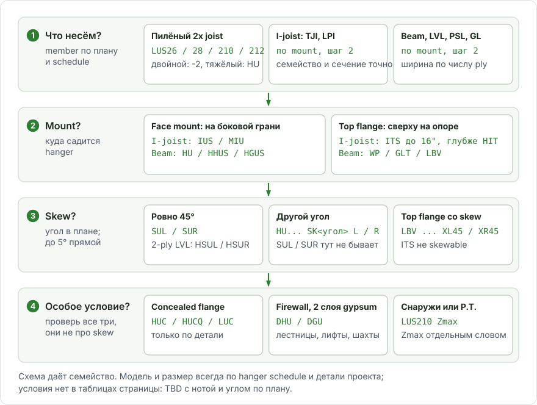
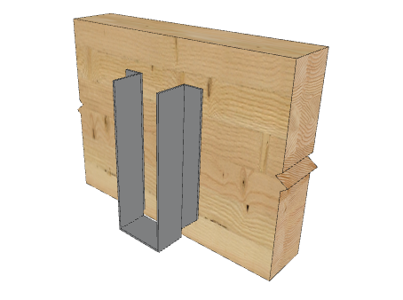
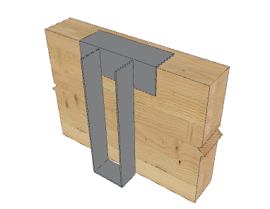
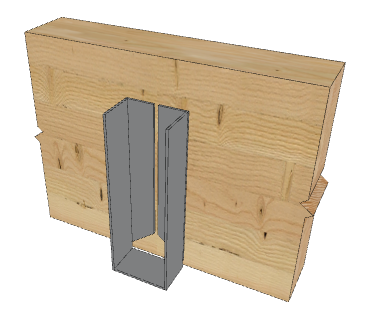
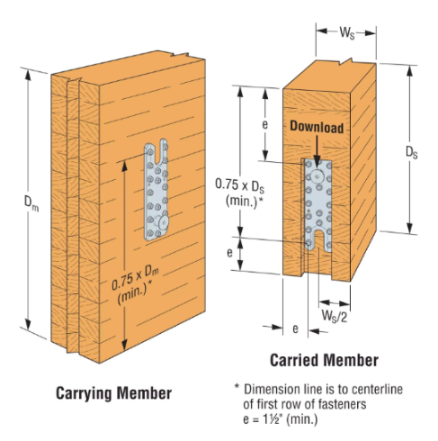
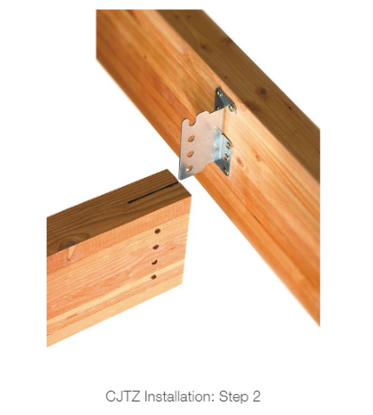

# Hangers

Here: how to pick a hanger by condition (what it carries, what it sits on, which mount, any skew or firewall) and how to write the model in the DFL. A hanger is picked by the condition and the project schedule, not by eyeballing the name.

!!! tip "Pick in 30 seconds"
    1. Identify the member: `Beam / LVL / PSL / GL`, `TJI`, `LPI`, double joist.
    2. Identify the mount: `Face Mount`, `Top Flange`, `Concealed Flange`.
    3. Check the depth: joists deeper than 16" usually go to `HIT`, not `ITS`.
    4. Check skew and slope: `ITS` is not skewable.
    5. Check special conditions: firewall and double gypsum, Cedar, glulam, shear wall.

<figure markdown>
  
  <figcaption markdown="span">Selection flow: mount condition first, then depth, skew and special conditions.</figcaption>
</figure>

## Quick pick

-   :material-view-column-outline: **Face Mount**

    ---

    The hanger hangs on the side face of the support. Usually `HU`, `HHUS`, `HGUS`, `IUS`,
    `MIU`, `SUL / SUR`.

-   :material-dock-top: **Top Flange**

    ---

    The hanger sits on top of the support. For joists it is `ITS / MIT`, for beams
    `WP`, `GLT / GLTV`, `LBV`.

-   :material-vector-square: **Concealed Flange**

    ---

    The flange is hidden inside the connection: `HUC / HUCQ`, `LUC`. Do not quietly
    swap this hanger for a regular face mount: check the detail and fasteners.

-   :material-angle-acute: **Skew / Slope**

    ---

    There is an angle - do not use `ITS`. Face mount: `SUL / SUR` (45 degrees), other angle
    `LSSR`; top flange: `LBV ... XL45 / XR45`; LPI slope and skew: `LSSU / LSSUH / LSSUI`.

-   :material-alert-octagon-outline: **Deep Joist**

    ---

    Joists deeper than 16" - the `HIT` family, for example `HIT420`. `ITS` only up to
    16" inclusive.

-   :material-fire-alert: **Firewall / Double Gypsum**

    ---

    `DHU / DGU` only where joists hang through firewall double gypsum:
    stairs, elevators, shafts. A regular demising wall, where the gypsum stops under
    the floor framing, gets `ITS`.

## Critical rules

- `ITS` - top flange for I-joist only and only up to 16" deep; there is no skewed `ITS`.
- Skewed top mount: `WP / HUTF / LBV` per detail; skewed face mount: `SUL / SUR / HSUR`.
- EWP (`LVL`, `PSL`, `GL`, `TJI`, `LPI`): keep the exact family and section, do not turn it into a generic hanger.
- Model per the detail: the detail says `U210-2` - write `U210-2`, not `LUS210-2`.
- Hangers on both ends of every joist, counted by assemblies on the plan, not by purchase boards after the cut list; whole pieces only.
- Exterior and on P.T. - `Zmax`. `H2.5A` ties to trusses under the sheathing - no `Zmax` unless the detail says otherwise.
- Repeated area (units x N): check that the hanger count repeats as many times as the framing.
- The project schedule wins over the tables below; the tables are a hint, not a replacement for the engineer's detail.

## How to write hardware in the DFL { #dfl-format }

Column B format, as in delivered jobs.

| Rule | Do | Don't |
| --- | --- | --- |
| `Zmax` as a separate word after the model | `ABU66 Zmax`, `LUS210 Zmax`, `HHUS410 Zmax SK30 R` | `ABU66Z`, `LSSR28Z`, `LUS210Z` |
| Angle and hand as the suffix `SK<angle> <L or R>` | `HHUS410 Zmax SK30 R`, `HU612 Zmax SK60 L` | `skew 30 deg`, `special order`, `HDG` in B |
| Skewed on sawn 2x: `SUL` left hand, `SUR` right hand, a separate row for each hand and each angle | `SUL28 Zmax` 12 pcs, `SUR28 Zmax` 16 pcs; angle in E `skewed 30°` | one row "all skewed as one SKU" |
| `LSSR` only for an angle outside the `SUL / SUR` range | `LSSR28 Zmax`, E `skewed 60°` | `LSSR` on all skewed |
| Fire hangers only over stair, elevator, shaft walls | `DHU210-2` with E = detail | `DHU` on a regular demising wall |
| Ties | `H2.5A` without `Zmax` to trusses; `H3` on both sides of the truss if the detail says so; spacing = truss spacing; all bearing lines | `H2.5A Zmax` under sheathing, ties only on exterior walls |
| Quantity | `pcs`, by assemblies, whole; under 50 - round up to even | by boards after the cut list |

First count on the plan how many go left and how many go right, then write the rows. Pick the model from the tables below, not from the catalog from scratch; a condition not in the tables gets `TBD` with a note and the angle from the plan, not a guess.

## How to read a hanger code

`ITS2.37/11.88`

| Part | Meaning | Example |
| --- | --- | --- |
| `ITS` | family: I-joist top flange | top mount for TJI and LPI |
| `2.37` | flange width of the carried joist | about 2 5/16" |
| `11.88` | joist depth | 11 7/8" |

!!! note "Quick size conversion"
    - `1.81` = 1 3/4", `2.06` = 2 1/16", `2.37` = 2 5/16", `3.56` = 3 1/2", `5.50` = 5 1/2".
    - `9.5` = 9 1/2", `11.88` = 11 7/8".

## Visual types

  
Hide 5 illustrated rules

  <figure class="kb-figure-row">
    <figcaption class="kb-figure-row__text">
      
Face Mount

      
The hanger attaches to the side face of the support.

      
Check the section, the depth of the carried member and whether there is a skew.

    </figcaption>
    
  </figure>
  <figure class="kb-figure-row">
    <figcaption class="kb-figure-row__text">
      
Top Flange

      
The flange sits on top of the beam, wall or support.

      
For I-joist see <code>ITS / MIT</code>; for beams top mount <code>WP / GLT / LBV</code>.

    </figcaption>
    
  </figure>
  <figure class="kb-figure-row">
    <figcaption class="kb-figure-row__text">
      
Concealed Flange

      
The flange is hidden; most often the <code>HUC / HUCQ</code> family.

      
Check the fastener note and the detail. Do not swap for a regular <code>HU</code> without a reason.

    </figcaption>
    
  </figure>
  <figure class="kb-figure-row">
    <figcaption class="kb-figure-row__text">
      
CBH for Glulam

      
<code>CBH2.37X9.75C-KT</code> - a special connection for glulam.

      
Only when a detail or schedule shows a glulam or Cedar-style connection.

    </figcaption>
    
  </figure>
  <figure class="kb-figure-row">
    <figcaption class="kb-figure-row__text">
      
CJTZ for Cedar

      
<code>CJTZ</code> - a separate item for Cedar beams and posts.

      
Do not mix with regular beam hangers; it is a separate row in the workbook.

    </figcaption>
    
  </figure>

## Pick by condition

| Condition | Usually look at | Don't forget |
| --- | --- | --- |
| LVL / PSL / GL face mount | `HU`, `HHUS`, `HGUS` | built-up member width: `(2)`, `(3)`, `(4)` LVL |
| LVL / PSL / GL concealed | `HUC`, `HUCQ` | concealed flange and fasteners |
| LVL / PSL / GL top flange | `WP`, `GLT`, `GLTV`, `LBV` | top seat, skew, support width |
| TJI / LPI top flange | `ITS`, `MIT`, `BA`, `LBV` | depth up to 16" for `ITS`; double joists separately |
| TJI / LPI face mount | `IUS`, `MIU`, `HU`, `SUL / SUR` | face and skew condition |
| LPI field slope and skew | `LSSU`, `LSSUH`, `LSSUI` | left or right and the real angle per detail |
| Firewall, double gypsum | `DHU`, `DGU` | only if the detail explicitly shows the condition |
| Cedar, glulam special | `CJTZ`, `CBH` | separate row, not a generic hanger |

## Hanger quick table { #tables }

=== "Beam Face Mount"

    | Member section | Hanger |
    | --- | --- |
    | 1 3/4 x 9 1/2 | `HU9` |
    | 1 3/4 x 11 7/8 | `HU11` |
    | 1 3/4 x 14 | `HU14` |
    | 3 1/2 x 9 1/2 | `HU410` / `HHUS410` |
    | 3 1/2 x 11 7/8 | `HU412` |
    | 3 1/2 x 14 | `HU414` |
    | 5 1/2 x 11 7/8 | `HU612` / `HHUS5.50/12` |
    | 5 1/4 x 9 1/2 | `HHUS5.50/10` |
    | 7 x 11 7/8 | `HGUS7.25/12` |
    | 1 3/4 x 11 7/8 skew left 45 | `SUL1.81/11` |
    | 1 3/4 x 11 7/8 skew right 45 | `SUR1.81/11` |

=== "Beam Concealed"

    | Member section | Hanger |
    | --- | --- |
    | 1 3/4 x 9 1/2 | `HUCQ1.81/9` |
    | 1 3/4 x 11 7/8 | `HUCQ1.81/11` |
    | 3 1/2 x 11 7/8 | `HUCQ412 SDS` |
    | 5 1/2 x 9 1/2 | `HUCQ610` |
    | 3 1/2 x 9 1/2 | `HUC410` |
    | 3 1/2 x 11 7/8 | `HUC412` |
    | 3 1/2 x 14 | `HUC414` |
    | 5 1/4 x 11 7/8 | `HUC612` |

=== "Beam Top Flange"

    | Member section / condition | Hanger |
    | --- | --- |
    | 1 3/4 x 9 1/2 | `WP9` |
    | 1 3/4 x 11 7/8 | `WP11` |
    | 1 3/4 x 14 | `WP14` |
    | 1 3/4 x 16 | `WP16` |
    | 1 3/4 x 11 7/8 skew left 45 | `LBV1.81/11.88XL45` |
    | 1 3/4 x 11 7/8 skew right 45 | `LBV1.81/11.88XR45` |
    | 3 1/2 x 9 1/2 | `MIT49.5` / `GLTV3.59` |
    | 3 1/2 x 11 7/8 | `GLTV3.511` / `GLT4/11.88` |
    | 3 1/2 x 14 | `GLTV3.514` |
    | 5 1/2 x 11 7/8 | `GLTV5.511` / `GLT6/11.88` |
    | 5 1/2 x 14 | `GLTV5.5/14` |
    | 7 x 11 7/8 | `HGLTV411.88 2` |

=== "TJI"

    | Joist | Top flange | Face mount |
    | --- | --- | --- |
    | 11 7/8 TJI 110 | `ITS1.81/11.88` | `IUS1.81/11.88` |
    | 11 7/8 TJI 210 | `ITS2.06/11.88` | `IUS2.06/11.88` |
    | 11 7/8 TJI 230 / 360 | `ITS2.37/11.88` | `IUS2.37/11.88` |
    | 11 7/8 TJI 560 | `ITS3.56/11.88` | `IUS3.56/11.88` |
    | (2) 11 7/8 TJI 110 | `MIT3.12/11.88` | `MIU3.12/11` |
    | (2) 11 7/8 TJI 210 | `MIT4.12/11.88` | `MIU4.12/11` |
    | (2) 11 7/8 TJI 360 | `MIT4.75/11.88` | `MIU4.75/11` |
    | (2) 11 7/8 TJI 560 | `BA412-2` | `HU412-2` |

=== "LPI"

    | Joist | Top flange | Face mount |
    | --- | --- | --- |
    | 9 1/2 LPI 18/20/32 | `ITS2.56/9.5` | `IUS2.56/9.5` |
    | 11 7/8 LPI 18/20/32 | `ITS2.56/11.88` | `IUS2.56/11.88` |
    | 14 LPI 18/20/32 | `ITS2.56/14` | `IUS2.56/14` |
    | 11 7/8 LPI 36 | `ITS2.37/11.88` | `IUS2.37/11.88` |
    | 14 LPI 36 | `ITS2.37/14` | `IUS2.37/14` |
    | 11 7/8 LPI 56 | `ITS3.56/11.88` | `IUS3.56/11.88` |
    | 14 LPI 56 | `ITS3.56/14` | `IUS3.56/14` |
    | Double 9 1/2 LPI 18/20/32 | `MIT39.5 2` | `MIU5129` |
    | Double 11 7/8 LPI 36 | - | `MIU4.75/11` |

=== "Skew / Slope"

    | Condition | Hanger |
    | --- | --- |
    | LPI 56 field slope and skew | `LSSU410` |
    | LPI 18/20/32 field slope and skew | `LSSUH310` |
    | LPI 36 field slope and skew | `LSSUI35` |
    | LPI 18/20/32 skew left 45 | `SUL2.56/9` |
    | LPI 18/20/32 skew right 45 | `SUR2.56/9` |
    | LPI 36 skew left 45 | `SUL2.37/9` |
    | LPI 36 skew right 45 | `SUR2.37/9` |
    | LPI 18/20/32 top flange skew left | `LBV2.56/9.5XL45` / `LBV2.56/11.88XL45` |
    | LPI 18/20/32 top flange skew right | `LBV2.56/9.5XR45` / `LBV2.56/11.88XR45` |

## Special items

| Item | When to use | Check before output |
| --- | --- | --- |
| `CJTZ` | Cedar beams and posts | the detail must have a Cedar callout |
| `CBH2.37X9.75C-KT` | glulam special connection | check the glulam condition and the carried member |
| `A35`, `LTP4` | shear wall connections | per the SW schedule and details: if the schedule names them, count by spacing; do not add them "just in case" |
| `HDU`, `HDUE`, `DTT2Z` | holdown | to concrete one; through wood floor framing two (btm and top); over a beam, no transfer needed ([Blocks](dfl-blocks.md#holdowns)) |
| `DHU / DGU` | double gypsum, firewall | do not use without a firewall detail |

## Common mistakes

- Hangers not on both ends, or counted by purchase boards instead of assemblies.
- No `Zmax` on the exterior; bases are Zmax but hangers are not.
- `LUS210-2` instead of the model from the detail; `ITS` on a skewed condition.
- All skewed on one row without splitting by hand and angle.
- `DHU` on a regular demising wall; ties not on all bearing lines or not at truss spacing.

All mistakes: [Floor framing and beams](../start/common-mistakes.md#floor).

## Final check

- Family, size, skew, top or face mount, support condition checked against the detail.
- The schedule on the plan wins over the default table.
- The connection looks non-standard - open the detail, do not guess from the thumbnail.
- Repeated areas: the count repeats as many times as the framing.

## See also

- [Hardware catalog](hardware-catalog.md), [Balcony, porch and holdown blocks](dfl-blocks.md), [DFL row labels](takeoff-items.md)
- [Joist](../work/horizontal/floor-framing/joist.md), [Beam](../work/horizontal/floor-framing/beam.md), [Frame (deck/porch/balcony)](../work/deck/deck-porch-balcony-frame.md)
