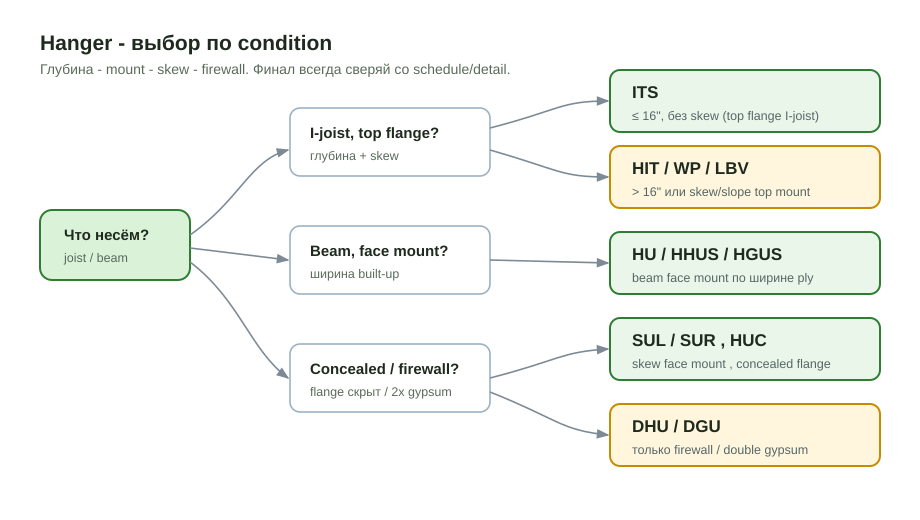
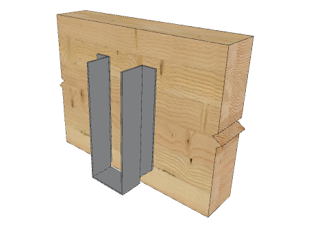
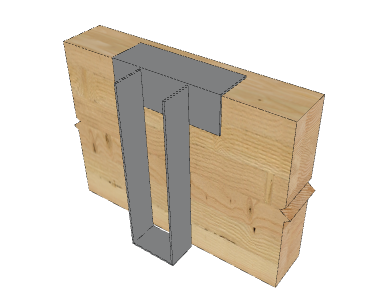
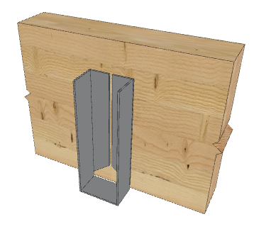
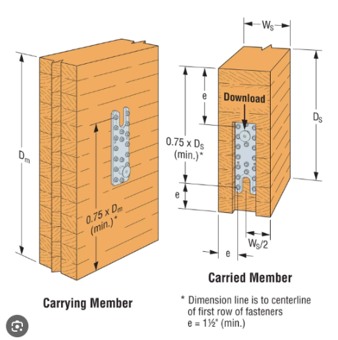
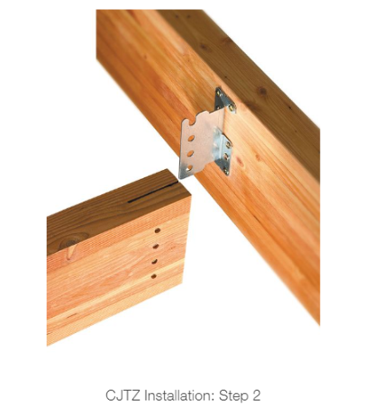

# Hangers

Здесь: как выбрать hanger по условию (что несём, куда садится, какой mount, есть ли skew или firewall) и как записать модель в DFL. Hanger выбирается не по названию на глаз, а по condition и schedule проекта.

!!! tip "Выбор за 30 секунд"
    1. Определи member: `Beam / LVL / PSL / GL`, `TJI`, `LPI`, double joist.
    2. Определи mount: `Face Mount`, `Top Flange`, `Concealed Flange`.
    3. Проверь depth: joists глубже 16" обычно уходят в `HIT`, не `ITS`.
    4. Проверь skew и slope: `ITS` не skewable.
    5. Проверь special condition: firewall и double gypsum, Cedar, glulam, shear wall.

<figure markdown>
  
  <figcaption markdown="span">Схема выбора: сначала mount condition, потом depth, skew и special conditions.</figcaption>
</figure>

## Быстрый выбор

-   :material-view-column-outline: **Face Mount**

    ---

    Hanger висит на боковой грани опоры. Обычно `HU`, `HHUS`, `HGUS`, `IUS`,
    `MIU`, `SUL / SUR`.

-   :material-dock-top: **Top Flange**

    ---

    Hanger садится сверху на опору. Для joists это `ITS / MIT`, для балок
    `WP`, `GLT / GLTV`, `LBV`.

-   :material-vector-square: **Concealed Flange**

    ---

    Полка скрыта внутри соединения: `HUC / HUCQ`, `LUC`. Такой hanger нельзя
    молча заменить на обычный face mount: сверяй деталь и fasteners.

-   :material-angle-acute: **Skew / Slope**

    ---

    Есть угол - не ставь `ITS`. Face mount: `SUL / SUR` (45 градусов), другой угол
    `LSSR`; top flange: `LBV ... XL45 / XR45`; LPI slope и skew: `LSSU / LSSUH / LSSUI`.

-   :material-alert-octagon-outline: **Deep Joist**

    ---

    Joists глубже 16" - семейство `HIT`, например `HIT420`. `ITS` только до
    16" включительно.

-   :material-fire-alert: **Firewall / Double Gypsum**

    ---

    `DHU / DGU` только там, где joists висят через двойной гипс firewall:
    лестницы, лифты, шахты. Обычная demising, где гипс кончается под
    перекрытием, идёт на `ITS`.

## Критические правила

- `ITS` - только top flange для I-joist и только до 16" глубины; для skewed `ITS` не бывает.
- Skewed top mount: `WP / HUTF / LBV` по детали; skewed face mount: `SUL / SUR / HSUR`.
- EWP (`LVL`, `PSL`, `GL`, `TJI`, `LPI`): держи точное семейство и сечение, не превращай в generic hanger.
- Модель по детали: деталь даёт `U210-2` - пишем `U210-2`, а не `LUS210-2`.
- Hangers на оба конца каждого joist, считаются по сборкам на плане, а не по закупочным доскам после раскроя; только целые штуки.
- Снаружи и на P.T. - `Zmax`. Ties `H2.5A` к фермам под обшивкой - без `Zmax`, если деталь не говорит иначе.
- Повторяющаяся зона (units x N): проверь, что число hangers повторилось столько же раз, сколько каркас.
- Schedule проекта важнее таблиц ниже; таблицы - подсказка, не замена детали инженера.

## Как записывать крепёж в DFL { #dfl-format }

Формат колонки B, как в сданных работах.

| Правило | Так | Не так |
| --- | --- | --- |
| `Zmax` отдельным словом после модели | `ABU66 Zmax`, `LUS210 Zmax`, `HHUS410 Zmax SK30 R` | `ABU66Z`, `LSSR28Z`, `LUS210Z` |
| Угол и рука суффиксом `SK<угол> <L или R>` | `HHUS410 Zmax SK30 R`, `HU612 Zmax SK60 L` | `skew 30 deg`, `special order`, `HDG` в B |
| Skewed на пилёном 2x: `SUL` левая, `SUR` правая рука, отдельная строка на каждую руку и каждый угол | `SUL28 Zmax` 12 pcs, `SUR28 Zmax` 16 pcs; угол в E `skewed 30°` | одна строка "все skewed одним SKU" |
| `LSSR` только для угла вне диапазона `SUL / SUR` | `LSSR28 Zmax`, E `skewed 60°` | `LSSR` на все skewed |
| Fire hangers только над стенами лестниц, лифтов, шахт | `DHU210-2` с E = деталь | `DHU` на обычной demising |
| Ties | `H2.5A` без `Zmax` к фермам; `H3` с обеих сторон фермы, если деталь так даёт; шаг = шаг ферм; все линии опирания | `H2.5A Zmax` под обшивкой, ties только по наружным стенам |
| Количество | `pcs`, по сборкам, целыми; меньше 50 - до чётного | по доскам после раскроя |

Сначала посчитать по плану, сколько налево и сколько направо, потом писать строки. Подбор модели - по таблицам ниже, а не по каталогу с нуля; условия нет в таблицах - `TBD` с нотой и углом по плану, не выдумка.

## Как читать Hanger code

`ITS2.37/11.88`

| Часть | Что значит | Пример |
| --- | --- | --- |
| `ITS` | семейство: I-joist top flange | top mount для TJI и LPI |
| `2.37` | ширина полки несомого joist | около 2 5/16" |
| `11.88` | глубина joist | 11 7/8" |

!!! note "Быстрый перевод размеров"
    - `1.81` = 1 3/4", `2.06` = 2 1/16", `2.37` = 2 5/16", `3.56` = 3 1/2", `5.50` = 5 1/2".
    - `9.5` = 9 1/2", `11.88` = 11 7/8".

## Визуальные типы

  
Скрыть 5 правил с иллюстрациями

  <figure class="kb-figure-row">
    <figcaption class="kb-figure-row__text">
      
Face Mount

      
Hanger крепится к боковой грани опоры.

      
Проверяй сечение, глубину несомого элемента и есть ли skew.

    </figcaption>
    
  </figure>
  <figure class="kb-figure-row">
    <figcaption class="kb-figure-row__text">
      
Top Flange

      
Полка садится сверху на балку, стену или опору.

      
Для I-joist смотри <code>ITS / MIT</code>; для балок top mount <code>WP / GLT / LBV</code>.

    </figcaption>
    
  </figure>
  <figure class="kb-figure-row">
    <figcaption class="kb-figure-row__text">
      
Concealed Flange

      
Полка скрыта; чаще семейство <code>HUC / HUCQ</code>.

      
Сверяй fastener note и деталь. Не заменяй на обычный <code>HU</code> без причины.

    </figcaption>
    
  </figure>
  <figure class="kb-figure-row">
    <figcaption class="kb-figure-row__text">
      
CBH for Glulam

      
<code>CBH2.37X9.75C-KT</code> - специальное соединение для glulam.

      
Только когда деталь или schedule показывает glulam или Cedar-style соединение.

    </figcaption>
    
  </figure>
  <figure class="kb-figure-row">
    <figcaption class="kb-figure-row__text">
      
CJTZ for Cedar

      
<code>CJTZ</code> - отдельная позиция для Cedar beams и posts.

      
Не смешивать с обычными beam hangers; это отдельная строка в книге.

    </figcaption>
    
  </figure>

## Подбор по condition

| Condition | Обычно смотреть | Не забыть |
| --- | --- | --- |
| LVL / PSL / GL face mount | `HU`, `HHUS`, `HGUS` | ширина built-up member: `(2)`, `(3)`, `(4)` LVL |
| LVL / PSL / GL concealed | `HUC`, `HUCQ` | concealed flange и fasteners |
| LVL / PSL / GL top flange | `WP`, `GLT`, `GLTV`, `LBV` | top seat, skew, ширина опоры |
| TJI / LPI top flange | `ITS`, `MIT`, `BA`, `LBV` | глубина до 16" для `ITS`; double joists отдельно |
| TJI / LPI face mount | `IUS`, `MIU`, `HU`, `SUL / SUR` | face и skew condition |
| LPI field slope и skew | `LSSU`, `LSSUH`, `LSSUI` | left или right и реальный угол по детали |
| Firewall, double gypsum | `DHU`, `DGU` | только если деталь прямо показывает condition |
| Cedar, glulam special | `CJTZ`, `CBH` | отдельная строка, не generic hanger |

## Быстрая таблица Hangers { #tables }

=== "Beam Face Mount"

    | Member section | Hanger |
    | --- | --- |
    | 1 3/4 x 9 1/2 | `HU9` |
    | 1 3/4 x 11 7/8 | `HU11` |
    | 1 3/4 x 14 | `HU14` |
    | 3 1/2 x 9 1/2 | `HU410` / `HHUS410` |
    | 3 1/2 x 11 7/8 | `HU412` |
    | 3 1/2 x 14 | `HU414` |
    | 5 1/2 x 11 7/8 | `HU612` / `HHUS5.50/12` |
    | 5 1/4 x 9 1/2 | `HHUS5.50/10` |
    | 7 x 11 7/8 | `HGUS7.25/12` |
    | 1 3/4 x 11 7/8 skew left 45 | `SUL1.81/11` |
    | 1 3/4 x 11 7/8 skew right 45 | `SUR1.81/11` |

=== "Beam Concealed"

    | Member section | Hanger |
    | --- | --- |
    | 1 3/4 x 9 1/2 | `HUCQ1.81/9` |
    | 1 3/4 x 11 7/8 | `HUCQ1.81/11` |
    | 3 1/2 x 11 7/8 | `HUCQ412 SDS` |
    | 5 1/2 x 9 1/2 | `HUCQ610` |
    | 3 1/2 x 9 1/2 | `HUC410` |
    | 3 1/2 x 11 7/8 | `HUC412` |
    | 3 1/2 x 14 | `HUC414` |
    | 5 1/4 x 11 7/8 | `HUC612` |

=== "Beam Top Flange"

    | Member section / condition | Hanger |
    | --- | --- |
    | 1 3/4 x 9 1/2 | `WP9` |
    | 1 3/4 x 11 7/8 | `WP11` |
    | 1 3/4 x 14 | `WP14` |
    | 1 3/4 x 16 | `WP16` |
    | 1 3/4 x 11 7/8 skew left 45 | `LBV1.81/11.88XL45` |
    | 1 3/4 x 11 7/8 skew right 45 | `LBV1.81/11.88XR45` |
    | 3 1/2 x 9 1/2 | `MIT49.5` / `GLTV3.59` |
    | 3 1/2 x 11 7/8 | `GLTV3.511` / `GLT4/11.88` |
    | 3 1/2 x 14 | `GLTV3.514` |
    | 5 1/2 x 11 7/8 | `GLTV5.511` / `GLT6/11.88` |
    | 5 1/2 x 14 | `GLTV5.5/14` |
    | 7 x 11 7/8 | `HGLTV411.88 2` |

=== "TJI"

    | Joist | Top flange | Face mount |
    | --- | --- | --- |
    | 11 7/8 TJI 110 | `ITS1.81/11.88` | `IUS1.81/11.88` |
    | 11 7/8 TJI 210 | `ITS2.06/11.88` | `IUS2.06/11.88` |
    | 11 7/8 TJI 230 / 360 | `ITS2.37/11.88` | `IUS2.37/11.88` |
    | 11 7/8 TJI 560 | `ITS3.56/11.88` | `IUS3.56/11.88` |
    | (2) 11 7/8 TJI 110 | `MIT3.12/11.88` | `MIU3.12/11` |
    | (2) 11 7/8 TJI 210 | `MIT4.12/11.88` | `MIU4.12/11` |
    | (2) 11 7/8 TJI 360 | `MIT4.75/11.88` | `MIU4.75/11` |
    | (2) 11 7/8 TJI 560 | `BA412-2` | `HU412-2` |

=== "LPI"

    | Joist | Top flange | Face mount |
    | --- | --- | --- |
    | 9 1/2 LPI 18/20/32 | `ITS2.56/9.5` | `IUS2.56/9.5` |
    | 11 7/8 LPI 18/20/32 | `ITS2.56/11.88` | `IUS2.56/11.88` |
    | 14 LPI 18/20/32 | `ITS2.56/14` | `IUS2.56/14` |
    | 11 7/8 LPI 36 | `ITS2.37/11.88` | `IUS2.37/11.88` |
    | 14 LPI 36 | `ITS2.37/14` | `IUS2.37/14` |
    | 11 7/8 LPI 56 | `ITS3.56/11.88` | `IUS3.56/11.88` |
    | 14 LPI 56 | `ITS3.56/14` | `IUS3.56/14` |
    | Double 9 1/2 LPI 18/20/32 | `MIT39.5 2` | `MIU5129` |
    | Double 11 7/8 LPI 36 | - | `MIU4.75/11` |

=== "Skew / Slope"

    | Condition | Hanger |
    | --- | --- |
    | LPI 56 field slope and skew | `LSSU410` |
    | LPI 18/20/32 field slope and skew | `LSSUH310` |
    | LPI 36 field slope and skew | `LSSUI35` |
    | LPI 18/20/32 skew left 45 | `SUL2.56/9` |
    | LPI 18/20/32 skew right 45 | `SUR2.56/9` |
    | LPI 36 skew left 45 | `SUL2.37/9` |
    | LPI 36 skew right 45 | `SUR2.37/9` |
    | LPI 18/20/32 top flange skew left | `LBV2.56/9.5XL45` / `LBV2.56/11.88XL45` |
    | LPI 18/20/32 top flange skew right | `LBV2.56/9.5XR45` / `LBV2.56/11.88XR45` |

## Особые позиции

| Item | Когда использовать | Проверка перед выводом |
| --- | --- | --- |
| `CJTZ` | Cedar beams и posts | в детали должен быть Cedar callout |
| `CBH2.37X9.75C-KT` | glulam special connection | сверить glulam condition и несомый элемент |
| `A35`, `LTP4` | соединения shear walls | по SW schedule и деталям: если schedule их называет, считать по шагу; не добавлять "на всякий случай" |
| `HDU`, `HDUE`, `DTT2Z` | holdown | к бетону один; через деревянное перекрытие два (btm и top); над балкой transfer не нужен ([Блоки](dfl-blocks.md#holdowns)) |
| `DHU / DGU` | double gypsum, firewall | не использовать без firewall detail |

## Частые ошибки

- Hangers не на оба конца или по закупочным доскам, а не по сборкам.
- Снаружи без `Zmax`; базы Zmax, а hangers нет.
- `LUS210-2` вместо модели из детали; `ITS` на skewed условии.
- Все skewed одной строкой без разбивки по рукам и углам.
- `DHU` на обычной demising; ties не по всем линиям опирания или не по шагу ферм.

Все ошибки: [Перекрытия и балки](../start/common-mistakes.md#floor).

## Финальная проверка

- Семейство, размер, skew, top или face mount, support condition сверены с деталью.
- Schedule на плане важнее таблицы по умолчанию.
- Соединение выглядит нестандартно - открой деталь, не угадывай по миниатюре.
- Повторяющиеся зоны: число повторилось столько же раз, сколько каркас.

## См. также

- [Hardware catalog](hardware-catalog.md), [Блоки балконов, porch и holdowns](dfl-blocks.md), [Подписи строк DFL](takeoff-items.md)
- [Joist](../work/horizontal/floor-framing/joist.md), [Beam](../work/horizontal/floor-framing/beam.md), [Frame (deck/porch/balcony)](../work/deck/deck-porch-balcony-frame.md)
