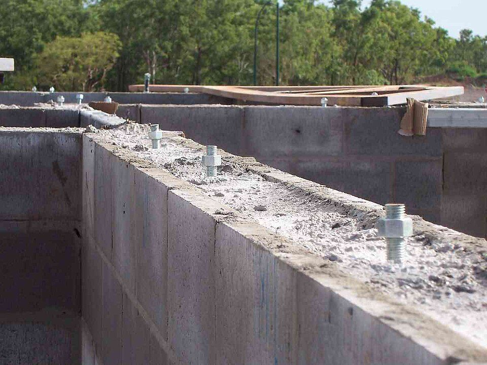
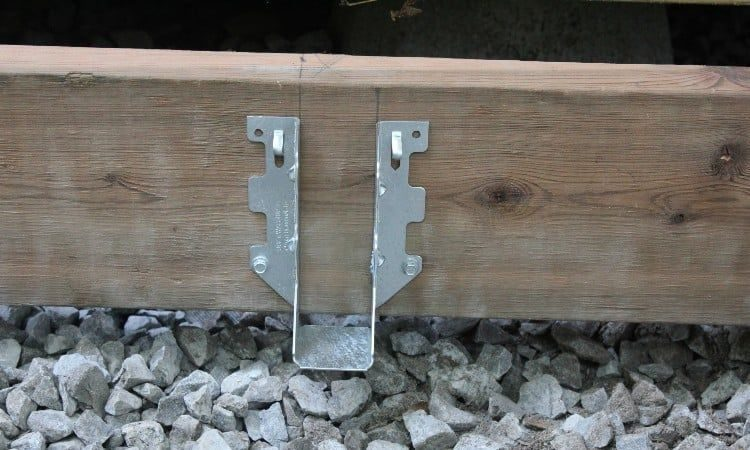
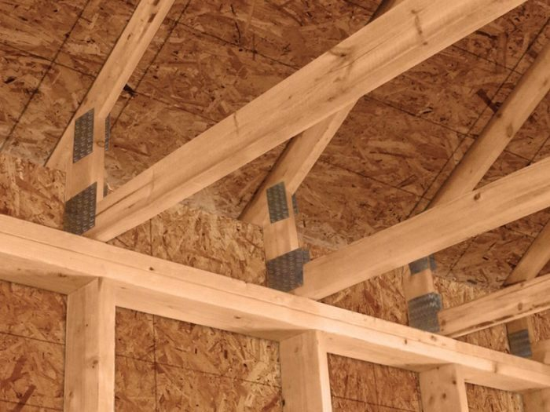

# Hardware catalog (Simpson)

Here: a glossary of the Simpson Strong-Tie hardware that shows up in the DFL: what it is and which connection it is for. Picking a hanger by condition: [Hangers](hangers.md); writing the model in column B: [same page](hangers.md#dfl-format).

!!! warning "A glossary, not defaults"
    The model always comes from the details and schedule of your own project. The list shows what exists and helps you read a mark on the drawing.

## How to read a mark

| Part | Meaning | Example |
| --- | --- | --- |
| `Zmax`, `Z` | hot-dip galvanized: exterior and on P.T. lumber | `LUS210 Zmax` (in B, written as a separate word) |
| `-2`, `-3` | number of plies of the carried beam | `HUC210-3` |
| `E` on a holdown | embedded: cast-in anchor, not post-installed | `HDUE7` |
| number in the model | section or load | `ABU66` for a 6x6, `HDU8` is stronger than `HDU4` |
| `SK30 R` after the model | skew 30 degrees, right hand (only in the B entry) | `HHUS410 Zmax SK30 R` |

## Hangers (joist, beam)

| Model | Used for |
| --- | --- |
| `LUS26`, `LUS28`, `LUS210`, `LUS212` (+`-2`, `-3`) | face mount for sawn 2x; the most common |
| `LUC26`, `LUC210` | concealed flange for 2x: end joists where the flange must not stick out |
| `HU9`, `HU11`, `HU14`, `HU410`, `HU412`, `HU414`, `HU612` | heavy U for LVL and built-up beams |
| `HHUS410`, `HHUS5.50/10`, `HHUS5.50/12`, `HGUS7.25/12` | heavy hi-cap for LVL, PSL, large beams |
| `HUC210-2`, `HUC412`, `HUCQ412 Zmax`, `HUCQ610` | concealed heavy: stairs, platforms, balcony beams |
| `ITS`, `IUS`, `MIT`, `MIU` | I-joists top flange and face mount; size by flange width and depth ([tables](hangers.md#tables)) |
| `SUL`, `SUR`, `HSUR`, `LSSR`, `LBV ... XL45 / XR45` | skewed and sloped; `SUL` left hand, `SUR` right hand |
| `DHU`, `DGU` | through firewall double gypsum: stairs, elevators, shafts; not instead of `ITS` on a regular demising wall |
| `WP`, `GLT`, `GLTV`, `LBV` | top flange for beams |
| `CJTZ`, `CBH` | cedar and glulam: separate rows, only per detail |

## Ties and clips

| Model | Used for |
| --- | --- |
| `H2.5`, `H2.5A` | truss or rafter to plate; the most common; to trusses without `Zmax` (under sheathing) |
| `H1`, `H3`, `H8`, `H10` | ties by load; `H3` on both sides of the truss if shown that way |
| `A35`, `A34`, `LTP4` | framing angle and lateral tie plate; on shear walls per schedule |
| `HGA10`, `HGA10KT` | hurricane gusset angle, `KT` = kit |
| `SDWC6` | truss screw instead of a tie, if the detail says `in lieu of H2.5A` (either screws or ties) |

## Straps

`MSTC40`, `MSTC52`, `MSTC66` (length in the name), `MSTA49`, `MST72`, `LSTA24`, `CS16` / `CS14` / `CS20` (coiled strap, cut to length). Do not mix straps with holdowns and anchors: their own row, their own SW mark in E.

## Post bases and caps

| Model | Used for |
| --- | --- |
| `ABU44`, `ABU66`, `ABU68`, `ABU88` (+`Zmax`), `ABA66Z` | post base by post section |
| `BC46 Zmax`, `BCS2-3/6 Zmax`, `BCS2-2/4` | cap by beam plies: 2-ply `BC46`, 3-ply `BCS2-3/6`; per schedule |
| `CCQ44`, `CCQ46`, `CCQ66`, `CCQ68`, `ECCQ66` | column cap; `ECCQ` at an edge or cantilever |
| `PC6Z`, `PB66 Zmax`, `CBSQ66 Zmax` | light cap and standoff base |
| `ML210Z`, `HL33Z` | beam-to-post angles on balconies |

Cap and base for every post, model per detail; the base and cap change together with the post section.

## Holdowns and anchors

| Model | Used for |
| --- | --- |
| `HDU2`, `HDU4`, `HDU5`, `HDU8`, `HDU11`, `HDU14`, `HDU19` | the workhorse series; the number grows with load per the SW schedule |
| `HDUE3`, `HDUE5`, `HDUE7`, `HDUE9`, `HDUE13` | embedded in concrete |
| `HTT5KT`, `HTT5K` | tension holdown, `KT` with anchor |
| `DTT2Z` | light, single-story houses, deck |
| `Titen HD 1/2" x 4"`, wedge anchor, `BP1/2-3`, `3x3 Square` | sill plate anchors and plate washers per the anchorage schedule; do not swap a wedge anchor for Titen HD without a reason |
| `TBD HD` | placeholder, with a note, when shear walls and holdowns are not defined |

Holdown count: to concrete one, through wood floor framing two ([Blocks](dfl-blocks.md#holdowns)).

<figure markdown>
  
  <figcaption markdown="span">Anchor bolts grouted into masonry under the sill plate: rows `Anchor Bolts` by spacing, `Washers`, `Nuts`. Photo: Bill Bradley, CC BY 2.5, [source](https://commons.wikimedia.org/wiki/File:HD-bolts.jpg)</figcaption>
</figure>

## Structural screws

`SDS25312`, `SDS25600` (length in the name), `SDWS22400DB`, `SDWS22500DB`, `SDWS22600DB` (ledger, deck, stairs; 3 per point), `SDWC6` (trusses). Screws need no washers or nuts; nails are not counted.

## Remember

- Exterior and on P.T. - `Zmax`; ties to trusses under the sheathing without `Zmax`.
- Hangers on both ends of every joist, by assemblies, not by purchase boards; whole pieces only.
- Model per the detail: `U210-2` if the detail gives it, not `LUS210-2`.

<figure markdown>
  { width="520" }
  <figcaption markdown="span">Face-mount hanger on a P.T. beam: one for each joist end that hangs on a beam or ledger; on the exterior, the model with `Zmax`. Photo: plasticinehouse.com, [source](https://plasticinehouse.com/joist-hangers/), found via Pinterest.</figcaption>
</figure>

<figure markdown>
  { width="520" }
  <figcaption markdown="span">Trusses on the wall top plate; the photo is soft, the metal at the joints is the trusses' own plates, the ties at the top plate are hardly visible here. Ties from the wall to every truss: one per truss at each bearing, model from the truss schedule or details (H2.5A, strap), under sheathing without `Zmax`. Photo: greenbuildingadvisor.com, [source](http://greenbuildingadvisor.com/), found via Pinterest.</figcaption>
</figure>

## See also

- [Hangers](hangers.md), [Balcony, porch and holdown blocks](dfl-blocks.md), [Anchor Bolts](../work/deck/anchor-bolts.md), [Shear Wall](../work/vertical/sheathing/shear-wall.md)
