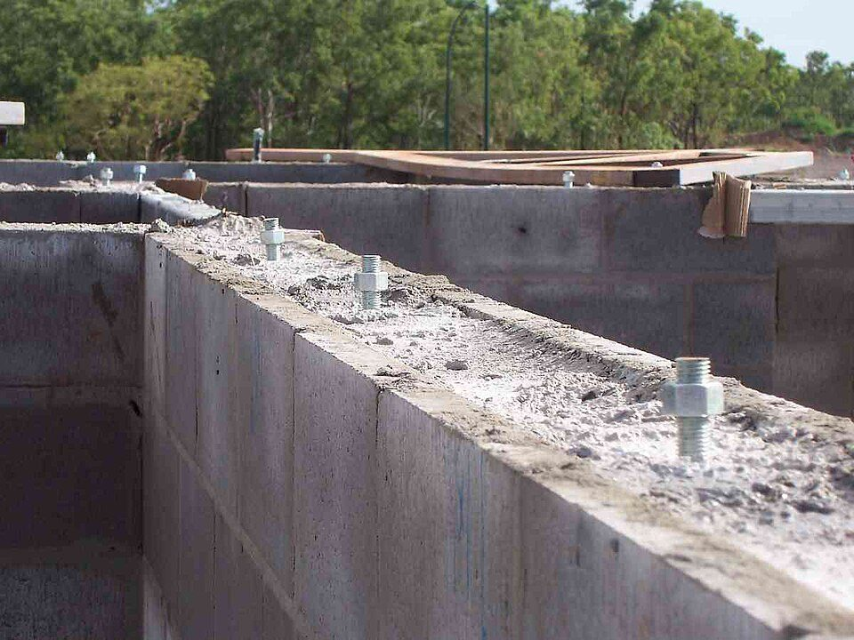
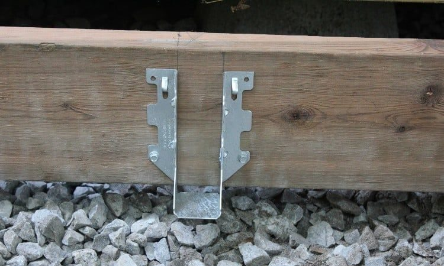
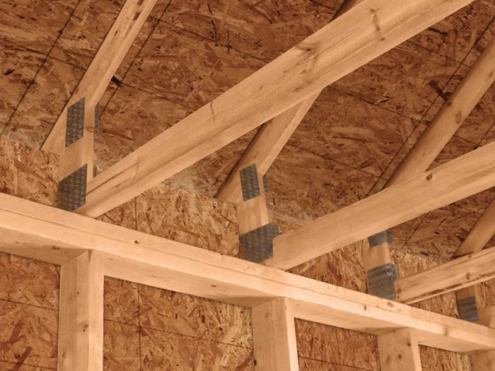

# Hardware catalog (Simpson)

Здесь: словарь крепежа Simpson Strong-Tie, который встречается в DFL: что это и для какого узла. Выбор hanger по условию - [Hangers](hangers.md), запись модели в колонку B - [там же](hangers.md#dfl-format).

!!! warning "Словарь, не дефолты"
    Модель всегда берётся из деталей и schedule своего проекта. Список показывает, что бывает, и помогает прочитать марку на чертеже.

## Как читать марку

| Часть | Значение | Пример |
| --- | --- | --- |
| `Zmax`, `Z` | горячая оцинковка: снаружи и на P.T.-древесине | `LUS210 Zmax` (в B пишется отдельным словом) |
| `-2`, `-3` | число plies несомой балки | `HUC210-3` |
| `E` у holdown | embedded: заливной анкер, не post-installed | `HDUE7` |
| число в модели | сечение или нагрузка | `ABU66` под 6x6, `HDU8` сильнее `HDU4` |
| `SK30 R` после модели | skew 30 градусов, правая рука (только в записи B) | `HHUS410 Zmax SK30 R` |

## Hangers (joist, beam)

| Модель | Для чего |
| --- | --- |
| `LUS26`, `LUS28`, `LUS210`, `LUS212` (+`-2`, `-3`) | face mount под пилёный 2x; самый частый |
| `LUC26`, `LUC210` | concealed flange под 2x: крайние joists, где полка не должна торчать |
| `HU9`, `HU11`, `HU14`, `HU410`, `HU412`, `HU414`, `HU612` | heavy U под LVL и построенные балки |
| `HHUS410`, `HHUS5.50/10`, `HHUS5.50/12`, `HGUS7.25/12` | heavy hi-cap под LVL, PSL, большие балки |
| `HUC210-2`, `HUC412`, `HUCQ412 Zmax`, `HUCQ610` | concealed heavy: лестницы, платформы, балки балконов |
| `ITS`, `IUS`, `MIT`, `MIU` | I-joists top flange и face mount; размер по ширине полки и глубине ([таблицы](hangers.md#tables)) |
| `SUL`, `SUR`, `HSUR`, `LSSR`, `LBV ... XL45 / XR45` | skewed и sloped; `SUL` левая, `SUR` правая рука |
| `DHU`, `DGU` | через двойной гипс firewall: лестницы, лифты, шахты; не вместо `ITS` на обычной demising |
| `WP`, `GLT`, `GLTV`, `LBV` | top flange под балки |
| `CJTZ`, `CBH` | кедр и glulam: отдельные строки, только по детали |

## Ties и clips

| Модель | Для чего |
| --- | --- |
| `H2.5`, `H2.5A` | ферма или rafter к plate; самый частый; к фермам без `Zmax` (под обшивкой) |
| `H1`, `H3`, `H8`, `H10` | ties по нагрузке; `H3` с обеих сторон фермы, если так показано |
| `A35`, `A34`, `LTP4` | framing angle и lateral tie plate; на shear walls по schedule |
| `HGA10`, `HGA10KT` | hurricane gusset angle, `KT` = комплект |
| `SDWC6` | truss screw вместо tie, если деталь даёт `in lieu of H2.5A` (либо screws, либо ties) |

## Straps

`MSTC40`, `MSTC52`, `MSTC66` (длина в имени), `MSTA49`, `MST72`, `LSTA24`, `CS16` / `CS14` / `CS20` (coiled strap, режется по длине). Страпы не смешивать с holdowns и анкерами: своя строка, своя марка SW в E.

## Post bases и caps

| Модель | Для чего |
| --- | --- |
| `ABU44`, `ABU66`, `ABU68`, `ABU88` (+`Zmax`), `ABA66Z` | база поста по его сечению |
| `BC46 Zmax`, `BCS2-3/6 Zmax`, `BCS2-2/4` | cap по plies балки: 2-ply `BC46`, 3-ply `BCS2-3/6`; per schedule |
| `CCQ44`, `CCQ46`, `CCQ66`, `CCQ68`, `ECCQ66` | column cap; `ECCQ` на краю и консоли |
| `PC6Z`, `PB66 Zmax`, `CBSQ66 Zmax` | лёгкие cap и standoff base |
| `ML210Z`, `HL33Z` | уголки балка к посту на балконах |

Cap и base на каждую стойку, модель по детали; база и cap меняются вместе с сечением поста.

## Holdowns и анкеры

| Модель | Для чего |
| --- | --- |
| `HDU2`, `HDU4`, `HDU5`, `HDU8`, `HDU11`, `HDU14`, `HDU19` | рабочая серия; число растёт с нагрузкой по SW schedule |
| `HDUE3`, `HDUE5`, `HDUE7`, `HDUE9`, `HDUE13` | embedded в бетон |
| `HTT5KT`, `HTT5K` | tension holdown, `KT` с анкером |
| `DTT2Z` | лёгкий, одноэтажные дома, deck |
| `Titen HD 1/2" x 4"`, wedge anchor, `BP1/2-3`, `3x3 Square` | анкеры sill plate и plate washers по anchorage schedule; wedge anchor на Titen HD не менять без основания |
| `TBD HD` | заглушка, когда shear walls и holdowns не определены, с нотой |

Счёт holdowns: к бетону один, через деревянное перекрытие два ([Блоки](dfl-blocks.md#holdowns)).

<figure markdown>
  
  <figcaption markdown="span">Анкерные болты, замоноличенные в кладку под sill plate: строки `Anchor Bolts` по шагу, `Washers`, `Nuts`. Фото: Bill Bradley, CC BY 2.5, [источник](https://commons.wikimedia.org/wiki/File:HD-bolts.jpg)</figcaption>
</figure>

## Structural screws

`SDS25312`, `SDS25600` (длина в имени), `SDWS22400DB`, `SDWS22500DB`, `SDWS22600DB` (ledger, deck, stairs; по 3 на точку), `SDWC6` (trusses). У screws шайбы и гайки не нужны; гвозди не считаются.

## Что помнить

- Снаружи и на P.T. - `Zmax`; ties к фермам под обшивкой без `Zmax`.
- Hangers на оба конца каждого joist, по сборкам, а не по закупочным доскам; только целые штуки.
- Модель по детали: `U210-2`, если деталь даёт его, а не `LUS210-2`.

<figure markdown>
  { width="520" }
  <figcaption markdown="span">Face-mount hanger на P.T. балке: по одному на каждый конец joist, который висит на балке или ledger; снаружи модель с `Zmax`. Фото: plasticinehouse.com, [источник](https://plasticinehouse.com/joist-hangers/), найдено через Pinterest.</figcaption>
</figure>

<figure markdown>
  { width="520" }
  <figcaption markdown="span">Ties от стены к каждой ферме: штука на ферму на каждой опоре, модель из truss schedule или деталей (H2.5A, страп), под обшивкой без `Zmax`. Фото: greenbuildingadvisor.com, [источник](http://greenbuildingadvisor.com/), найдено через Pinterest.</figcaption>
</figure>

## См. также

- [Hangers](hangers.md), [Блоки балконов, porch и holdowns](dfl-blocks.md), [Anchor Bolts](../work/deck/anchor-bolts.md), [Shear Wall](../work/vertical/sheathing/shear-wall.md)
