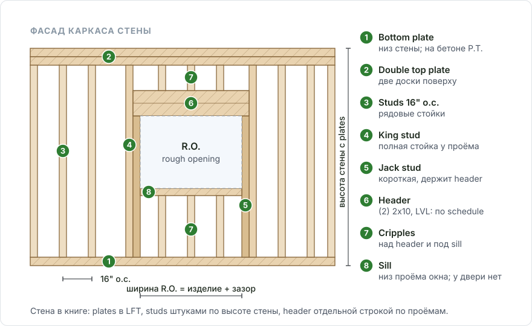

# Terms and specifications

Here: what the labels on the drawings and in the spec mean, where to find the source for a row and how to check a rule. Our internal calculation method (factors, formulas) does not become an industry standard; it lives in [Formulas](formulas.md).

## Plan set sheets

| Label | What it is | What to take from it |
| --- | --- | --- |
| `A` (A101, A3.01) | architectural: plans, elevations, sections, wall types, schedules | areas, walls, openings, trim, wall and layer types |
| `S` (S101, S3.0) | structural: framing plans, details, schedules, general notes | beams, joists, shear walls, holdowns, anchors, sheathing thickness |
| `G`, `LS`, `CS` | cover sheet, code compliance, life safety | construction type, FRT, rated walls |
| `M`, `E`, `P`, `FP`, `C`, `L` | MEP, civil, landscape | not needed for framing |
| `WS-1`, `WRS-1`, `SW-x` | wall sheathing schedule, roof sheathing schedule, shear wall schedule | different tables, read them to the end |

The section together with the details wins over the plan: stud height, layers, FRT.

## Framing terms

| Term | Meaning |
| --- | --- |
| `o.c.` | on center, spacing between centerlines: `16" o.c.` |
| `TYP.`, `U.N.O.` | typical; unless noted otherwise: the default rule until a detail says otherwise |
| `R.O.` | rough opening, the opening in the framing = the unit plus clearance (usually 1") |
| Floor-to-floor, F.F.E. | floor elevations; they are not the stud height |
| Plates, studs, jack, king, cripple | bottom and top plates, studs, opening studs |
| Header | the beam over an opening; `(2) 2x10`, `(3) 1 3/4 x 11 7/8 LVL` |
| Rim, ribbon, blocking, bridging | the end board of the floor framing; the let-in board in balloon framing; blocks between joists |
| Top chord bearing | the truss bears on its top chord: blocking between trusses instead of ribbon |
| Truss heel | truss heel height at the wall: a strip of sheathing |
| Gable stick, gable truss | a gable framed with studs, or a truss with vertical studs |
| Draft stop, fire block | attic and floor partitions by zone; separate items |
| Parapet | a wall above the roof: outside and inside height, top width |
| Shear wall, holdown, strap, anchor bolt | bracing wall, post anchor, strap, plate-to-concrete bolt |
| Ledger, box, stringer, tread, riser | board on the wall, band, stair stringer, tread, riser |
| Sleeper, overframe, piggyback | sleeper under decking; roof overframing; a second truss on top of the first |

<figure markdown>
  
  <figcaption markdown="span">A wall with a window: plates, studs, king and jack at the opening, header, cripples, sill, R.O. Wall height is taken together with the plates.</figcaption>
</figure>

## Materials and labels

| Label | Meaning |
| --- | --- |
| `P.T.`, `ACQ .25 / .40` | pressure-treated, treatment class; `.40` for posts in ground contact and 4x4 |
| `KD`, `S4S`, `#2 & Btr`, `MSR 1650f-1.5E` | kiln-dried, surfaced four sides, grade, machine stress rated grade |
| `FRT`, `FRTW` | fire-retardant treated wood: one requirement, two spellings |
| `EWP`: `LVL`, `LSL`, `PSL`, `TJI`, `LPI`, `BCI`, `Rim Board` | engineered wood products; the series stays in the row |
| `CDX`, `OSB`, `Ply`, `T&G`, `SE` | plywood exterior glue, OSB, tongue-and-groove, square edge (only with H-clips) |
| `Zip`, `Zip R-3 / R-6 / R-9` | sheathing with integrated WRB; R - with insulation |
| `WRB`, `Air Barrier`, `AVWB` | exterior barrier: Tyvek, fluid-applied; on the drawing it is not a vapor barrier |
| `GWB`, `Type X`, `DensGlass`, `Durock` | drywall, fire-rated gypsum, exterior gypsum, cement board |
| `Shaft liner`, `CH`, `J`, `H`, `C` channels | shaft walls: 1" panels and studs/tracks |
| `H-clips`, `PSCL` | clips between roof sheathing panels per support spacing |
| `Zmax`, `HDG`, `SDS`, `SDWS` | galvanizing; Simpson structural screws |

## Construction type and FRT

| Type | What it means for framing |
| --- | --- |
| Type III-A, III-B | exterior walls noncombustible or FRT: everything in the exterior wall plane is FRT, EWP not allowed there |
| Type V-A, V-B | regular wood framing; FRT only per detail |
| Podium (I-A below, III or V above) | wood walls below the podium follow podium rules; FRT per the Code Compliance Summary |

Take the type from the Code Compliance Summary or Life Safety sheet, not from a generic note.

## Spec divisions (CSI MasterFormat)

| Division | Topic |
| --- | --- |
| 03 | Concrete: anchors, embeds |
| 05 | Metals: steel beams, CFMF, metal connectors |
| 06 | Wood, Plastics, Composites: framing, EWP, sheathing, trim, decking |
| 07 | Thermal and Moisture Protection: WRB, insulation, membrane, flashing |
| 08 | Openings: windows, doors, R.O. |
| 09 | Finishes: gypsum, shaft liner, base, casing |

Labels in column E like `07.04 WD-01` are project tags from the legend, not MasterFormat codes: keep them as in the source.

## How to check a rule

1. Find the sheet, schedule, detail or spec section of your own project.
2. Check whether the rule applies to this material, connection and scope.
3. For a product, open the manufacturer's page for the right series.
4. When sources conflict, write down both sheets and the decision made in a note ([Notes in DFL](standard-notes.md)); do not hide an assumption by swapping the material.
5. After the calculation, go through the [QA checklist](../start/quality-checklist.md).

## See also

- [Material catalog](material-catalog.md), [Hardware catalog](hardware-catalog.md), [Hangers](hangers.md)
- [Tips and key rules](boss-feedback-rules.md), [Workflow](../start/workflow.md)
