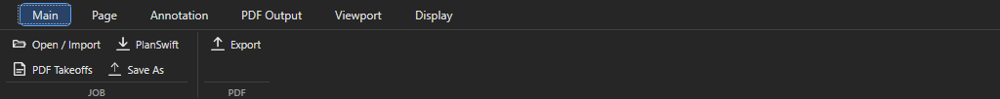
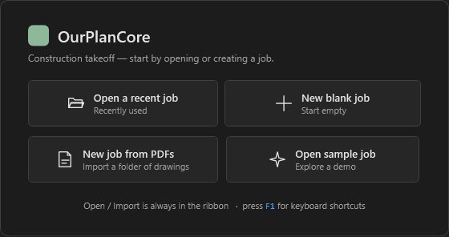
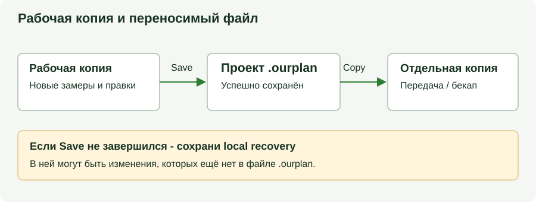
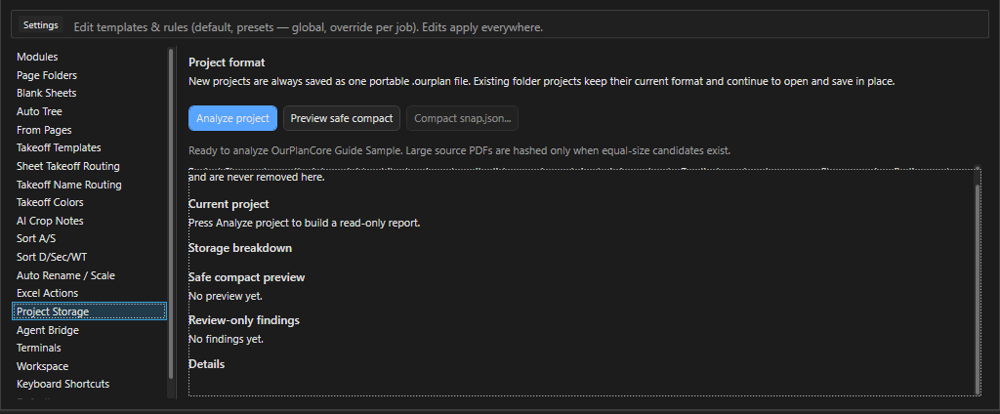

# Jobs and saving

Here: the start screen, how to create or open a job, add a PDF or another job to it, what the `.ourplan` file is, how autosave works, what to do if a job did not save or is already open in another window, and where a job takes up space. Needed at job intake, for a revision and before handing a job over.

!!! abstract "In short"
    A job is one `.ourplan` file. Copy and hand it over only after `Save: Saved hh:mm:ss` in the status bar. Old folder-based jobs keep the folder format: for them, copy the whole folder.

<figure markdown>
  
  <figcaption markdown="span">Everything about jobs is in one menu, `Main > Open / Import`. `Ctrl+O` opens the same menu.</figcaption>
</figure>

## Open / Import menu: reference { #create }

| Menu item | What it does |
| --- | --- |
| `Open project...` | job picker window: job folders on the left (SOURCES, `+ Add folder`), a name filter, a list with dates; at the bottom `Open`, `PDF project`, `Blank project`, links `Sample`, `Open project file...` for an `.ourplan` outside the folders, `Manage folders...`; the `Remove folder` button removes the selected folder from the SOURCES list, the files on disk stay |
| `Blank project - start empty` | name, location for the `.ourplan`; sheets are added later via `Page > Add Pages` or `Blank Sheet` |
| `New project from a folder of PDFs...` | a folder of PDFs (with subfolders), job name, `.ourplan` file; sheets go into `Pages/00. imported` |
| `Import PDF Takeoffs...` | a PDF with someone else's takeoff annotations, for old jobs ([import](ourplancore-extras-other.md#import)) |
| `Sample job (demo to explore)` | a demo job with no client data ([demo tour](ourplancore-start.md#demo)) |
| `Import into the current job > ...` | add a PDF, a folder of PDFs, another OurPlanCore job or a PlanSwift project to the open job ([below](#import-existing)) |
| `Undo Last Page Sort`, `Undo Last Page Operation` | undo the last sort or sheet operation (import, move) |
| `Project Data Recovery...` | recovery of protected job files ([if something went missing](#lost)) |
| `Manage job folders...` | add or pick the folder where jobs are kept |

`Ctrl+Shift+O` opens the list of recent jobs. A job from intake already comes with sheet names, folders and W/F/S/U dots, so a newcomer usually needs only `Open project...`.

In the command palette (`Ctrl+Shift+P`) the same items have shorter names: `Open / Import`, `Open Project File`, `Open Recent Job`, `Open Jobs Folder` (pick a jobs folder, it is added to SOURCES and its job list opens), `New PDF Job` (a job from a folder of PDFs), `Blank Job`, `Create Sample Job`. The `Show Main View` command returns to the sheet from Settings or Sheet Manager, like clicking the `Main View` tab.

## Start screen { #start }

<figure markdown>
  
  <figcaption markdown="span">The card in the center of the window is visible while no job is open. The `Open / Import` menu on the Main ribbon works here too.</figcaption>
</figure>

| Tile | What it does |
| --- | --- |
| **Open a recent job** / Recently used | list of recent jobs, like `Ctrl+Shift+O` |
| **New blank job** / Start empty | an empty job: name and location for the `.ourplan`, sheets are added later |
| **New job from PDFs** / Import a folder of drawings | a job from a folder of PDFs ([steps](#new-from-pdf)) |
| **Open sample job** / Explore a demo | creates and opens the demo job ([demo tour](ourplancore-start.md#demo)) |

## How to open a job { #open }

Why: to continue working on a job from the jobs folder or from a file.

1. Press `Ctrl+O` or **Main > Open / Import > Open project...** (on the start screen, the **Open a recent job** tile).
2. Pick the source folder on the left; if needed, type part of the name in the filter.
3. Click the job in the list and press **Open**. A file outside the job folders opens with the **Open project file...** link.

Result: the job name in the window title and the status bar, the sheet folders expand in Pages, the status shows `Save: Saved`.

## How to create a job from PDFs { #new-from-pdf }

Why: a new job from the client's drawing folder.
You need: a folder of PDF sheets (subfolders are fine).

1. Press **Main > Open / Import > New project from a folder of PDFs...** and pick the drawings folder.
2. Type the job name in the format `<number>. <name>` (the number at the start is needed by the `In Progress` button and the pipeline) and a location for the `.ourplan` file.
3. In the **Import PDF Options** window leave the raster checkbox on ([below](#raster)) and confirm.
4. Wait until the sheets land in `Pages/00. imported`.

Result: the job is open, sheets are in `00. imported` with names `Page N` or names read from the title block. Next: **Name+Scale** and sorting into folders: [Sheets](ourplancore-pages.md).

## How to add a PDF or a job to the open job { #import-existing }

Why: a new sheet set for a revision, missing sheets, buildings from different jobs.
You need: the right job open (its name in the window title): the import goes into it.

| Route | What is added | Where |
| --- | --- | --- |
| `Import into the current job > PDF file(s)...` or `Page > Add Pages` | one or more PDFs, with confirmation of sheet names | `Pages/00. imported` |
| `Import into the current job > Folder of PDFs...` | all PDFs from a folder and subfolders, without asking about each one | `Pages/00. imported` |
| `Import into the current job > OurPlanCore project...` | another job (`.ourplan` or a folder with `Data.xml`, `Pages`, `Takeoffs`) | separate branches in Pages and Takeoffs ([steps](#import-project)) |
| `Import into the current job > PlanSwift project...`, `Main > PDF Takeoffs` | old jobs: a PlanSwift project, takeoffs from PDF annotations ([import](ourplancore-extras-other.md#import)) | groups `01. planswift`, `from pdf` |
| `Page > Blank Sheet` | a blank sheet of a given size (dialog with presets) | the selected Pages folder |

### How to bring in another OurPlanCore job { #import-project }

1. Press **Main > Open / Import > Import into the current job > OurPlanCore project...**: the **Import OurPlanCore into Current Job** window opens, the `Destination` line shows the open job's name.
2. Choose **Choose .ourplan file...** or **Choose project folder...** (a folder with `Data.xml`, `Pages`, `Takeoffs`).
3. Read the number of sheets, takeoffs and measurements in the dialog and type the name for the new branches in the **Folder name in Pages and Takeoffs** field (for example `REV 2`).
4. Press **Import**.

Result: everything is added as separate folders in Pages and Takeoffs; existing content and job settings are not touched; importing again gives another branch. Crop links to sheets of the other job are not reassigned on import. To undo any import: **Open / Import > Undo Last Page Operation**.

## The `.ourplan` file and the working folder { #file }

- A job is stored as one `.ourplan` file. On opening, the app unpacks it into a working copy and works with that; `Save` packs the file back.
- The job name is shown in the window title, the status bar and the recent list. If the file was renamed in File Explorer, the new file name is shown; nothing is written inside the package.
- `Save As...` (`Ctrl+Shift+S`, the `Save As` button on the Main ribbon or the `Export` menu in Takeoffs) creates a new `.ourplan` in the chosen location and keeps the format of the open job. Do not change the extension or format by hand.
- Moving to another computer: copy a successfully saved `.ourplan`. Through a shared Workspace the job opens without copying: [Workspace](ourplancore-workspace.md).

## Autosave and the Save status { #autosave }

<figure markdown>
  
  <figcaption markdown="span">Measurements are written to the working copy right away, the `.ourplan` file is updated in a separate step. Copy only the file after a successful Save.</figcaption>
</figure>

Saving happens in two steps:

1. Every measurement and tree edit is written to the working copy right away.
2. The `.ourplan` file is rebuilt automatically after a few seconds of inactivity, at least every couple of minutes, and on `Ctrl+S`.

| Status | Meaning |
| --- | --- |
| `Save: Saved 14:32:10` | the file was updated at this time; safe to copy |
| `Save: Pending` | there are changes not yet written to the file |
| `Save: Saving...` | writing in progress; do not close the app |
| `Save: Failed` with the time of the next attempt | the write failed; the work stays in the working copy. The app retries after 30, 60 and 120 seconds, then every 5 minutes until it saves. `Ctrl+S` starts an attempt right away; copy the `.ourplan` only after `Save: Saved` |
| `Save: Protected data - open Project Data Recovery` | the job file cannot be read or is damaged; a temporarily unavailable file is checked again by the app, a damaged one needs manual recovery |

Retry intervals can be changed in **Settings > Autosave Recovery**: `After first failure`, `After second failure`, `After third failure`, `After later failures` in seconds. Defaults are 30, 60, 120, 300; 5-3600 seconds are allowed, in non-decreasing order. The category has Apply, Reset, Save global default, Save as this job and Clear job override.

### How to hand over or copy a job { #backup }

Why: a copy on another drive, handing over to a coworker, a restore point before a risky edit.

1. Press `Ctrl+S` and wait for `Save: Saved hh:mm:ss`.
2. Copy the `.ourplan` under a separate name or to another drive (for an old folder-based job, the whole folder).
3. Open the copy itself and check a few sheets, measurements and the export.
4. Keep the previous copy until the result is checked.

Result: the working copy and the backup match. A message about local recovery means the data is only in the working copy and the file has not been updated yet. `.snapshots` inside the job stores metadata snapshots; it is not a backup of PDFs, settings or the app.

## If a job did not save or something went missing { #lost }

| Symptom | What to do |
| --- | --- |
| Measurements are not on screen | check the active sheet, the takeoff's visibility (the dot at the sheet in Pages, `H`), the selected job; for an old folder-based job `Setup > Repair page links`. Do not redraw until the cause is clear |
| `Save: Failed` | keep the app open; it will retry saving by itself, and `Ctrl+S` tries right away. Wait for `Save: Saved`; if the error persists, `Save As...` to another location. Do not delete the working copy |
| `Save: Protected data` | if the file is temporarily locked, the app checks it every 30 seconds and lifts the protection only after successfully loading the same data. If the file is damaged or the protection stays, open **Open / Import > Project Data Recovery...** and choose **Retry reading** or **Restore from copy...** from a known good copy; after recovery the app rereads the data |
| The `.ourplan` file does not open | accept the offer to open the saved local recovery; Project Data Recovery does not repair the archive |
| `Save` failed after moving a sheet between folders | fixed in the current build; if it happens again: [Troubleshooting](ourplancore-troubleshooting.md) |
| No space when opening | the app needs space for the working copy; free up disk space outside the job and recovery folders |
| A quantity changed unexpectedly | check the sheet scale, units, the active sheet and which takeoff the measurement belongs to; auto-scale must be checked against a known dimension |

## If the job is already open in another window { #lease }

While a job is open, the app keeps an owner mark on it and refreshes it every 5 seconds. A second OurPlanCore window or a second computer opening the same file gets the **Job Is Already Open** window: job path, `Owner`, `Machine`, `Process`, `Started`, `Heartbeat`, `Version`.

### How to open a job held by another window { #lease-steps }

Why: to view or take over a job without corrupting it with two simultaneous writes.

1. Read `Machine` and `Heartbeat`. If the owner is another window of yours, save and close it, then press **Retry**.
2. You only need to look: press **Open Read-Only**. The window title shows `[READ-ONLY]`, saving and editing are disabled.
3. The owner crashed or hung, the mark has not been refreshed for 30 seconds: the badge changes to `STALE LEASE` and the **Take Over** button becomes available. Press it and confirm in the `Confirm Risky Take Over` window.
4. If in doubt, press **Cancel**, and opening is canceled.

Result: the job is open for writing (after Retry or Take Over) or read-only.

!!! warning "Take Over while the owner is alive"
    If the other window is actually working, two windows write to one job and can corrupt it. Take over only when you know for sure the owner is closed or hung.

## Raster on import and Sheet Manager { #raster }

In `Import PDF Options`, the `Build readable raster cache and strict black-line snap index` checkbox prepares a raster of the sheets and an index of black lines for PDF Snap. It takes longer and uses space, but sheets open faster and `Ctrl+F3` snaps to lines. The choice is remembered. For sheets already imported, the raster is prepared in the `Sheet Manager` tab (a module): select the sheets, `Prepare`, then `First On` ([steps](ourplancore-managers.md#raster)). Otherwise, scans without a text layer are not named or scaled automatically.

In Sheet Manager, the `Options...` button opens the raster format: `Auto` (default, WebP where possible), `WebP` or `PNG` for difficult PDFs that look like scans. The set of DPI buttons is edited in `Settings > Defaults`, section `Sheet Manager raster DPI presets` ([Settings](ourplancore-settings.md#defaults)).

## Project Storage { #storage }

<figure markdown>
  
  <figcaption markdown="span">Analysis buttons at the top, the report by section below. The analysis only reads the job.</figcaption>
</figure>

### How to check where a job takes up space { #storage-check }

Why: to understand why an `.ourplan` grew large and safely compact what can be compacted.
You need: the job open; for compacting, not read-only.

1. Open **Settings > Project Storage** and press **Analyze project**.
2. Read the report sections (table below). The analysis does not change any files.
3. Press **Preview safe compact**: the `Safe compact preview` section shows how much space compacting will free.
4. If the savings are above zero, press **Compact snap.json...** and confirm. Only formatting whitespace in the `snap.json` snap indexes is compacted; PDFs, raster, recovery history, takeoffs and measurements are not deleted.

Result: the status shows `Compacted N file(s); saved ...`; for a fresh report press **Analyze project** again.

| Section | What it shows |
| --- | --- |
| `Project format` | new jobs are always one portable `.ourplan` file; old folder-based jobs stay folders and are saved in place |
| `Current project` | name, number of files and total size |
| `Storage breakdown` | size by group: job data, sheet raster (rebuildable), recovery history, duplicate source PDFs, PDFs not referenced by a sheet, PDFs to review, other |
| `Safe compact preview` | how much of `snap.json` can be compacted and how much that saves |
| `Review-only findings` | duplicate source PDFs, PDFs not referenced by a sheet, external sheet dependencies. For information only: nothing is deleted here, such files may be needed for recovery |
| `Details` | the first lines of findings: `DUP` (duplicate), `REVIEW` (review), `WARN` (warning) |

This is not a cleanup of recovery data and caches on the computer. Unused raster variants of the selected sheets are removed by `Clean` in Sheet Manager; for all sheets on app close, the `Clean unused raster cache on close` checkbox in `Settings > Defaults` (the active raster and snap index stay).

??? note "What is inside a job (advanced)"
    ```text
    Data.xml                     job card
    sources/                     source PDFs
    Pages/.../<sheet>/
      Data.xml, source.json      name, source, scale
      source_pdf.json            metadata for Name/Scale
      takeoff_routing.json       the sheet's W/F/S/U dot
      annotations.json           markup, Hide masks, crops
      layers.json, raster/       PDF layers, raster
    Takeoffs/.../<takeoff>/
      Data.xml, measurements.json
    AI_Context/settings/         settings of this job (routing, shortcuts, modules)
    AI_Context/project.md        job notes for AI: observations and AI answers
    AI_Context/*-trash           undo bins for Merge and the agent
    3D_Context/walls_model.json  3D model
    bookmarks.json, import_reports/
    ```
    The folder on disk may have a technical name; the visible name is stored in `Data.xml`. Do not edit job files by hand while the app is running. The exception is `AI_Context/project.md`, the log of AI observations and answers for the job: with the AI module, right-click a sheet, **Open Project Context** opens it in Notepad. The app only appends to the end, so your own notes there are kept.

## See also

- [Getting started](ourplancore-start.md), [Sheets](ourplancore-pages.md)
- [Workflow: the project arrives](../start/workflow.md)
- [Troubleshooting](ourplancore-troubleshooting.md)
