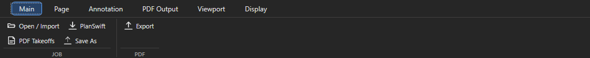

# Проекты и сохранение

Здесь: как создать или открыть проект, добавить в него PDF или другой проект, что такое файл `.ourplan`, как работает автосохранение и что делать, если проект не сохранился. Нужно на приёме работы, при ревизии и перед передачей проекта.

!!! abstract "Коротко"
    Проект - один файл `.ourplan`. Копировать и передавать его можно только после `Save: Saved hh:mm:ss` в строке статуса. Старые проекты-папки сохраняют папочный формат: для них копируется вся папка.

## Создать или открыть проект { #create }

<figure markdown>
  
  <figcaption markdown="span">Всё про проекты в одном меню `Main > Open / Import`. `Ctrl+O` открывает его же.</figcaption>
</figure>

| Пункт меню | Что делает |
| --- | --- |
| `Open project...` | окно выбора проекта: слева папки с работами (SOURCES, `+ Add folder`), фильтр по имени, список с датой; внизу `Open`, `PDF project`, `Blank project`, ссылки `Sample`, `Open project file...` для `.ourplan` вне папок, `Manage folders...` |
| `Blank project - start empty` | имя, место для `.ourplan`; листы добавляются потом через `Page > Add Pages` или `Blank Sheet` |
| `New project from a folder of PDFs...` | папка с PDF (с подпапками), имя проекта, файл `.ourplan`; листы попадают в `Pages/00. imported` |
| `Import PDF Takeoffs...` | PDF с чужими замерами-аннотациями: сканирует, показывает найденные линии, площади и точки, спрашивает новый или текущий проект |
| `Sample job (demo to explore)` | демо-проект без клиентских данных ([начало работы](ourplancore-start.md#demo)) |
| `Undo Last Page Sort`, `Undo Last Page Operation` | откат последней сортировки или операции с листами (импорт, перенос) |
| `Project Data Recovery...` | восстановление защищённых файлов проекта ([если пропало](#lost)) |
| `Manage job folders...` | добавить или выбрать папку, где лежат работы |

`Ctrl+Shift+O` открывает список недавних проектов. Проект из приёма приходит уже с именами листов, папками и точками W/F/S/U, поэтому новичку чаще всего нужен только `Open project...`.

### Новый проект из PDF по шагам

1. `Open / Import > New project from a folder of PDFs...`, выбрать папку с чертежами.
2. Ввести имя проекта в формате `<номер>. <имя>` (номер в начале нужен кнопке `In Progress` и конвейеру) и место для `.ourplan`.
3. В окне `Import PDF Options` оставить включённой галку растра (см. [ниже](#raster)) и подтвердить.
4. Листы лягут в `Pages/00. imported`. Дальше `Name+Scale` и раскладка по папкам: [Листы](ourplancore-pages.md).

## Импорт в открытый проект { #import-existing }

Сначала проверь имя открытого проекта в заголовке окна: импорт идёт в него.

| Маршрут | Что добавляется | Куда |
| --- | --- | --- |
| `Import into the current job > PDF file(s)...` или `Page > Add Pages` | один или несколько PDF, с подтверждением имён листов | `Pages/00. imported` |
| `Import into the current job > Folder of PDFs...` | все PDF из папки и подпапок без вопросов по каждому | `Pages/00. imported` |
| `Import into the current job > OurPlanCore project...` | другой проект (`.ourplan` или папка с `Data.xml`, `Pages`, `Takeoffs`): диалог показывает число листов, позиций и замеров и даёт сменить имя ветки | отдельные ветки в Pages и Takeoffs; существующее не трогается; повторный импорт даёт ещё одну ветку |
| `Import into the current job > PlanSwift project...` | листы и позиции старого проекта PlanSwift | группы `01. planswift` |
| `Main > PDF Takeoffs` | замеры из аннотаций PDF | группа `from pdf` и отчёт импорта |
| `Page > Blank Sheet` | пустой лист заданного размера (диалог с пресетами) | выбранная папка Pages |

Откат любого импорта: `Open / Import > Undo Last Page Operation`. Импорт проекта удобен для ревизии (подтянуть старую работу рядом с новым комплектом) и для сборки корпусов из разных проектов.

## Файл `.ourplan` и рабочая папка { #file }

- Проект хранится одним файлом `.ourplan`. При открытии программа распаковывает его в рабочую копию и работает с ней; `Save` собирает файл обратно.
- Имя проекта видно в заголовке окна, в статусе и в списке недавних. Если файл переименовали в проводнике, показывается новое имя файла; внутрь пакета ничего не пишется.
- `Save As...` (`Ctrl+Shift+S`, кнопка `Save As` на ленте Main или меню `Export` в Takeoffs) создаёт новый `.ourplan` в выбранном месте. Расширение и формат руками не менять.
- Передача на другой компьютер: скопировать успешно сохранённый `.ourplan`. Через общий Workspace проект открывается без копирования: [Workspace](ourplancore-workspace.md).

## Автосохранение и статус Save { #autosave }

<figure markdown>
  
  <figcaption markdown="span">Замеры пишутся в рабочую копию сразу, файл `.ourplan` обновляется отдельным шагом. Копировать можно только файл после успешного Save.</figcaption>
</figure>

Сохранение идёт в два шага:

1. Каждый замер и правка дерева сразу пишутся в рабочую копию.
2. Файл `.ourplan` пересобирается автоматически через несколько секунд тишины, не реже чем раз в пару минут, и по `Ctrl+S`.

| Статус | Значение |
| --- | --- |
| `Save: Saved 14:32:10` | файл обновлён в это время; можно копировать |
| `Save: Pending` | есть изменения, ещё не записанные в файл |
| `Save: Saving...` | идёт запись; не закрывать программу |
| `Save: Failed - N pending` | запись не удалась; держать программу открытой и смотреть сообщение |
| `Save: Protected data - open Project Data Recovery` | повреждён файл метаданных; открыть восстановление |

Перед копированием, передачей или закрытием: `Ctrl+S`, дождаться `Saved`. Сообщение про local recovery означает, что данные лежат только в рабочей копии; файл ещё не обновлён.

## Если проект не сохранился или что-то пропало { #lost }

| Симптом | Что делать |
| --- | --- |
| Замеров нет на экране | проверить активный лист, видимость позиции (точка у листа в Pages, `H`), выбранный проект; у старого проекта-папки `Setup > Repair page links`. Не рисовать заново, пока причина не ясна |
| `Save: Failed` | не закрывать программу; повторить `Ctrl+S`; если не помогает, `Save As...` в другое место. Рабочую копию не удалять |
| `Save: Protected data` | `Open / Import > Project Data Recovery...`: выбрать запись, `Retry reading` после снятия блокировки или `Restore from copy...` из известной исправной копии; после восстановления закрыть окно, программа перечитает данные |
| Файл `.ourplan` не открывается | принять предложение открыть сохранённую local recovery; Project Data Recovery архив не ремонтирует |
| `Save` отказывал после переноса листа между папками | исправлено в текущей сборке; если повторилось - [Решение проблем](ourplancore-troubleshooting.md) |
| Нет места при открытии | программе нужно место под рабочую копию; освободить диск вне папок проектов и recovery |
| Количество неожиданно изменилось | проверить масштаб листа, единицы, активный лист и принадлежность позиции; автомасштаб требует проверки по известному размеру |

## Резервные копии и передача { #backup }

1. `Ctrl+S`, дождаться `Saved`.
2. Скопировать `.ourplan` под отдельным именем или на другой диск (для старого проекта - всю папку).
3. Открыть именно копию, проверить несколько листов, замеры и экспорт.
4. Прежнюю копию хранить до проверки результата.

`.snapshots` внутри проекта хранит снимки метаданных; это не бекап PDF, настроек и программы. Потерю диска с единственным проектом ничто внутри программы не компенсирует.

## Растр при импорте и Sheet Manager { #raster }

В `Import PDF Options` галка `Build readable raster cache and strict black-line snap index` готовит растр листов и индекс чёрных линий для привязки PDF Snap. Это дольше и занимает место, зато листы открываются быстрее, а `Ctrl+F3` цепляется к линиям. Выбор запоминается. Для уже импортированных листов растр готовится во вкладке `Sheet Manager` (модуль): выделить листы, `Prepare`, затем `First On`. Сканы без текстового слоя иначе не именуются и не масштабируются автоматически.

## Project Storage { #storage }

`Settings > Project Storage`: `Analyze project` показывает размер и состав проекта, `Preview safe compact` - что можно ужать без потерь, `Compact snap.json...` сжимает индексы привязки. Это не очистка recovery и кешей на компьютере.

??? note "Что внутри проекта (для продвинутых)"
    ```text
    Data.xml                     карточка проекта
    sources/                     исходные PDF
    Pages/.../<лист>/
      Data.xml, source.json      имя, источник, масштаб
      source_pdf.json            метаданные для Name/Scale
      takeoff_routing.json       точка W/F/S/U листа
      annotations.json           разметка, маски Hide, кропы
      layers.json, raster/       слои PDF, растр
    Takeoffs/.../<позиция>/
      Data.xml, measurements.json
    AI_Context/settings/         настройки этого проекта (маршрутизация, клавиши, модули)
    AI_Context/*-trash           корзины отката Merge и агента
    bookmarks.json, import_reports/
    ```
    Папка на диске может иметь техническое имя; видимое имя хранится в `Data.xml`. Файлы проекта во время работы программы руками не править.

## См. также

- [Начало работы](ourplancore-start.md), [Листы](ourplancore-pages.md)
- [Процесс работы: проект пришёл](../start/workflow.md)
- [Решение проблем](ourplancore-troubleshooting.md)
