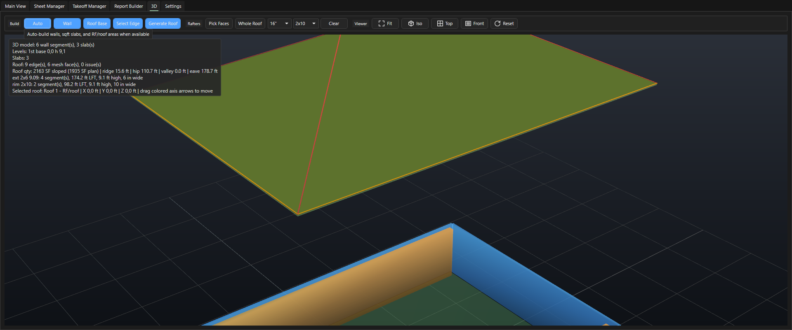
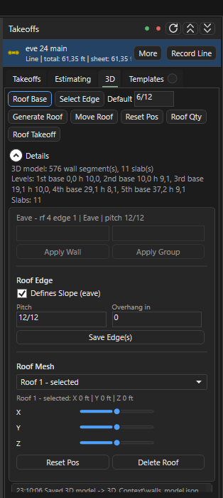

# 3D roof

Here: how to turn roof plane and eave areas into a 3D roof on the 3D tab, set the pitch of edges, add overhangs and rafters, and pull ridge, hip, valley and eave lengths from the model into the Takeoffs tree. You need it on a complex roof (L, U, several pitches, dormer) when the plan does not show where hips and valleys run, and when the client asks for edge lengths. A simple gable roof is measured without 3D: an Area per roof plane with the pitch in the name ([Roof](../work/sqfts/roof.md)). Walls in 3D, the general viewer and the archived Massing: [3D and Massing](ourplancore-3d.md).

<figure markdown>
  <video class="kb-demo" loop muted playsinline preload="none" poster="../../assets/images/ourplancore/demo/d-3d-roof.png"><source src="../../assets/images/ourplancore/demo/d-3d-roof.mp4" type="video/mp4"></video>
  <figcaption markdown="span">Demo on a real job: select the roof area `rf 4`, `3D > Auto` builds a hip roof; a second roof from a second area, picked in `Roof Mesh`.</figcaption>
</figure>

<figure markdown>
  
  <figcaption markdown="span">The 3D ribbon (`Build`, `Rafters`, `Viewer`), the scene window and the side panel: `Default` pitch, the `Roof Edge` block, the `Roof Mesh` list, the `Roof Qty` tabs and the log.</figcaption>
</figure>

## How the model works

| Concept | What it is | Where it comes from |
| --- | --- | --- |
| Roof Base | the roof outline in plan, the base of the model | selected Areas: `rf 6`, `rf mtl 4`, `flat` from `sqfts`, or any area from the sheet |
| Edge | a side of the outline; an edge has the properties `Defines Slope`, `Pitch`, `Overhang` | created with the Roof Base, one per side of the outline |
| Eave | an edge with `Defines Slope`: a roof plane rises from it at the given pitch | you set it, or `Auto` sets it on all edges |
| Rake | an edge with no slope: gable end | uncheck `Defines Slope` |
| Roof Mesh, group | the generated roof of one base; a job can have several (main house, garage, dormer) | each `Roof Base` makes its own group, the active one is picked in the `Roof Mesh` list |
| Ridge, Hip, Valley | the seams between roof planes | calculated by `Generate Roof` |
| Rafters | rafters on the faces | `Pick Faces` or `Whole Roof` |

The model is stored in the job (`3D_Context/walls_model.json`) and survives closing; a roof plane's color comes from the color of the source Area takeoff. The generator builds the roof "by footprint" like Revit: each eave edge rises at its own pitch, the edges meet in hips and valleys at one height. The roof stays a draft for checking: it knows nothing about windows, second-level roof planes or cutouts.

## How to build a roof from roof plane areas { #build }

What for: see the ridge, hips and valleys on a complex outline and get their lengths.
Needed: the 3D module is on (`Settings > Modules`), the roof plan has roof plane Areas with the sheet scale set.

There are two ways. `Auto` builds a full hip roof right away: all outline edges become eaves with one pitch. `Roof Base` creates only the outline, and you set the edge pitches yourself. On one area, pick one way: `Auto` with a selected area always creates a new group, and after `Roof Base` on the same area the model will have two roofs.

The fast way, `Auto`:

1. Open sheet `a105 rf` and select the roof plane areas on the sheet with the Select tool (or the takeoffs `rf 6`, `rf mtl 4` in Takeoffs).
2. Open the **3D** tab and type the default pitch in the **Default** box of the side panel: `6/12`, `4` or `0.333`.
3. Press **Build > Auto**. Status: `3D Auto Roof: Roof 1, full hip from N eave edge(s), pitch 6/12, generated M roof mesh face(s)`.
4. For gables, switch the needed edges to Rake ([below](#edges)) and press **Generate Roof**.

The manual way, `Roof Base`:

1. Select the roof plane areas, as in step 1 above.
2. Press **Build > Roof Base** (or right-click the sheet, **3D > Create Roof Base from Areas**).
3. Read the status: `3D Roof Base: created Roof 1, 1 base layer(s), N selectable edge(s). Select slope edges and apply pitch.` The outline appears in the scene as a flat slab, all edges are Rake for now, edge selection mode is on.
4. Set the pitch on the eave edges ([below](#edges)) and press **Generate Roof**.

Result: status `Roof generated: Roof 1, N mesh face(s)` with area and length totals; in the scene, roof planes in the takeoff color, seams as single lines. `Viewer > Iso`, `Top`, `Front`, `Fit` turn the camera.

!!! tip "Tips"
    - `Auto` with nothing selected takes all `rf` and `roof` takeoffs of the job and builds a new group from them. If there are no such takeoffs but a `Roof Base` already exists, `Auto` sets the pitch from **Default** on all its edges. The status `select RF/roof area takeoffs first` means there are neither takeoffs nor a base.
    - The `Auto` and `Wall` buttons rebuild walls and slabs but leave the created roofs and their edge settings in place.
    - An area without a sheet scale is skipped, with a counter in the status: set the scale and repeat.
    - Several roofs (house and garage): a separate `Roof Base` for each area, the active group is picked in the **Roof Mesh** list.

## How to set edge pitch { #edges }

<figure markdown>
  <video class="kb-demo" loop muted playsinline preload="none" poster="../../assets/images/ourplancore/demo/d-3d-pitch.png"><source src="../../assets/images/ourplancore/demo/d-3d-pitch.mp4" type="video/mp4"></video>
  <figcaption markdown="span">Demo: `Roof Base`, edge selection, `Defines Slope` at 6/12 pitch and `Save Edge(s)`, one edge at 12/12, `Generate Roof`.</figcaption>
</figure>

What for: different pitches on roof planes, a gable instead of a hip, an overhang of the right width.
Needed: a Roof Base exists.

1. Press **Build > Select Edge** (status on the sheet: `3D Roof Edge Select: click a roof base edge...`).
2. Click an edge on the sheet; `Ctrl` or `Shift` with a left or right click adds edges to the selection (a right click with the key does not open the sheet menu). A **Pitch** window opens next to the edge (with several edges, `Pitch x3`).
3. Type the pitch `6/12`, `4` or `0.333` and press `Enter`: the edge became an eave with that pitch. `Esc` closes the window without changes.
4. For a gable, open the **Roof Edge** block in the side panel, uncheck **Defines Slope (eave)** and press **Save Edge(s)**; right-click on the edge does the same: **3D > Set Edge as Rake**. Back: **Set Edge as Eave + Pitch 6/12**.
5. Type **Overhang in** (overhang in inches, for example `12` or `24`) and press **Save Edge(s)**: the roof plane extends past the wall by that amount.
6. Press **Generate Roof**.

Result: status `3D Roof: saved edge properties to N edge(s)` and then `Roof generated`; the **Roof Edge** block shows the pitch and overhang of the selected edge, gable edges do not raise a roof plane.

<figure markdown>
  { width="320" }
  <figcaption markdown="span">The `3D` sub-tab next to Takeoffs: the `Roof Base`, `Select Edge` buttons, the `Default` box, the `Roof Edge` block with the `Defines Slope (eave)` checkbox, `Pitch`, `Overhang in` and `Save Edge(s)`, below it the `Roof Mesh` list with offset sliders.</figcaption>
</figure>

!!! tip "Tips"
    - The error `invalid edge pitch` means a wrong format: only `6/12`, `4` or a decimal rise per foot.
    - The pitch can be taken from finished eave lines: select the takeoffs `eve 24 main` in Takeoffs and apply them to the base edges from their **3D** menu; matching edges get the pitch from the **Default** box (status `matched N roof edge(s) from selected eave line takeoff(s)`).
    - The same actions are in the right-click menu on an edge on the sheet, the **3D** submenu: the header `Roof Edge - <type> | <pitch>`, then `Add Edge to Selection` (on an already selected edge, `Remove Edge from Selection`) adds the edge to the selection without `Ctrl`, `Set Edge as Eave + Pitch ...` and `Set Edge as Rake` apply to all selected edges.
    - Clear the edge selection: right-click the sheet, **3D > Clear Edge Selection**; turn the mode off: **Select Edge** again or any sheet tool (`Line`, `Select`, `Pan`...).

## How to move a roof and work with groups { #groups }

What for: the roof and the walls were drawn from different sheets and do not line up; the job has several roofs; the roof of a low building landed at the height of the tallest one.

1. Pick the group in the **Roof Mesh** list of the side panel (status `3D Roof: selected Roof 2`): pitch, move, reset and delete act on it.
2. Press **Move Roof** and drag the roof in the 3D window: the gizmo moves it along an axis, status `dragging Roof 2 on X-axis`; the motion is slowed down for precise fitting.
3. Press **Reset Pos** to put the roof back where it was built.
4. Delete an extra group with the delete button by the **Roof Mesh** list; the whole roof together with its edges is removed with right-click on the sheet, **3D > Clear Roof Base**.

Result: the roof sits on the walls, the list has only the groups you need.

## How to get rafters and check lengths { #rafters }

<figure markdown>
  <video class="kb-demo" loop muted playsinline preload="none" poster="../../assets/images/ourplancore/demo/d-3d-rafters.png"><source src="../../assets/images/ourplancore/demo/d-3d-rafters.mp4" type="video/mp4"></video>
  <figcaption markdown="span">Demo: 24" spacing, 2x8 member, `Whole Roof`; the status shows the rafter count and the linear footage.</figcaption>
</figure>

What for: estimate the number and lengths of rafters per face, see the member depth under the roof plane.
Needed: the roof is generated (`Roof Base`, edges, `Generate Roof`), otherwise the status is `Rafters: generate the roof first`.

1. In the **Rafters** group, pick the spacing in the first list (tooltip `Rafter spacing o.c.`: `12"`, `16"`, `19.2"`, `24"`, measured horizontally along the eave) and the member in the second (tooltip `Rafter member size`: `2x6`, `2x8`, `2x10`, `2x12`; the member depth goes down from the roof plane, the walls are trimmed to the bottom of the rafters). Default `16"` and `2x10`.
2. Press **Whole Roof** for all faces, or **Pick Faces** and click faces in the 3D window to turn rafters on one at a time.
3. Read the status: `Rafters 2x10 @16" o.c.: 86 pcs, 1240 ft (4 face(s)) - 24 @ 18.5 ft, ...`: count, total length and a breakdown by length.
4. Check the lengths against the section: rafter length along the slope equals the horizontal run times the pitch factor, plus the overhang.
5. Press **Clear** to remove the rafters.

Result: the rafters show in the scene under the roof planes, the walls are trimmed to their bottom edge, the numbers are in the status and the 3D log.

## What the 3D roof gives to the tree { #takeoff }

What for: seam lengths and roof plane area as takeoffs you can check and use.

1. In Takeoffs, select the folder for the result (otherwise the takeoffs go to the root or to the green-dot building).
2. Press **Roof Qty** in the side panel: the tab shows `Sloped` and `Plan` area in SF, `Ridge`, `Hip`, `Valley`, `Eave` lengths in feet and the number of faces.
3. Press **Roof Takeoff**.

Result: status `3D Roof Takeoff: created N reviewable takeoff item(s)` and new takeoffs in the selected folder:

| Takeoff | Type | What is inside |
| --- | --- | --- |
| `Roof Eave` | Line | edges with `Defines Slope`, length in plan |
| `Roof Ridge`, `Roof Hip`, `Roof Valley` | Line | the seams the generator found |
| `Roof Area (plan)` | Area | the base outline in plan |

The `Notes` of each takeoff have a summary: `Generated from 3D roof. Sloped ... SF, plan ... SF, ridge ... ft, hip ... ft, valley ... ft, eave ... ft`. The measurements sit on the sheet where the base is and go into its legend.

Link with Excel and the DFL: these takeoffs are a check, not a replacement for the canon. The workbook gets the takeoffs the XL strip reads: roof planes `rf 6` from `sqfts` (the `SF` button calculates roofing by the pitch in the name), eaves `eve 24 main` and `rake 12 main` from `eves rakes` (the `E/R` button, overhang in inches from the name). `Roof Eave` lengths from 3D are checked against the `eve` total, `Roof Hip` and `Roof Valley` help check hips and valleys in the roof details; after checking, the 3D takeoffs can be deleted or kept in a separate `3d check` folder so they do not get into the export. Measuring rules: [Roof](../work/sqfts/roof.md), [Eve](../work/sheathing-and-misc/eve.md).

## Roof guide mode keys

For manual guides on the sheet (when the base does not give the seam you need): `R` Ridge, `H` Hip, `V` Valley, `E` Eave, `K` Rake, `P` Pitch; `Backspace` or `Ctrl+Z` back, `Esc` cancels the line or exits. Two clicks create a guide, Snap and Ortho work. The full key list: [Keyboard shortcuts](ourplancore-shortcuts.md).

## Scenarios

??? note "Change the pitch of one group"
    1. Pick the group in **Roof Mesh** (for example `Roof 2`, the garage).
    2. **Select Edge**, `Shift` and clicks on all garage eave edges.
    3. In the **Pitch x4** window type `4/12`, `Enter`.
    4. **Generate Roof**: only this group is rebuilt, the main house does not change.

??? note "Dormer as an extra group"
    1. Draw an Area along the dormer outline on the roof plan (`rf dormer 8`).
    2. Select it, **Roof Base**: `Roof 2` appears.
    3. **Select Edge**: make the front dormer edge Rake (gable), leave the sides as eaves at `8/12`, **Generate Roof**.
    4. **Move Roof** to lift the dormer onto the main roof plane if it sat lower; check in `Iso`.
    5. The generator does not cut the dormer's intersection with the main roof plane: the valley along the joint is measured on the plan by hand.

??? note "Get rafters and check lengths"
    1. The roof is generated; in **Rafters** pick `16"` and `2x10`.
    2. **Whole Roof**, read the status with the breakdown by length.
    3. Check the longest group against the section; a difference bigger than the overhang means a wrong edge pitch or the wrong Overhang.

## Limits and common mistakes

- The generator builds the roof from the outer outline: cutouts, a second level of roof planes, dormer intersection with the main roof, fascia and true overhangs at hips and valleys are planned ([ideas](ourplancore-ideas.md)).
- A self-intersecting outline is straightened to a convex hull: extra areas in the scene mean a crooked Area outline on the plan.
- Different pitches on neighboring eaves meet correctly, but check the result in `Iso`: a gap along a seam is a sign of an edge with no pitch that should be an eave.
- `Roof Base` with no area selected just shows the status `select area measurements or RF/roof area takeoffs first`.
- The roof is placed at the highest point of the model: the top of the tallest walls, level or slab in the whole job. In a job with buildings of different heights, the roof of the low building will float above its walls: lower it with `Move Roof` along the vertical axis ([groups](#groups)) and check in `Front`.
- `Roof ...` takeoffs from 3D got into the Excel export: keep them in a separate folder or delete them after checking.
- 3D does not replace Areas per roof plane with the pitch in the name: `SF` in Excel reads `rf 6`, not `Roof Area (plan)`.

## See also

- [3D and Massing](ourplancore-3d.md): walls in 3D, the viewer, what is turned off
- [Roof](../work/sqfts/roof.md), [Eve](../work/sheathing-and-misc/eve.md), [Gable](../work/vertical/walls/gable.md): roof measuring rules
- [Measuring tools](ourplancore-tools.md): Area, Pitch
- [Ideas and plans](ourplancore-ideas.md): what else is planned for the roof
