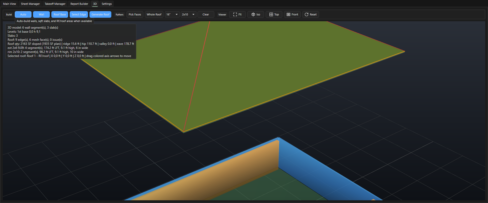

# 3D and Massing

!!! info "Full version only"
    OurPlanCore Lite has no 3D module, and it cannot be turned on. How the versions differ: [Lite vs full version](ourplancore-lite.md).

Here: the 3D tab, which is off by default: walls and slabs from measurements, the general viewer, and the honest status of the old AI Massing. You need it when you want to see a building in 3D or when someone asks "what about 3D". The roof in 3D is described separately: [3D roof](ourplancore-3d-roof.md). The Sheet Manager, Takeoff Manager, Report Builder and Materials tabs: [Managers](ourplancore-managers.md).

<figure markdown>
  <video class="kb-demo" loop muted playsinline preload="none" poster="../../assets/images/ourplancore/demo/d-3d.png"><source src="../../assets/images/ourplancore/demo/d-3d.mp4" type="video/mp4"></video>
  <figcaption markdown="span">Demo: the 3D tab on a demo job: walls, a slab and a gable roof; rotating with the mouse, the `Front` and `Iso` views.</figcaption>
</figure>

## Status in short

| What | Status in 3.0 | Where |
| --- | --- | --- |
| 3D walls and slabs from measurements | works, no AI | `Settings > Modules > 3D`, the 3D tab |
| 3D roof from edges, Roof Qty, Roof Takeoff, rafters | works | [3D roof](ourplancore-3d-roof.md) |
| AI 3D Massing (Build 3D Draft, Review, Accept) | turned off in code since May 2026, archive | nowhere |

## How to turn it on and what is on the tab

1. Open **Settings > Modules**, check **3D**, press **Save global default** (or **Apply** until restart).
2. A **3D** tab appeared in the mode bar; a `3D` sub-tab appeared under Takeoffs.
3. To get to them without the mouse, open the command palette (++ctrl+shift+p++): `Show 3D Viewer` opens the 3D tab in the mode bar, `Show 3D Tab` selects the `3D` sub-tab next to Takeoffs.

<figure markdown>
  <video class="kb-demo" loop muted playsinline preload="none" poster="../../assets/images/ourplancore/demo/d-settings.png"><source src="../../assets/images/ourplancore/demo/d-settings.mp4" type="video/mp4"></video>
  <figcaption markdown="span">Demo: `Settings > Modules`, the AI and 3D checkboxes, `Apply` and `Save global default`; the 3D tab appeared in the mode bar.</figcaption>
</figure>

<figure markdown>
  
  <figcaption markdown="span">The 3D ribbon (`Build`, `Rafters`, `Viewer`), the scene window and the side panel with edge pitches and the log.</figcaption>
</figure>

| Group | Button | What it does |
| --- | --- | --- |
| Build | `Auto` | walls from Line, slabs from sqft Areas and roofs from RF Areas, if there are any |
| Build | `Wall` | wall prisms from the selected Line takeoffs |
| Build | `Roof Base`, `Select Edge`, `Generate Roof` | roof: [3D roof](ourplancore-3d-roof.md) |
| Rafters | `Pick Faces`, `Whole Roof`, spacing, member, `Clear` | rafters: [3D roof](ourplancore-3d-roof.md#rafters) |
| Viewer | `Fit`, `Iso`, `Top`, `Front`, `Reset` | camera |

The model is stored in the job (`3D_Context/walls_model.json`) and survives closing; it can be rebuilt at any time, and it does not change the measurements.

## How to raise walls and slabs { #walls }

What for: see the building in 3D and check that the wall heights in the names agree between floors.
Needed: walls drawn as Line with the height in the name (`ext 2x6 9.09`), floor areas as Area in `sqfts`.

1. Select the wall takeoffs in Takeoffs (or nothing, if you need the whole building).
2. Open the **3D** tab and press **Build > Auto**: walls from all Line takeoffs, slabs from sqft Areas, a roof from RF Areas if present. Or **Build > Wall** for the selected lines only.
3. Press **Viewer > Iso**, then **Fit**.
4. Click a wall in the scene: the **Details** block of the side panel shows its height and thickness; type **Height ft** and **Width in**, press **Apply Wall** for one segment or **Apply Group** for all segments of the takeoff.

Result: floors are stacked by wall height, slabs sit at floor levels, walls are trimmed to the rafters if a roof with rafters is already built. The status `3D viewer ready...` changes to the number of walls built.

!!! tip "Tips"
    - The wall height is taken from the takeoff name in feet: a wall without a number gets the default height and the floor "sags". This is a handy name check before Excel.
    - Edits in 3D (height, thickness) live in the model and do not change takeoff names or the tree.

## Massing: what is turned off and why { #massing }

The old AI 3D Massing workflow (the `Build 3D Draft`, `Review Roof / Openings`, `Accept 3D` buttons) has been turned off in code since May 2026 and does not show in the interface. The AI model drafts needed a manual check of every wall and roof, while the deterministic roof from edge pitches gives the same result with no network and no surprises. The code stays in the repository as an archive; removing it is on the plan. If old notes mention "AI massing", they mean this archive.

## See also

- [3D roof](ourplancore-3d-roof.md): base, edge pitches, rafters, Roof Takeoff
- [Managers](ourplancore-managers.md): Sheet Manager, Takeoff Manager, Report Builder, Materials
- [Extra features](ourplancore-extras.md), [Ideas and plans](ourplancore-ideas.md)
