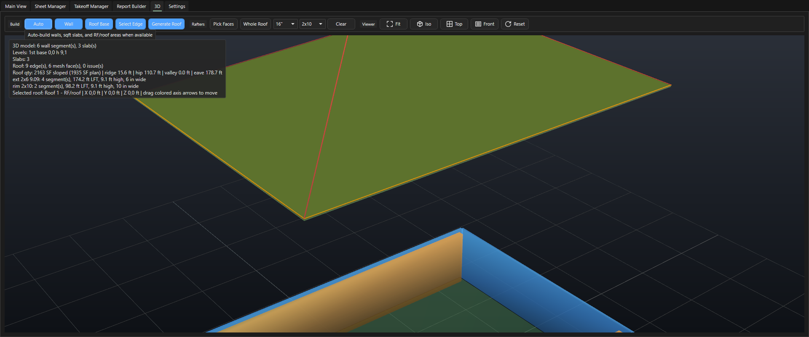

# 3D и Massing

Здесь: вкладка 3D, которая по умолчанию выключена: стены и плиты из замеров, общий вьюер, и честный статус старого AI Massing. Нужно, когда хочется увидеть корпус в объёме или когда спрашивают "а что с 3D". Крыша в 3D описана отдельно: [3D-крыша](ourplancore-3d-roof.md). Вкладки Sheet Manager, Takeoff Manager, Report Builder и Materials: [Менеджеры](ourplancore-managers.md).

<!-- DEMO: d-3d -->

## Статус коротко

| Что | Статус в 3.0 | Где |
| --- | --- | --- |
| 3D стены и плиты по замерам | работает, без ИИ | `Settings > Modules > 3D`, вкладка 3D |
| 3D крыша по рёбрам, Roof Qty, Roof Takeoff, стропила | работает | [3D-крыша](ourplancore-3d-roof.md) |
| AI 3D Massing (Build 3D Draft, Review, Accept) | выключен в коде с мая 2026, архив | нет |

## Как включить и что на вкладке

1. Откройте **Settings > Modules**, поставьте галку **3D**, нажмите **Save global default** (или **Apply** до перезапуска).
2. В строке режимов появилась вкладка **3D**; под Takeoffs появился под-таб `3D`.
3. Чтобы перейти к ним без мыши, откройте палитру команд (++ctrl+shift+p++): `Show 3D Viewer` открывает вкладку 3D в строке режимов, `Show 3D Tab` выбирает под-таб `3D` рядом с Takeoffs.

<figure markdown>
  
  <figcaption markdown="span">Лента 3D (`Build`, `Rafters`, `Viewer`), окно сцены и боковая панель с уклонами рёбер и журналом.</figcaption>
</figure>

| Группа | Кнопка | Что делает |
| --- | --- | --- |
| Build | `Auto` | стены из Line, плиты из sqft-Area и крыши из RF-Area, если они есть |
| Build | `Wall` | призмы стен из выбранных Line-позиций |
| Build | `Roof Base`, `Select Edge`, `Generate Roof` | крыша: [3D-крыша](ourplancore-3d-roof.md) |
| Rafters | `Pick Faces`, `Whole Roof`, шаг, сечение, `Clear` | стропила: [3D-крыша](ourplancore-3d-roof.md#rafters) |
| Viewer | `Fit`, `Iso`, `Top`, `Front`, `Reset` | камера |

Модель хранится в проекте (`3D_Context/walls_model.json`) и переживает закрытие; её можно собрать заново в любой момент, замеры она не меняет.

## Как поднять стены и плиты { #walls }

Зачем: увидеть корпус в объёме и проверить, что высоты стен в именах согласованы между этажами.
Нужно: стены нарисованы Line с высотой в имени (`ext 2x6 9.09`), площади этажей Area в `sqfts`.

1. Выделите в Takeoffs позиции стен (или ничего, если нужен весь корпус).
2. Откройте вкладку **3D** и нажмите **Build > Auto**: стены из всех Line-позиций, плиты из sqft-Area, крыша из RF-Area при наличии. Или **Build > Wall** только для выделенных линий.
3. Нажмите **Viewer > Iso**, затем **Fit**.
4. Щёлкните стену в сцене: блок **Details** боковой панели показывает её высоту и толщину; впишите **Height ft** и **Width in**, нажмите **Apply Wall** для одного сегмента или **Apply Group** для всех сегментов позиции.

Результат: этажи сложены по высоте стен, плиты лежат на уровнях этажей, стены подрезаны к стропилам, если крыша со стропилами уже построена. Статус `3D viewer ready...` сменяется числом построенных стен.

!!! tip "Советы"
    - Высота стен берётся из имени позиции в футах: стена без числа получает высоту по умолчанию, и этаж "проседает". Это удобная проверка имён перед Excel.
    - Правки в 3D (высота, толщина) живут в модели и не меняют имена позиций и дерево.

## Massing: что выключено и почему { #massing }

Старый рабочий поток AI 3D Massing (кнопки `Build 3D Draft`, `Review Roof / Openings`, `Accept 3D`) отключён в коде с мая 2026 и в интерфейсе не показывается. Черновики модели от ИИ требовали ручной проверки каждой стены и крыши, а детерминированная крыша по уклонам рёбер даёт тот же результат без сети и без сюрпризов. Код остался в репозитории как архив; его удаление стоит в плане. Если где-то в старых заметках встречается "AI massing", речь об этом архиве.

## См. также

- [3D-крыша](ourplancore-3d-roof.md): база, уклоны рёбер, стропила, Roof Takeoff
- [Менеджеры](ourplancore-managers.md): Sheet Manager, Takeoff Manager, Report Builder, Materials
- [Дополнительные возможности](ourplancore-extras.md), [Идеи и планы](ourplancore-ideas.md)
