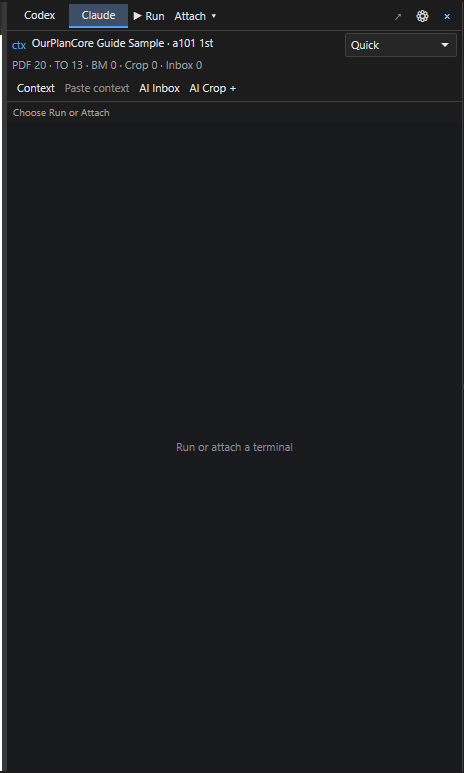
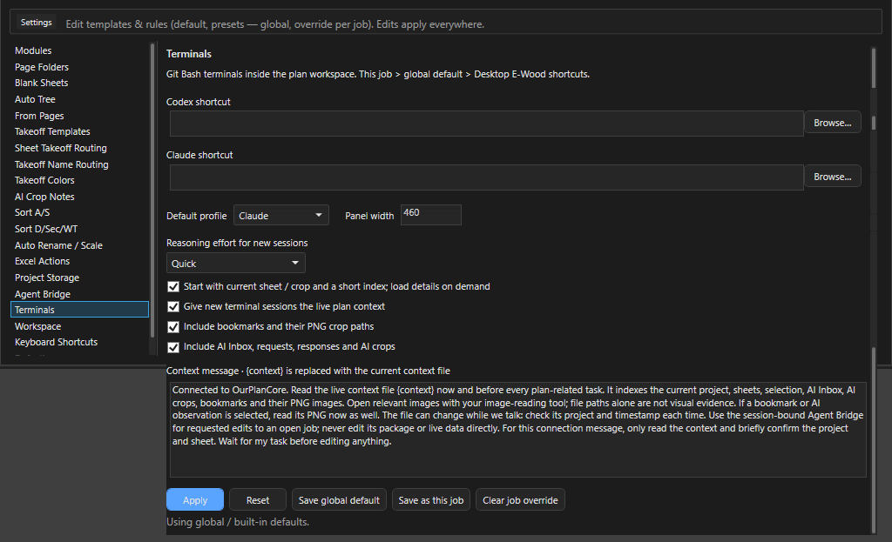

# AI console: Claude, Codex and DeepSeek terminals

Here: the `>_` panel with Claude, Codex and DeepSeek terminals inside the app window, what they know about the job (the `ctx` line, the context file), how to send the assistant a sheet crop, how it edits the open job through Agent Bridge and how to continue a conversation on a second computer. You need it when you want to ask the assistant about the current sheet, get notes from a schedule table or hand it routine work in the tree without leaving the app. The other AI features (AI Crop Notes, AI Manager, title block reading, Agent Bridge settings) are on [AI in the app](ourplancore-ai.md).

<figure markdown>
  <video class="kb-demo" loop muted playsinline preload="none" poster="../../assets/images/ourplancore/demo/d-terminal.png"><source src="../../assets/images/ourplancore/demo/d-terminal.mp4" type="video/mp4"></video>
  <figcaption markdown="span">Demo: the `>_` button opens the console: pick Codex or Claude, the `Quick / Balanced / Deep` level, a context line with the job and the sheet.</figcaption>
</figure>

<figure markdown>
  
  <figcaption markdown="span">The `>_` panel to the right of the sheet: the `Codex` / `Claude` switch, `Run` and `Attach`, the `ctx` line with counters, context buttons and the Git Bash terminal itself inside the window.</figcaption>
</figure>

## One-time setup { #setup }

- Git for Windows (Git Bash, `mintty.exe`): the terminal lives in it.
- The assistant CLI (`claude` or `codex`) is installed and you have logged in once on this computer.
- Without Workspace: launch shortcuts in `Settings > Terminals` (by default `Codex - E-Wood (bash).lnk` and `Claude - E-Wood (bash).lnk` on the desktop; a mintty shortcut or an E-Wood bash launcher with the single line `start mintty` works). With Workspace on, no shortcut is needed: the app starts mintty from the managed folder itself ([Workspace](ourplancore-workspace.md#workspace)).
- For edits in the job: `Settings > Agent Bridge > Enable local assistant access` ([Agent Bridge](ourplancore-ai.md#bridge)). For crops into the console: the AI module.

## How to run the assistant in the window { #run }

What for: Claude or Codex next to the drawing, with live job context.
Needed: Git Bash and the assistant CLI installed ([above](#setup)).

1. Press `>_` on the right command strip (palette command `Codex / Claude / DeepSeek Terminal`): the panel opens to the right of the sheet.
2. Pick the **Claude**, **Codex** or **DeepSeek** profile. DeepSeek runs through the local Codex CLI; requests sent are billed through the API.
3. Pick the effort in the list: **Quick** for questions about the sheet, **Deep** for a breakdown.
4. Press **Run** and wait for the status `Connected - context sent at startup`; the assistant briefly confirms the job and the sheet.
5. Type the task in the terminal.

Result: the conversation runs in the panel, the `ctx` line shows the job and the sheet; the X hides the panel, the conversation continues.

## Panel: buttons { #panel }

Panel width is 340-900 px: drag the left edge or set it in `Settings > Terminals > Panel width` (460 by default); in a narrow window the panel gives way to the drawing.

| Element | What it does |
| --- | --- |
| `Codex` / `Claude` / `DeepSeek` | profile: each has its own terminal, switching does not break sessions |
| `Run` | start or continue the assistant (`Run / resume using the selected E-Wood shortcut`); with Workspace it starts `claude --continue` or `codex resume --last`, that is, it continues the last session, otherwise a new one |
| `Attach` | pick up an already open Git Bash or mintty window: a menu with the window list and `Refresh`; after connecting, press `Paste context` |
| `Quick` / `Balanced` / `Deep` / `Provider default` | the `Reasoning effort for the next launch` list: reasoning effort for the next launch, low, medium, high or the provider default; for a connected session the list is inactive, it runs on its own settings |
| `ctx <job> <sheet>` | what is in the context now ([below](#context)) |
| `Context` | open the live context file in the default editor |
| `Paste context` | paste the connection message into the terminal without `Enter`: read it and send it yourself when the assistant is free |
| `AI Inbox` | expand AI Inbox at the bottom of Main View |
| `AI Crop +` | draw a crop on the sheet and hand its PNG to the context ([below](#crop)) |
| the `Detach` arrow (`Detach terminal to its own window`) | detach the terminal into its own window; the conversation continues (`Detached - conversation continues in its own window`); active only with a connected session |
| gear | `Settings > Terminals` |
| three dots (`Terminal actions`) | only on a narrow panel (under 390 px): instead of the arrow and gear, a menu with `Detach to window` and `Settings > Terminals`; button captions get shorter (`Inbox`, `Crop +`), the counter line hides |
| X (`Hide panel`) | hide the panel; both conversations keep running |

The status line under the buttons guides you step by step: `Choose Run or Attach`, `Starting Claude...`, `Connected - context sent at startup`, `Connected - startup context disabled`, `Context pasted - submit it in your assistant when ready`, `AI crop saved - available in context and AI Inbox`. An error is written there too and in the window status bar with the `Terminal:` prefix.

## What the assistant knows about the job { #context }

While the panel is open, the app checks every two seconds whether something changed (sheet, selection, bookmark, an AI Inbox entry, job files) and rewrites two files in the app profile (`%LOCALAPPDATA%\OurPlanCore\terminals\<process number>\`), not in the job:

| File | What is inside |
| --- | --- |
| `context-summary.json` | a short summary: job, current sheet (name, PDF, scale), the selected bookmark or crop with the path to the PNG, the selected Inbox request, counters, the Agent Bridge descriptor, a link to the full file |
| `context.json` | the full index: all sheets (`pages`), all takeoffs (`takeoffs`), bookmarks with PNG (`bookmarks`), crops (`ai_crop_bookmarks`), Inbox requests and responses (`ai_requests`), selected measurements, markup of the current sheet, read-only, package path, a `bridge` block with the session and instructions |

The `ctx` line shows the same in short: `<job> <sheet>` and counters `PDF` (sheets), `TO` (takeoffs), `BM` (bookmarks), `Crop` (AI crops), `Inbox` (requests); with a bookmark selected, `BM: <name>` is added. `No project open` means there is no job and the context is empty.

Checkboxes in `Settings > Terminals` decide what goes into the file: `Include bookmarks and their PNG crop paths`, `Include AI Inbox, requests, responses and AI crops`. The checkbox `Start with current sheet / crop and a short index; load details on demand` (on) sends the assistant the summary instead of the full file: it reads details as the task needs them and answers faster. When the app closes, the file is left with `state: app_closed`, and the assistant knows the bridge is invalid until the next opening.

## Connection message { #message }

On `Run` with the checkbox `Give new terminal sessions the live plan context`, the assistant gets the text from `Settings > Terminals > Context message` as its first message; `{context}` in it is replaced with the path to the context file. The built-in text asks it to: read the file now and before every task on the plan, open bookmark and crop PNGs with the image-reading tool (a path by itself is not evidence), check the job and the time in the file, make edits only through Agent Bridge, and answer the connection itself with a short confirmation of the job and the sheet, then wait for a task. With Workspace, the shared folder path, the memory index `_agent-memory/MEMORY.md` and the rules `_rules/global.md` are added, without loading the whole knowledge base.

The text is edited in the settings (up to 12000 characters, `{context}` is required); `Reset` restores the built-in one. `Paste context` pastes the same message into a session that is already running, without sending it.

## How to send a sheet crop to the console: AI Crop + { #crop }

<figure markdown>
  <video class="kb-demo" loop muted playsinline preload="none" poster="../../assets/images/ourplancore/demo/d-ai-crop.png"><source src="../../assets/images/ourplancore/demo/d-ai-crop.mp4" type="video/mp4"></video>
  <figcaption markdown="span">Demo: `AI Crop +` and a frame over part of the plan: the crop goes into the console context and into AI Inbox.</figcaption>
</figure>

What for: the assistant sees a table or detail as an image instead of guessing from text.
Needed: the AI module is on, the job is not read-only, the terminal is connected.

1. Open the sheet, press `AI Crop +` (needs the AI module and a job that is not read-only). Status: `Drag a crop on the sheet - Esc cancels`.
2. Drag a frame over the schedule table, detail or title block.
3. The app saves the crop PNG into the job, creates a `terminal_crop` observation and an AI Inbox request with the text "read the crop in the context of the plan and wait for a task". The entry is selected in Inbox right away and goes into the context as the selected crop.
4. Tell the assistant in the terminal what to do with the crop: "list the notes from this table", "which header mark is over opening 3". It opens the PNG from the path in the context.

Result: the status `AI crop saved - available in context and AI Inbox`, the entry is selected in Inbox, the `ctx` line shows `Crop` one higher.

The selected bookmark (`B`, `K`, the Bookmarks tab) and the selected AI Inbox entry go into the context the same way: just select it before asking. The item `Use in Codex / Claude / DeepSeek terminal` in the AI Inbox entry menu does this in one click: it opens the `>_` panel and refreshes the context with that entry right away. Into a conversation that is already running you need to pass it with the `Paste context` button; a new session gets it on `Run`.

## Job edits through Agent Bridge { #bridge }

The assistant does not touch the job files. The `bridge` block of the context holds the session of the open job and the path to the client `agent_bridge.py` (the `Tools\AgentBridge` folder next to the EXE). The order on its side: `inspect` (a tree snapshot and revision), `apply` with that revision (create, rename, move, copy, delete folders and takeoffs, add measurements), `save`, on error `undo`. Changes show up in the tree and on the sheet right away, deleted items go to `AI_Context/agent-trash`.

What the estimator should check after the assistant's work: the tree (names per the canon, folder, measurement type), `Total` of new takeoffs, `Ctrl+S`. If the bridge is off or the job is read-only, the assistant answers that it cannot make edits; turn on `Settings > Agent Bridge`. Bridge limits (it does not set the page scale, only launches palette commands, one agent per session): [Agent Bridge](ourplancore-ai.md#bridge).

## Conversations and a second computer { #workspace }

With Workspace on, sessions started from the panel are archived automatically. `Settings > Workspace > Conversations`: `Continue selected` opens a separate branch of the saved conversation (Claude continues the transcript with `--resume --fork-session`, Codex imports a copy of the history and continues it), `Setup on this computer` installs the shortcuts and checks the CLI, `Import a Claude / Codex conversation` picks up a conversation started outside the app. Before opening another conversation, detach the current terminal: `Detach the current terminal before opening another conversation; it will keep running.` A conversation over 256 MB is skipped with a warning. The server address and the assistant logins live on each computer separately.

## Settings > Terminals { #settings }

<figure markdown>
  
  <figcaption markdown="span">Shortcuts, profile, width, effort, four context checkboxes and the connection message text.</figcaption>
</figure>

| Field | What it sets |
| --- | --- |
| `Codex shortcut`, `Claude shortcut` | a shortcut or launcher (`.lnk`, `.cmd`, `.bat`, `.exe`), `Browse...`; order: this job, global, the E-Wood shortcuts on the desktop |
| `Default profile` | which terminal is selected when the panel opens |
| `Panel width` | 340-900 |
| `Reasoning effort for new sessions` | Quick, Balanced, Deep, Provider default |
| `Start with current sheet / crop and a short index; load details on demand` | summary instead of the full file |
| `Give new terminal sessions the live plan context` | send the connection message on `Run` |
| `Include bookmarks and their PNG crop paths`, `Include AI Inbox, requests, responses and AI crops` | what the context contains |
| `Context message` | a template with `{context}` |

Buttons `Apply` (until restart), `Reset`, `Save global default`, `Save as this job`, `Clear job override`; the line under them says what applies: `Using global / built-in defaults`, `Using this job's override`, `Applied for this session`.

## Scenarios

??? note "Ask about the current sheet"
    1. Open `s201 2nd`, select the questionable detail with the Select tool (the selection is in the context too).
    2. `>_`, `Claude`, `Quick`, `Run`; wait for the short confirmation of the job and the sheet.
    3. Type: "what is the detail under the selected measurement and which floor does it belong to".
    4. Check the answer against the sheet; if in doubt, `Deep` for the next session.

??? note "Send a schedule crop and get notes"
    1. Open the schedule sheet `a901 win sch`, `AI Crop +`, drag a frame over the table.
    2. In the terminal: "list the Tag - Size rows from this crop for the opening notes".
    3. Check the rows against the table and paste them into the takeoff Notes or into the DFL. The format of the compact lines from `AI crop here -> note` is set by `Settings > AI Crop Notes` ([AI in the app](ourplancore-ai.md#crop-notes)).

??? note "Ask it to create takeoffs through the bridge and check"
    1. `Settings > Agent Bridge`, turn access on; open the sheet you need, put the green dot on the building.
    2. In the terminal: "create takeoffs in `framing/2nd floor framing/posts` for the posts from the S2.1 schedule, names per the canon, Count type".
    3. The assistant runs `inspect`, `apply`, `save`; the takeoffs appear in the tree.
    4. Check the folder, names, `Total`, remove extras, `Ctrl+S`. Not right: ask for `undo` or `Ctrl+Z` in the tree.

??? note "Continue a conversation on a second computer"
    1. On the first one: `Ctrl+S`, `Settings > Workspace > Sync now`, wait for Synced.
    2. On the second one: open the job via `Projects > Open selected`, `Settings > Workspace > Conversations`, pick the conversation, `Continue selected`.
    3. The `>_` panel opens with a branch of that conversation; the context is already local, from the open sheet.

## If the terminal does not start { #not-starting }

| Message | What to do |
| --- | --- |
| `Terminal shortcut was not found. Choose it in Settings > Terminals.` | point to a shortcut with `Browse...` or turn on Workspace |
| `Install Git for Windows (Git Bash), then try Run again.` | install Git for Windows; `Settings > Workspace` has the instructions |
| `Choose a Git Bash / mintty shortcut, or the E-Wood Bash launcher.`, `This launcher has additional batch commands...` | the shortcut does not lead to mintty, or the launcher is more than the single line `start mintty`; pick a direct mintty shortcut |
| `Assistant CLI not installed. Open Settings > Workspace > Setup on this computer.` | the terminal has no `claude` or `codex`: install the CLI and log in |
| `The terminal did not expose its window. Use Attach if it opens later.` | the window opened separately: `Attach`, pick it in the list |
| `This terminal is already connected.` | the session is already running; type into it, or `Detach` and `Run` again |
| `Context update failed: ...`, `context_unavailable` in the file | the context was not built; switch the sheet and press `Context` again; on sheets with crops this was fixed in 2.2.36 |

Everything else: [Troubleshooting, terminal and Agent Bridge](ourplancore-troubleshooting.md#terminal).

## See also

- [AI in the app](ourplancore-ai.md): AI Crop Notes, title block reading, Agent Bridge
- [Managers: AI Inbox and AI Manager](ourplancore-managers.md#ai-manager)
- [Workspace and a second computer](ourplancore-workspace.md)
- [Settings and modules](ourplancore-settings.md)
