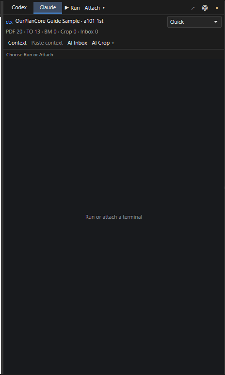
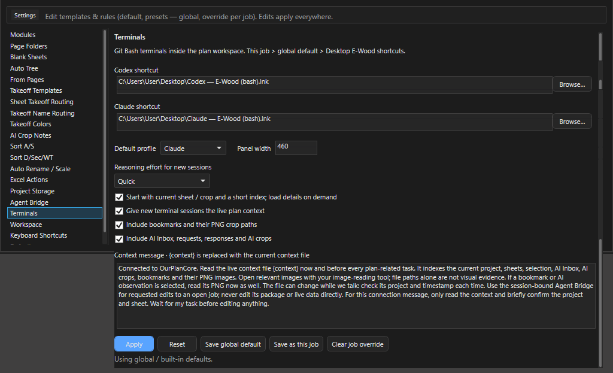

# Консоль ИИ: терминалы Claude и Codex

Здесь: панель `>_` с терминалами Claude и Codex внутри окна программы, что они знают о проекте (строка `ctx`, файл контекста), как отправить ассистенту кроп листа, как он правит открытый проект через Agent Bridge и как продолжить беседу на втором компьютере. Нужно, когда хочется спросить у ассистента про текущий лист, получить ноты из таблицы schedule или поручить ему рутину в дереве, не выходя из программы. Остальные места с ИИ (AI Crop Notes, AI Manager, чтение штампов, настройки Agent Bridge) - [ИИ в программе](ourplancore-ai.md).

<!-- DEMO: d-terminal -->

<figure markdown>
  
  <figcaption markdown="span">Панель `>_` справа от листа: переключатель `Codex` / `Claude`, `Run` и `Attach`, строка `ctx` со счётчиками, кнопки контекста и сам терминал Git Bash внутри окна.</figcaption>
</figure>

## Что нужно один раз { #setup }

- Git for Windows (Git Bash, `mintty.exe`): терминал живёт в нём.
- CLI ассистента (`claude` или `codex`) установлен и вход выполнен один раз на этом компьютере.
- Без Workspace: ярлыки запуска в `Settings > Terminals` (по умолчанию `Codex - E-Wood (bash).lnk` и `Claude - E-Wood (bash).lnk` на рабочем столе; годится ярлык mintty или E-Wood bash-лончер с одной строкой `start mintty`). С включённым Workspace ярлык не нужен: программа сама запускает mintty из управляемой папки ([Workspace](ourplancore-workspace.md#workspace)).
- Для правок в проекте: `Settings > Agent Bridge > Enable local assistant access` ([Agent Bridge](ourplancore-ai.md#bridge)). Для кропов в консоль: модуль AI.

## Как запустить ассистента в окне { #run }

Зачем: Claude или Codex рядом с чертежом, с живым контекстом проекта.
Нужно: Git Bash и CLI ассистента установлены ([выше](#setup)).

1. Нажмите `>_` на правой командной полосе (`Show / hide Codex and Claude terminals`, команда палитры `Codex / Claude Terminal`): панель открылась справа от листа.
2. Выберите профиль **Claude** или **Codex**.
3. Выберите усилие в списке: **Quick** для вопросов по листу, **Deep** для разбора.
4. Нажмите **Run** и дождитесь статуса `Connected - context sent at startup`; ассистент коротко подтверждает проект и лист.
5. Напишите задачу в терминале.

Результат: беседа идёт в панели, строка `ctx` показывает проект и лист; крестик скрывает панель, беседа продолжается.

## Панель: кнопки { #panel }

Ширина панели 340-900 px: тянуть за левый край или задать в `Settings > Terminals > Panel width` (по умолчанию 460); на узком окне панель уступает место чертежу.

| Элемент | Что делает |
| --- | --- |
| `Codex` / `Claude` | профиль: у каждого свой терминал, оба живут одновременно, переключение не рвёт сессии |
| `Run` | запустить или продолжить ассистента (`Run / resume using the selected E-Wood shortcut`); при Workspace стартует `claude --continue` или `codex resume --last`, то есть продолжает последнюю сессию, иначе новую |
| `Attach` | подхватить уже открытое окно Git Bash или mintty: меню со списком окон и `Refresh`; после подключения нажать `Paste context` |
| `Quick` / `Balanced` / `Deep` / `Provider default` | список `Reasoning effort for the next launch`: усилие рассуждения для следующего запуска, low, medium, high или как у провайдера; у подключённой сессии список неактивен, она живёт своими настройками |
| `ctx <проект> <лист>` | что сейчас в контексте ([ниже](#context)) |
| `Context` | открыть живой файл контекста в редакторе по умолчанию |
| `Paste context` | вставить сообщение подключения в терминал без `Enter`: прочитать и отправить самому, когда ассистент свободен |
| `AI Inbox` | развернуть AI Inbox внизу Main View |
| `AI Crop +` | нарисовать кроп на листе и отдать его PNG в контекст ([ниже](#crop)) |
| стрелка `Detach` (`Detach terminal to its own window`) | открепить терминал в отдельное окно; беседа продолжается (`Detached - conversation continues in its own window`); активна только при подключённой сессии |
| шестерёнка | `Settings > Terminals` |
| три точки (`Terminal actions`) | только на узкой панели (уже 390 px): вместо стрелки и шестерёнки меню `Detach to window` и `Settings > Terminals`; подписи кнопок укорачиваются (`Inbox`, `Crop +`), строка счётчиков прячется |
| крестик (`Hide panel`) | скрыть панель; обе беседы продолжают работать |

Строка статуса под кнопками ведёт по шагам: `Choose Run or Attach`, `Starting Claude...`, `Connected - context sent at startup`, `Connected - startup context disabled`, `Context pasted - submit it in your assistant when ready`, `AI crop saved - available in context and AI Inbox`. Ошибка пишется туда же и в строку статуса окна с префиксом `Terminal:`.

## Что ассистент знает о проекте { #context }

Пока панель открыта, программа раз в две секунды проверяет, не изменилось ли что-то (лист, выделение, закладка, запись в AI Inbox, файлы проекта), и переписывает два файла в профиле программы (`%LOCALAPPDATA%\OurPlanCore\terminals\<номер процесса>\`), не в проекте:

| Файл | Что внутри |
| --- | --- |
| `context-summary.json` | короткая сводка: проект, текущий лист (имя, PDF, масштаб), выбранная закладка или кроп с путём к PNG, выбранный запрос Inbox, счётчики, дескриптор Agent Bridge, ссылка на полный файл |
| `context.json` | полный индекс: все листы (`pages`), все позиции (`takeoffs`), закладки с PNG (`bookmarks`), кропы (`ai_crop_bookmarks`), запросы и ответы Inbox (`ai_requests`), выделенные замеры, разметка текущего листа, read-only, путь пакета, блок `bridge` с сессией и инструкцией |

Строка `ctx` показывает то же коротко: `<проект> <лист>` и счётчики `PDF` (листов), `TO` (позиций), `BM` (закладок), `Crop` (кропов ИИ), `Inbox` (запросов); при выбранной закладке добавляется `BM: <имя>`. `No project open` значит, что проекта нет и контекст пустой.

Галки в `Settings > Terminals` решают, что попадает в файл: `Include bookmarks and their PNG crop paths`, `Include AI Inbox, requests, responses and AI crops`. Галка `Start with current sheet / crop and a short index; load details on demand` (включена) отправляет ассистенту сводку, а не полный файл: он читает детали по мере задачи и отвечает быстрее. Когда программа закрывается, в файле остаётся `state: app_closed`, и ассистент знает, что мост недействителен до нового открытия.

## Сообщение подключения { #message }

При `Run` с галкой `Give new terminal sessions the live plan context` ассистент получает первым сообщением текст из `Settings > Terminals > Context message`; `{context}` в нём заменяется путём к файлу контекста. Встроенный текст просит: прочитать файл сейчас и перед каждой задачей по плану, открывать PNG закладок и кропов инструментом чтения картинок (путь сам по себе не доказательство), проверять проект и время в файле, правки делать только через Agent Bridge, а на само подключение ответить коротким подтверждением проекта и листа и ждать задачу. С Workspace добавляется путь общей папки, индекс памяти `_agent-memory/MEMORY.md` и правила `_rules/global.md` без загрузки всей базы знаний.

Текст правится в настройках (до 12000 знаков, `{context}` обязателен); `Reset` возвращает встроенный. `Paste context` вставляет то же сообщение в уже идущую сессию без отправки.

## Как отправить кроп листа в консоль: AI Crop + { #crop }

<!-- DEMO: d-ai-crop -->

Зачем: ассистент видит таблицу или узел картинкой, а не догадывается по тексту.
Нужно: модуль AI включён, проект не read-only, терминал подключён.

1. Открыть лист, нажать `AI Crop +` (нужен модуль AI и проект не read-only). Статус: `Drag a crop on the sheet - Esc cancels`.
2. Растянуть рамку по таблице schedule, узлу или штампу.
3. Программа сохраняет PNG кропа в проект, создаёт наблюдение `terminal_crop` и запрос в AI Inbox с текстом "прочитай кроп в контексте плана и жди задачу". Запись сразу выбрана в Inbox и попадает в контекст как выбранный кроп.
4. Написать ассистенту в терминале, что с кропом делать: "выпиши ноты из этой таблицы", "какая марка header над проёмом 3". Он открывает PNG по пути из контекста.

Результат: статус `AI crop saved - available in context and AI Inbox`, запись выбрана в Inbox, строка `ctx` показывает `Crop` на единицу больше.

Так же в контекст попадает выбранная закладка (`B`, `K`, вкладка Bookmarks) и выбранная запись AI Inbox: достаточно выделить её перед вопросом. Пункт `Use in Codex / Claude terminal` в меню записи AI Inbox делает это одним щелчком: открывает панель `>_` и сразу обновляет контекст с этой записью. В уже идущую беседу её нужно передать кнопкой `Paste context`, новая сессия получит её при `Run`.

## Правки проекта через Agent Bridge { #bridge }

Ассистент не трогает файлы проекта. В блоке `bridge` контекста лежит сессия открытого проекта и путь к клиенту `agent_bridge.py` (папка `Tools\AgentBridge` рядом с EXE). Порядок на его стороне: `inspect` (снимок дерева и ревизия), `apply` с этой ревизией (создать, переименовать, перенести, скопировать, удалить папки и позиции, добавить замеры), `save`, при ошибке `undo`. Изменения появляются в дереве и на листе сразу, удалённое уходит в `AI_Context/agent-trash`.

Что проверить эстиматору после работы ассистента: дерево (имена по канону, папка, тип замера), `Total` у новых позиций, `Ctrl+S`. Мост выключен или проект read-only - ассистент ответит, что правок сделать не может; включить `Settings > Agent Bridge`. Ограничения моста (масштаб страницы не ставит, команды палитры только запускает, один агент на сессию): [Agent Bridge](ourplancore-ai.md#bridge).

## Беседы и второй компьютер { #workspace }

При включённом Workspace сессии, начатые из панели, архивируются сами. `Settings > Workspace > Conversations`: `Continue selected` открывает отдельную ветку сохранённой беседы (Claude продолжает расшифровку с `--resume --fork-session`, Codex импортирует копию истории и продолжает её), `Setup on this computer` ставит ярлыки и проверяет CLI, `Import a Claude / Codex conversation` подхватывает беседу, начатую вне программы. Перед открытием другой беседы текущий терминал нужно открепить: `Detach the current terminal before opening another conversation; it will keep running.` Беседа больше 256 MB пропускается с предупреждением. Адрес сервера и вход в ассистентов живут на каждом компьютере отдельно.

## Settings > Terminals { #settings }

<figure markdown>
  
  <figcaption markdown="span">Ярлыки, профиль, ширина, усилие, четыре галки контекста и текст сообщения подключения.</figcaption>
</figure>

| Поле | Что задаёт |
| --- | --- |
| `Codex shortcut`, `Claude shortcut` | ярлык или лончер (`.lnk`, `.cmd`, `.bat`, `.exe`), `Browse...`; порядок: этот проект, глобально, ярлыки E-Wood на рабочем столе |
| `Default profile` | какой терминал выбран при открытии панели |
| `Panel width` | 340-900 |
| `Reasoning effort for new sessions` | Quick, Balanced, Deep, Provider default |
| `Start with current sheet / crop and a short index; load details on demand` | сводка вместо полного файла |
| `Give new terminal sessions the live plan context` | отправлять сообщение подключения при `Run` |
| `Include bookmarks and their PNG crop paths`, `Include AI Inbox, requests, responses and AI crops` | состав контекста |
| `Context message` | шаблон с `{context}` |

Кнопки `Apply` (до перезапуска), `Reset`, `Save global default`, `Save as this job`, `Clear job override`; строка под ними говорит, что действует: `Using global / built-in defaults`, `Using this job's override`, `Applied for this session`.

## Сценарии

??? note "Спросить про текущий лист"
    1. Открыть `s201 2nd`, выделить спорный узел инструментом Select (выделение тоже в контексте).
    2. `>_`, `Claude`, `Quick`, `Run`; дождаться короткого подтверждения проекта и листа.
    3. Написать: "что за деталь под выделенным замером и к какому этажу она относится".
    4. Ответ сверить с листом; при сомнении `Deep` для следующей сессии.

??? note "Отправить кроп schedule и получить ноты"
    1. Открыть лист спецификации `a901 win sch`, `AI Crop +`, растянуть рамку по таблице.
    2. В терминале: "выпиши из этого кропа строки Tag - Size для нот проёмов".
    3. Полученные строки проверить по таблице и вставить в Notes позиций или в DFL. Формат компактных строк из `AI crop here -> note` задаёт `Settings > AI Crop Notes` ([ИИ в программе](ourplancore-ai.md#crop-notes)).

??? note "Попросить создать позиции через bridge и проверить"
    1. `Settings > Agent Bridge`, включить доступ; открыть нужный лист, поставить зелёную точку на корпус.
    2. В терминале: "создай в `framing/2nd floor framing/posts` позиции по постам со schedule S2.1, имена по канону, тип Count".
    3. Ассистент делает `inspect`, `apply`, `save`; позиции появляются в дереве.
    4. Проверить папку, имена, `Total`, лишнее убрать, `Ctrl+S`. Не так - попросить `undo` или `Ctrl+Z` в дереве.

??? note "Продолжить беседу на втором компьютере"
    1. На первом: `Ctrl+S`, `Settings > Workspace > Sync now`, дождаться Synced.
    2. На втором: открыть проект через `Projects > Open selected`, `Settings > Workspace > Conversations`, выбрать беседу, `Continue selected`.
    3. Панель `>_` открывается с веткой этой беседы; контекст уже местный, с открытого листа.

## Если терминал не стартует { #not-starting }

| Сообщение | Что сделать |
| --- | --- |
| `Terminal shortcut was not found. Choose it in Settings > Terminals.` | указать ярлык `Browse...` или включить Workspace |
| `Install Git for Windows (Git Bash), then try Run again.` | поставить Git for Windows; `Settings > Workspace` держит инструкцию |
| `Choose a Git Bash / mintty shortcut, or the E-Wood Bash launcher.`, `This launcher has additional batch commands...` | ярлык ведёт не на mintty или лончер сложнее одной строки `start mintty`; выбрать прямой ярлык mintty |
| `Assistant CLI not installed. Open Settings > Workspace > Setup on this computer.` | в терминале нет `claude` или `codex`: установить CLI и войти |
| `The terminal did not expose its window. Use Attach if it opens later.` | окно открылось отдельно: `Attach`, выбрать его в списке |
| `This terminal is already connected.` | сессия уже идёт; писать в неё или `Detach` и `Run` заново |
| `Context update failed: ...`, в файле `context_unavailable` | контекст не собрался; переключить лист и снова `Context`; на листах с кропами исправлено в 2.2.36 |

Остальное: [Решение проблем, терминал и Agent Bridge](ourplancore-troubleshooting.md#terminal).

## См. также

- [ИИ в программе](ourplancore-ai.md): AI Crop Notes, чтение штампов, Agent Bridge
- [Менеджеры: AI Inbox и AI Manager](ourplancore-managers.md#ai-manager)
- [Workspace и второй компьютер](ourplancore-workspace.md)
- [Settings и модули](ourplancore-settings.md)
