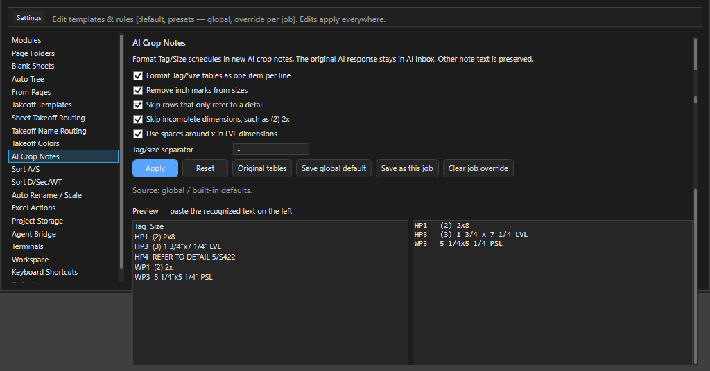
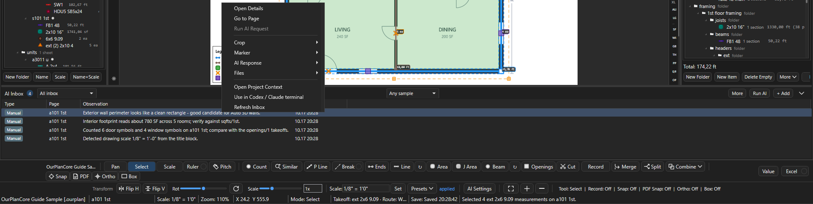
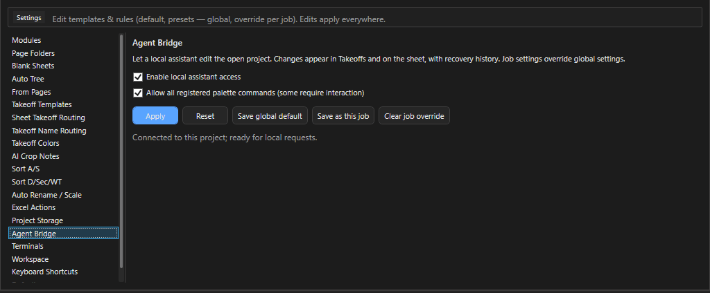

# AI in OurPlanCore

Here: every place where OurPlanCore 3.0 calls a model or an external agent: notes from crops and their format (AI Crop Notes), reading sheet title blocks, AI Inbox and AI Manager in short, Agent Bridge. You need it when you want to speed up routine work while every AI result stays under the estimator's review. The Claude and Codex terminals in the app window, with all their buttons, context and scenarios, are described separately: [AI console](ourplancore-ai-console.md).

## What there is and what it needs

| Tool | What it does | Online | What to turn on |
| --- | --- | --- | --- |
| AI crop here -> note | a crop of a table or detail becomes a takeoff note | yes | AI module, OpenAI key in `AI Settings` |
| AI Crop Notes | the format of Tag/Size lines in such notes | no | `Settings > AI Crop Notes` |
| AI Inbox and AI Manager | request queue, responses, observations, markers | yes | AI module |
| Similar with AI double-check | advice on which symbol was picked | yes | AI module, checkbox in the Similar dialog |
| OCR on Name | reading the sheet number without a text layer (Tesseract) | no | always works |
| AI from the title block image | a sheet name that text and OCR could not read | yes | checkbox in `Settings > Auto Rename / Scale` |
| `>_` terminals ([AI console](ourplancore-ai-console.md)) | Claude or Codex in the right panel with live plan context | yes | Git Bash and the assistant CLI, log in once |
| Agent Bridge | an agent edits the open job through the app | no (local) | `Settings > Agent Bridge` |

The OpenAI key is set in the `AI Settings` dialog (a button on the tool strip, in AI Manager or the `OpenAI Settings` palette command); it is saved to the Windows user environment variables and is not written into the job. The default model is `gpt-5-mini`, the model list is in the same place. Everything marked "yes" goes to the network as sheet crops: keep that in mind with other people's drawings.

## AI crop and AI Crop Notes {#crop-notes}

<figure markdown>
  
  <figcaption markdown="span">Tag/size separator and preview: the pasted text on the left, how it will land in the note on the right.</figcaption>
</figure>

### How to get a note from a table crop { #crop-note }

What for: schedule rows in the takeoff Notes without typing them by hand.
Needed: the AI module, a key in `AI Settings`, a takeoff selected in Takeoffs.

1. Right-click the sheet and choose **AI crop here -> note** (outline an area) or **AI quick box here -> note**.
2. Wait for the answer in AI Inbox: the app reformats a schedule answer like `Tag - Size` into compact lines `HP1  (2) 2x8` without repeated headers and table lines.
3. Check the lines against the table on the sheet.

Result: a note in the Notes of the selected takeoff; the raw answer stays in AI Inbox.

`Settings > AI Crop Notes`: `Tag/size separator`, a preview (`Preview - paste the recognized text on the left`), the `Original tables` checkbox, Reset, global and per job. Other note text is not touched.

The other items of the same **AI Assist** submenu: `Save AI crop here`, `Save AI marker here` (a symbol sample, [below](#marker)), `Ask AI about this point / area`, `Read text near point`, `Save observation here`, `Add as pending check`, `Suggest takeoff item here`, `Trace wall from this point`, `Trace closed area`, `Check missed takeoffs on this page`. On a measurement: `Save measurement AI crop` (a crop around the measurement with its description goes to AI Inbox, the model is not called), `Save measurement as AI marker` (the measurement as a sample), `Explain measurement`, `Find Similar`, `Link to observation`, `Create note from measurement`. The Trace commands work deterministically from the PDF geometry and show a preview before applying.

## AI Inbox and AI Manager { #inbox }

AI Inbox is a panel at the bottom of Main View (AI module): the job's observations, crops, model requests, responses and markers, newest on top; a request has a status at the start of the line: `[pending]`, `[running]`, `[done]`, `[failed]`. AI Manager is the same feed as a separate tab with the `Run AI`, `Run New`, `Retry Failed` buttons and marker sets ([Managers](ourplancore-managers.md#ai-manager)). AI output is a draft, not measurements: it gets into the tree only after review ([below](#action-draft)). Everything is stored in the job, in the `AI_Context` folder.

<figure markdown>
  
  <figcaption markdown="span">The AI Inbox header: entry counter, two marker filters, `More`, `Run AI`, `+ Add` and the collapse arrow. Right-click on an entry opens the action menu.</figcaption>
</figure>

| Element | Where | What it does |
| --- | --- | --- |
| arrow in the header (`Toggle AI Inbox`) | AI Inbox header; palette command `Toggle AI Inbox` | collapse the panel to the header or expand it |
| `Show AI Manager` | palette command | open the AI Manager tab |
| the `Filter AI markers by type` list | header | `All inbox` - all entries; `All markers` - only markers; a type (`window_sample`, `door_sample`, `roof_edge_sample`, `ignore_area` and others) - only markers of that type |
| the `Filter AI markers by sample kind` list | header | `Any sample`, `positive`, `negative`, `ignore`: which kind of markers to show |
| `Run AI` | header | send the selected request; if it is not waiting to be sent, the first waiting one in the queue |
| `More` | header | `Run New Bookmarks`, `Retry Failed Bookmarks` ([batch](#batch)), `Create Marker Set`, `Manage Marker Sets...`, `Export Marker Context` ([entry menu](#inbox-menu)) |
| `+ Add` | header | your own observation note for the current sheet |
| ++enter++ | the selected entry | the Observation Details window |

### How to send a request to the model { #run-request }

What for: get an AI answer for a crop, point or measurement waiting in Inbox.
Needed: the AI module, an OpenAI key in `AI Settings`, a job that is not read-only.

1. Select an entry with the `[pending]` or `[failed]` status in AI Inbox.
2. Right-click and choose **Run AI Request** (or the `Run AI` button in the header).
3. Read the `Review AI Attachments` window: it lists the job files (crops, layers) that will go to the network. Press **Yes**.
4. Wait for the run to finish: the entry status becomes `[done]` or `[failed]`.

Result: the answer shows in the Observation Details window (++enter++ on the entry) as AI Request, AI Response and AI Action Draft blocks. If the answer has points, review the draft ([below](#action-draft)).

### How to save a symbol sample: a marker { #marker }

What for: show the AI what the symbol you need looks like (window, door, roof edge), so it can look for the same ones later.
Needed: the AI module, a job that is not read-only.

1. Right-click the symbol on the sheet and choose **AI Assist > Save AI marker here**; on a finished measurement, **AI Assist > Save measurement as AI marker**.
2. Pick a **Marker type** from the list or type your own.
3. Pick a **Sample kind**: `positive` - this is what you need, `negative` - similar but not it, `ignore` - do not look at this area.
4. If needed, fill in **Value / measurement text** (size, mark) and **Note**, press **Save**.

Result: a crop around the point is saved, the marker shows on the sheet and as an entry in AI Inbox, status `Saved AI marker <type> on <sheet>`. `Find Similar From Marker` works from a marker: a request with the marker crop and a crop of the neighboring sheet area is queued, and the answer comes back as an action draft.

### How to review an AI action draft { #action-draft }

What for: turn the points the AI found into measurements only after your own review.
Needed: the entry has an answer with points (after `Run AI Request`, `Find Similar From Marker` or a manual answer).

1. Right-click the entry and choose **AI Response > Preview Action Draft**: the app opens the sheet and draws the draft points over the drawing.
2. Choose **AI Response > Review Action Draft**: a window with candidate rows opens.
3. Check the correct rows in the **Accept** column (buttons `Accept Selected`, `Reject Selected`, `Accept Valid`, `Reject All`; `Preview Selected` shows the selected ones on the sheet).
4. For each accepted row, pick a **Target Takeoff**: an existing takeoff or `New AI Line Item`, `New AI Area Item`, `New AI Count Item`.
5. Press **Apply Accepted**, then clear the preview points: **AI Response > Clear Action Preview**.

Result: the accepted candidates became measurements in the chosen takeoffs, the draft is marked `reviewed`; accepted and rejected rows are remembered as marker feedback.

`Add Manual AI Response` (in the Observation Details window, the `AI Response` button) lets you type an answer by hand, for example one you got in the assistant console: it is saved as finished (`done`), and an action draft is built from it right away.

### How to send crops in a batch { #batch }

What for: collect crops while reviewing sheets and send them to the model in one run.

1. Right-click an entry with a crop and choose **Crop > Bookmark Crop For Batch AI**: status `Bookmarked crop ...; Run New will send it to OpenAI.`
2. Repeat for other crops.
3. Press **More > Run New Bookmarks** in the AI Inbox header (`Run New` in AI Manager): the new bookmarks go to the model one by one.
4. Retry the failed ones: **More > Retry Failed Bookmarks** (`Retry Failed`).

Result: status `Processed new crop bookmarks: N done, N failed, N total`, answers in Inbox. If an answer found candidates with points, the app adds a new crop bookmark for each by itself (one level deep, no duplicates nearby); the next `Run New` sends them.

### AI Inbox entry menu: reference { #inbox-menu }

??? note "All entry menu items and Observation Details window buttons"

    | Item | Submenu | What it does |
    | --- | --- | --- |
    | `Open Details` | - | the Observation Details window with the entry text, request, response and draft |
    | `Go to Page` | - | open the sheet the entry belongs to |
    | `Run AI Request` | - | send this entry's request to the model ([above](#run-request)) |
    | `Open Crop` | Crop | show the crop PNG in a viewer |
    | `Open Crop Folder` | Crop | open the job's crop folder in File Explorer |
    | `Bookmark Crop For Batch AI` | Crop | a bookmark for a batch run ([above](#batch)) |
    | `Edit Marker` | Marker | the same window as when saving a marker: type, sample kind, value, note |
    | `Delete Marker` | Marker | delete the marker after confirmation; the crop and the log stay in `AI_Context` |
    | `Find Similar From Marker` | Marker | queue a search for similar items from the sample |
    | `Create Marker Set From Filter` | Marker | save the markers under the current filters as a named set (name and `Description / use`); same as `More > Create Marker Set` |
    | `Manage Marker Sets...` | Marker | the list of sets: `Apply Filter` (set the set's filters), `Rename...`, `Delete` (deletes only the set file), `Open JSON` |
    | `Export Marker Context` | Marker | export the visible markers under the filters to JSON for an external agent and open the file |
    | `Hide This Marker Type` | Marker | hide markers of this type on the sheet; remembered for the job |
    | `Show All Marker Types` | Marker | bring all hidden types back onto the sheet |
    | `Add Manual AI Response` | AI Response | type an answer by hand ([above](#action-draft)) |
    | `Preview Action Draft`, `Review Action Draft`, `Clear Action Preview` | AI Response | show, review and clear the action draft ([above](#action-draft)) |
    | `Apply Sheet Metadata Response` | AI Response | apply the model's answer on the sheet name and scale ([below](#sheet-names)) |
    | `Open Request JSON` and others | Files | the entry's service files in Notepad |
    | `Open Project Context` | - | the job log `project.md`: all observations in a row, in Notepad |
    | `Use in Codex / Claude terminal` | - | hand the entry to the assistant in the console ([AI console](ourplancore-ai-console.md#crop)) |
    | `Refresh Inbox` | - | re-read the list from disk |

    Observation Details window buttons: `Go to Page`, `Open Crop`, `Request JSON`, `Run AI`, `AI Response` (manual answer), `Project Context` (job log), `Close`.

## AI when reading sheet names {#sheet-names}

The `Name` button (and `Name+Scale`) looks for the sheet number in the text of the whole plan set. If there is no text layer, the built-in OCR works (the right strip of the title block, the bottom strip, a learned location). If that did not give a number either, the sheet can be handed to the model: `Settings > Auto Rename / Scale`, the checkbox `Read title blocks the PDF text cannot name with AI (online; AI module and OPENAI_API_KEY)`.

- No more than 80 sheets per run; answers are cached in the job (`AI_Context/cache/sheet_vision`), title block images are deleted after the request.
- The result shows in Sheet Manager: the `Name Source` / `Name Conf.`, `Why` columns.
- The `Kept` column in the rule table is learning without AI: how many times a name with that tag stayed final when jobs were opened.

A manual request for selected sheets (Sheet Manager and AI modules):

1. Right-click a sheet or folder in Pages and choose **PDF Metadata > Queue GPT Metadata Fallback**.
2. Read the summary in the window: the app takes only sheets where PDF parsing did not find the number, title or scale (or there is no text at all) and that do not have such a request yet; for each one it saves a title block crop (from the `Crop Hints` regions, if set) and queues a request in AI Inbox.
3. Send the requests: `Run AI Request` on an entry or `AI Fill` in Sheet Manager (it queues, sends and writes the answers into the sheet table by itself).
4. Apply the answer per entry: right-click > **AI Response > Apply Sheet Metadata Response**, check the `Rename` checkboxes and the `Scale Action` column in the preview window, press **Apply**.

Result: the sheet name and scale are updated only where the checkboxes were left on.

## Claude and Codex terminals {#terminals}

The `>_` button on the right command strip opens a panel with Git Bash inside the app window: the assistant sees the job, the sheet, the selection, bookmarks and crops through a live context file, and edits the job through Agent Bridge. Panel buttons, the `ctx` line, `AI Crop +`, `Settings > Terminals`, scenarios and what to do if the terminal does not start: [AI console](ourplancore-ai-console.md).

## Agent Bridge {#bridge}

<figure markdown>
  
  <figcaption markdown="span">Two switches: local assistant access and permission for palette commands.</figcaption>
</figure>

**What it is.** A channel through which an external agent (Claude Code, Codex) edits the open job with the app's own hands: changes show up in the tree and on the sheet right away, a recovery log is kept, deleted items go to `AI_Context/agent-trash`. The agent does not touch job files behind the app's back: if you rewrite `Takeoffs` on disk and press Refresh, the app overwrites it with its in-memory state.

**Who it is for.** The owner and the agents that help with measuring; the estimator presses nothing in the window except turning it on.

**Where it is turned on.** `Settings > Agent Bridge`: `Enable local assistant access` and `Allow all registered palette commands (some require interaction)`; Apply, Reset, global and per job. Off by default.

**What it can do.** The client `agent_bridge.py` is in the `Tools\AgentBridge` folder next to the EXE, commands: `sessions`, `ping`, `status`, `commands`, `inspect`, `context`, `save`, `refresh`, `refresh_pages`, `reload`, `apply`, `undo`, `palette`. Through `apply` the agent creates, renames, moves, copies and deletes Takeoffs folders and takeoffs, changes takeoff properties, adds and replaces measurements. Every batch needs a revision from `inspect`; on a conflict a new `inspect` is needed. `save` waits for the batch to be actually saved and reports the result, `undo` rolls back the agent's last batch.

**What it cannot do.** It does not set the page scale; it only reads and refreshes sheets; it only launches palette commands (`dispatched`, no result) and does not bypass modules or read-only; it does not work while a modal window is open or a drawing gesture is unfinished; a timeout is not a reason to repeat the request with a new ID. One agent per session of the open job.

The rules for how the agent works with the tree (names, `move` instead of create+delete, measurement types) are in the owner's skills; for the estimator one thing matters: after the agent's work, check the tree and press ++ctrl+s++.

## What AI does not do

- It does not replace the scale or the check against a known dimension.
- It does not count for you: Similar, AI crop, Trace give candidates you have to confirm.
- It does not read closed jobs: the bridge and the terminals work only with the open job.

## See also

- [AI console](ourplancore-ai-console.md) - Claude and Codex terminals in the window
- [Managers](ourplancore-managers.md) - AI Manager, Sheet Manager
- [Settings: all categories](ourplancore-settings.md)
- [Workspace and a second computer](ourplancore-workspace.md)
- [Sheets (Pages)](ourplancore-pages.md) - Name, Scale
- [Editing and snapping](ourplancore-editing.md) - Similar
- [Ideas and plans](ourplancore-ideas.md) - what is still planned for AI
