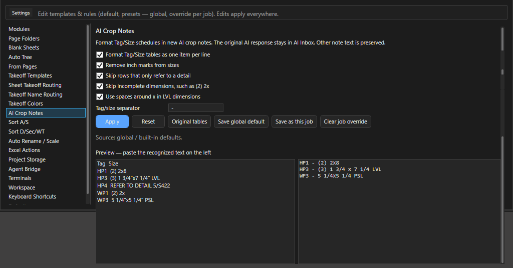
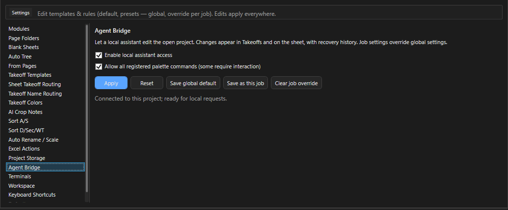

# ИИ в OurPlanCore

Здесь - все места, где OurPlanCore 3.0 зовёт модель или внешнего агента: заметки из кропов и их формат (AI Crop Notes), чтение штампов листов, AI Inbox и AI Manager коротко, Agent Bridge. Нужно, когда хочется ускорить рутину, но так, чтобы каждый результат ИИ оставался на проверке у эстиматора. Терминалы Claude и Codex в окне программы со всеми кнопками, контекстом и сценариями описаны отдельно: [Консоль ИИ](ourplancore-ai-console.md).

## Что есть и что для этого нужно

| Инструмент | Что делает | Онлайн | Что включить |
| --- | --- | --- | --- |
| AI crop here -> note | кроп таблицы или узла превращается в заметку takeoff | да | модуль AI, ключ OpenAI в `AI Settings` |
| AI Crop Notes | формат строк Tag/Size в таких заметках | нет | `Settings > AI Crop Notes` |
| AI Inbox и AI Manager | очередь запросов, ответы, наблюдения, маркеры | да | модуль AI |
| Similar с перепроверкой AI | совет, какой символ выбран | да | модуль AI, галка в диалоге Similar |
| OCR при Name | чтение номера листа без текстового слоя (Tesseract) | нет | работает всегда |
| AI по картинке штампа | имя листа, которое не удалось прочитать текстом и OCR | да | галка в `Settings > Auto Rename / Scale` |
| Терминалы `>_` ([консоль ИИ](ourplancore-ai-console.md)) | Claude или Codex в панели справа с живым контекстом плана | да | Git Bash и CLI ассистента, вход один раз |
| Agent Bridge | агент правит открытый проект через программу | нет (локально) | `Settings > Agent Bridge` |

Ключ OpenAI задаётся в диалоге `AI Settings` (кнопка на полосе инструментов, в AI Manager или команда `OpenAI Settings` в палитре); он сохраняется в переменные окружения пользователя Windows, в проект не пишется. Модель по умолчанию `gpt-5-mini`, список моделей там же. Всё, что помечено "да", уходит в сеть кропами листа: на чужих чертежах учитывайте это.

## AI crop и AI Crop Notes {#crop-notes}

<figure markdown>
  
  <figcaption markdown="span">Разделитель Tag/size и предпросмотр: слева вставленный текст, справа как он лягет в заметку.</figcaption>
</figure>

### Как получить заметку из кропа таблицы { #crop-note }

Зачем: строки schedule в Notes позиции без ручного набора.
Нужно: модуль AI, ключ в `AI Settings`, выбранная позиция в Takeoffs.

1. Щёлкните ПКМ по листу и выберите **AI crop here -> note** (обвести область) или **AI quick box here -> note**.
2. Дождитесь ответа в AI Inbox: ответ по schedule вида `Tag - Size` программа переформатирует в компактные строки `HP1  (2) 2x8` без повторных заголовков и линий таблицы.
3. Проверьте строки по таблице на листе.

Результат: заметка в Notes выбранной позиции; исходный ответ остаётся в AI Inbox.

`Settings > AI Crop Notes`: `Tag/size separator`, предпросмотр (`Preview - paste the recognized text on the left`), галка `Original tables`, Reset, глобально и для проекта. Другой текст заметки не трогается.

Остальные пункты того же меню: `Ask AI about this point / area`, `Read text near point`, `Save observation here`, `Add as pending check`, `Suggest takeoff item here`, `Trace wall from this point`, `Trace closed area`, `Check missed takeoffs on this page`; у замера `Explain measurement`, `Find Similar`, `Link to observation`, `Create note from measurement`. Trace-команды работают детерминированно по геометрии PDF и показывают предпросмотр перед применением.

## AI Inbox и AI Manager

AI Inbox - панель внизу Main View (модуль AI): запросы, ответы, наблюдения, маркеры. AI Manager - отдельная вкладка с таблицей запросов, кнопками `Run AI`, `Run New`, `Retry Failed` и наборами маркеров. Выводы ИИ в Inbox - черновики, не замеры: в дерево они попадают только после подтверждения. Кнопки и колонки вкладки: [Менеджеры, AI Inbox и AI Manager](ourplancore-managers.md#ai-manager).

## AI при чтении имён листов {#sheet-names}

Кнопка `Name` (и `Name+Scale`) ищет номер листа по тексту всего комплекта. Если текстового слоя нет, работает встроенный OCR (правая полоса штампа, нижняя полоса, выученное место). Если и он не дал номер, лист можно отдать модели: `Settings > Auto Rename / Scale`, галка `Read title blocks the PDF text cannot name with AI (online; AI module and OPENAI_API_KEY)`.

- Не больше 80 листов за прогон; ответы кешируются в проекте (`AI_Context/cache/sheet_vision`), картинки штампа удаляются после запроса.
- Результат виден в Sheet Manager: колонки `Name Source` / `Name Conf.`, `Why`.
- Колонка `Kept` в таблице правил - обучение без ИИ: сколько раз имя с таким тегом оставалось финальным при открытии проектов.

## Терминалы Claude и Codex {#terminals}

Кнопка `>_` на правой командной полосе открывает панель с Git Bash внутри окна программы: ассистент видит проект, лист, выделение, закладки и кропы через живой файл контекста, а правит проект через Agent Bridge. Кнопки панели, строка `ctx`, `AI Crop +`, `Settings > Terminals`, сценарии и что делать, если терминал не стартует: [Консоль ИИ](ourplancore-ai-console.md).

## Agent Bridge {#bridge}

<figure markdown>
  
  <figcaption markdown="span">Два выключателя: доступ локального ассистента и разрешение на команды палитры.</figcaption>
</figure>

**Что это.** Канал, через который внешний агент (Claude Code, Codex) правит открытый проект руками самой программы: изменения сразу видны в дереве и на листе, ведётся журнал восстановления, удалённое уходит в `AI_Context/agent-trash`. Файлы проекта за спиной программы агент не трогает: если переписать `Takeoffs` на диске и нажать Refresh, программа залёет своё состояние из памяти.

**Кому.** Владельцу и агентам, которые помогают мерить; эстиматор в окне ничего не нажимает, кроме включения.

**Где включается.** `Settings > Agent Bridge`: `Enable local assistant access` и `Allow all registered palette commands (some require interaction)`; Apply, Reset, глобально и для проекта. По умолчанию выключено.

**Что умеет.** Клиент `agent_bridge.py` лежит в папке `Tools\AgentBridge` рядом с EXE, команды: `sessions`, `ping`, `status`, `commands`, `inspect`, `context`, `save`, `refresh`, `refresh_pages`, `reload`, `apply`, `undo`, `palette`. Через `apply` агент создаёт, переименовывает, двигает, копирует и удаляет папки и позиции Takeoffs, меняет свойства позиций, добавляет и заменяет замеры. Каждый пакет требует ревизию из `inspect`; при конфликте нужен новый `inspect`. `save` ждёт настоящего сохранения пакета и сообщает результат, `undo` откатывает последний пакет агента.

**Чего не умеет.** Не ставит масштаб страницы; листы только читает и обновляет; команды палитры лишь запускает (`dispatched`, без результата) и не обходит модули и read-only; не работает при открытом модальном окне или незаконченном жесте рисования; таймаут - не повод повторить запрос с новым ID. Один агент на сессию открытого проекта.

Правила работы агента с деревом (имена, `move` вместо create+delete, типы замеров) - в скилах владельца; для эстиматора важно одно: после работы агента проверить дерево и нажать ++ctrl+s++.

## Что ИИ не делает

- Не заменяет масштаб и проверку по известному размеру.
- Не считает за вас: Similar, AI crop, Trace дают кандидатов, которые надо подтвердить.
- Не читает закрытые проекты: мост и терминалы работают только с открытым проектом.

## См. также

- [Консоль ИИ](ourplancore-ai-console.md) - терминалы Claude и Codex в окне
- [Менеджеры](ourplancore-managers.md) - AI Manager, Sheet Manager
- [Settings: все категории](ourplancore-settings.md)
- [Workspace и второй компьютер](ourplancore-workspace.md)
- [Листы Pages](ourplancore-pages.md) - Name, Scale
- [Правка и привязки](ourplancore-editing.md) - Similar
- [Идеи и планы](ourplancore-ideas.md) - что про ИИ ещё в планах
