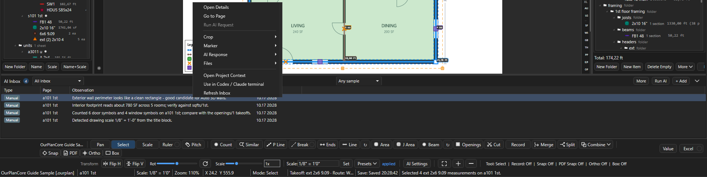

# ИИ в OurPlanCore

Здесь - все места, где OurPlanCore 3.0 зовёт модель или внешнего агента: заметки из кропов и их формат (AI Crop Notes), чтение штампов листов, AI Inbox и AI Manager коротко, Agent Bridge. Нужно, когда хочется ускорить рутину, но так, чтобы каждый результат ИИ оставался на проверке у эстиматора. Терминалы Claude и Codex в окне программы со всеми кнопками, контекстом и сценариями описаны отдельно: [Консоль ИИ](ourplancore-ai-console.md).

## Что есть и что для этого нужно

| Инструмент | Что делает | Онлайн | Что включить |
| --- | --- | --- | --- |
| AI crop here -> note | кроп таблицы или узла превращается в заметку takeoff | да | модуль AI, ключ OpenAI в `AI Settings` |
| AI Crop Notes | формат строк Tag/Size в таких заметках | нет | `Settings > AI Crop Notes` |
| AI Inbox и AI Manager | очередь запросов, ответы, наблюдения, маркеры | да | модуль AI |
| Similar с перепроверкой AI | совет, какой символ выбран | да | модуль AI, галка в диалоге Similar |
| OCR при Name | чтение номера листа без текстового слоя (Tesseract) | нет | работает всегда |
| AI по картинке штампа | имя листа, которое не удалось прочитать текстом и OCR | да | галка в `Settings > Auto Rename / Scale` |
| Терминалы `>_` ([консоль ИИ](ourplancore-ai-console.md)) | Claude или Codex в панели справа с живым контекстом плана | да | Git Bash и CLI ассистента, вход один раз |
| Agent Bridge | агент правит открытый проект через программу | нет (локально) | `Settings > Agent Bridge` |

Ключ OpenAI задаётся в диалоге `AI Settings` (кнопка на полосе инструментов, в AI Manager или команда `OpenAI Settings` в палитре); он сохраняется в переменные окружения пользователя Windows, в проект не пишется. Модель по умолчанию `gpt-5-mini`, список моделей там же. Всё, что помечено "да", уходит в сеть кропами листа: на чужих чертежах учитывайте это.

## AI crop и AI Crop Notes {#crop-notes}

<figure markdown>
  
  <figcaption markdown="span">Разделитель Tag/size и предпросмотр: слева вставленный текст, справа как он лягет в заметку.</figcaption>
</figure>

### Как получить заметку из кропа таблицы { #crop-note }

Зачем: строки schedule в Notes позиции без ручного набора.
Нужно: модуль AI, ключ в `AI Settings`, выбранная позиция в Takeoffs.

1. Щёлкните ПКМ по листу и выберите **AI crop here -> note** (обвести область) или **AI quick box here -> note**.
2. Дождитесь ответа в AI Inbox: ответ по schedule вида `Tag - Size` программа переформатирует в компактные строки `HP1  (2) 2x8` без повторных заголовков и линий таблицы.
3. Проверьте строки по таблице на листе.

Результат: заметка в Notes выбранной позиции; исходный ответ остаётся в AI Inbox.

`Settings > AI Crop Notes`: `Tag/size separator`, предпросмотр (`Preview - paste the recognized text on the left`), галка `Original tables`, Reset, глобально и для проекта. Другой текст заметки не трогается.

Остальные пункты того же подменю **AI Assist**: `Save AI crop here`, `Save AI marker here` (образец символа, [ниже](#marker)), `Ask AI about this point / area`, `Read text near point`, `Save observation here`, `Add as pending check`, `Suggest takeoff item here`, `Trace wall from this point`, `Trace closed area`, `Check missed takeoffs on this page`. У замера: `Save measurement AI crop` (кроп вокруг замера с его описанием ложится в AI Inbox, модель не вызывается), `Save measurement as AI marker` (замер как образец), `Explain measurement`, `Find Similar`, `Link to observation`, `Create note from measurement`. Trace-команды работают детерминированно по геометрии PDF и показывают предпросмотр перед применением.

## AI Inbox и AI Manager { #inbox }

AI Inbox - панель внизу Main View (модуль AI): наблюдения, кропы, запросы к модели, ответы и маркеры проекта, новые сверху; у запроса в начале строки статус `[pending]`, `[running]`, `[done]`, `[failed]`. AI Manager - та же лента отдельной вкладкой с кнопками `Run AI`, `Run New`, `Retry Failed` и наборами маркеров ([Менеджеры](ourplancore-managers.md#ai-manager)). Выводы ИИ - черновики, не замеры: в дерево они попадают только после проверки ([ниже](#action-draft)). Всё хранится в проекте, в папке `AI_Context`.

<figure markdown>
  
  <figcaption markdown="span">Шапка AI Inbox: счётчик записей, два фильтра маркеров, `More`, `Run AI`, `+ Add` и стрелка свернуть. ПКМ по записи открывает меню действий.</figcaption>
</figure>

| Элемент | Где | Что делает |
| --- | --- | --- |
| стрелка в шапке (`Toggle AI Inbox`) | шапка AI Inbox; команда палитры `Toggle AI Inbox` | свернуть панель до шапки или развернуть |
| `Show AI Manager` | команда палитры | открыть вкладку AI Manager |
| список `Filter AI markers by type` | шапка | `All inbox` - все записи; `All markers` - только маркеры; тип (`window_sample`, `door_sample`, `roof_edge_sample`, `ignore_area` и другие) - только маркеры этого типа |
| список `Filter AI markers by sample kind` | шапка | `Any sample`, `positive`, `negative`, `ignore`: маркеры какого вида показать |
| `Run AI` | шапка | отправить выбранный запрос; если он не ждёт отправки, первый ожидающий в очереди |
| `More` | шапка | `Run New Bookmarks`, `Retry Failed Bookmarks` ([пакет](#batch)), `Create Marker Set`, `Manage Marker Sets...`, `Export Marker Context` ([меню записи](#inbox-menu)) |
| `+ Add` | шапка | своя заметка-наблюдение к текущему листу |
| ++enter++ | выбранная запись | окно Observation Details |

### Как отправить запрос модели { #run-request }

Зачем: получить ответ ИИ по кропу, точке или замеру, который ждёт в Inbox.
Нужно: модуль AI, ключ OpenAI в `AI Settings`, проект не read-only.

1. Выделите запись со статусом `[pending]` или `[failed]` в AI Inbox.
2. Щёлкните ПКМ и выберите **Run AI Request** (или кнопку `Run AI` в шапке).
3. Прочитайте окно `Review AI Attachments`: в нём файлы проекта (кропы, слои), которые уйдут в сеть. Нажмите **Yes**.
4. Дождитесь конца прогона: статус записи станет `[done]` или `[failed]`.

Результат: ответ виден в окне Observation Details (++enter++ по записи) блоками AI Request, AI Response и AI Action Draft. Если в ответе есть точки, проверьте черновик ([ниже](#action-draft)).

### Как сохранить образец символа: маркер { #marker }

Зачем: показать ИИ, как выглядит нужный символ (окно, дверь, край крыши), чтобы потом искать такие же.
Нужно: модуль AI, проект не read-only.

1. Щёлкните ПКМ по символу на листе и выберите **AI Assist > Save AI marker here**; по готовому замеру - **AI Assist > Save measurement as AI marker**.
2. Выберите **Marker type** из списка или впишите свой.
3. Выберите **Sample kind**: `positive` - так выглядит нужное, `negative` - похоже, но не то, `ignore` - эту область не смотреть.
4. При необходимости заполните **Value / measurement text** (размер, марка) и **Note**, нажмите **Save**.

Результат: кроп вокруг точки сохранён, маркер виден на листе и записью в AI Inbox, статус `Saved AI marker <тип> on <лист>`. По маркеру работает `Find Similar From Marker`: в очередь встаёт запрос с кропом маркера и кропом соседней области листа, ответ приходит черновиком действий.

### Как проверить черновик действий ИИ { #action-draft }

Зачем: превратить найденные ИИ точки в замеры только после своей проверки.
Нужно: у записи есть ответ с точками (после `Run AI Request`, `Find Similar From Marker` или ручного ответа).

1. Щёлкните ПКМ по записи и выберите **AI Response > Preview Action Draft**: программа открывает лист и рисует точки черновика поверх чертежа.
2. Выберите **AI Response > Review Action Draft**: откроется окно со строками-кандидатами.
3. Отметьте верные строки в колонке **Accept** (кнопки `Accept Selected`, `Reject Selected`, `Accept Valid`, `Reject All`; `Preview Selected` показывает выбранные на листе).
4. Выберите для каждой принятой строки **Target Takeoff**: готовую позицию или `New AI Line Item`, `New AI Area Item`, `New AI Count Item`.
5. Нажмите **Apply Accepted**, затем уберите точки предпросмотра: **AI Response > Clear Action Preview**.

Результат: принятые кандидаты стали замерами в выбранных позициях, черновик помечен `reviewed`; принятые и отклонённые строки запоминаются как отзыв по маркерам.

`Add Manual AI Response` (в окне Observation Details кнопка `AI Response`) вписывает ответ вручную, например полученный в консоли ассистента: он сохраняется как готовый (`done`), и из него сразу строится черновик действий.

### Как отправить кропы пакетом { #batch }

Зачем: набрать кропы при просмотре листов и отправить их модели одним прогоном.

1. Щёлкните ПКМ по записи с кропом и выберите **Crop > Bookmark Crop For Batch AI**: статус `Bookmarked crop ...; Run New will send it to OpenAI.`
2. Повторите для других кропов.
3. Нажмите **More > Run New Bookmarks** в шапке AI Inbox (`Run New` в AI Manager): новые закладки уходят модели по очереди.
4. Повторите неудачные: **More > Retry Failed Bookmarks** (`Retry Failed`).

Результат: статус `Processed new crop bookmarks: N done, N failed, N total`, ответы в Inbox. Если ответ нашёл кандидатов с точками, программа сама добавляет по каждому новую закладку-кроп (один уровень, без дублей рядом); их отправит следующий `Run New`.

### Меню записи AI Inbox: справка { #inbox-menu }

??? note "Все пункты меню записи и кнопки окна Observation Details"

    | Пункт | Подменю | Что делает |
    | --- | --- | --- |
    | `Open Details` | - | окно Observation Details с текстом записи, запросом, ответом и черновиком |
    | `Go to Page` | - | открыть лист, к которому относится запись |
    | `Run AI Request` | - | отправить запрос этой записи модели ([выше](#run-request)) |
    | `Open Crop` | Crop | показать PNG кропа в окне просмотра |
    | `Open Crop Folder` | Crop | открыть папку кропов проекта в проводнике |
    | `Bookmark Crop For Batch AI` | Crop | закладка для пакетного прогона ([выше](#batch)) |
    | `Edit Marker` | Marker | то же окно, что при сохранении маркера: тип, вид образца, значение, заметка |
    | `Delete Marker` | Marker | удалить маркер после подтверждения; кроп и журнал остаются в `AI_Context` |
    | `Find Similar From Marker` | Marker | поставить в очередь поиск похожих по образцу |
    | `Create Marker Set From Filter` | Marker | сохранить маркеры под текущими фильтрами именованным набором (имя и `Description / use`); то же `More > Create Marker Set` |
    | `Manage Marker Sets...` | Marker | список наборов: `Apply Filter` (выставить фильтры набора), `Rename...`, `Delete` (удаляет только файл набора), `Open JSON` |
    | `Export Marker Context` | Marker | выгрузить видимые маркеры под фильтрами в JSON для внешнего агента и открыть файл |
    | `Hide This Marker Type` | Marker | спрятать маркеры этого типа на листе; запоминается для проекта |
    | `Show All Marker Types` | Marker | вернуть на лист все спрятанные типы |
    | `Add Manual AI Response` | AI Response | вписать ответ вручную ([выше](#action-draft)) |
    | `Preview Action Draft`, `Review Action Draft`, `Clear Action Preview` | AI Response | показать, проверить и убрать черновик действий ([выше](#action-draft)) |
    | `Apply Sheet Metadata Response` | AI Response | применить ответ модели по имени и масштабу листа ([ниже](#sheet-names)) |
    | `Open Request JSON` и другие | Files | служебные файлы записи в Блокноте |
    | `Open Project Context` | - | журнал проекта `project.md`: все наблюдения подряд, в Блокноте |
    | `Use in Codex / Claude terminal` | - | отдать запись ассистенту в консоли ([консоль ИИ](ourplancore-ai-console.md#crop)) |
    | `Refresh Inbox` | - | перечитать список с диска |

    Кнопки окна Observation Details: `Go to Page`, `Open Crop`, `Request JSON`, `Run AI`, `AI Response` (ручной ответ), `Project Context` (журнал проекта), `Close`.

## AI при чтении имён листов {#sheet-names}

Кнопка `Name` (и `Name+Scale`) ищет номер листа по тексту всего комплекта. Если текстового слоя нет, работает встроенный OCR (правая полоса штампа, нижняя полоса, выученное место). Если и он не дал номер, лист можно отдать модели: `Settings > Auto Rename / Scale`, галка `Read title blocks the PDF text cannot name with AI (online; AI module and OPENAI_API_KEY)`.

- Не больше 80 листов за прогон; ответы кешируются в проекте (`AI_Context/cache/sheet_vision`), картинки штампа удаляются после запроса.
- Результат виден в Sheet Manager: колонки `Name Source` / `Name Conf.`, `Why`.
- Колонка `Kept` в таблице правил - обучение без ИИ: сколько раз имя с таким тегом оставалось финальным при открытии проектов.

Запрос по выбранным листам вручную (модули Sheet Manager и AI):

1. Щёлкните ПКМ по листу или папке в Pages и выберите **PDF Metadata > Queue GPT Metadata Fallback**.
2. Прочитайте итог в окне: программа берёт только листы, где разбор PDF не нашёл номер, название или масштаб (или текста нет совсем) и где ещё нет такого запроса; для каждого сохраняет кроп штампа (по областям `Crop Hints`, если они заданы) и ставит запрос в AI Inbox.
3. Отправьте запросы: `Run AI Request` по записи или `AI Fill` в Sheet Manager (он сам ставит, отправляет и записывает ответы в таблицу листов).
4. Примените ответ по записи: ПКМ > **AI Response > Apply Sheet Metadata Response**, проверьте в окне предпросмотра галки `Rename` и столбец `Scale Action`, нажмите **Apply**.

Результат: имя и масштаб листа обновлены только там, где оставлены галки.

## Терминалы Claude и Codex {#terminals}

Кнопка `>_` на правой командной полосе открывает панель с Git Bash внутри окна программы: ассистент видит проект, лист, выделение, закладки и кропы через живой файл контекста, а правит проект через Agent Bridge. Кнопки панели, строка `ctx`, `AI Crop +`, `Settings > Terminals`, сценарии и что делать, если терминал не стартует: [Консоль ИИ](ourplancore-ai-console.md).

## Agent Bridge {#bridge}

<figure markdown>
  
  <figcaption markdown="span">Два выключателя: доступ локального ассистента и разрешение на команды палитры.</figcaption>
</figure>

**Что это.** Канал, через который внешний агент (Claude Code, Codex) правит открытый проект руками самой программы: изменения сразу видны в дереве и на листе, ведётся журнал восстановления, удалённое уходит в `AI_Context/agent-trash`. Файлы проекта за спиной программы агент не трогает: если переписать `Takeoffs` на диске и нажать Refresh, программа залёет своё состояние из памяти.

**Кому.** Владельцу и агентам, которые помогают мерить; эстиматор в окне ничего не нажимает, кроме включения.

**Где включается.** `Settings > Agent Bridge`: `Enable local assistant access` и `Allow all registered palette commands (some require interaction)`; Apply, Reset, глобально и для проекта. По умолчанию выключено.

**Что умеет.** Клиент `agent_bridge.py` лежит в папке `Tools\AgentBridge` рядом с EXE, команды: `sessions`, `ping`, `status`, `commands`, `inspect`, `context`, `save`, `refresh`, `refresh_pages`, `reload`, `apply`, `undo`, `palette`. Через `apply` агент создаёт, переименовывает, двигает, копирует и удаляет папки и позиции Takeoffs, меняет свойства позиций, добавляет и заменяет замеры. Каждый пакет требует ревизию из `inspect`; при конфликте нужен новый `inspect`. `save` ждёт настоящего сохранения пакета и сообщает результат, `undo` откатывает последний пакет агента.

**Чего не умеет.** Не ставит масштаб страницы; листы только читает и обновляет; команды палитры лишь запускает (`dispatched`, без результата) и не обходит модули и read-only; не работает при открытом модальном окне или незаконченном жесте рисования; таймаут - не повод повторить запрос с новым ID. Один агент на сессию открытого проекта.

Правила работы агента с деревом (имена, `move` вместо create+delete, типы замеров) - в скилах владельца; для эстиматора важно одно: после работы агента проверить дерево и нажать ++ctrl+s++.

## Что ИИ не делает

- Не заменяет масштаб и проверку по известному размеру.
- Не считает за вас: Similar, AI crop, Trace дают кандидатов, которые надо подтвердить.
- Не читает закрытые проекты: мост и терминалы работают только с открытым проектом.

## См. также

- [Консоль ИИ](ourplancore-ai-console.md) - терминалы Claude и Codex в окне
- [Менеджеры](ourplancore-managers.md) - AI Manager, Sheet Manager
- [Settings: все категории](ourplancore-settings.md)
- [Workspace и второй компьютер](ourplancore-workspace.md)
- [Листы Pages](ourplancore-pages.md) - Name, Scale
- [Правка и привязки](ourplancore-editing.md) - Similar
- [Идеи и планы](ourplancore-ideas.md) - что про ИИ ещё в планах
