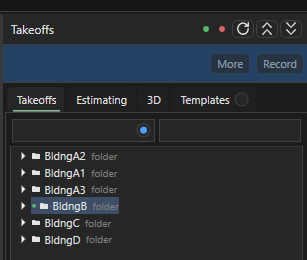
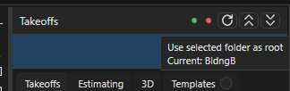

# Multiple buildings

This page covers how to run a job with several buildings in one file: a folder per building in Takeoffs and in Pages, the green and red dots in the Takeoffs header (where new measurements are written), how the W/F/S/U sheet dots work inside the selected building, copying identical buildings, a separate Excel workbook and a separate PDF per building. You need it on every job with more than one building: townhouses, a house with a garage and storage, a complex of buildings A, B, C.

<figure markdown>
  <video class="kb-demo" loop muted playsinline preload="none" poster="../../assets/images/ourplancore/demo/d-buildings.png"><source src="../../assets/images/ourplancore/demo/d-buildings.mp4" type="video/mp4"></video>
  <figcaption markdown="span">Demo on a job with several buildings: the green dot on a building folder sends new measurements into it, the red dot returns to the `Takeoffs` root.</figcaption>
</figure>

<figure markdown>
  
  <figcaption markdown="span">Three buildings `A`, `B`, `C`: each has its own `walls`, `sqfts`, `framing`. The green marker on `B` says new measurements go into it.</figcaption>
</figure>

## A folder per building

- One building: the roots `walls`, `sqfts`, `framing`... sit right in Takeoffs; do not create a `Main` folder.
- Several buildings: a folder for each, with the regular canonical tree inside. Names per the plans or by role: `A`, `B`, `C`; `Main`, `Grge`, `Storage`, `Clubhouse`; `Bldng A`. The building name repeats in Pages, in the Excel workbook and in the PDF name, so pick it once and keep it short.
- `More > Auto Tree` builds the building tree when the building folder is selected; `New Folder` under the building adds whatever is missing.
- In Pages the building also gets its own folder with the same name; shared sheets (complex elevations, details, specs) stay in `00. imported/...`. Canonical folders: [Takeoff tree and sheet names](../start/takeoff-structure.md).

Identical buildings (a mirrored townhouse, a repeated typical house) are measured once, then copied ([below](#copy)).

## Green and red dots { #root }

<figure markdown>
  
  <figcaption markdown="span">Two dots to the left of the tree refresh button. The tooltip shows the current root: `Current: B` or `Current: Takeoffs root`.</figcaption>
</figure>

The dots set the **root for new takeoffs**: which building receives measurements, `New Item`, Beam, Openings and pasted `New takeoffs`.

| Dot | Tooltip | What it does |
| --- | --- | --- |
| green | `Use selected folder as root` | the selected folder becomes the root; it gets a green marker, status `New takeoffs -> B` |
| red | `Use Takeoffs root` | the root is the whole Takeoffs again; status `New takeoffs -> Takeoffs root` |

### How to pick the building for new measurements { #select-root }

Why: everything you draw next goes into this building's folders.
You need: the building folders created in Takeoffs.

1. Select the building folder in the tree (`B`).
2. Press the green dot in the Takeoffs header. With no folder selected the status will tell you: `Select a Takeoffs folder, then press the green dot.`
3. Measure: all new takeoffs go inside `B`; the sheet dot picks the floor and branch.
4. For another building, select `C` and press the green dot again. For complex-wide takeoffs press the red dot.

Result: folder `B` has the green marker, status `New takeoffs -> B`, the tooltip on the dots reads `Current: B`; in the New Item dialog the path starts with `B/`.

The choice is stored in the job and follows the folder when it is renamed or moved; it is restored when the job is opened. Existing takeoffs do not move when the root changes; `Record` continues its takeoff in any building. If the root points to a deleted folder, creation is blocked with a message: press the red dot and pick the building again.

Without the green dot the building comes from `Settings > Sheet Takeoff Routing > Building root` (the default building for the job; with `Save as this job` it is also written to the dot of the open sheet), and if that is empty too, the Takeoffs root. In the New Item dialog the target path is visible before creation; in the paste dialog, the line `Root: Takeoffs/B.`

## Sheet dots inside a building

The W/F/S/U sheet dot picks the branch and floor, the green dot picks the building: sheet `a201 2nd` with the W 2 dot under root `B` gives `B/walls/2nd floor walls`, under root `C` gives `C/walls/2nd floor walls`. Name rules (`eve`, `prpt`, `gable`, Openings) are also counted from the root: `B/eves rakes/eves`, `B/openings`. Rule order: [Names and auto-routing](takeoff-naming.md#order).

A sheet shared by two buildings (one plan with buildings A and B side by side): measure building A with the green dot on `A`, then switch to `B` and measure the other half from the same sheet. A sheet copy for the second building is needed only when the buildings cannot be told apart on different sheets, or for a separate PDF ([split by sheets](ourplancore-split-by-sheets.md)).

## How to copy a building { #copy }

Why: do not draw identical or mirrored buildings a second time.
You need: building `A` measured, folder `B` created, building `B` sheets in Pages.

1. On a building `A` sheet, select the measurements with the Select tool (`Ctrl+A` for everything on the sheet), `Ctrl+C`.
2. Select folder `B`, green dot. Open a building `B` sheet (with identical plans, a sheet copy or the same sheet).
3. `Ctrl+V`, in the `Paste Measurements` dialog pick `New takeoffs`; the line `Root: Takeoffs/B.` shows the target building.
4. The copies go into the same folders as the sources, only inside `B`: `A/sqfts` to `B/sqfts`, `A/framing/2nd floor framing/details` to `B/framing/2nd floor framing/details`, Openings to `B/openings`. On a sheet with a different dot of the same row only the floor changes.
5. Check the `B` tree, fix whatever differs (a different opening size, an extra post), `Ctrl+S`.

Result: `B` has the same folders and takeoffs as `A`, with measurements on the building `B` sheets; the `A` totals did not change.

`Same takeoffs` is not what you want when copying between buildings: it adds the measurements to the source takeoffs of building `A`. The `Copies keep their source folders` checkbox in `Settings > Sheet Takeoff Routing` turns off the folder mirroring; then copies follow the sheet dot. Copying whole tree folders: `Ctrl+C` / `Ctrl+V` in Takeoffs carries takeoffs without the measurements of another sheet, so for a building you copy measurements from the sheet. Details: [copying](ourplancore-takeoffs.md#copy).

## How to export an Excel workbook per building { #excel }

Why: each building has its own DFL with the wall matrix and framing lists.
You need: copies of `TemplateCom.xlsm` per building, Excel open with macros enabled.

1. Each building gets its own copy of `TemplateCom.xlsm`: workbook names by building (`Bldng A.xlsm`, `Bldng B.xlsm`), workbook name equals the Job Name on the Front Page.
2. Open the building workbook, activate `Detailed Frame List`.
3. In Lite: click a cell, select a folder or takeoff of **this** building in Takeoffs and press `Excel`, `Value` or `Link to Excel`. For `Auto Link` put the [green dot](#root) on the building: it takes only that building's takeoffs.
4. With the XL strip, instead of step 3 (in Lite the `Excel Strip (XL)` checkbox in `Settings > Modules` turns it on): select **one** building folder and press `ALL` on the XL strip. A selection from two buildings is not accepted: `Excel ALL found more than one building/root in the selection`. The `LG` legend is per workbook: the beam and post codes of that building.
5. Repeat for the next building with its workbook.

Result: the building workbook is filled with the numbers of this building only. The Lite buttons and the XL strip: [Export to Excel](ourplancore-excel.md).

## How to get a PDF per building { #pdf }

From the window: the building has its own sheet folder in Pages; in `Export PDF` tick it with one checkbox; on a shared sheet hide the other building's takeoffs (`H` on the building folder in Takeoffs), export, name it `<job> Bldg A.pdf`, restore visibility and repeat ([PDF and delivery](ourplancore-pdf.md#buildings)).

With the pipeline: `OurPlanCoreCli export-pdf --grouping auto` splits the PDF by building on its own: it takes the saved green dot choice, exports each sibling building branch as a separate file, and on a shared sheet prints only that branch's measurements. With no root selected (red dot) you get one file; `--grouping single` forces one file; measurements outside the building folders stop the export with a message. Before delivery: `Ctrl+S`, green dot on the building, save again ([pipeline](job-creation-storage.md#cli)).

## Example: a job with three buildings A, B, C

```text
Pages/
  00. imported/   shared: a001 n, a901 win sch, s501 d
  A/  a101 1st, a102 2nd, s101 1st, s102 2nd, a105 rf
  B/  copies of the A sheets (same building, mirrored)
  C/  a301 1st, s301 1st, a305 rf

Takeoffs/
  A/  sqfts, walls/1st floor walls, framing/1st floor framing/..., openings/1, eves rakes
  B/  same, pasted as New takeoffs from the A sheets, openings fixed
  C/  sqfts, walls, framing, openings, eves rakes
```

Workbooks: `Bldng A.xlsm`, `Bldng B.xlsm`, `Bldng C.xlsm`; PDFs: `<job> Bldg A.pdf`, `... B.pdf`, `... C.pdf`.

## Common mistakes

- Forgot to switch the green dot: half a day of measurements went into `A` instead of `B`. Move them by folders (`Ctrl+X`, `Paste Into Folder`); measurements and colors are kept. Check the `Current:` tooltip on the dots before starting a new building.
- The green dot is on a building while a shared complex sheet is being measured: complex takeoffs ended up inside the building. For shared ones, the red dot.
- Pasting `Same takeoffs` between buildings: building `B` measurements were added to the `A` takeoffs, the `A` totals grew. `Ctrl+Z`, paste again as `New takeoffs`.
- `ALL` in Excel with two buildings selected or with all of Takeoffs selected: the export stops; select one building folder.
- One PDF for all buildings: the client cannot tell what is what; export by building folders or with the pipeline.
- A `Main` folder in a single-building job: an extra level; Excel and the pipeline expect the roots right in Takeoffs.

All sheet and tree mistakes: [Common mistakes](../start/common-mistakes.md#pages).

## See also

- [Takeoffs tree](ourplancore-takeoffs.md): panel, Record, copying
- [Split by sheets and routing](ourplancore-split-by-sheets.md), [Names and auto-routing](takeoff-naming.md)
- [Export to Excel](ourplancore-excel.md), [PDF and delivery](ourplancore-pdf.md)
- [Takeoff tree and sheet names](../start/takeoff-structure.md), [Workflow](../start/workflow.md)
