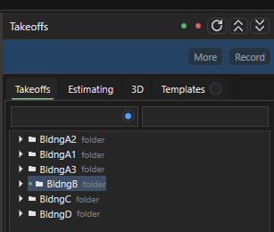
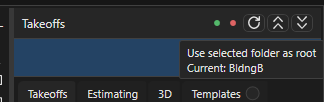

# Несколько зданий

Здесь: как вести проект с несколькими корпусами в одном файле: папка на корпус в Takeoffs и в Pages, зелёная и красная точки в заголовке Takeoffs (куда пишутся новые замеры), как точки листа W/F/S/U работают внутри выбранного корпуса, копирование одинаковых корпусов, отдельная книга Excel и отдельный PDF на корпус. Нужно на каждом проекте, где больше одного здания: таунхаусы, дом с гаражом и storage, комплекс из корпусов A, B, C.

<figure markdown>
  <video class="kb-demo" loop muted playsinline preload="none" poster="../../assets/images/ourplancore/demo/d-buildings.png"><source src="../../assets/images/ourplancore/demo/d-buildings.mp4" type="video/mp4"></video>
  <figcaption markdown="span">Демонстрация на проекте с несколькими корпусами: зелёная точка на папке корпуса направляет новые замеры в него, красная возвращает корень `Takeoffs`.</figcaption>
</figure>

<figure markdown>
  
  <figcaption markdown="span">Три корпуса `A`, `B`, `C`: у каждого свои `walls`, `sqfts`, `framing`. Зелёный маркер у `B` говорит, что новые замеры идут в него.</figcaption>
</figure>

## Папка на корпус

- Один корпус: корни `walls`, `sqfts`, `framing`... лежат прямо в Takeoffs, папку `Main` не создавать.
- Несколько корпусов: папка на каждый, внутри обычное дерево по канону. Имена по чертежу или по роли: `A`, `B`, `C`; `Main`, `Grge`, `Storage`, `Clubhouse`; `Bldng A`. Имя корпуса повторяется в Pages, в книге Excel и в имени PDF, поэтому выбирается один раз и коротко.
- Дерево корпуса строит `More > Auto Tree` при выделенной папке корпуса; `New Folder` под корпусом добавляет недостающее.
- В Pages корпусу тоже даётся своя папка с тем же именем; общие листы (фасады комплекса, детали, спецификации) остаются в `00. imported/...`. Канон папок: [Дерево takeoff и имена листов](../start/takeoff-structure.md).

Одинаковые корпуса (зеркальный таунхаус, повтор типового дома) мерятся один раз, потом копируются ([ниже](#copy)).

## Зелёная и красная точки { #root }

<figure markdown>
  
  <figcaption markdown="span">Две точки слева от кнопки обновления дерева. Подсказка показывает текущий корень: `Current: B` или `Current: Takeoffs root`.</figcaption>
</figure>

Точки задают **корень для новых позиций**: в какой корпус лягут замеры, `New Item`, Beam, Openings и вставка `New takeoffs`.

| Точка | Подсказка | Что делает |
| --- | --- | --- |
| зелёная | `Use selected folder as root` | выделенная папка становится корнем; у неё появляется зелёный маркер, статус `New takeoffs -> B` |
| красная | `Use Takeoffs root` | корень снова весь Takeoffs; статус `New takeoffs -> Takeoffs root` |

### Как выбрать корпус для новых замеров { #select-root }

Зачем: всё, что нарисуете дальше, ложится в папки этого корпуса.
Нужно: папки корпусов созданы в Takeoffs.

1. Выделите папку корпуса в дереве (`B`).
2. Нажмите зелёную точку в заголовке Takeoffs. Без выделенной папки статус подскажет: `Select a Takeoffs folder, then press the green dot.`
3. Мерьте: все новые позиции идут внутрь `B`, этаж и ветку выбирает точка листа.
4. Для другого корпуса выделите `C` и нажмите зелёную точку ещё раз. Для общих позиций комплекса нажмите красную точку.

Результат: у папки `B` зелёный маркер, статус `New takeoffs -> B`, подсказка на точках `Current: B`; в диалоге New Item путь начинается с `B/`.

Выбор хранится в проекте и следует за переименованием и переносом папки; при открытии проекта восстанавливается. Готовые позиции при смене корня не переезжают, `Record` продолжает свою позицию в любом корпусе. Если корень указывает на удалённую папку, создание блокируется с сообщением: нажать красную точку и выбрать корпус заново.

Без зелёной точки корпус берётся из `Settings > Sheet Takeoff Routing > Building root` (корпус по умолчанию для проекта; при `Save as this job` он же прописывается точке открытого листа), а если и он пуст - корень Takeoffs. В диалоге New Item путь назначения виден до создания, в диалоге вставки строка `Root: Takeoffs/B.`

## Точки листа внутри корпуса

Точка W/F/S/U листа выбирает ветку и этаж, зелёная точка выбирает корпус: лист `a201 2nd` с точкой W 2 при корне `B` даёт `B/walls/2nd floor walls`, при корне `C` - `C/walls/2nd floor walls`. Правила по имени (`eve`, `prpt`, `gable`, Openings) тоже считаются от корня: `B/eves rakes/eves`, `B/openings`. Порядок правил: [Имена и автомаршрут](takeoff-naming.md#order).

Общий лист на два корпуса (один план с корпусами A и B рядом): мерить корпус A с зелёной точкой на `A`, потом переключить на `B` и мерить вторую половину с того же листа. Копия листа под второй корпус нужна только когда корпуса на разных листах не различить или под отдельный PDF ([раскладка по листам](ourplancore-split-by-sheets.md)).

## Как скопировать корпус { #copy }

Зачем: одинаковые или зеркальные корпуса не рисовать второй раз.
Нужно: корпус `A` измерен, папка `B` создана, листы корпуса `B` в Pages.

1. На листе корпуса `A` инструментом Select выделить замеры (`Ctrl+A` всё на листе), `Ctrl+C`.
2. Выделить папку `B`, зелёная точка. Открыть лист корпуса `B` (при одинаковых планах - копию листа или тот же лист).
3. `Ctrl+V`, в диалоге `Paste Measurements` выбрать `New takeoffs`; строка `Root: Takeoffs/B.` показывает корпус назначения.
4. Копии ложатся в те же папки, что исходники, только внутри `B`: `A/sqfts` в `B/sqfts`, `A/framing/2nd floor framing/details` в `B/framing/2nd floor framing/details`, Openings в `B/openings`. На листе с другой точкой того же ряда меняется только этаж.
5. Проверить дерево `B`, поправить, что отличается (другой размер проёма, лишний пост), `Ctrl+S`.

Результат: в `B` те же папки и позиции, что в `A`, с замерами на листах корпуса `B`; итоги `A` не изменились.

`Same takeoffs` при копировании между корпусами не нужен: он добавляет замеры в исходные позиции корпуса `A`. Галка `Copies keep their source folders` в `Settings > Sheet Takeoff Routing` выключает зеркало папок, тогда копии идут по точке листа. Копирование целых папок дерева: `Ctrl+C` / `Ctrl+V` в Takeoffs переносит позиции без замеров другого листа, поэтому для корпуса копируют замеры с листа. Подробно: [копирование](ourplancore-takeoffs.md#copy).

## Как выгрузить книгу Excel на корпус { #excel }

Зачем: у каждого корпуса своя DFL с матрицей стен и framing lists.
Нужно: копии `TemplateCom.xlsm` по корпусам, Excel с макросами открыт.

1. На каждый корпус своя копия `TemplateCom.xlsm`: имена книг по корпусу (`Bldng A.xlsm`, `Bldng B.xlsm`), имя книги равно Job Name на Front Page.
2. Открыть книгу корпуса, активировать `Detailed Frame List`.
3. В Takeoffs выделить **одну** папку корпуса и нажать `ALL`. Выделение из двух корпусов не принимается: `Excel ALL found more than one building/root in the selection`.
4. Легенда `LG` своя на книгу: коды балок и постов корпуса. Повторить для следующего корпуса с его книгой.

Результат: книга корпуса заполнена, статус `Completed`. Полоса XL и кнопки по шагам: [Экспорт в Excel](ourplancore-excel.md).

## Как получить PDF на корпус { #pdf }

Из окна: у корпуса своя папка листов в Pages, в `Export PDF` отметить её одной галкой; на общем листе спрятать позиции чужого корпуса (`H` по папке корпуса в Takeoffs), экспортировать, назвать `<проект> Bldg A.pdf`, вернуть видимость и повторить ([PDF и сдача](ourplancore-pdf.md#buildings)).

Конвейером: `OurPlanCoreCli export-pdf --grouping auto` делит PDF по корпусам сам: берёт сохранённый выбор зелёной точки, экспортирует каждую соседнюю ветку корпуса отдельным файлом, на общем листе печатает только замеры этой ветки. Без выбранного корня (красная точка) получается один файл; `--grouping single` даёт один файл принудительно; замеры вне папок корпусов останавливают экспорт с сообщением. Перед сдачей: `Ctrl+S`, зелёная точка на корпусе, сохранить ещё раз ([конвейер](ourplancore-workspace.md#cli)).

## Пример: проект с тремя корпусами A, B, C

```text
Pages/
  00. imported/   общие: a001 n, a901 win sch, s501 d
  A/  a101 1st, a102 2nd, s101 1st, s102 2nd, a105 rf
  B/  копии листов A (корпус тот же, зеркальный)
  C/  a301 1st, s301 1st, a305 rf

Takeoffs/
  A/  sqfts, walls/1st floor walls, framing/1st floor framing/..., openings/1, eves rakes
  B/  то же, вставлено New takeoffs с листов A, поправлены проёмы
  C/  sqfts, walls, framing, openings, eves rakes
```

Книги: `Bldng A.xlsm`, `Bldng B.xlsm`, `Bldng C.xlsm`; PDF: `<проект> Bldg A.pdf`, `... B.pdf`, `... C.pdf`.

## Частые ошибки

- Забыли переключить зелёную точку: полдня замеров ушло в `A` вместо `B`. Перенести папками (`Ctrl+X`, `Paste Into Folder`), замеры и цвета сохраняются; проверять подсказку `Current:` на точках перед новым корпусом.
- Зелёная точка на корпусе, а мерится общий лист комплекса: позиции комплекса оказались внутри корпуса. Для общего - красная точка.
- Вставка `Same takeoffs` между корпусами: замеры корпуса `B` добавились в позиции `A`, итоги `A` выросли. `Ctrl+Z`, вставить заново как `New takeoffs`.
- `ALL` в Excel при выделенных двух корпусах или при выделении всего Takeoffs: экспорт останавливается; выделять одну папку корпуса.
- Один PDF на все корпуса: клиент не разберёт, что к чему; экспорт по папкам корпусов или конвейером.
- Папка `Main` в проекте с одним корпусом: лишний уровень, Excel и конвейер ждут корни прямо в Takeoffs.

Все ошибки по листам и дереву: [Частые ошибки](../start/common-mistakes.md#pages).

## См. также

- [Дерево Takeoffs](ourplancore-takeoffs.md): панель, Record, копирование
- [Раскладка по листам и роутинг](ourplancore-split-by-sheets.md), [Имена и автомаршрут](takeoff-naming.md)
- [Экспорт в Excel](ourplancore-excel.md), [PDF и сдача](ourplancore-pdf.md)
- [Дерево takeoff и имена листов](../start/takeoff-structure.md), [Процесс работы](../start/workflow.md)
